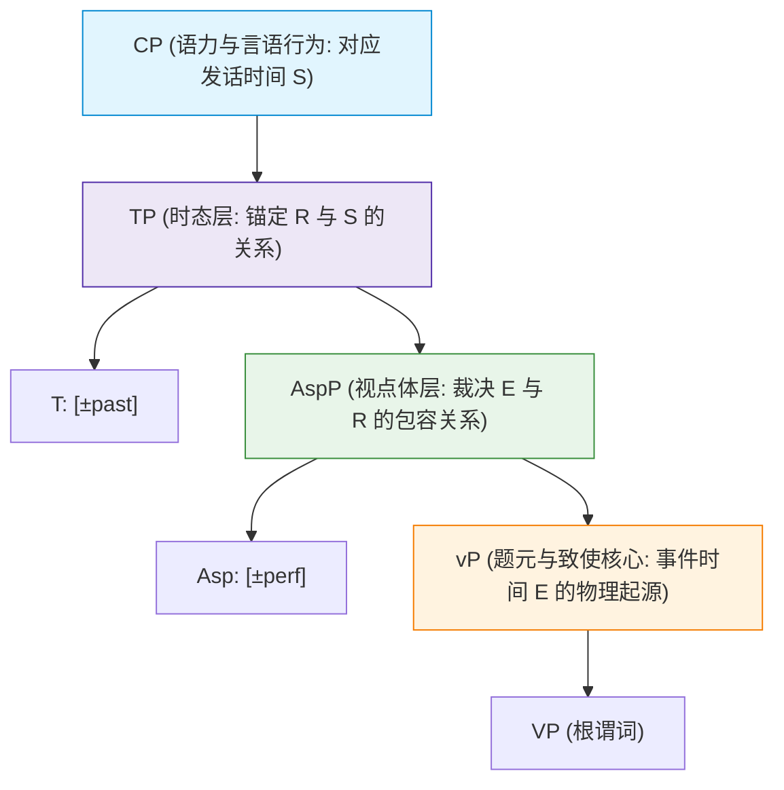

# Lec 14 时态与体貌的形式句法拓扑 (Syntactic Architecture of Tense & Aspect)

在传统语法与日常经验中，人们常常将“时间”直觉地视为一条单向流动的时间轴，并将动词的“时态（Tense）”与“体貌（Aspect）”混为一谈。然而，在形式句法学与形式语义学的交叉前沿中，人类语言对时间的认知被揭示为一套极其精密、具有层次化拓扑投影的离散计算系统。

本讲将系统研读汉斯·赖兴巴哈（Hans Reichenbach 1947）与沃尔夫冈·克莱因（Wolfgang Klein 1994）的**时间三位一体区间模型（S/R/E 模型）**，构建包含时态短语 $TP$ 与体貌短语 $AspP$ 的普遍功能层级拓扑（Cinque 1999），并通过斯拉夫语、现代希腊语与英语的经验事实，揭示动词词缀如何遵循马克·贝克（Mark Baker）的**镜像原则（Mirror Principle）**在树形中完成时空编织。

## TL;DR

- **时态（Tense）与体貌（Aspect）的本质区隔**：时态是指向性关系（Deictic），计算参考时间（Reference Time / Topic Time）与发话时间（Speech Time）的先后坐标；体貌是拓扑包含关系（Topological Inclusion），计算客观事件时间（Event Time）与参考时间区间的几何包容或先行关系。
- **普遍功能投射层级（Functional Hierarchy）**：子句拓扑严格遵循层级镜像：$CP > TP > AspP > vP > VP$。体貌中心语 $Asp$ 紧邻题元核心 $vP$ 负责事件内部时空轮廓切片，时态中心语 $T$ 居于更高位负责将切片锚定至交际时空坐标。
- **镜像原则的跨语言实证**：现代希腊语等语言中动词词干的词缀物理排列（$\text{Root} - \text{Aspect} - \text{Tense} - \text{Agreement}$）严格镜像了句法树自下而上的合并与中心语移位顺序，确立了句法结构对词法形态生成的决定性主导地位。

## 赖兴巴哈与克莱因的 S/R/E 时间区间模型

形式语义学大师 Hans Reichenbach（1947）指出，要精确形式化自然语言的所有时态与体貌，必须引入三个独立的时间参量：

::: definition [时间三位一体参量 (Reichenbach 1947, Klein 1994)]
1. **发话时间（Speech Time, $S$）**：说话者发出该言语行为的物理现实时间坐标（此时此刻）；
2. **事件时间（Event Time, $E$）**：谓词所描摹的物理状态或动作在世界中真实展开的时间区间；
3. **参考时间 / 话题时间（Reference Time $R$ / Topic Time $TT$）**：当前话语正在断言、观察或讨论的特定目标时间窗口。
:::

基于这三个时间参量，时态与体貌被赋予了清晰无误的几何逻辑定义：

### 时态（Tense）的形式定义

**时态是计算参考时间 $R$ 与发话时间 $S$ 之间的先后序关系**：
- **过去时（Past Tense）**：参考时间先于发话时间（$R < S$）；
- **现在时（Present Tense）**：参考时间与发话时间重合（$R = S$ 或 $R \circ S$）；
- **将来时（Future Tense）**：参考时间晚于发话时间（$S < R$）。

### 视点体（Viewpoint Aspect）的形式定义

**体貌是计算事件时间 $E$ 与参考时间 $R$ 之间的空间包容关系**：
- **完整体（Perfective Aspect）**：事件时间完全被包含在参考时间区间之内（$E \subseteq R$）。
  --> 说话者从外部将事件视为一个具有明确起点与终点的封闭整体（Closed Whole）。
- **未完整体 / 进行体（Imperfective / Progressive Aspect）**：参考时间完全被包含在事件时间区间之内（$R \subseteq E$）。
  --> 说话者置身于事件时间窗口内部，事件处于持续进行状态，不承诺事件是否达到终点（Open / Ongoing）。
- **完成态（Perfect Aspect）**：事件时间先于参考时间（$E < R$）。
  --> 处于过去的事件在当下的参考时间依然具有现时关联性（Current Relevance）。

考察英语过去完成时与过去进行时的经典对比：

```text
(1) a. 过去完成时: When Mary arrived at 5:00, John had left.
       --> R = 5:00 (Mary arrived)
       --> E < R < S (John 的离开发生在 5:00 之前，5:00 处于现在之前)

    b. 过去进行时: When Mary arrived at 5:00, John was sleeping.
       --> R = 5:00
       --> R ⊆ E, 且 R < S (John 的睡眠区间包裹着 5:00 这个参考切片)
```

## 形式句法中的时空功能拓扑

根据 Guglielmo Cinque（1999）著名的“功能中心语填槽制图理论（Cartography）”，自然语言在普遍语法中拥有一套严格固定的子句层级骨架：

$$[_{CP} \; C \; [_{TP} \; T \; [_{AspP} \; Asp \; [_{vP} \; v \; [_{VP} \; V ]]]]]$$



### 视点体（Outer Aspect）vs 情状体（Inner Aspect / Telicity）

句法学严格区隔两种不同层次的“体貌”：
1. **情状体 / 内体（Inner Aspect / Aktionsart）**：在 $vP/VP$ 内部由动词与宾语的组合语义决定，表达事件本身是“有界/终结（Telic）”还是“无界/活动（Atelic）”。例如 *eat an apple*（有界终结）vs *eat apples*（无界未终结）；
2. **视点体 / 外体（Outer / Viewpoint Aspect）**：由独立的句法功能投射 $AspP$ 承载，它位于 $vP$ 之上，负责将底层已经生成的完整事件 $vP$ 切割为“完整体”或“未完整体”呈现给认知系统。

## 镜像原则与跨语言词缀合成

语言学家 Mark Baker（1985）提出了理论语言学中极其著名的**镜像原则（The Mirror Principle）**：

::: theorem [镜像原则 (The Mirror Principle, Baker 1985)]
形态学中词缀物理排列的线性顺序，必须精确反映句法推导中功能投射中心语自下而上的合并（Merge）或移位（Head Movement）层级顺序。
$$\text{Morphological Derivation} \iff \text{Syntactic Derivation}$$
:::

### 现代希腊语动词词缀的句法投射实证

在现代希腊语（Modern Greek）中，动词词干的屈折形态构成是镜像原则的绝美样本。以动词 *grafo*（写）的过去完整体第一人称复数形式 *grap-s-ame*（我们写了）为例：

```text
(2) 现代希腊语动词内部形态拆解:
    grap  - s     - ame
    write - PERF  - PAST.1PL
    [词根] - [体貌] - [时态与人称]
```

观察这一词法串联的物理空间顺序：
1. 最内层核心：动词词根 *grap-*（生成在 $V$）；
2. 中间层：完整体词缀 *-s-*（生成在 $Asp$）；
3. 最外层：过去时与主谓一致词缀 *-ame*（生成在 $T$）。

句法推导自下而上进行：动词中心语 $V$ 首先经历中心语移位（Head Movement）升入 $Asp$，与体貌特征结合；随后复合中心语 $[Asp \; V-Asp]$ 继续向上提升至 $T$，与时态和一致性特征结合。动词表面上的词缀堆叠顺序，无可辩驳地印证了句法树中 $TP$ 高于 $AspP$、$AspP$ 高于 $VP$ 的绝对拓扑位阶！

## 斯拉夫语时态-体貌冲突：为什么现在完整体强制表达将来？

在俄语、波兰语等斯拉夫语族语言中，存在一个极其著名的句法-语义谜题：**只要一个动词带有完整体前缀（Perfective），当它附加上现在时态词尾时，该句在语义上绝对无法表达“现在”，而必须强制解释为“将来时”！**

```text
(3) 俄语时态-体貌互动:
    a. 未完整体现在时: Ja chitaju.      (I read.IMPF.PRES --> "我正在读书")
    b. 完整体现在时:   Ja pro-chitaju.  (I PERF-read.PRES --> "我将会读完", 绝对不能表示现在!)
```

为什么普遍语法在语义界面禁止“完整体现在时”？克莱因模型与句法投射给出了极其纯粹的几何解释：
1. **现在时的几何定义**：发话时间 $S$ 处于瞬时流动的当下，因此现在时的参考时间 $R$ 是一个极度狭窄、近乎无持续宽度的“瞬时时间点（Instantaneous Point）”；
2. **完整体的几何定义**：完整体要求事件时间完全被包裹在参考时间内部（$E \subseteq R$）；
3. **不可调和的拓扑冲突**：现实世界中任何包含终结点的非瞬时物理事件 $E$（如“读完一本书”），其持续时间必然大于一个瞬时时间点！一个拥有时间跨度的事件 $E$ 无论如何在几何上都**无法被塞进一个瞬时点 $R$ 之中**；
4. **系统的自动求生**：为了避免解释界面崩溃，句法计算系统将参考时间 $R$ 强制向时间轴后方推移，使得 $R$ 演化为将来的一个完整时间段，从而完美容纳事件 $E$。

这一优雅的数学推导再次证明：自然语言中看似古怪的跨语言形态禁令，本质上是深层拓扑几何公理运算的必然结果。

::: pitfall [常见误区：将进行体（Progressive）等同于现在时]
许多英语初学者由于常见句型 *He is running*，常下意识地将 *-ing*（进行体）等同于现在时。如本讲所示，进行体属于 $AspP$（视点体），它完全可以与过去时结合（*He was running*）、与将来时结合（*He will be running*），甚至与非限定不定式结合（*to be running*）。二者隶属于完全不同的功能中心语槽位。
:::

::: insight [深度洞见：时空认知在大脑中的句法结晶]
康德在《纯粹理性批判》中指出，“时间”是人类感性认知的先验形式。而现代形式句法学进一步向世界揭示：**这种先验认知在人类心智中拥有坚硬如铁的代数句法结构**。

我们的大脑绝不是随意用词语打上时间戳记。从事件的物理起源（$VP$）、到动作轮廓的几何勾勒（$AspP$）、再到锚定自我与现实世界的坐标系建立（$TP$ 与 $CP$），人类语言以二叉树形合并与中心语投射的方式，构建了一座将瞬息万变的物理宇宙凝固为确定心智命题的巍峨圣殿。
:::

## 时态与体貌核心参数全景对照

| 语法范畴 | 句法功能投射 | Reichenbach / Klein 几何关系 | 核心跨语言形态体现 |
| :--- | :--- | :--- | :--- |
| **时态 (Tense)** | 时态短语 $TP$ | 计算参考时间 $R$ 与发话时间 $S$（$R < S, R = S, S < R$） | 屈折词尾（英语 *-ed*）、独立虚词、现代希腊语外层词缀 |
| **视点体 (Viewpoint Aspect)** | 体貌短语 $AspP$ | 计算事件时间 $E$ 与参考时间 $R$（$E \subseteq R, R \subseteq E$） | 斯拉夫语动词前缀、现代希腊语中间词缀 *-s-*、英语助动词短语 |
| **情状体 (Inner Aspect / Telicity)** | 动词核心 $vP / VP$ | 谓词概念结构本身的终结性（Telic vs Atelic） | 动宾组合语义（*run a mile* vs *run*）、动词词汇分类 |
| **语力与语气 (Force & Mood)** | 标补词短语 $CP$ | 锚定命题真实性与交际意图（真实世界 vs 可能世界） | 陈述句/疑问句标补词、虚拟语气词缀、主谓倒装 |
