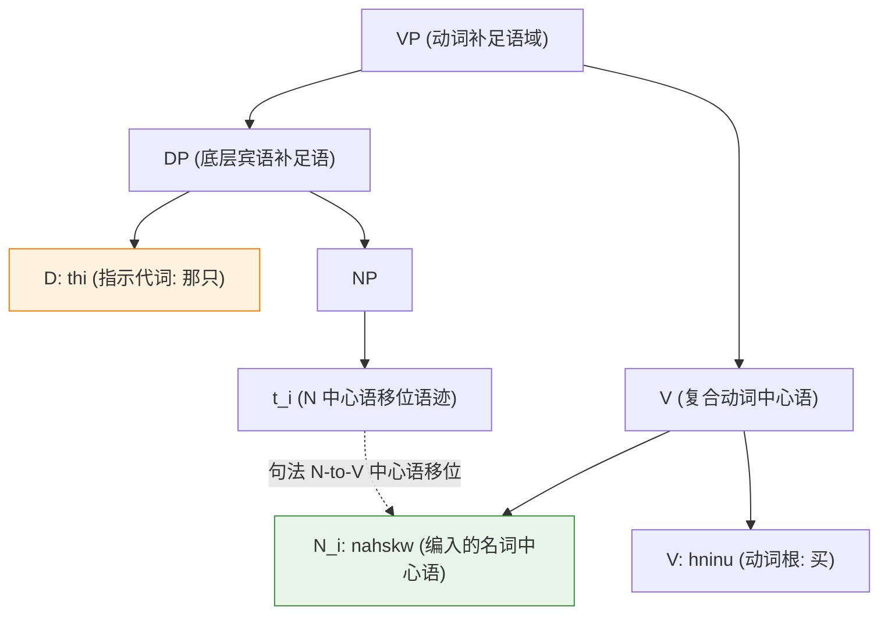
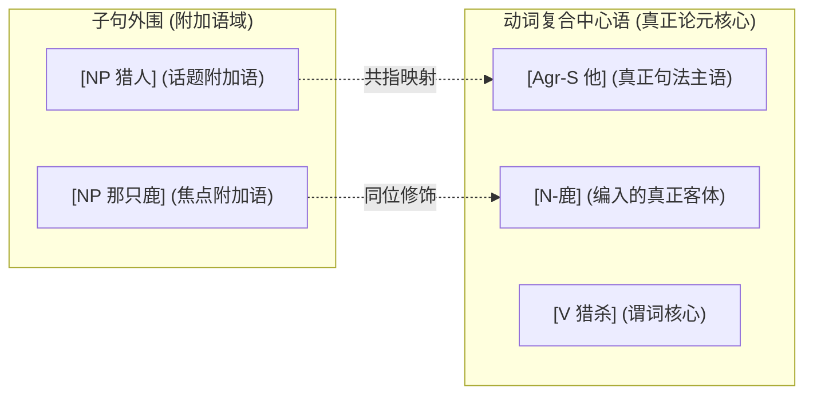

# Lec 15 多式综合语与名词编入 (Polysynthesis & Noun Incorporation)

在人类语言的类型学谱系中，北美原住民语言（如莫霍克语 Mohawk、因纽特语 Inuktitut、克里语 Cree 等）展现出令古典传统语法学家震惊的形态句法奇观——**多式综合语（Polysynthetic Languages）**。在这些语言中，一个表面上的单一“长单词”，即可完整编码一个包含主语、宾语、谓词、时态与工具状语的完整复合句子。

本讲基于生成语法学家马克·贝克（Mark Baker 1988, 1996）的划时代奠基理论，探讨**名词编入（Noun Incorporation, NI）**的深层生成机制。我们将证明：多式综合现象绝非词库中死板的词汇复合游戏，而是标准句法中心语移位（Head Movement: N-to-V）在词法层面的直接投射；由此引申出的**形态可见性条件（MVC）**，更揭示了普遍语法中论元结构与词法可见性之间的深层参数纽带。

## TL;DR

- **名词编入（Noun Incorporation）的句法本质**：名词短语的核心名词中心语 $N$ 从底层的动词补足语内部，通过句法中心语移位（N-to-V）直接并入动词中心语 $V$，生成复合动词词干，严格服从中心语移位限制（HMC）。
- **修饰语滞留（Stranded Modifiers）的决定性经验实证**：编入动词的名词词根能够留下外部的指示代词、数词或所有格修饰语（如莫霍克语中说“我买了一只[马]，[那只]”）。若编入只是词库预先复合，则句法外部修饰语将因违反封闭性而不可解。
- **多式综合参数与代词论元假说**：贝克的形态可见性条件（MVC）与 Eloise Jelinek 的代词论元假说（PAH）揭示：多式综合语中的表层独立名词短语并非处于真正的论元位置，而是处于外围附加语槽位（Adjuncts），动词内部的词缀与编入成分才是真正的核心句法语义论元。

## 什么是名词编入？从莫霍克语谈起

在易洛魁语系（Iroquoian）的莫霍克语（Mohawk，Baker 1996）中，说话者表达“我买了那只动物”时，拥有两种截然不同的句法表述方式：

```text
(1) a. 独立名词短语型 (Non-incorporated):
       Wa'-k-hninu'              ne     ka-nahskw-a'.
       FACT-1SG.SUBJ-buy        NE     NEUT-animal-NOUN.SUFFIX
       "我买了那只动物。"

    b. 名词编入型 (Noun Incorporated):
       Wa'-k-nahskw-a-hninu'.
       FACT-1SG.SUBJ-animal-Ø-buy
       "我【动物-买】了。" (Animal-bought)
```

在例句 (1b) 中，名词词根 *nahskw*（动物）被物理编入到了动词词根 *hninu*（买）的内部，成为整个动词复合词的一个有机形态组成部分。

传统词汇学派曾试图主张：(1b) 只是词库（Lexicon）在进入句法之前制造好的一个复合动词（类似英语中的 *babysit* 或 *spoon-feed*）。然而，Baker（1988）通过一系列严格的句法测试粉碎了词汇论假设，确立了名词编入的**纯句法中心语移位模型**。

## 句法中心语移位模型与修饰语滞留

根据生成句法学的分析，(1b) 中的名词短语在深层结构中依然是一个具有完整树形构型的动词内部补足语 $DP$。

在句法推导过程中，名词中心语 $N$ 经历**向上的中心语移位（N-to-V Movement）**，物理附加到动词中心语 $V$ 之上：



### 决定性铁证：修饰语滞留（Stranded Modifiers）

如果名词编入只是词典里造好的复合词，那么根据“词汇完整性假说（Lexical Integrity Hypothesis）”，句法规则绝不能深入单词内部去修改或修饰其中的子成分。例如在英语中，你不能说 **I today-babysat the handsome*（试图用 *handsome* 修饰 *babysit* 里面的 *baby*）。

然而在莫霍克语中，奇迹出现了——当名词中心语并入动词之后，原本修饰该名词的**指示词、数词与所有格，可以合法滞留在宾语短语原位**！

```text
(2) 莫霍克语修饰语滞留实证 (Baker 1996):
    Wa'-k-nahskw-a-hninu'         [DP  thi     [NP  t_N ]].
    FACT-1SG.SUBJ-animal-buy      [    that    [    t   ]]
    "我买【动物】了，那只。" --> 实际语义: "我买了【那只动物】。"
```

观察这一句型的惊人句法构型：
- 留在外部的指示代词 *thi*（那只）在语义上修饰的正是被并入动词内部的“动物”；
- 句法外部的指示代词与从句内部留下的语迹 $t_N$ 共同构成了一个合法的 $DP$；
- 这一现象在词汇论框架下是绝对无法解释的自相矛盾，但它完美契合句法中心语移位模型——**中心语 $N$ 飞走了，留下了它的指示短语外壳！**

### 结构局域性：中心语移位限制（HMC）

名词编入严格遵循 Travis（1984）的**中心语移位限制公理（Head Movement Constraint, HMC）**：

::: theorem [中心语移位限制 (HMC)]
中心语 $X^0$ 只能移位至直接成分统领它的最近功能或词汇中心语 $Y^0$ 中，严禁跳过任何干预的中心语。
:::

在多式综合语中，HMC 产生了极其纯粹的论元不对称性：
1. **直接宾语（内部论元）允许编入**：动词 $V$ 直接成分统领其直接宾语 $N$，$N$-to-$V$ 属于极小距离移动，完全合法；
2. **主语（外部论元）绝对禁止编入**：有限句主语位于 $[Spec, vP]$ 或 $[Spec, TP]$。由于动词中心语并不成分统领主语，主语名词向动词的编入将引发向下的逆向移位，直接违反普遍语法公理；
3. **介词补足语禁止直接跨越介词编入**：若名词处于介词短语内部（$[_{PP} P [_{NP} N]]$），$N$ 不能直接跳过介词中心语 $P$ 编入动词 $V$，除非介词首先与动词发生编入。

## 贝克的形态可见性条件与多式综合参数

为什么英语等分析语严禁大规模名词编入，而美洲原住民语言却将多式综合作为普遍常态？

马克·贝克提出了著名的**形态可见性条件（Morphological Visibility Condition, MVC）**：

::: definition [形态可见性条件 (MVC, Baker 1996)]
在多式综合语言中，动词的每一个论元（Argument）若要在句法推导中满足“可见性（Visibility，即格位过滤在语义界面的等价物）”，必须且只能通过以下两种形态手段之一获得显性标识：
1. **手段 A**：与动词上的主谓一致词缀（Agreement Morphemes）发生一致性对应；
2. **手段 B**：通过名词编入（Noun Incorporation）直接融合成动词词干的组成部分。
:::

### 代词论元假说（Pronominal Argument Hypothesis, PAH）

MVC 引出了语言学家 Eloise Jelinek（1984）极富远见的**代词论元假说（PAH）**：

在多式综合语中，那些听起来像是主语或宾语的显性独立名词短语（如独立的“猎人”、“那只鹿”），**在纯粹句法构型上根本不是真正的论元（Arguments）！**
- 真正的论元是动词身上附着的一致性词缀或被编入的名词中心语；
- 表层的独立名词短语全部是挂在子句最外层的**附加语（Adjuncts）**，通过同位语形式与动词内部的真正论元形成指称映射。



这一假说完美破解了多式综合语的一系列宏观类型学谜团：
1. **极端自由的语序（Radical Scrambling）**：既然表层名词短语全都是附加语，附加语在句首、句末或句中插入自然不会破坏核心树形几何；
2. **非组构性（Non-configurationality）**：表层句子不存在经典英语式的强弱主宾不对称，因为真正的句法树形早已压缩在动词复合词的内部！

::: pitfall [常见误区：将名词编入等同于汉语的动宾复合词]
汉语中存在大量“动宾复合词”，如“吃饭”、“打球”、“游泳”。很多初学者常误以为这就是名词编入。两者的根本区别在于**句法生产力与修饰语滞留**：
- 汉语的“吃饭”是一个词库锁死的词汇单元，你无法在句法中说 **我今天大米吃了那包*（滞留指示词修饰复合词内的大米）；
- 多式综合语的名词编入是 100% 具备活性能动性的句法运算，任何合法的动词与名词均可在推导中实时并入，并完整保留深层句法树的算子与修饰语关系。
:::

::: insight [深度洞见：词法与句法疆界的瓦解]
20 世纪传统结构主义语言学曾武断地认为：“词法学（Morphology）管单词内部，句法学（Syntax）管单词之间，二者井水不犯河水”。

然而，多式综合语与名词编入的发现彻底瓦解了这一狭隘的人为边界。它向全人类认知科学证明：**二叉合并（Merge）与中心语移位（Head Movement）是贯穿心智语言计算全维度的普遍机制**。当句法运算在较晚的音系拼读阶段被赋予极紧密的语音粘合时，它就呈现为传统所谓的“长单词”；当粘合较为松散时，它就呈现为“独立的词串”。形式句法的几何公理，统治着从词素到复杂句的每一个角落。
:::

## 核心机制与跨语言类型学对照

| 维度指标 | 分析型语言 (如英语、现代汉语) | 屈折型语言 (如拉丁语、现代希腊语) | 多式综合语言 (如莫霍克语、因纽特语) |
| :--- | :--- | :--- | :--- |
| **主要论元承载者** | 独立的独立句法短语 ($DP$) | 独立的 $DP$ + 动词弱一致性词尾 | **动词内部的一致性词缀与编入名词 ($N^0$)** |
| **名词编入活性** | 极低（仅偶见历史残留词汇复合） | 低（仅存在少量构词法派生） | **极高（活跃的句法 N-to-V 移位，允许滞留修饰）** |
| **语序固定度** | 高度固定（SVO / SOV 构型刚性） | 相对灵活（依赖格位标记区隔） | **极端自由（表层名词为非限制性附加语）** |
| **表层名词句法地位** | 占据核心 $[Spec, TP]$ 与 $[Comp, VP]$ | 占据核心论元位置 | **全句最外层附加语（通过 MVC 获得可见性）** |
| **空论元策略** | 严格禁止或依赖语篇话题链 | 依靠动词一致性识别小 pro | **全量论元默认内化于动词复合体中** |
