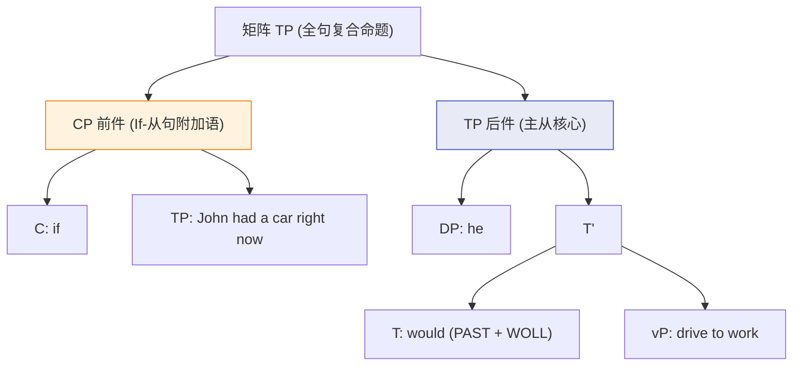
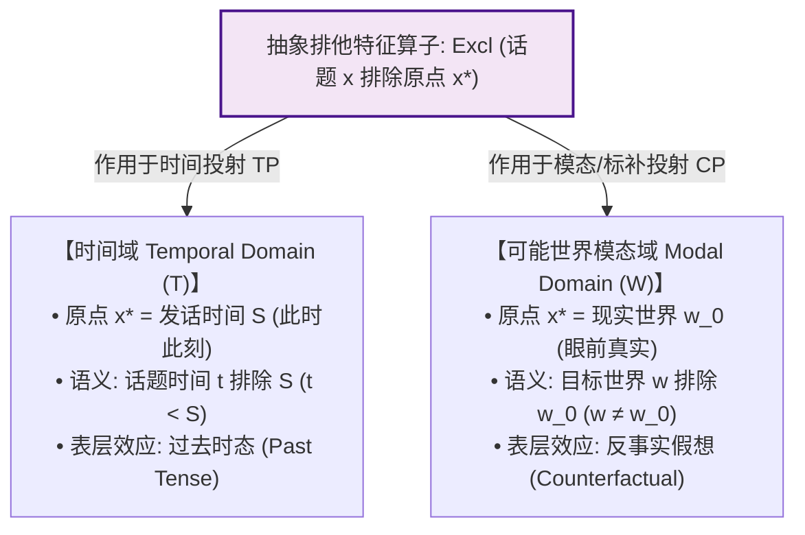

# Lec 16 条件句句法与假过去时 (Conditionals: Syntax & Fake Past)

在人类语言的日常表达中，条件句与反事实假想（Counterfactuality）是我们构想“如果当初……那么就会……”等可能世界的核心认知工具。然而，跨语言审视反事实条件句时，理论语言学家遭遇了一个近乎诡异的跨语言普遍语法之谜：
- 在英语中，当我们说 *If John had a car right now, he would drive to work*（“如果约翰现在有车，他就会开车上班”）时，动词 *had* 携带了标准的**过去时态形态（Past Tense Morphology）**；
- 但任何说话者都知道，这句话所描摹的事件**绝非发生在过去**，而是在谈论“此时此刻（Present）”！

为什么全人类如此多完全不相关的语言（英语、现代希腊语、法语、印地语、俄语等），都会系统性地使用“过去时形态”来表达“非真实的假想”？

本讲基于授课教授 Sabine Iatridou（2000）发表于 *Linguistic Inquiry* 的划时代奠基之作《反事实性的语法配方》（*The Grammatical Ingredients of Counterfactuality*），系统剖析条件句的深层句法拓扑，确立**排他特征假说（Exclusion Feature, $Excl$）**，解开跨语言“假过去时（Fake Past）”的心智生成之谜。

## TL;DR

- **假过去时（Fake Past）的跨语言谜题**：在现在时反事实条件句中，过去时形态并不表达时间上的“过去”，而是系统性地表达可能世界与现实世界的断裂。这种跨语言广泛存在的形态借用绝非修辞巧合，而是受普遍语法算子驱动的系统性运算。
- **排他特征统一理论（The Exclusion Feature, $Excl$）**：Iatridou 论证“过去时形态”本质是抽象排他特征 $Excl$ 的物理拼读。当 $Excl$ 作用于时间域时，它排除了发话时间 $S$（产生过去时）；当 $Excl$ 作用于可能世界模态域时，它排除了现实世界 $w_0$（产生反事实假想）。
- **条件句的二叉句法拓扑**：条件句前件（Protasis / *If*-clause）作为条件命题附加语高位挂载于主句时态短语 $TP$ 之上；后件（Apodosis）通过模态算子（*WOLL* + Past = *would*）完成跨世界的真实性锚定。

## 条件句的解剖学：前件与后件的句法拓扑

一个完整的条件句在句法上由两大命题单元构成，二者在层级组织中呈现出典型的非对称主从结构：

::: definition [条件句的组成要素]
1. **前件（Protasis / Antecedent）**：由从属连词 *if* 引出的条件状语从句，表达假想的前提假设集合；
2. **后件（Apodosis / Consequent）**：复合句的矩阵主句（Matrix Clause），表达在该假想前提下必然或可能导出的逻辑结果。
:::

在句法树几何中，*if*-从句是一个标补词短语 $CP$。根据局域性与管辖原则，它通常作为附加语（Adjunct）高位合并在主句时态短语 $TP$ 的顶端。由于前件处于高阶附加语位置，它能够对后件主句所包含的完整事件进行整体命题层面的模态修饰。

在后件主句中，时态中心语 $T$ 容纳了情态助动词（如英语中的 *would*），该情态词实际上是由抽象模态词根 *WOLL* 与时态屈折特征合并而成的复合物。通过这种自上而下的树形几何，前件中的假想条件集合与后件中的模态算子形成语义绑定，如下方的树形拓扑所示：



这种构型不仅确立了前件的附加语身份，也解释了为什么条件前件在移位操作中会表现出典型的附加语孤岛效应（Adjunct Island Effect），严禁从前件内部向主句发起 Wh-提取。

## 跨语言的反事实“形态配方”

考察以下英语条件句的演进阶梯：

```text
(1) a. 直陈条件句 (Indicative):
       If John has a car right now, he will drive to work.
       (谈论真实可能性: 动词为现在时 has / will)

    b. 现在时反事实条件句 (Present Counterfactual):
       If John had a car right now, he would drive to work.
       (谈论非现实假想: 动词出现过去时 had / would, 但时间锚定为 right now!)

    c. 过去时反事实条件句 (Past Counterfactual):
       If John had had a car yesterday, he would have driven to work.
       (过去完成时: 双重过去层级)
```

在例句 (1b) 中，时间副词 *right now* 明确锁定了当前发话时间。然而，动词却强制使用了过去形态 *had*，而后件的助动词 *would* 在词法上正是底层模态词 *will*（形式记法为 *WOLL*）与过去时词缀 *-ed* 的句法合成体：
$$\text{would} = \text{WOLL} + \text{PAST}$$

这种“用过去形态表达当下假想”的现象，不仅普遍存在于英语，而且在跨语言语料中展现出高度的一致性。以现代希腊语（Modern Greek）为例，该语言在屈折形态上具有极高的辨识度，其反事实构型为理论分析提供了绝佳样本：

```text
(2) 现代希腊语反事实条件句:
    An   eixe             aftokinito tora,       tha    pigene          stegulia.
    If   have.PAST.IMPF   car        now,        FUT    go.PAST.IMPF    to-work
    "如果他现在有车，他就会去上班。"
```

希腊语的前件动词 *eixe* 与后件动词 *pigene* 均带有不容置疑的**过去未完整体词缀（Past Imperfective）**，同时搭配表示当下的副词 *tora*（now）。这一跨语言事实无可辩驳地表明：“假过去时”绝不是英语个别词汇的历史偶发偏误，而是植根于全人类心智普遍语法的深层规律。无论语言的表层语序与语音实现如何不同，大脑都在动用相同的形态资源来标记可能世界偏离现实的程度。

## 萨宾·亚特里杜的排他特征假说（Exclusion Feature）

面对这一谜题，Sabine Iatridou（2000）提出了震惊语言学界的优雅统一理论：**人类语言中所谓的“过去时词缀”，其底层根本不是为了“时间”专门设计的！**

::: theorem [排他特征公理 (The Exclusion Feature, Iatridou 2000)]
过去时形态素（Past Morpheme）在抽象句法词库中的本质是一个**领域排他算子（Exclusion Operator, 记作 $Excl$）**。
$Excl$ 的数学语义为：所讨论的话题区间 $x$ 与心智锚定的中心参考原点 $x^*$ 互不相交（Disjoint / Excluded）：
$$\text{Excl}(x) \iff x \cap x^* = \emptyset$$
:::

普遍语法系统极其经济地在不同的概念域中复用了这同一个排他特征 $Excl$：



1. **当 $Excl$ 作用于时间轴（Temporal Domain）时**：
   - 参考原点 $x^*$ 是当前言语行为的发话时间 $S$（“现在”）；
   - $Excl$ 强制规定话题时间必须排除发话时间（$T_{\text{topic}} \cap S = \emptyset$）；
   - 排除现在的单向时间流，自然解码为**时间上的过去（Past Time）**。
2. **当 $Excl$ 作用于可能世界轴（Modal Domain of Possible Worlds）时**：
   - 参考原点 $x^*$ 是说话者所在的现实世界 $w_0$（“真实”）；
   - $Excl$ 强制规定当前讨论的世界集合必须排除现实世界（$W_{\text{topic}} \cap \{w_0\} = \emptyset$）；
   - 排除现实世界的假设空间，自然解码为**反事实假想（Counterfactuality）**！

“假过去时”根本不“假”！它在语义底层极其诚实地执行着它的天职——**宣布当前命题与现实原点决裂**。因为语言的形态拼读器（Spell-Out）只认特征标签 $Excl$，当它在树形中检测到 $Excl$ 时，便机械地调出音系词缀 *-ed*。

## 双重过去的层级叠加：过去反事实句

如果一个反事实假想本身又是发生在过去的（如例句 (1c) *If John had had a car yesterday...*），句法系统如何处理？

此时，认知系统需要同时施加**双重排他运算**：
1. **排他运算一（模态排他）**：排除现实世界 $w_0$（声明为反事实假想）；
2. **排他运算二（时间排他）**：排除当下发话时间 $S$（声明事件发生在过去）。

由于单一的时态投射槽位无法在同一个节点承载两次相同的形态指派，句法系统调动了完成态结构（Aspectual Perfect: *have + -en*）作为辅助载体：
$$\text{Had had} = \text{Past}_{Excl(W)} + \text{Perfect}_{Excl(T)}$$
通过在功能层级中叠加过去时态与完成体投射，句法树完美容纳了二维坐标的联合偏移。

::: pitfall [常见误区：将虚拟语气视为随意的修辞变体]
很多传统外语教学将英语条件句中的动词倒退（Backshifting）称为死记硬背的“虚拟语气规则”。在形式句法学中，不存在无意义的形态退步。每一个时态词缀的出现，都是深层逻辑形式界面中严格满足可能世界算子作用域的几何映射。
:::

::: insight [深度洞见：心智计算的极简算子复用]
Sabine Iatridou 的假过去时理论，是认知科学与最简方案“概念经济性（Conceptual Economy）”的极具说服力的例证。

人类的大脑并没有进化出两套完全独立的复杂硬件系统——一套专门计算“昨天发生了什么（时间记忆）”，另一套完全无关的系统专门计算“如果我当年中了彩票（虚构假想）”。相反，**普遍语法用一个极其极简的排他算子（$Excl$），统一接管了人类认知中所有‘离体（Displacement）’的心智飞跃**。无论是穿梭回过去的记忆，还是漫游在未发生的平行可能世界，人类语言都在用同一种句法代数度量着我们与现实原点的距离。
:::

## 条件句类型学与时态形态矩阵

| 条件句类别 | 时间定位 | 模态性质 | 前件谓词形态配方 | 后件核心谓词配方 |
| :--- | :--- | :--- | :--- | :--- |
| **直陈现在条件句** | 现在 / 将来 | 真实可能（开放可能世界） | 现在直陈时（*has / goes*） | *will* + 原形动词 |
| **现在反事实条件句** | **此时此刻 (Present)** | **非现实 (排除现实世界 $w_0$)** | **假过去时 ($Excl$ 作用于模态域: *had*)** | **过去模态词 (*would* = PAST + *WOLL*)** |
| **过去反事实条件句** | **过去历史 (Past)** | **非现实 (排除现实世界且排除现在)** | **双重过去 (过去完成时: *had had*)** | **过去模态完成时 (*would have driven*)** |
| **通则习惯条件句** | 无时间限制（全称量化） | 物理必然规律 | 零度直陈时（*heats, boils*） | 现在直陈时（*boils*） |
