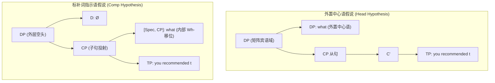
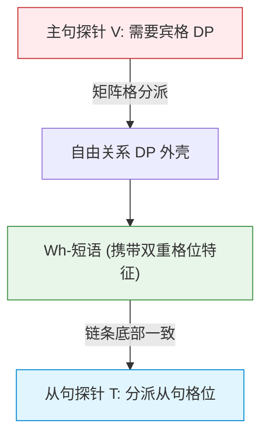

# Lec 17 自由关系从句与匹配效应 (Free Relatives & The Matching Effect)

在人类语言的修饰结构中，普通关系从句（Relative Clause）通常包含一个明确的外在先行词中心语（如英语 *the book [which Mary bought]*）。然而，自然语言中还普遍存在一类极为奇特的从句构型——**自由关系从句（Free Relatives, FR）**。例如在句子 *I will read [what you wrote]*（“我将阅读你所写的内容”）中，关系从句在表层上完全失去了显性的外在中心名词，疑问词 *what* 仿佛同时身兼从句引导词与矩阵宾语的双重角色。

这种“无头从句”引发了生成句法学历史上极其著名的争论：引导词究竟处于主句外部名词槽位，还是内嵌从句内部？本讲将基于琼·布雷斯南与简·格里姆肖（Bresnan & Grimshaw 1978）的奠基性研究，探讨**匹配效应（The Matching Effect）**、德语格位冲突实验以及同形异义（Syncretism）对接口崩溃的挽救，确立形态学词库与句法格位过滤在界面上的最终协调机制。

## TL;DR

- **自由关系从句（FR）的双重身份悖论**：自由关系从句在外部矩阵句中整体表现为一个名词短语（$DP$），能够接收主句格位并满足选择限制；但在内部几何中又表现为包含 Wh-移位语迹的标准子句（$CP$）。
- **布雷斯南与格里姆肖的匹配效应（Matching Effect）**：在具有丰富格位屈折的语言（如德语）中，自由关系从句的引导词必须**同时满足主句赋予的格外壳与从句赋予的格内核**。若两层格位需求发生冲突（如主句要宾格 ACC、从句要与格 DAT），推导将陷入彻底崩溃。
- **形态混杂（Syncretism）的救赎与界面启示**：当特定疑问词发生形态同形（如德语 *was* 同时充当主格与宾格形态）时，格位冲突得以被音系拼读界面成功掩盖。这证明句法不仅是抽象树形的合并，更在 PF 界面受到词库形态实现潜能的刚性制约。

## 什么是自由关系从句？两大理论假说的碰撞

考察自由关系从句与普通名词短语在句法分布上的完全同构性：

```text
(1) a. 普通关系从句: I will buy [DP the book [CP that you recommended]].
    b. 自由关系从句: I will buy [DP what you recommended].
```

在 (1b) 中，从句 *what you recommended* 既满足了动词 *buy* 对宾语名词短语（$DP$）的选择需求，其内部疑问词 *what* 又填补了内嵌动词 *recommend* 的宾语缺额。

面对这一双重属性，生成语法学界爆发了两种经典模型的分野：

::: definition [自由关系从句的两大结构假说]
1. **外置中心语假说（Head Hypothesis, Bresnan & Grimshaw 1978）**：
   - 假定 Wh-疑问词位于主句外部的中心名词位置 $[Head, DP]$；
   - 从句内部由一个隐性的空算子或语迹填充：
     $$[_{DP} \; \text{what}_i \; [_{CP} \; \text{OP}_i \; \text{you recommended } t_i ]]$$
   - 优点：天然解释了为什么整个从句向外表现为普通的名词短语 $DP$。
2. **标补词指示语假说（Comp Hypothesis, Groos & van Riemsdijk 1981）**：
   - 假定从句外壳拥有一个空名词中心语，Wh-词处于标准的从句标补词指示语位置 $[Spec, CP]$：
     $$[_{DP} \; \emptyset \; [_{CP} \; \text{what}_i \; \text{you recommended } t_i ]]$$
   - 优点：完全保留了标准 Wh-移位的句法几何与孤岛约束特征。
:::



## 布雷斯南与格里姆肖的匹配效应（The Matching Effect）

如果自由关系从句既连结着主句又连结着从句，当两边的句法要求发生剧烈冲突时，会发生什么？

Bresnan & Grimshaw（1978）在考察具有显性形态格位的语言（如德语、古希腊语、波兰语）时，发现了震惊学界的**匹配效应（Matching Effect）**：

::: theorem [格位匹配公理 (The Case Matching Requirement)]
自由关系从句中的 Wh-引导词，必须在形态格位上**同时核准**主句功能中心语指派的格位（矩阵格）与从句谓词指派的格位（从句格）。
$$\text{Case}_{\text{Matrix}}(\text{Wh}) = \text{Case}_{\text{Embedded}}(\text{Wh})$$
:::

### 德语中的格位冲突与不可调和崩溃

现代德语拥有极其清晰的格位词形变化。考察阳性单数疑问代词的屈折范式：
- 主格（Nominative）：*wer*
- 宾格（Accusative）：*wen*
- 与格（Dative）：*wem*

现在构建两组德语谓词环境：
- 主句动词：*zerstören*（毁灭，**强制要求宾格 ACC**）；
- 从句动词：*vertrauen*（信任，**强制要求与格 DAT**）。

当尝试将这两个动词拼装为一个自由关系从句时，德语说话者陷入了彻底的语法瘫痪：

```text
(2) a. 选用从句所要求的与格形态 wem:
       *Ich zerstöre, [wem du vertraust].
       (严重非法! 主句动词 zerstöre 要求宾格，无法接纳与格 wem!)

    b. 选用主句所要求的宾格形态 wen:
       *Ich zerstöre, [wen du vertraust].
       (严重非法! 从句动词 vertraust 要求与格，无法接纳宾格 wen!)
```

无论你选择宾格 *wen* 还是与格 *wem*，句子都**100% 绝对不合法**！由于任何单一词形都无法同时满足两端的格位需求，推导直接在格位过滤（Case Filter）与一致性核准下被句法系统粉碎。

## 形态混杂（Syncretism）：形式系统的惊天绝杀

既然格位冲突会导致必然崩溃，那么德语在何种情况下才能允许自由关系从句合法生成？

答案揭示了人类语言最深刻的形态-句法接口秘密——**同形异义/形态混杂（Syncretism）**！

在德语中，中性疑问代词 *was*（什么）以及阴性代词具有形态重叠特征：**它的主格（NOM）与宾格（ACC）在发音形态上是完全全同的（Syncretic Form）**。

现在考察当主句要求宾格、从句要求主格时的匹配情境：

```text
(3) a. 主句动词: Ich nehme [ACC] ("我收下...")
    b. 从句谓词: [NOM] gefällt mir ("...让我满意")

    c. 合并自由关系从句 (完美合法!):
       Ich nehme, [was gefällt mir].
       "我收下让我满意的东西。"
```

深入剖析为什么 (3c) 奇迹般地生还了：
1. 主句动词 *nehme* 向外部 $DP$ 分派**宾格（Accusative）**；
2. 从句谓词 *gefällt mir* 向主语槽位分派**主格（Nominative）**；
3. 代词 *was* 在词典中同时具备主格与宾格的形态实现潜能；
4. 当音系拼读界面（Spell-Out / PF）扫描该节点时，检测到一个单一词项 *was* 能够同时消解两边的格位指派，系统判定推导合法！

::: theorem [同形挽救定理 (Syncretism as a Savior)]
句法系统中的格位冲突是形态实现的冲突。只要物理词库中存在一个形态上能够同时覆盖冲突双方的同形词（Syncretic Exponent），原本导致系统崩溃的格位违规就会被完美中和并被界面所接纳。
:::

## 现代最简方案视角：特征共享与投射合并

在现代最简方案（Minimalist Program）中，自由关系从句被形式化为**特征共享（Feature Sharing）**与中心语投射的联合推导：



1. Wh-短语在从句内部底层生成，接收从句谓词分派的题元角色与内部格位特征；
2. Wh-短语经历 A'-移位提升至从句边缘 $[Spec, CP]$；
3. 由于从句缺少外在实体中心词，处于边缘的 Wh-短语向上将其分类特征（$[\text{D-feature}]$）与格位特征共享给外层的短语节点；
4. 主句探针直接与该复合节点建立一致（Agree）关系；若词库无法产出兼容量格的物理词形，推导便在形态拼读阶段被强制抛弃。

::: pitfall [常见误区：将自由关系从句与内嵌疑问句混淆]
英语在表层形式上，自由关系从句与间接内嵌疑问句（Embedded Questions）长相极其相似：
- *I know [what you bought].* (内嵌疑问句：意为“我知道你买了什么问题的答案”)
- *I ate [what you bought].* (自由关系从句：意为“我吃了你买的那个物理实体东西”)
在句法上，内嵌疑问句是一个命题补足语 $CP$，动词 *know* 选择命题；而自由关系从句是一个实体的量化短语 $DP$，动词 *eat* 绝不能吃一个抽象命题，只能吃一个物理 $DP$。二者的层级截然不同。
:::

::: insight [深度洞见：词库与抽象句法的终极握手]
自由关系从句中的匹配效应与同形救赎，构成了生成语言学中关于“语法模块性（Modularity）”最震撼人心的证据。

纯粹的句法运算器（Narrow Syntax）是一个无情的数学逻辑引擎，它只负责依照二叉合并与成分统领推导树形几何。然而，人类语言最终必须从嘴巴里发出声音。**当纯逻辑计算所推导出的完美几何，无法在特定的具身物理词典中找到能够兑现的形态发音时，整座宏伟的句法大厦便会轰然坍塌**。自由关系从句让我们看见了抽象心智逻辑与物理血肉词库之间，那场既残酷又精妙的永恒妥协。
:::

## 自由关系从句与关联句型全景对比

| 句型类别 | 外部投射属性 | 引导词位置 | 语义解释类型 | 是否存在格位匹配效应 |
| :--- | :--- | :--- | :--- | :--- |
| **标准关系从句 (Relative Clause)** | 完整名词短语 $DP$ | $[Spec, CP]$（由外在先行词统领） | 实体限定修饰语 | 否（外在先行词与关系代词各自独立赋格） |
| **间接内嵌疑问句 (Embedded Question)** | 命题短语 $CP$ | $[Spec, CP]$ | 真实性命题疑问 | 否（疑问词仅受从句内部赋格） |
| **自由关系从句 (Free Relative)** | **外壳 $DP$ 内部 $CP$** | **从句边缘并向上投射** | **被量化的实体对象** | **强制存在（必须同时满足矩阵格与从句格）** |
