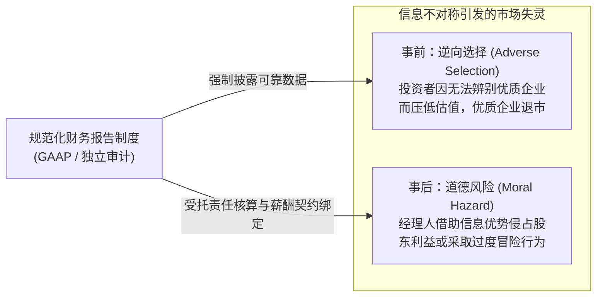
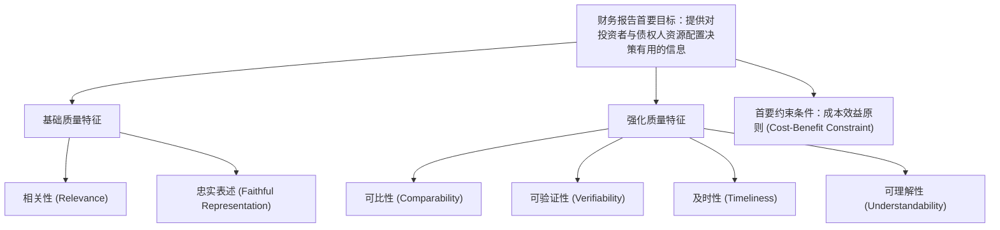
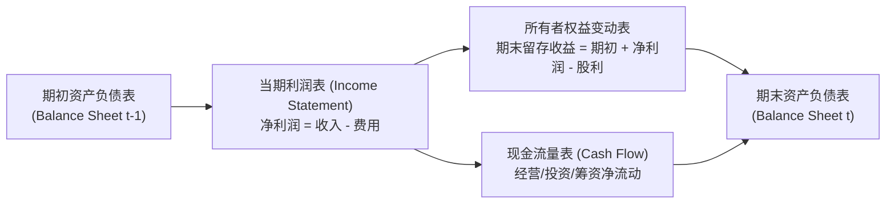

# Lec 01 财务会计框架与资本市场契约角色 (Overview of Accounting Framework & Capital Market Roles)

> MIT Sloan School of Management · 15.501 Corporate Financial Accounting · 讲义 01

## TL;DR

- 财务会计是现代资本市场中化解企业内外部信息不对称、降低交易与代理成本的基础契约制度。
- 财务报告核心服务于外部资金提供者（股东与债权人），通过规范化披露支持资本配置与管理层受托责任监督。
- GAAP/IFRS 概念框架确立了相关性（Relevance）与忠实表述（Faithful Representation）两大基础质量特征。
- 财务会计侧重历史与权责发生制合规计量，与侧重内部经营决策的管理会计形成明确职责分工。

## 会计信息系统的经济学本质与信息不对称

在现代公司制企业中，所有权与经营权高度分离。职业经理人拥有对公司日常运营、技术储备与实际财务状况的完全掌控，而外部投资者与债权人只能通过定期披露获取信息。这种严重的信息不对称（Information Asymmetry）会诱发两类经典的微观经济学市场失灵：

::: definition 财务会计 (Financial Accounting)
财务会计是一套标准化的经济信息计量与报告系统。它依据公认会计准则（GAAP），对企业已发生的经济交易与事项进行确认、计量、记录与汇总，向企业外部利益相关者（股东、债权人、分析师、监管机构）提供有助于经济决策的通用财务报表。
:::

财务会计的核心功能并非记录流水账，而是充当外部契约（债务契约、高管薪酬契约、税收征管契约）的执行基准。通过由独立注册会计师执行的外部审计，财务报表大幅降低了资本市场的尽职调查摩擦成本。

## 财务会计与管理会计的职责分界

在 MIT 15.501 体系中，理解会计首先需要严格区分外部财务会计与内部管理会计：

| 比较维度 | 财务会计 (Financial Accounting) | 管理会计 (Managerial Accounting) |
| :--- | :--- | :--- |
| **主要服务对象** | 外部利益相关者（股东、银行、投行分析师、SEC） | 内部各级管理者（CEO、事业部主管、工厂厂长） |
| **准则约束性** | 必须严格遵循 GAAP / IFRS 及监管法律规范 | 不受准则约束，完全服务于内部决策与效益原则 |
| **时间导向** | 历史导向（反映过去已发生的交易与履约结果） | 未来导向（聚焦预算编制、本量利预测与战略投资） |
| **信息颗粒度** | 高度汇总的整体验证数据（公司整体财务报表） | 高度细分的微观运营数据（单一产品、工序、客户线） |
| **计量属性** | 强调可验证性、历史成本与稳健性计量 | 强调相关性、机会成本、边际贡献与作业成本 |

::: pitfall 混淆决策边界的认知误区
初学者常试图从公开财务报表中直接寻找特定产品线的边际生产成本或最优定价策略。公开财务报表遵循汇总披露原则，研发费用往往在当期全额费用化，固定资产折旧按预设年限平摊，这些数据无法替代内部管理会计的边际贡献分析。
:::

## 会计准则框架与质量特征结构

为确保跨公司、跨行业财务报告的可比性，美国财务会计准则委员会（FASB）构建了财务会计概念框架（Conceptual Framework），确立了会计信息质性特征的层级体系：

::: theorem 会计信息质量特征层级 (Qualitative Characteristics of Accounting Information)
1. **基础质量特征 (Fundamental Characteristics)**：
   - **相关性 (Relevance)**：信息必须具备预测价值（Predictive Value）、确认价值（Confirmatory Value）或重要性（Materiality），能够改变决策者的经济判断；
   - **忠实表述 (Faithful Representation)**：信息必须具备完整性（Completeness）、中立性（Neutrality）与无重大差错（Free from Error），真实刻画其宣称反映的经济实质。
2. **强化质量特征 (Enhancing Characteristics)**：
   - **可比性 (Comparability)**：跨时期与跨企业间的计量基准保持连贯；
   - **可验证性 (Verifiability)**：不同独立专家依据相同数据能得出相近结论；
   - **及时性 (Timeliness)**：在决策失去时效前向市场传递；
   - **可理解性 (Understandability)**：具备合理商业与经济学素养的读者能够清晰理解。
:::

## 会计四大基本假设与四大计量原则

在现代复式记账演进中，财务报表的构建依赖于四项底层假设与四项核心原则：

### 四大基本假设 (Basic Assumptions)
1. **会计主体假设 (Economic Entity Assumption)**：企业是独立的法律与经济实体，其资产、负债与交易必须与所有者个人及其他关联实体的财产严格区分。
2. **持续经营假设 (Going Concern Assumption)**：假定企业在可预见的未来将持续正常营运，不会被迫破产清算，因此厂房设备等资产可按历史成本结合折旧摊销计量，而非清算拍卖价值。
3. **会计分期假设 (Periodicity Assumption)**：人为将企业连续的生命周期划分为相等的期间（年度、季度、月份），以便定期评估经营业绩与财务状况。
4. **货币计量假设 (Monetary Unit Assumption)**：以名义货币作为统一计量单位，假定币值基本稳定，不随通货膨胀波动对基础报表数据进行连续价格指数调整。

### 四大计量原则 (Basic Principles)
1. **历史成本原则 (Historical Cost Principle)**：资产在取得时按实际支付的现金或公允对价入账，因其具备极高的客观性与可审计性。
2. **收入确认原则 (Revenue Recognition Principle)**：收入在赚取（Earned）且可实现或已实现（Realized/Realizable）时方可确认，严禁以收到现金作为确认前置。
3. **配比原则 (Matching Principle)**：当期产生收入所消耗的成本与费用，必须在同一会计期间与该项收入相互配比结转。
4. **充分披露原则 (Full Disclosure Principle)**：凡是对审慎投资人决策产生实质影响的重要经济信息，必须在报表表内或附注中予以充分说明。

## 财务报表核心构件与基本关系

企业的全部经济活动最终浓缩为四份核心财务报表：

- **资产负债表 (Balance Sheet)**：特定时点的**存量（Stock）**快照，反映企业拥有的经济资源及对应的索偿权（$Assets = Liabilities + Equity$）。
- **利润表 (Income Statement)**：涵盖特定区间的**流量（Flow）**汇总，衡量企业在生产经营过程中创造经济价值的能力。
- **现金流量表 (Statement of Cash Flows)**：穿透权责发生制的人工调整，真实展现企业现金流入与流出的流动性底色。
- **所有者权益变动表 (Statement of Shareholders' Equity)**：解释净资产从期初到期末的变动轨迹，连接留存收益与股利发放。

## 我的理解

::: insight 会计是人造的契约语言，并非纯粹的自然科学规律
初学财务会计时，工程师和理科背景的学生常倾向于寻找类似物理守恒定律那样的“终极绝对客观真理”。然而，财务会计本质上是**商业社会在信息不对称环境下博弈达成的一套制度性妥协**：
1. **可靠性与相关性的永久张力**：以历史成本计量一座位于纽约核心商圈的办公楼极度可靠（有发票与契约存根），但对当期投资人而言相关性极低（账面成本可能只有 1970 年的 500 万美元，而现值达 3 亿美元）；若改用公允价值评估，虽然相关性大幅提升，却为管理层主观操纵估值模型大开方便之门。
2. **规则导向（US GAAP）与原则导向（IFRS）的博弈**：过细的规则容易诱发“遵从字面却架空实质”的监管套利（如安然利用 SPE 规则逃避并表），而纯粹的原则导向则要求审计师与管理层具备极高的诚信与专业裁量权。
3. **理解会计是掌握商业世界底层的博弈语法**：卓越的管理者和投资者看报表，不是死记数字，而是透过分录看穿管理层在会计政策选择（折旧年限、坏账计提、存货方法）背后释放的真实意图与契约压力。
:::
