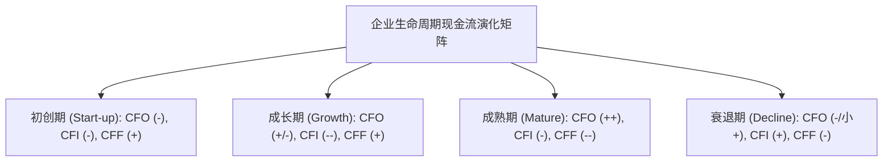
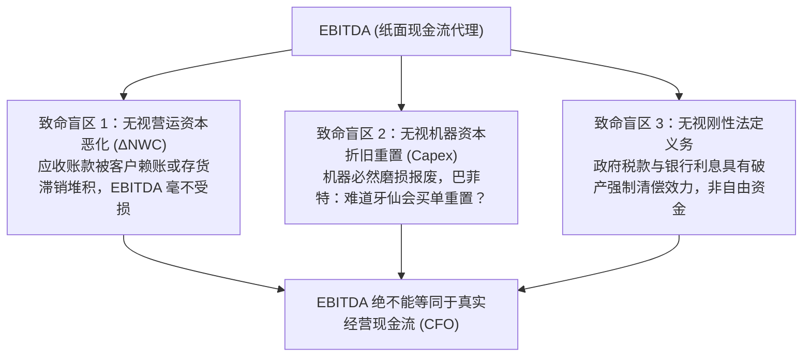
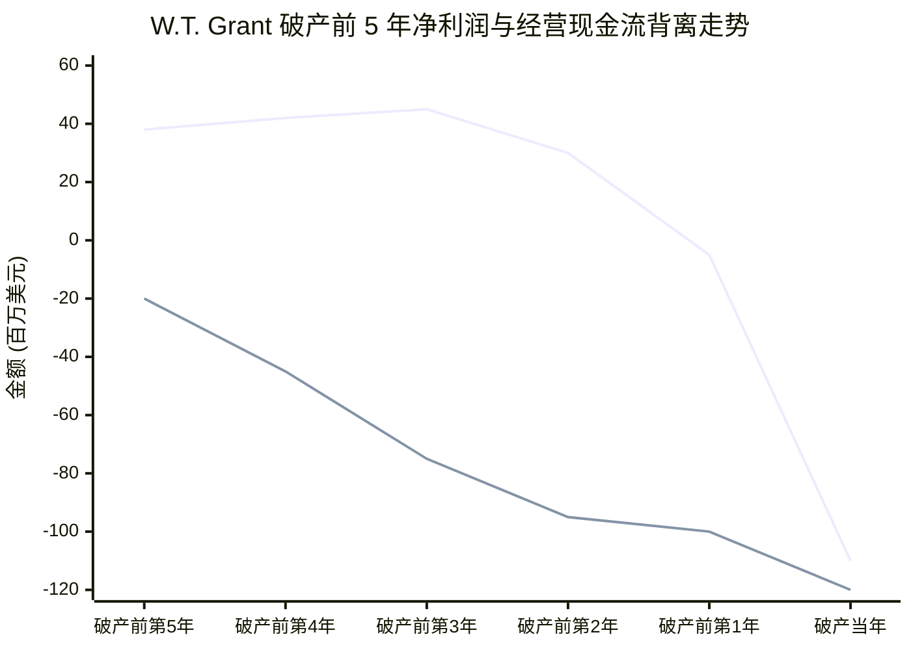
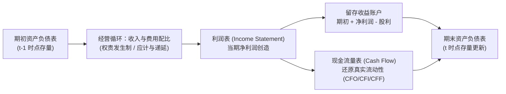

# Lec 10 现金流深度剖析与盈余质量诊断 (Cash Flow Quality, EBITDA vs. CFO & Midterm 1 Synthesis)

> MIT Sloan School of Management · 15.501 Corporate Financial Accounting · 讲义 10

## TL;DR

- 企业生命周期演进在现金流三要素的代数符号组合中呈现出不可伪造的指纹式轨迹特征。
- 自由现金流衡量企业在维系现有产能前提下可向股东与债权人自由分配的真实经济余量。
- 投行推崇的 EBITDA 掩盖了营运资本恶化、设备磨损再投资与刚性利息税负，是虚假的类现金替代物。
- 利润与经营现金流的长期负向背离是财务危机最经典的早期预警，四大财务报表在期中实现逻辑大统合。

## 企业生命周期的现金流特征指纹

任何企业的商业演进，都会在经营活动（CFO）、投资活动（CFI）与筹资活动（CFF）的正负符号组合中留下不可磨灭的财务轨迹：

| 生命周期阶段 | 经营现金流 (CFO) | 投资现金流 (CFI) | 筹资现金流 (CFF) | 核心经济逻辑与财务特征 |
| :--- | :---: | :---: | :---: | :--- |
| **初创期 (Introduction)** | **负 ($-$)** | **负 ($-$)** | **正 ($+$)** | 尚未形成规模造血，处于纯失血研发阶段；必须依赖风投股权注资或政府补助维系生命 |
| **成长期 (Growth)** | **微正或负** | **强负 ($--$)** | **正 ($+$)** | 营收快速爆发，但营运资本（应收与存货）疯狂吸水；巨额 Capex 扩建产能，依赖外部募资 |
| **成熟期 (Maturity)** | **强正 ($++$)** | **温和负 ($-$)** | **强负 ($--$)** | 现金奶牛阶段；核心业务造血充沛，仅需维持性资本开支；大量现金用于偿还债务、派发股利与股票回购 |
| **衰退期 (Decline)** | **转负或萎缩** | **正 ($+$)** | **负 ($-$)** | 核心盈利丧失，违约风险高悬；依靠变卖闲置厂房设备（CFI+）或断臂求生，银行抽贷逃离 |

::: theorem 现金流健康判定基准
一个健康经营的成熟公司，其现金流量表在绝大多数年份应呈现固定的 **“$+ \quad - \quad -$”** 经典构型（经营造血充沛、自发资本再投资、向资本市场净回馈）。一旦成熟期公司的构型滑向 **“$- \quad - \quad +$”**，意味着主营业务遭遇重创，重新沦为依赖外部输血的危险状态。
:::

## 自由现金流（Free Cash Flow）的精准度量

在华尔街公司金融估值中，分析师最关注的指标不是净利润，而是**自由现金流（Free Cash Flow, FCF）**：

::: definition 股权自由现金流 (Free Cash Flow to Equity, FCFE / FCF)
企业在维持现有生产经营能力与正常资本开支前提下，所创造的能够完全自由支配、向全体资本提供者（尤其是普通股股东）全额派发而不会危及企业未来持续经营的剩余现金流：
$$\text{自由现金流 (FCF)} = \text{经营活动现金流量净额 (CFO)} - \text{必要资本性开支 (Capital Expenditures, Capex)}$$
:::

其中，资本性开支（Capex）从现金流量表投资活动项下的“购建固定资产、无形资产和其他长期资产支付的现金”中直接获取。若 $\text{FCF} > 0$，说明企业拥有坚实的内生性分红、并购与自主扩张实力；若 $\text{FCF} < 0$，意味着企业必须不断消耗存量现金或对外借债来维持现有产能运转。

## EBITDA 的虚假繁荣与华尔街认知陷阱

自 1980 年代杠杆收购（LBO）浪潮兴起以来，投资银行和私募股权基金极度偏爱使用 **EBITDA（息税折旧摊销前利润）** 作为衡量企业偿债能力与现金流的代理指标：

$$\text{EBITDA} = \text{营业利润 (Operating Income)} + \text{折旧费用 (Depreciation)} + \text{摊销费用 (Amortization)}$$

::: pitfall 沃伦·巴菲特对 EBITDA 的经典批判
沃伦·巴菲特（Warren Buffett）在致股东信中多次严厉警告：
“管理层推崇 EBITDA，就好像折旧不是真实的成本一样。难道他们以为是**牙仙（Tooth Fairy）**在为未来的新设备和新厂房买单吗？任何固定资产终有一天会彻底报废并需要重新耗费真金白银进行资本重置。把折旧剔除在利润之外，等于把真实商业经营中最沉重的再投资负担完全抹杀。”
:::

在电信泡沫时期的世通（WorldCom）与安然（Enron），管理层正是利用极具迷惑性的“高 EBITDA 增长率”误导资本市场，掩盖其惨烈的真实自由现金流持续流失。

## 经典财务困境诊断：W.T. Grant 破产启示录

美国大型全美零售连锁巨头 **W.T. Grant** 的破产案，是商业史上运用现金流诊断企业暴雷的殿堂级教案：

- **表面的纸面繁荣**：在破产前 5 年至前 2 年，W.T. Grant 财报上的净利润（Net Income）常年稳定在 3,000 万至 4,500 万美元，EPS 稳步上行，华尔街投行连续给出买入评级；
- **水底下的现金大失血**：通过现金流量表可以清晰发现，其经营现金流（CFO）早在破产前 5 年就已经跌为负数，并且随着公司盲目推行无门槛信用卡赊销扩张，应收账款（A/R）与存货发生恶性膨胀，CFO 逆差迅速扩大至每年流出近 1 亿美元；
- **致命终局**：由于缺乏真实现金回收，公司不得不发行天量短期商业票据偿还旧债。当最后一年宏观银根紧缩、银行拒绝展期时，这家百年零售帝国轰然破产。

## 期中核心四表大统合（Midterm 1 Synthesis）

截至本讲，学员已完整掌握了现代企业财务报表体系的四大支柱及其内在动力学机制：

::: theorem 四表闭环统合守恒律
1. **资产与权益的瞬时守恒**：在任意特定报告时点，$\text{资产} \equiv \text{负债} + \text{所有者权益}$ 无条件成立；
2. **存量与流量的代数合流**：期末资产负债表的现金余额等于期初现金余额加上当期现金流量表全部活动净额（$\Delta \text{Cash}$）；
3. **留存收益的承前启后**：利润表的净利润扣除股东股利后，全额注入期末资产负债表留存收益，完成资本的内生积累闭环。
:::

## 我的理解

::: insight 财务分析的最高境界是多维立体交叉印证
在进行企业财务深度尽调时，任何孤立看一张表的做法都是致命的盲人摸象：
1. **利润表与资产负债表的交叉检验**：单看利润表的高营收没有意义，必须将营收增速与资产负债表上的应收账款和合同负债变动率并排对比。如果营收增长 20% 但应收账款增长 80%，表明当期利润绝大部分是“挂账利润”。
2. **利润表与现金流量表的交叉检验**：单看净利润的高低没有意义，必须用现金流量表中的 CFO 予以核验。如果净利润丰厚但现金流贫瘠，说明其应计项（Accruals）过载，要么是遭遇了客户赖账，要么是在会计政策上实施了激进的延迟费用化。
3. **资产负债表与现金流量表的交叉检验**：单看账面货币资金充沛没有意义（如康美药业 300 亿存款虚假造假），必须将大额存款与高额短期借款的利息支出进行匹配。如果一家企业账上躺着数百亿现金，却依然在资本市场上以 8% 以上的高息发行短期超短融债券，这必定是资金受限甚至凭空虚构的重大舞弊信号。
:::
