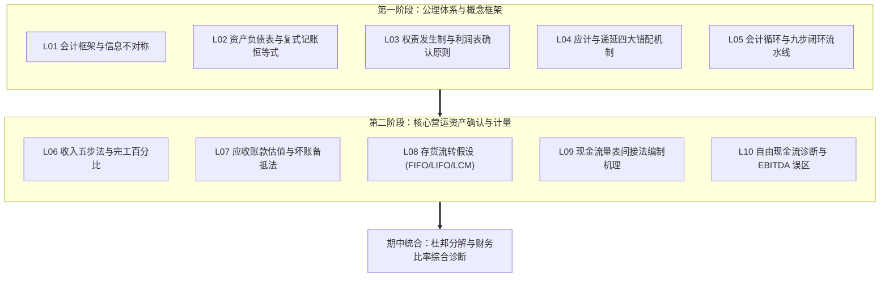
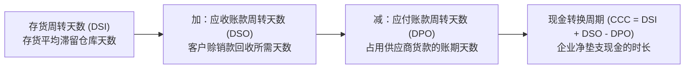
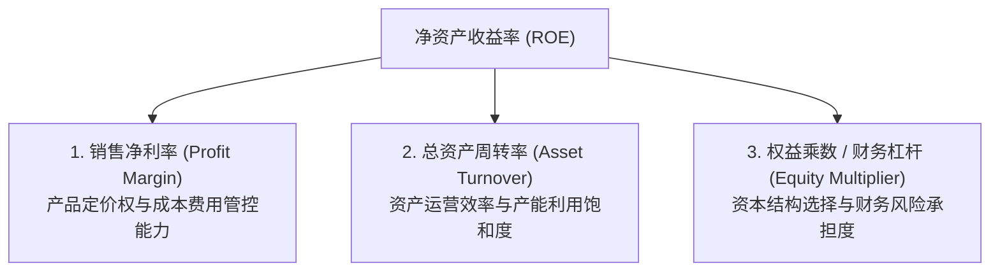

# Lec 11 期中核心财务概念综合检视 (Midterm 1 Review & Conceptual Integration)

> MIT Sloan School of Management · 15.501 Corporate Financial Accounting · 讲义 11

## TL;DR

- 期中核心聚焦四大财务报表勾稽关系的自洽校验与权责发生制跨期调账的工程落地。
- 杜邦分析体系将净资产收益率严格解构为经营利润率、资产周转率与财务杠杆的三维乘积。
- 流动性与营运资本比率穿透了资产负债表的静态数字，揭示企业现金周转循环的动态效率。
- 期中综合诊断要求从单笔复杂业务的分录推演，贯通至对企业整体盈余质量与破产风险的定性判断。

## 核心知识板块拓扑映射与期中架构

麻省理工学院斯隆管理学院开设的 15.501 课程在前十讲构筑了现代企业财务会计的底层公理基石与核心运营资产计量框架。进入期中综合检视阶段，学员的首要任务是跳出碎片化的科目定义与单一分录记忆，建立跨越资产负债表、利润表与现金流量表的全局动态认知。

从知识演进的拓扑关系来看，前十讲清晰分为两大递进板块：第一阶段确立了以复式记账法、借贷自洽平衡、权责发生制跨期解耦以及九步会计循环为代表的规则底座；第二阶段则深入企业核心营运资本，系统剖析了收入确认的时点控制权、应收账款的预期坏账拨备、存货流转的三大成本分配假定以及穿透权责发生制重构流动性的间接法现金流模型。

期中评估并非测试机械计算能力，而是要求学员具备“从业务实质反推分录，从账簿数据透视商业模式，从现金流量检验利润成色”的三维复合分析素养。掌握这一逻辑网络，是后续深入学习固定资产折旧、长期债务融资、租赁表外化以及企业并购高级专题的必备通关密码。

## 财务比率分析：流动性、周转率与现金循环周期

评估企业财务健康度，必须通过财务比率（Financial Ratios）将报表上的绝对数转化为具有行业可比性的相对数：

### 1. 短期偿债与流动性比率 (Liquidity Ratios)
- **流动比率 (Current Ratio)**：
  $$\text{流动比率} = \frac{\text{流动资产 (Current Assets)}}{\text{流动负债 (Current Liabilities)}}$$
- **速动比率 (Quick Ratio / Acid-Test Ratio)**：剔除变现周期长且易跌价的存货与预付款项：
  $$\text{速动比率} = \frac{\text{现金及等价物} + \text{有价证券} + \text{应收账款净额}}{\text{流动负债}}$$

### 2. 营运效率与现金转化周期 (Cash Conversion Cycle, CCC)
企业投入一元现金用于采购原材料，到最终收回销售现金的物理时间跨度，由三大周转天数决定：

$$\text{应收账款周转率} = \frac{\text{营业收入}}{\text{平均应收账款净额}}, \quad \text{DSO} = \frac{365}{\text{应收账款周转率}}$$

$$\text{存货周转率} = \frac{\text{主营业务成本 (COGS)}}{\text{平均存货账面余额}}, \quad \text{DSI} = \frac{365}{\text{存货周转率}}$$

$$\text{应付账款周转率} = \frac{\text{采购总额 (或 COGS)}}{\text{平均应付账款余额}}, \quad \text{DPO} = \frac{365}{\text{应付账款周转率}}$$

$$\text{现金转换周期 (CCC)} = \text{DSI} + \text{DSO} - \text{DPO}$$

::: example 苹果与传统制造企业的 CCC 对比
优秀的科技巨头通过极致供应链管理实现负 CCC：
- 某传统机床企业：$\text{DSI} = 90 \text{ 天}, \text{DSO} = 60 \text{ 天}, \text{DPO} = 45 \text{ 天} \rightarrow \text{CCC} = 90 + 60 - 45 = 105 \text{ 天}$（需垫支现金 105 天）；
- 苹果公司（Apple Inc.）：$\text{DSI} = 9 \text{ 天}, \text{DSO} = 25 \text{ 天}, \text{DPO} = 105 \text{ 天} \rightarrow \text{CCC} = 9 + 25 - 105 = -71 \text{ 天}$。
负 CCC 意味着苹果不仅无需自己垫资生产，反而常年无偿占用供应商 71 天的免息流动资金为自身产生利息收益。
:::

## 杜邦分析体系（DuPont Analysis）三要素分解

杜邦分析法由杜邦公司（DuPont）财务主管提出，是现代商业分析师拆解企业净资产收益率（ROE）的经典框架：

::: theorem 经典三步杜邦分解公式 (Three-Step DuPont Model)
$$\text{净资产收益率 (ROE)} = \frac{\text{净利润 (Net Income)}}{\text{普通股股东权益 (Shareholders' Equity)}}$$

分子分母同乘“营业收入”与“总资产”，展开为三大维度的乘积：

$$\text{ROE} = \underbrace{\left( \frac{\text{净利润}}{\text{营业收入}} \right)}_{\text{销售净利率 (Profit Margin)}} \times \underbrace{\left( \frac{\text{营业收入}}{\text{平均总资产}} \right)}_{\text{总资产周转率 (Asset Turnover)}} \times \underbrace{\left( \frac{\text{平均总资产}}{\text{平均净资产}} \right)}_{\text{权益乘数 / 财务杠杆 (Equity Multiplier)}}$$
:::

### 商业模式的杜邦映射
三大要素清晰揭示了企业创造股东回报的三种不同竞争战略：
1. **高利润率驱动型（奢侈品与专利药）**：如爱马仕或辉瑞，资产周转率较低，但凭借高壁垒获得极高的销售净利率（$30\%+$），驱动高 ROE；
2. **高周转率驱动型（平价超市与量产电子）**：如好市多（Costco）或富士康，净利率极薄（$1\% \sim 2\%$），但依靠高超的供应链周转（每年周转十余次）实现高 ROE；
3. **高杠杆驱动型（银行与商业地产）**：资产周转极慢、利差薄，依靠极高的权益乘数（$10 \sim 15$ 倍）放大收益，但伴随着极高的违约与破产风险。

## 期中综合题型典型陷阱与实战指引

在期中考试与实务尽调中，学员应重点防范以下四类连环陷阱：

::: pitfall 期中四类高频易错考点剖析
1. **混淆坏账计提与坏账核销的报表影响**：
   - 计提坏账准备：影响利润表（借记资产减值损失），使当期净利润与应收账款净额双降；
   - 实际核销坏账：仅在资产内部一增一减（借 ADA，贷 A/R），**不影响净利润，不影响应收账款净值**。
2. **通胀期 FIFO 与 LIFO 报表对比的记忆颠倒**：
   - 物价上涨期，FIFO 结转早期廉价成本 $\rightarrow$ 成本低、利润高、交税多、存货高；
   - LIFO 结转晚期昂贵成本 $\rightarrow$ 成本高、利润低、交税少、存货低。
3. **间接法编制现金流时的符号正负号倒置**：
   - 资产类项目增加是现金流出，记负号（$-\Delta A/R, -\Delta \text{Inv}$）；
   - 负债类项目增加是现金流入，记正号（$+\Delta A/P, +\Delta \text{Accrued Expenses}$）。
4. **完工百分比法下合同亏损的滞后分摊**：
   - 一旦预计总成本超标，**必须全额当期计入损失**，严禁乘完工百分比分期摊销。
:::

## 我的理解

::: insight 财务指标是体温计，业务实质才是健康根源
许多商业顾问和初级分析师容易沦为“比率计算机器”，算出 ROE 提高便欢呼雀跃：
1. **警惕“毒药式 ROE 上升”**：如果一家公司的 ROE 提升不是源于净利率改善或资产周转提速，而完全是源于大幅借债推高了权益乘数，甚至是因为大规模亏损导致净资产缩水（分母变小），这种 ROE 上升不仅不是业绩好转，反而是破产深渊的预兆。
2. **比率分析必须结合商业模式的生命周期**：初创期的软件企业，其流动比率和净利率可能极难看，但若其留存客户的 LTV/CAC 极高、合同负债以 100% 复合增速扩张，它就具备极高的经济价值；反之，一家账面流动比率完美的传统制造厂，若其资产全部由积压三年的老旧存货和应收账款构成，其名义流动性就是一张纸。看懂财务比率的前提，永远是看懂商业模式。
:::
