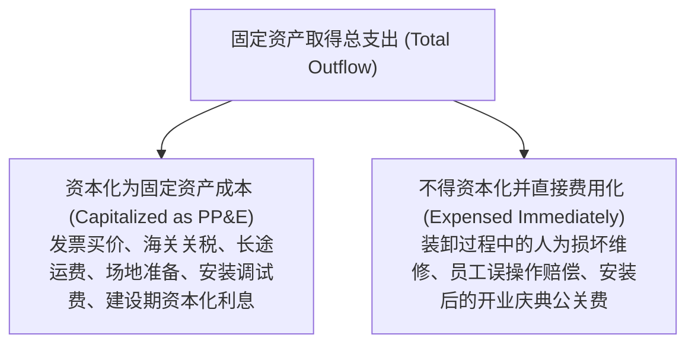
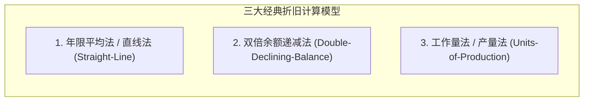
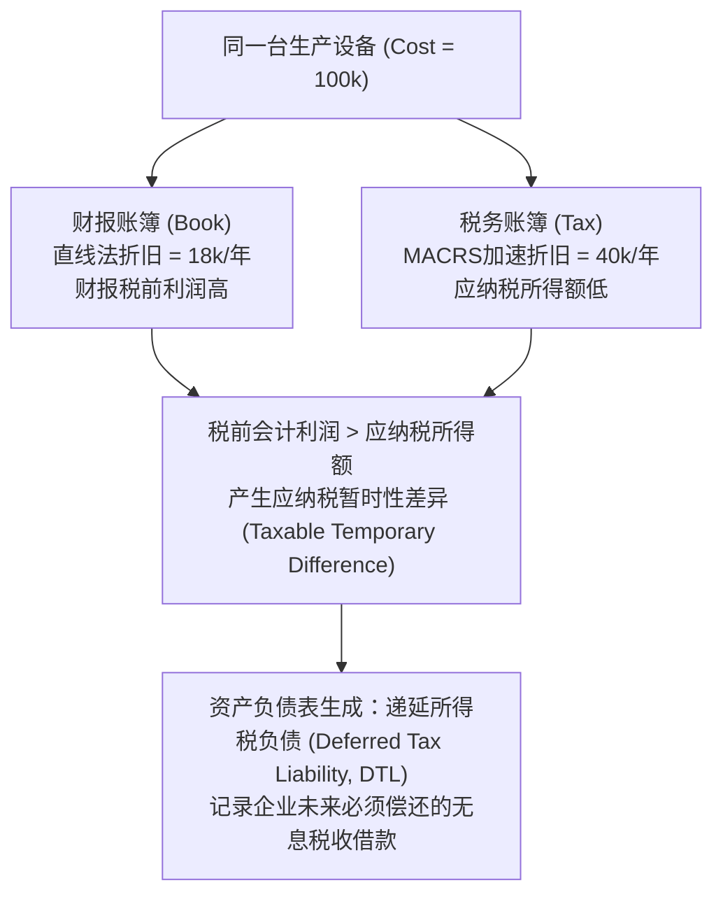

# Lec 12 长期资产资本化与折旧摊销策略 (Long-Term Assets, Capitalization vs. Expensing, Depreciation)

> MIT Sloan School of Management · 15.501 Corporate Financial Accounting · 讲义 12

## TL;DR

- 长期资产初始确认遵循全口径资本化原则，涵盖使资产达到预定可使用状态的一切必要合理支出。
- 日常修理维护支出直接费用化，显著延长寿命或提升产能的资本性改良则追加资本化入账。
- 直线法追求各期成本均衡分配，加速折旧法（双倍余额递减法）反映早期高生产力与防范技术贬损。
- 财报直线折旧与税法加速折旧（MACRS）的时间性差异衍生出递延所得税负债这一核心财务变量。

## 长期营运资产（PP&E）的初始计量与资本化边界

固定资产（Property, Plant, and Equipment, PP&E）是企业开展生产经营所持有的、使用寿命超过一个会计年度的重型有形实物资产。

::: definition 初始资本化准则 (Capitalization of Acquisition Cost)
凡是为使一项长期资产达到其**预定可使用地点与可使用状态（Intended Location and Condition）**所发生的一切必要且合理的支出，均应当予以资本化，计入该资产的历史成本总额。
:::

### 初始资本化构件明细
1. **购置发票净价**：扣除商业折扣与现金折扣后的实际支付对价；
2. **运杂费与运输保险**：从制造厂商运输至安装现场的物流费用；
3. **场地平整与基建改造**：为安装特定重型设备而对厂房地基进行的特殊加固支出；
4. **专业安装与联调测试**：工程师现场组装、试运转以及样品试制所净耗费的原材料和人工（扣除试运行产出样品的变现价值）；
5. **建设期借款利息资本化 (Capitalized Interest, ASC 835)**：为建造大型厂房或远洋货轮而专门借入的贷款利息，在建设资产达到预定使用状态前必须资本化计入资产原值，严禁在当期费用化。

### 后续支出的判别：日常维护 vs. 资本化改良

| 支出性质 | 经济实质判断标准 | 会计处理方式 | 报表直接影响 |
| :--- | :--- | :--- | :--- |
| **日常维护与修理 (Ordinary Repairs)** | 仅为了维系资产正常的日常运转状态，并不延长其初始预计使用寿命，也不提高产能 | **全额费用化 (Expensed)** 计入发生当期的管理费用或制造费用 | 直接压低当期营业利润 |
| **资本性改良与扩建 (Betterments / Additions)** | 显著延长了资产的原定使用年限，或者大幅提升了设备的生产效率与产品良品率 | **追加资本化 (Capitalized)** 计入固定资产原值，或冲减累计折旧 | 递延至未来各期通过折旧逐步释放 |

## 三大经典折旧方法数学推导与经济学比较

折旧（Depreciation）在会计上**绝不是资产物理磨损的市场价值评估过程，而是一项成本在各会计期间的系统性分摊程序（Allocation of Cost, not Valuation）**：

$$\text{可折旧基数 (Depreciable Base)} = \text{资产历史原值 (Cost)} - \text{预计净残值 (Salvage Value)}$$

### 1. 直线法 (Straight-Line Method)
假定资产随时间流逝提供均匀的经济效用，各年折旧额恒定：

$$\text{各年年折旧费用} = \frac{\text{资产原值} - \text{预计净残值}}{\text{预计使用年限 (Years)}}$$

### 2. 双倍余额递减法 (Double-Declining-Balance Method, DDB)
加速折旧法的典型代表。假定资产在投入运营早期运转效率最高、维修费用最低，因而应在早期承担更高折旧：

$$\text{直线折旧率} = \frac{1}{\text{预计使用年限}}, \quad \text{DDB 折旧率} = \frac{2}{\text{预计使用年限}}$$

$$\text{第 } t \text{ 年折旧额} = \text{第 } t \text{ 年期初资产账面净值 (Book Value)} \times \text{DDB 折旧率}$$

::: pitfall 双倍余额递减法的残值陷阱
1. **初期不扣除残值**：在计算 DDB 折旧额时，期初基数直接使用“期初账面净值（原值减去累计折旧）”，**第一年不得事先扣除预计净残值**；
2. **末期强制封顶截断**：折旧提至最后几年时，如果按折旧率计算会导致账面净值跌破预定净残值，必须**停止按比例计算，改为差额截断倒扎**，确保最终账面净值严格等于预计净残值。
:::

### 3. 工作量法 (Units-of-Production Method)
适用于航空发动机、重载卡车或采矿设备，折旧随物理消耗量动态浮动：

$$\text{单位工作量折旧额} = \frac{\text{资产原值} - \text{预计净残值}}{\text{预计生命周期总工作量 (如总里程或总工时)}}$$

$$\text{当期折旧额} = \text{当期实际完成工作量} \times \text{单位工作量折旧额}$$

::: example 直线法与双倍余额递减法全面数值演练
某半导体制造企业购置一台精密光刻机：
- 资产原值：$100,000$ 美元；
- 预计使用年限：$5$ 年；
- 预计净残值：$10,000$ 美元。

**直线法计算**：
- 可折旧基数：$100,000 - 10,000 = 90,000$ 美元；
- 每年固定折旧额：$\frac{90,000}{5} = 18,000$ 美元。

**双倍余额递减法（DDB）计算**（$\text{DDB 率} = \frac{2}{5} = 40\%$）：
- **第 1 年**：期初净值 $100,000$，折旧额 $100,000 \times 40\% = 40,000$ 美元；期末净值 $60,000$；
- **第 2 年**：期初净值 $60,000$，折旧额 $60,000 \times 40\% = 24,000$ 美元；期末净值 $36,000$；
- **第 3 年**：期初净值 $36,000$，折旧额 $36,000 \times 40\% = 14,400$ 美元；期末净值 $21,600$；
- **第 4 年**：若按 $40\%$ 计算为 $21,600 \times 40\% = 8,640$，则期末净值将降至 $12,960$；
- **第 5 年**：为避免跌破 $10,000$ 残值底线，在第 4 与第 5 年通常切换为直线法平摊剩余可折旧金额：$\frac{21,600 - 10,000}{2} = 5,800$ 美元；
- 最终第 5 年末累计折旧精确锁定为 $90,000$ 美元，期末账面价值恰好等于 $10,000$ 美元。
:::

## 财税差异初探：递延所得税负债（DTL）的生成机理

在现代公司治理中，同一套机器设备往往存在“两套折旧账簿”：
1. **财务报告账簿（Book Accounting）**：为了向二级市场股东呈现稳定优雅的盈利轨迹，企业普遍偏好采用**直线折旧法**（前期折旧费用低，净利润高）；
2. **税务申报账簿（Tax Accounting）**：为了向税务局最大化递延税负，企业依法采用美国国税局规定的**修正加速成本回收法（MACRS）**（前期折旧极高，应纳税所得额极低）。

::: theorem 递延所得税负债初始生成方程
$$\text{当期所得税费用 (Income Tax Expense)} = \text{当期应交所得税 (Income Tax Payable)} + \Delta \text{递延所得税负债 (DTL)}$$
通过计提 DTL，权责发生制消除了税收优惠带来的利润表剧烈扰动，使报告所得税费用与当期会计税前利润保持精准配比。
:::

## 我的理解

::: insight 调整折旧年限是管理层粉饰业绩的最隐蔽杠杆
在重资产工业（航空、航运、钢铁、半导体）的财务造假与盈余管理史中，修改固定资产折旧参数是 CFO 最常用的“合法魔术棒”：
1. **延长折旧年限的无痛暴利**：某大型航空公司拥有 300 架波音客机，原值合计 300 亿美元。管理层在财报附注中轻描淡写地将机队折旧寿命从 20 年延长至 25 年，每年的直线折旧费用便从 15 亿美元骤降至 12 亿美元，不增加一张机票销量、不削减一名员工薪酬，便为当年净利润凭空注入 3 亿美元的纯利润。
2. **识别折旧政策操纵的排雷法**：专业分析师必须监测两项核心指标：
   - **资产原值更新率与账面净值比率（Net PP&E / Gross PP&E）**：若该比率跌破 $30\%$，说明设备已处于超期服役的严重老化状态，未来几年将面临断崖式的资本开支重置压力；
   - **同行可比折旧寿命**：将目标公司的折旧年限与行业头部标杆（如达美航空对比美联航）横向对比，任何显著长于行业平均的折旧设定，都是管理层通过低估成本虚增利润的危险信号。
:::
