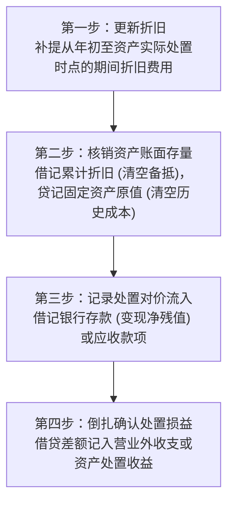
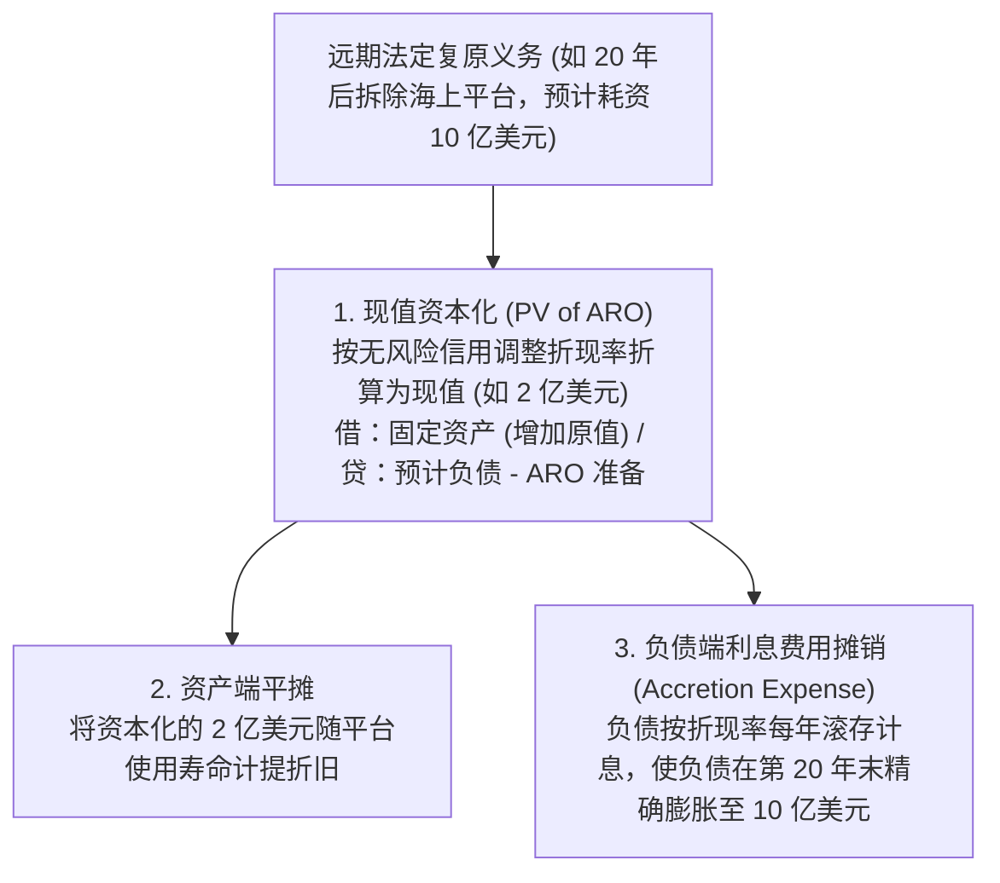
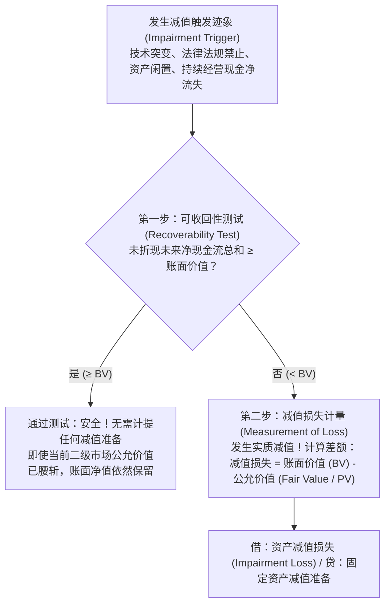

# Lec 13 固定资产配比原则与资产减值处置 (Matching Principle for PP&E, Asset Retirement & Impairments)

> MIT Sloan School of Management · 15.501 Corporate Financial Accounting · 讲义 13

## TL;DR

- 固定资产终止确认必须首先补提截至处置日的期间折旧，再清算账面净值与实收变现对价差额。
- 资产处置利得或损失属于非经常性损益，本质是对过去各年度折旧估计误差的一次性历史修正。
- 资产弃置义务（ARO）要求将远期法定环境复原支出折现确认为初始资产原值与负债储备。
- 美股 GAAP 长期资产减值实行两步法检验，以未折现未来现金流为触发门槛且减值一经计提严禁转回。

## 固定资产的终止确认与处置损益核算

当固定资产因技术淘汰、物理报废或战略出售而离开企业时，会计系统必须执行**终止确认（Derecognition）**。处置固定资产的标准四步核算流水线如下：

::: theorem 资产处置损益计量方程
$$\text{处置利得或损失 (Gain/Loss on Disposal)} = \text{实际变现净流入 (Net Proceeds)} - \text{处置日资产账面净值 (Book Value)}$$
其中：
$$\text{处置日资产账面净值} = \text{资产历史原值 (Historical Cost)} - \text{截至处置日累计折旧 (Accumulated Depreciation)}$$
- 若实际售价大于账面净值：产生**处置利得（Gain, 贷记利润表）**；
- 若实际售价小于账面净值：产生**处置损失（Loss, 借记利润表）**。
:::

::: example 处置设备全流程分录演练
某企业于 2021 年 1 月 1 日购入一台物流运输卡车，原值 60,000 美元，预计使用 5 年，预计残值 6,000 美元，采用直线法折旧（年折旧额 $\frac{60,000 - 6,000}{5} = 10,800$ 美元）。2023 年 6 月 30 日，企业将该卡车以 32,000 美元现金出售给第三方：
1. **补提 2023 年上半年 6 个月折旧**（$10,800 \times \frac{6}{12} = 5,400$ 美元）：
   $$\text{借：折旧费用 (Depreciation Expense)} \quad 5,400 \quad / \quad \text{贷：累计折旧 (Accumulated Depreciation)} \quad 5,400$$
   此时，累计折旧总额为：$10,800 \times 2 + 5,400 = 27,000$ 美元；卡车账面净值（BV）为：$60,000 - 27,000 = 33,000$ 美元。
2. **记录卡车出售并结转处置损失**（变现 32,000 美元，账面 33,000 美元，产生 1,000 美元处置损失）：
   $$\begin{aligned}
   \text{借：银行存款 (Cash)} \quad 32,000 & \\
   \text{借：累计折旧 (Accumulated Depreciation)} \quad 27,000 & \\
   \text{借：资产处置损失 (Loss on Disposal of PP\&E)} \quad 1,000 & \quad / \quad \text{贷：固定资产 - 卡车 (Vehicles)} \quad 60,000
   \end{aligned}$$
:::

## 资产弃置义务（Asset Retirement Obligations, ARO）

在重化工业、远洋钻井与能源开发领域，企业在建造和运营固定资产的第一天起，就受到严格的法定环境监管约束。例如在近海架设海上石油开采钻井平台，或者建设商用核反应堆，根据特许权出让协议与环保法案，油气开采完毕或机组退役后，企业必须全额承担深海钻井封闭、钻井钢结构割除、核污染去污及海底地貌全面复原的巨额法定义务。

根据 FASB ASC 410 与 IAS 37 准则规范，企业绝不能采取掩耳盗铃的做法，将这些数额庞大的清算费用拖延到三四十年后报废当年作为“营业外支出”一次性集中冲销。这种滞后处理严重违背了权责发生制和配比原则，因为导致环境破坏与退役责任的经济根源，正是长达数十年的日常开采与发电业务。因此，现代会计准则建立了严密的**资产弃置义务（ARO）折现与双重分摊机制**。

具体而言，ARO 的会计处理分为三个系统阶段：
1. **初始资本化与预计负债确认**：在设施竣工并产生法定拆卸义务的当期，测算远期总支出并按照信用调整后的无风险利率折现，以现值借记固定资产原值，同时贷记“预计负债—资产弃置义务（ARO Liability）”；
2. **资产端折旧结转**：被资本化的弃置成本现值并入固定资产总原值，随着设施的预计开采年限逐年计提折旧，以制造费用形式进入产品成本；
3. **负债端利息费用摊销（Accretion Expense）**：预计负债存量按初始折现率在每个会计期末计提利息费用，借记财务费用/增量费用（Accretion Expense），贷记 ARO 负债。随着时间的推移，负债账面值逐年复利滚存增长，直至退役结算时精确达到预计的名义总清偿金额。

## 长期资产减值准则：US GAAP 两步法深度解析

当宏观经济恶化、核心产品技术被淘汰或出现严重物理损坏时，长期资产的历史账面净值可能永久性无法通过未来经营回收。此时必须启动**资产减值测试（Impairment Testing, ASC 360）**。

::: theorem 美股 GAAP 长期资产减值两步法公理
1. **第一步：可收回性测试（门槛检验）**：
   比较资产未来预计产生的**未折现现金流量总和（Undiscounted Future Cash Flows）**与当前账面价值（Book Value）：
   - 若 $\sum \text{Undiscounted Cash Flows} \ge \text{Book Value}$，即使资产公允价值大幅下挫，准则推定资产在持有使用过程中仍能回收其历史成本，**测试终止，严禁确认任何减值**；
   - 若 $\sum \text{Undiscounted Cash Flows} < \text{Book Value}$，证明成本回收已经落空，强制进入第二步。
2. **第二步：减值损失计量（公允价值差额）**：
   $$\text{减值损失 (Impairment Loss)} = \text{账面净值 (Book Value)} - \text{公允价值 (Fair Value)}$$
   其中公允价值通常通过**已折现未来现金流量现值（Discounted Cash Flows, DCF）**确定。
:::

::: example 减值两步法数值计算演练
某重型机械厂拥有一条特种钢铁锻造生产线：
- 资产原值：$1,000,000$ 美元，累计折旧：$400,000$ 美元，当前账面净值（BV）：$600,000$ 美元；
- 突发环保法规限制导致开工率不足。管理层评估该生产线剩余 4 年产生的未来经营净现金流：每年 $130,000$ 美元；
- 考虑折现率后，该资产的市场公允价值（现值）为 $380,000$ 美元。

**测试推导**：
1. **第一步（未折现测试）**：未来未折现现金流总和 $= 130,000 \times 4 = 520,000$ 美元；
   - 比较：$520,000 < 600,000$（账面价值）。**未折现总和跌破账面价值，未通过可收回性测试，必须计提减值**！
2. **第二步（减值计量）**：
   $$\text{减值损失} = \text{账面净值 (600,000)} - \text{公允价值 (380,000)} = 220,000 \text{ 美元}$$
3. **会计分录**：
   $$\text{借：资产减值损失 (Impairment Loss)} \quad 220,000 \quad / \quad \text{贷：固定资产减值准备 (Accumulated Impairment)} \quad 220,000$$
4. **后续折旧调整**：资产新账面净值修正为 $380,000$ 美元，以此为基数在剩余 4 年内重新计算每年的直线折旧额（$\frac{380,000}{4} = 95,000$ 美元/年）。
:::

::: pitfall 美股与国际准则在“减值转回”上的绝对分歧
- **US GAAP 刚性铁律**：持有供使用的长期资产（PP&E）计提减值后，**新确立的账面低成本即成为永久性历史成本，未来即便行业景气反弹、公允价值暴涨，也绝对严禁转回任何减值损失**！
- **IFRS 国际准则（IAS 36）**：采用一步法测试（直接对比账面值与可收回金额）；若未来客观经济环境好转，除商誉外，**允许在原计提范围内全额转回减值收益**。
这一规则差异使得跨国上市公司的资产负债表稳健度呈现出显著分化。
:::

## 我的理解

::: insight 处置损益本质是历史折旧偏差的“秋后总算账”
在财务报表分析中，将资产处置损益（Gain/Loss on Sale）视为“企业卓越投资能力”是极大的业余误解：
1. **处置利得的本质是对过去过度保守折旧的补正**：如果一家企业以 1000 万买入机器，预计寿命 5 年、每年折旧 200 万，三年后账面净值仅剩 400 万，此时将其以 700 万卖出，产生 300 万“处置利得”。这绝非公司在第三年创造了超额财富，而是因为前三年预设的折旧速度太快，每年多提了 100 万折旧费用，将前三年的净利润人为压低了 300 万。处置时爆出的利得，只是把过去被压低利润的“尸体”重新挖出来还魂而已。
2. **两步法未折现门槛构筑的管理层护城河**：US GAAP 之所以在第一步坚持采用“未折现现金流”，是极其偏袒管理层的制度设计。由于货币时间价值的存在，未折现现金流往往数倍于折现现值。管理层只需在模型里虚增远期几年的粗略现金流入，便能轻松跨过第一步门槛，从而“合法地”拒绝计提上亿美元的资产减值，为虚胖的账面资产提供长达数年的庇护伞。
:::
