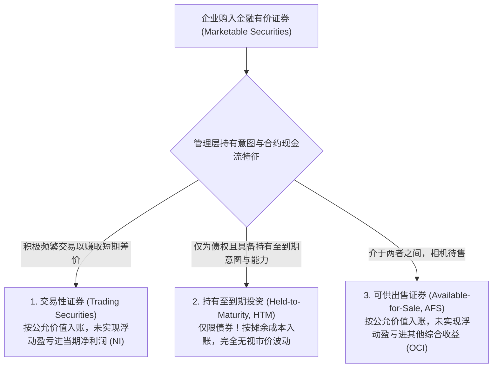
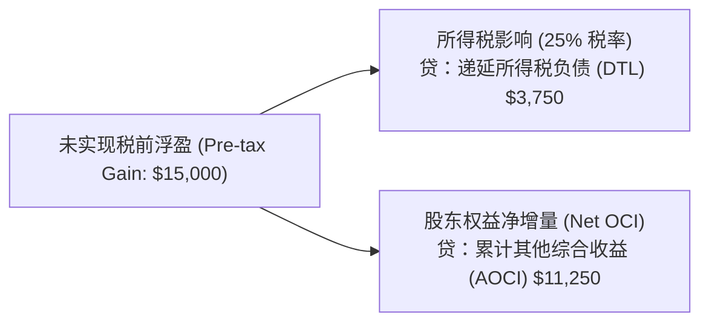
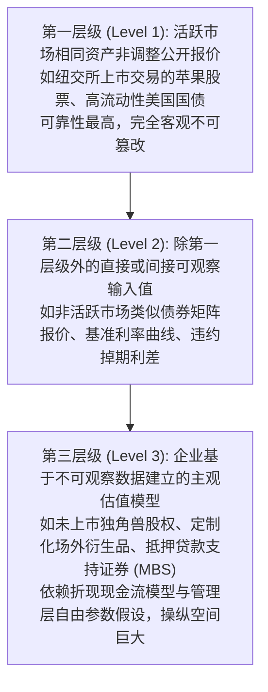

# Lec 14 有价证券投资与公允价值计量 (Marketable Securities: Trading, AFS, HTM & Deferred Tax Intro)

> MIT Sloan School of Management · 15.501 Corporate Financial Accounting · 讲义 14

## TL;DR

- 企业对外金融证券投资的会计计量属性取决于管理层的持有意图与商业模式能力。
- 交易性证券按公允价值随行就市计量，未实现浮动盈亏直接计入当期利润表净利润。
- 可供出售证券按公允价值列示于资产负债表，但浮动盈亏绕过利润表存入其他综合收益蓄水池。
- 持有至到期债券严格按摊余成本计量，公允价值三层级架构确立了估值客观性的准则约束。

## 有价证券分类准则与管理层持有意图

企业除主营业务资产外，往往将闲置流动资金投向资本市场的金融工具。根据美国会计准则（ASC 320/321）规范，企业持有的无重大影响（持股比例通常低于 20% 且无董事会席位）的债券与股票投资，被划分为三大截然不同的会计资产池：

::: definition 三类有价证券的界定基准
1. **持有至到期投资 (HTM)**：仅适用于**债权类证券（Debt Securities）**。企业管理层必须具备明确的积极意图与充足的财务实力将债券持有至最终到期兑付日。
2. **交易性证券 (Trading)**：为在近期内（通常数天至数月）通过二级市场买卖赚取短期差价而购入持有的债权或权益证券。
3. **可供出售证券 (AFS)**：未被归类为交易性或持有至到期的债权证券。管理层可能将其长期持有，但在面临流动性压力或利率变动时随时可能择机变现。
:::

## 三大证券类别的报表流转与会计处理对比

三大分类在资产负债表与利润表上的会计处理存在根本性的规则对立：

| 评估维度 | 持有至到期投资 (HTM) | 交易性证券 (Trading) | 可供出售证券 (AFS) |
| :--- | :--- | :--- | :--- |
| **资产适用范围** | **仅限债权证券 (Debt Only)** | 债权与部分权益证券 | 债权证券 (Debt Securities) |
| **资产负债表计量属性** | **摊余成本 (Amortized Cost)** | **期末公允价值 (Fair Value)** | **期末公允价值 (Fair Value)** |
| **未实现持有利得/损失 (Unrealized Gains/Losses)** | **完全不作任何确认**（无视二级市场价格涨跌） | **计入当期利润表净利润 (Net Income)** | **计入资产负债表其他综合收益 (OCI)**，绕过利润表 |
| **利息与股利收入** | 计入当期净利润（投资收益） | 计入当期净利润（投资收益） | 计入当期净利润（投资收益） |
| **实际出售已实现损益** | 售价与账面摊余成本差额计入净利润 | 售价与最近期末公允价值差额计入净利润 | 售价与历史摊余成本差额计入净利润，并将累计 OCI 循环结转 |

::: example AFS 与 Trading 浮盈会计分录对照
某企业于 10 月 1 日以 100,000 美元买入一批优质企业债券。12 月 31 日，该债券二级市场公允价值因基准利率下行上涨至 115,000 美元（浮盈 15,000 美元）：
- **若划分为交易性证券（Trading）**：
  $$\text{借：交易性金融资产 - 公允价值变动} \quad 15,000 \quad / \quad \text{贷：公允价值变动损益 (进利润表 NI)} \quad 15,000$$
  直接推高当期净利润 15,000 美元（暂不考虑所得税）。
- **若划分为可供出售证券（AFS）**：
  $$\text{借：可供出售金融资产 - 公允价值变动} \quad 15,000 \quad / \quad \text{贷：其他综合收益 (OCI - 进净资产)} \quad 15,000$$
  资产负债表资产增加 15,000 美元，股东权益项下的累计其他综合收益（AOCI）等额增加，**当期利润表净利润完全不受任何影响**。
:::

## 其他综合收益（OCI）与递延所得税互动

其他综合收益（Other Comprehensive Income, OCI）是现代财务会计在所有者权益中开辟的“**业绩避震缓冲池**”。它允许企业将非核心经营引发的暂时性价值波动（如 AFS 浮动盈亏、外币报表折算差额、养老金精算损益）先存入资产负债表，避免对二级市场每股收益（EPS）造成毁灭性的人工剧烈波动。

由于 AFS 债券的浮盈在未实际卖出前不需要向国税局缴纳现金所得税，因此产生了**应纳税暂时性差异**：

$$\text{税后 OCI 净增额} = \text{未实现税前浮盈} \times (1 - \text{税率 } t)$$

企业必须在确认 OCI 的同时，在资产负债表计提对应的**递延所得税负债（DTL）**，体现了极其精密的权责发生制自洽性。

## 公允价值计量三层级架构（ASC 820）

在衡量金融资产“公允价值（Fair Value）”时，准则委员会制定了严格的**三层级估值可靠性排序（Fair Value Hierarchy）**：

::: pitfall 违规跨类重分类的惩罚：玷污规则 (Tainting Rule)
在 HTM 债券投资中，如果企业声称具备持有至到期意图，却在到期日前因流动性紧张擅自提前卖出了超过重要性门槛（如 5% 以上）的 HTM 债券：
- 将触发极其严厉的**玷污规则（Tainting Rule）**；
- 会计准则将判定管理层丧失了持有至到期的商业诚信；
- 企业剩余的**全部 HTM 债券必须被强制全额剥离，全部重分类为 AFS 证券并强制按公允价值调整**；
- 且在未来至少连续两个会计年度内，严禁再次使用 HTM 这一摊余成本避风港科目。
:::

## 我的理解

::: insight OCI 是华尔街金融机构与会计准则的政治妥协产物
深入研究现代金融会计的演进史，便会洞悉 AFS 与 OCI 机制背后的深刻制度博弈：
1. **纯粹公允价值学派的理想主义**：理论界会计学者曾强烈主张“全面公允价值会计”，要求所有流动证券的浮动盈亏一律全额计入净利润。这一主张在 1990 年代遭到华尔街商业银行家极其激烈的政治游说反对。银行家向国会抗议：银行资产负债表上持有数万亿美元长期国债，一旦基准利率波动 50 个基点，账面浮盈浮亏将导致大银行每季度的每股收益呈现数十亿美元的过山车暴涨暴跌，彻底击垮公众对银行体系稳健性的信心。
2. **OCI 制度的妥协智慧**：AFS 和 OCI 的诞生，正是既满足监管层“在资产负债表上如实反映资产缩水（公允价值入表）”，又保护管理层“不让无常的宏观利率波动砸碎利润表净利润（绕过利润表）”的高超折中。
3. **硅谷银行（SVB）暴雷中的报表遮羞布**：2023 年硅谷银行之所以破产，正是因为管理层在 2021 年利率低点时，将数千亿美元长期抵押支持证券（MBS）由 AFS 大规模转移到了 HTM 分类中。在 HTM 的掩护下，即便由于美联储激进加息导致这些债券二级市场暴跌数百亿美元，硅谷银行在公开资产负债表上依然按照“摊余成本”全额列示，未在利润表和 OCI 中计提一分钱损失，制造出资本充足的致命幻觉。直到储户突发挤兑迫使其断臂折价变现，这一巨额隐形黑洞才彻底引爆。
:::
