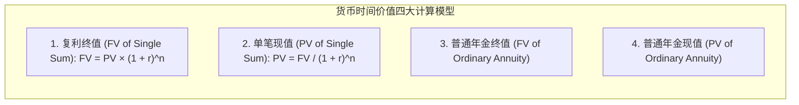
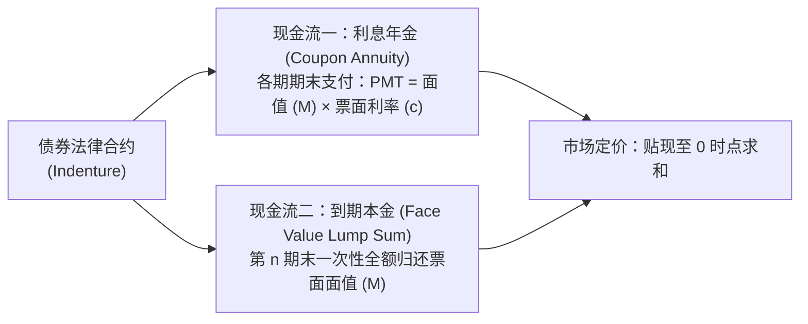
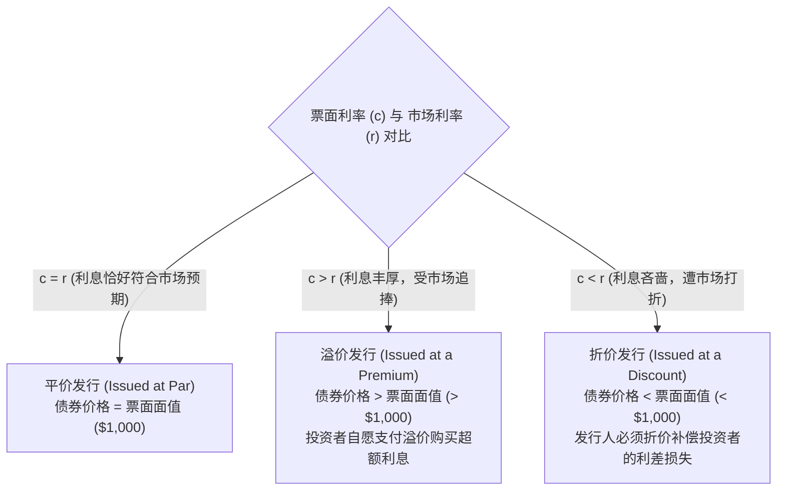

# Lec 15 货币时间价值与债券定价原理 (Time Value of Money & Bond Valuation Mechanics)

> MIT Sloan School of Management · 15.501 Corporate Financial Accounting · 讲义 15

## TL;DR

- 货币时间价值确立了不同时间切片上的现金流量不可简单代数相加的现代金融基准。
- 普通年金现值与单笔终值贴现公式构成了长期负债、融资租赁与资产折现估值的计算基石。
- 债券市场定价在本质上是未来确定性利息年金与到期本金现值的代数叠加。
- 票面利率与市场收益率的利差博弈决定了债券平价、溢价或折价发行的初始账面价值。

## 货币时间价值（TVM）公理与四维贴现矩阵

在现代财务学与会计学中，“今天的 100 美元比明天的 100 美元更有价值”是一条不可动摇的公理。资金之所以具有时间价值（Time Value of Money, TVM），根源于三大经济学现实：
1. **真实再投资机会成本 (Opportunity Cost)**：持有资金可在实体产业或金融市场中立即产生生产性收益；
2. **通货膨胀购买力稀释 (Inflation Risk)**：物价上涨使得未来名义货币的实际购买力受损；
3. **违约与流动性不确定性 (Uncertainty & Risk)**：远期现金流入伴随着债务人经营失败与宏观违约风险。

::: theorem 货币时间价值核心代数方程组
设 $r$ 为每期折现率（实际利率），$n$ 为期数，$PMT$ 为等额定期年金：
1. **单笔现金现值 (PV of a Single Lump Sum)**：
   $$PV = \frac{FV}{(1 + r)^n} = FV \times (1 + r)^{-n}$$
2. **普通年金现值 (PV of an Ordinary Annuity, PVOA)**：各期期末发生等额支付：
   $$PVOA = PMT \times \left[ \frac{1 - (1 + r)^{-n}}{r} \right]$$
3. **即付年金现值 (PV of an Annuity Due, PVAD)**：各期期初发生支付（如租金预付）：
   $$PVAD = PVOA \times (1 + r)$$
4. **半年度复利调整 (Semiannual Compounding)**：若每年计息 2 次，年名义利率 $R$，期限 $Y$ 年：
   $$\text{每期利率 } r = \frac{R}{2}, \quad \text{总期数 } n = Y \times 2$$
:::

## 公司债券合约解构与双流现金流模型

公司债券（Corporate Bonds）是大型企业在公开资本市场向成千上万外部投资者举借长期债务的法律契约凭证。一份标准的附息债券包含两个独立的未来现金流入流：

::: definition 债券核心法律参数
- **面值 (Face Value / Par Value, $M$)**：债券证书上载明的本金金额，通常为 1,000 美元或其整数倍；
- **票面利率 (Stated / Coupon Rate, $c$)**：合约约定的定期名义利息计算比例，决定每期实际向投资者发放的法定现金利息：
  $$\text{每期法定利息支付额} = M \times c$$
- **市场利率 / 到期收益率 (Market Rate / Yield to Maturity, $r$)**：由二级资本市场根据宏观无风险利率、通胀预期与发行公司的违约信用风险实时决定的必要报酬率。
:::

## 债券理论定价统一方程

在资本市场均衡时，债券的发行价格严格等于其未来全部预期现金流入按市场利率折现的现值总和：

::: theorem 债券定价主方程 (Master Bond Pricing Equation)
$$\begin{aligned}
\text{债券理论价格 (Bond Price)} &= \text{未来各期利息的现值 (PV of Coupons)} + \text{到期还本的现值 (PV of Par)} \\
&= \sum_{t=1}^n \frac{M \cdot c}{(1 + r)^t} + \frac{M}{(1 + r)^n} \\
&= (M \cdot c) \times \left[ \frac{1 - (1 + r)^{-n}}{r} \right] + M \times (1 + r)^{-n}
\end{aligned}$$
:::

### 三大定价关系矩阵

在债券发行的那一刻，票面利率（$c$）与市场利率（$r$）之间的利差关系，决定了债券在资本市场上的三种根本定价形态。票面利率是固化在合同文本中的法定付息契约，而市场利率是买方投资者基于宏观资金供求与风险溢价要求的实际回报率。两者之间的博弈直接决定了债券是以面值发行，还是必须通过溢价或折价来进行价格自适应微调。

三大定价场景的经济学机制剖析如下：
1. **平价发行 (Par Bond, $c = r$)**：当企业设定的票面利息恰好完全满足资本市场对同等风险债务的要求时，投资者愿意支付等于面值的全额现金，发行价严格等于面值，资产负债表无任何折价或溢价储备；
2. **溢价发行 (Premium Bond, $c > r$)**：当宏观利率下行导致市场上类似债券普遍只提供 6% 回报时，企业承诺支付的 8% 票面利息构成稀缺的超额收益。理性的二级市场买方竞相加价竞拍，推高认购价格直到实际回报率被压回 6% 为止，产生**应付债券溢价（Premium on Bonds Payable）**；
3. **折价发行 (Discount Bond, $c < r$)**：当通胀走高导致市场基准利率攀升至 10% 时，企业承诺的 8% 利息显得极度缺乏吸引力。投资者拒绝按原价认购，发行人必须以低于面值的折扣价甩卖，产生**应付债券折价（Discount on Bonds Payable）**，以此弥补投资者未来各期利息收入的缺口。

## 债券发行定价实战演练

以面值 100,000 美元、期限 5 年、票面年利率 8%（每年付息一次）的公司债券为例，对比不同市场利率下的定价结果：
- 每年法定利息支付额：$PMT = 100,000 \times 8\% = 8,000$ 美元；
- 5 年末一次性归还本金：$100,000$ 美元。

::: example 三种市场利率下的定价推导
1. **情景一：市场利率等于 8%（平价）**：
   $$\text{Price} = 8,000 \times PVOA(8\%, 5) + 100,000 \times PV(8\%, 5) = 8,000 \times 3.9927 + 100,000 \times 0.6806 = 100,000 \text{ 美元}$$
2. **情景二：市场利率飙升至 10%（折价发行）**：
   - 利息现值：$8,000 \times PVOA(10\%, 5) = 8,000 \times 3.7908 = 30,326$ 美元；
   - 本金现值：$100,000 \times PV(10\%, 5) = 100,000 \times 0.6209 = 62,092$ 美元；
   - **债券发行价格**：$30,326 + 62,092 = 92,418$ 美元（折价 7,582 美元）。
3. **情景三：市场利率降至 6%（溢价发行）**：
   - 利息现值：$8,000 \times PVOA(6\%, 5) = 8,000 \times 4.2124 = 33,699$ 美元；
   - 本金现值：$100,000 \times PV(6\%, 5) = 100,000 \times 0.7473 = 74,726$ 美元；
   - **债券发行价格**：$33,699 + 74,726 = 108,425$ 美元（溢价 8,425 美元）。
:::

::: definition 零息债券定价 (Zero-Coupon Bonds)
零息债券在存续期间不支付任何阶段性票面利息（$c = 0$），纯粹按远低于面值的深幅折扣发行：
$$\text{零息债券价格} = \frac{M}{(1 + r)^n}$$
投资者的全部投资回报完全来自于发行价格与到期面值之间的巨额自然增值差额。
:::

## 我的理解

::: insight 债券折价与溢价本质是“预先结算的未来利差”
许多初涉财务的人常把“债券折价 7,582 美元”误认为是发债企业的即期亏损，把“溢价 8,425 美元”当成企业的横财收入：
1. **利差的经济实质**：当市场利率为 10% 时，投资者要求每年获得 10,000 美元的收益，但债券合同已被锁死为每年只发 8,000 美元现金，每年产生了 2,000 美元的利息缺口。折价 7,582 美元，正是这笔 5 年累计 10,000 美元的利差缺口在今天的净现值。
2. **发债人与投资者的零和公平对价**：发行人在第 0 天少拿 7,582 美元现金，等于在第 0 天预先向投资者补偿了未来 5 年的利差；反之，溢价发行的企业在第 0 天多收 8,425 美元现金，是因为它承诺在未来 5 年每年超额向投资者发放 2,000 美元的高于市场均价的利息。
3. **有效利率摊销的必然性**：在后续讲义中我们将看到，这笔在第 0 天产生的折价或溢价，必须在债券存续期内通过“实际利率法”逐期摊销平摊进每年的财务费用中。无论平价、折价还是溢价，企业在全周期内承担的真实年化融资成本率，必定精确等于市场利率 10% 或 6%，资本市场的定价机制从未给任何人留下免费午餐。
:::
