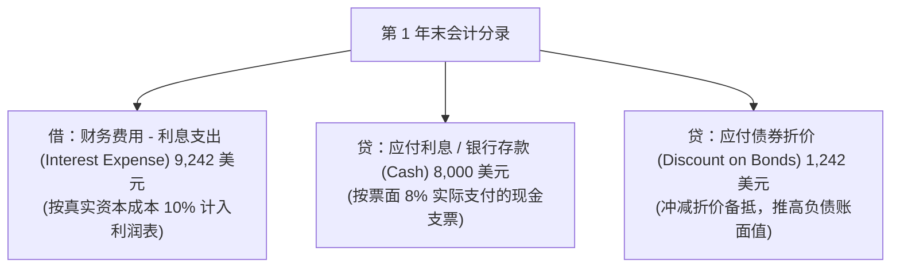

# Lec 16 长期负债核算与实际利率摊销 (Long-Term Debt Accounting, Premium/Discount Amortization)

> MIT Sloan School of Management · 15.501 Corporate Financial Accounting · 讲义 16

## TL;DR

- 实际利率法将债券折溢价在存续期内系统摊销，确保各期财务费用率恒定等于发行时的市场利率。
- 应付债券折价作为负债备抵科目随摊销递减，推高负债账面价值直至到期日与票面面值精确闭合。
- 溢价摊销使得各期实际利息费用低于合同付现利息，差额冲减应付债券溢价并压低负债账面值。
- 债务提前清偿损益由再收购支付现金与清偿日负债账面净值的差额决定，属于独立非经常损益。

## 债券账面价值与实际利率摊销法公理

在债券发行日，由于票面利率与市场利率的偏差，资产负债表上会生成“应付债券折价（Discount on Bonds Payable）”或“应付债券溢价（Premium on Bonds Payable）”。随后的核心会计任务，是在债券的存续期内将这笔初始差额合理分摊至各会计期间的利润表财务费用中。

```mermaid
flowchart LR
    subgraph CarryingValue [债券账面净值 (Carrying Value)]
        direction TB
        CV_Discount["折价状态：账面净值 = 债券面值 (Par) - 未摊销折价 (Discount)<br/>期初净值 < 面值，随摊销逐年递增至面值"]
        CV_Premium["溢价状态：账面净值 = 债券面值 (Par) + 未摊销溢价 (Premium)<br/>期初净值 > 面值，随摊销逐年递减至面值"]
    end
```

::: definition 实际利率法 (Effective-Interest Method)
美国 GAAP 与 IFRS 强制要求的唯一基准摊销方法。该方法要求每期的**利息费用（Interest Expense）**必须严格等于**该期期初债券账面净值（Beginning Carrying Value）**乘以**债券发行时的实际市场利率（Effective Market Rate, $r$）**：
$$\text{当期利息费用} = \text{期初债券账面净值} \times \text{发行时市场实际利率 } (r)$$
$$\text{当期法定现金利息} = \text{债券票面面值 } (M) \times \text{票面利率 } (c)$$
$$\text{当期折价 / 溢价摊销额} = |\text{当期利息费用} - \text{当期法定现金利息}|$$
:::

与简单的直线摊销法相比，实际利率法反映了复利规律，确保企业的资本成本率在整个发债生命周期中保持严格的理论恒定。

## 折价发行债券的实际利率摊销实战

接续上讲案例：某企业发行面值 100,000 美元、票面利率 8%、5 年期、市场利率 10% 的公司债券。
- 发行价格（初始账面净值）：$92,418$ 美元；
- 初始应付债券折价：$100,000 - 92,418 = 7,582$ 美元；
- 每年支付法定现金利息：$100,000 \times 8\% = 8,000$ 美元。

### 实际利率法折价摊销计划表（Amortization Schedule）

| 年度 | 期初账面净值 (A) | 利息费用 (B = A × 10%) | 法定现金利息 (C = 8,000) | 折价摊销额 (D = B - C) | 期末未摊销折价 (E = E - D) | 期末账面净值 (F = A + D) |
| :---: | :---: | :---: | :---: | :---: | :---: | :---: |
| **0** | — | — | — | — | 7,582 | **92,418** |
| **1** | 92,418 | 9,242 | 8,000 | 1,242 | 6,340 | **93,660** |
| **2** | 93,660 | 9,366 | 8,000 | 1,366 | 4,974 | **95,026** |
| **3** | 95,026 | 9,503 | 8,000 | 1,503 | 3,471 | **96,529** |
| **4** | 96,529 | 9,653 | 8,000 | 1,653 | 1,818 | **98,182** |
| **5** | 98,182 | 9,818 | 8,000 | 1,818 | 0 | **100,000** |



::: theorem 折价摊销财务轨迹特征
1. **利息费用逐年攀升**：随着未摊销折价被冲销，债券账面净值从 92,418 逐年升至 100,000，导致按 10% 计提的利息费用从 9,242 逐年爬坡至 9,818；
2. **到期完全收敛**：在第 5 年末，未摊销折价余额精准归零，账面净值完全收敛于 100,000 美元，到期日只需纯粹偿还本金。
:::

## 溢价发行债券的实际利率摊销实战

接续上讲情景：当市场利率为 6% 时，该债券以 108,425 美元溢价发行。
- 初始溢价余额：$8,425$ 美元；
- 每年法定现金利息：$8,000$ 美元。

### 实际利率法溢价摊销计划表

| 年度 | 期初账面净值 (A) | 利息费用 (B = A × 6%) | 法定现金利息 (C = 8,000) | 溢价摊销额 (D = C - B) | 期末未摊销溢价 (E = E - D) | 期末账面净值 (F = A - D) |
| :---: | :---: | :---: | :---: | :---: | :---: | :---: |
| **0** | — | — | — | — | 8,425 | **108,425** |
| **1** | 108,425 | 6,506 | 8,000 | 1,494 | 6,931 | **106,931** |
| **2** | 106,931 | 6,416 | 8,000 | 1,584 | 5,347 | **105,347** |
| **3** | 105,347 | 6,321 | 8,000 | 1,679 | 3,668 | **103,668** |
| **4** | 103,668 | 6,220 | 8,000 | 1,780 | 1,888 | **101,888** |
| **5** | 101,888 | 6,112 | 8,000 | 1,888 | 0 | **100,000** |

第 1 年末溢价摊销会计分录：
$$\begin{aligned}
\text{借：财务费用 - 利息支出 (Interest Expense)} \quad 6,506 & \\
\text{借：应付债券溢价 (Premium on Bonds Payable)} \quad 1,494 & \quad / \quad \text{贷：银行存款 (Cash)} \quad 8,000
\end{aligned}$$
溢价的摊销冲减了每年的利息费用，真实体现了发行人在第 0 天超额获得资金的利差红利。

## 债务提前清偿（Early Extinguishment of Debt）损益核算

在宏观利率大幅波动或企业现金流充沛时，发行人可能在二级市场上回购自身发行的流通债券，或行使赎回权提前清偿债务：

::: definition 债务清偿损益 (Gain / Loss on Early Extinguishment)
清偿日被注销债务的账面净值与实际支付的清偿代价（回购价格）之间的差额：
$$\text{清偿利得或损失} = \text{清偿日债券账面净值 (Carrying Value)} - \text{实际清偿再收购价 (Reacquisition Price)}$$
- 若实际赎回代价 $<$ 账面净值：确认**债务重组清偿利得（Gain，贷记利润表）**；
- 若实际赎回代价 $>$ 账面净值：确认**债务重组清偿损失（Loss，借记利润表）**。
:::

::: example 提前赎回债券实战分录
在上述折价债券案例中，假设在第 2 年末付息后（此时期末账面净值为 95,026 美元，未摊销折价为 4,974 美元），由于宏观基准利率大幅上升，债券二级市场暴跌，企业以 91,000 美元现金在公开市场上回购了全部债券并予以注销：
- 账面净值：$95,026$ 美元；
- 回购付现：$91,000$ 美元；
- 产生提前清偿利得：$95,026 - 91,000 = 4,026$ 美元；
- 会计分录：
  $$\begin{aligned}
  \text{借：应付债券面值 (Bonds Payable)} \quad 100,000 & \\
  & \text{贷：应付债券折价 (Discount on Bonds)} \quad 4,974 \\
  & \text{贷：银行存款 (Cash)} \quad 91,000 \\
  & \text{贷：债务提前清偿利得 (Gain on Extinguishment)} \quad 4,026
  \end{aligned}$$
:::

## 我的理解

::: insight 债务提前清偿利得往往是“信用恶化”的反常警报
在审阅企业利润表时，初级分析师看到巨额的“债务重组利得”或“回购债券利得”，常以为企业管理层展示了高超的理财财技：
1. **逆向选择的财务表象**：为什么一家公司能以 70 美元的超低价格在市场上回购面值 100 美元的自身债券？答案从来不是管理层精明，而是因为资本市场对该公司的**违约风险产生了极度恐慌**，评级机构将公司评级下调为垃圾级（Junk Bond），债权人宁愿打七折也要割肉斩仓逃命。
2. **掩盖主营业务巨亏的会计修饰**：许多陷入经营困境的重工业和房地产企业，在主营业务出现数亿元断崖式亏损的关头，选择动用仅剩的宝贵现金低价回购二级市场折价债券。在账面上，这笔清偿利得合法地进入利润表，恰好“冲平”了主营业务的巨额亏损。
3. **识别方法**：分析师必须无情地将债务清偿利得从核心营业利润（EBIT）中剔除。利用自身信用坍塌在纸面上赚取的“会计利润”，不仅不具备任何持续性，反而加速消耗了企业宝贵的流动性防线。
:::
