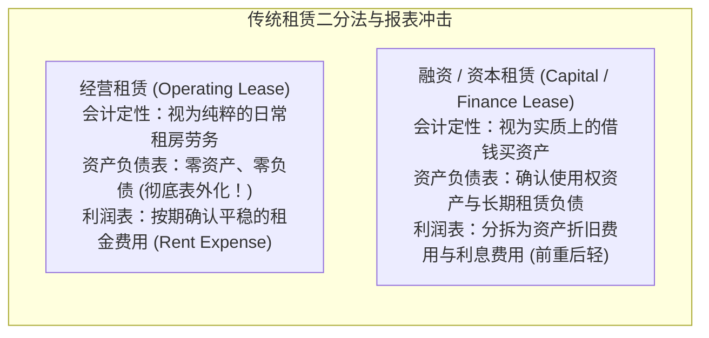
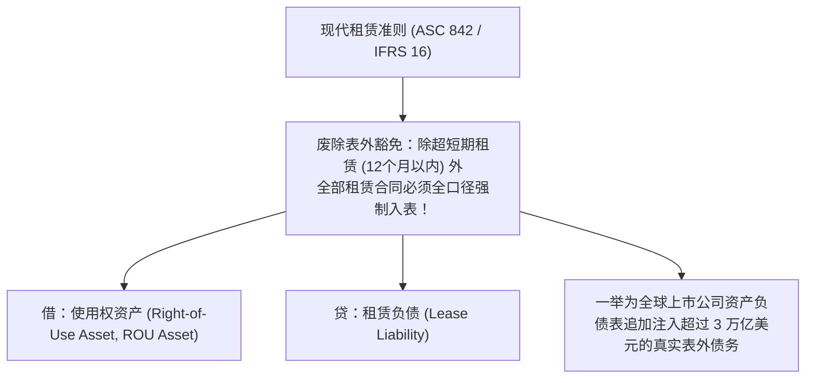

# Lec 17 租赁会计与表外融资穿透 (Leases and Off-Balance Sheet Financing: Operating vs. Capital)

> MIT Sloan School of Management · 15.501 Corporate Financial Accounting · 讲义 17

## TL;DR

- 租赁本质上是一种通过分期付款换取长期资产实质控制权与使用权的债务融资替代方案。
- 传统经营租赁将巨额刚性租金支付义务隐匿于资产负债表外，严重人为美化资产负债率与总资产周转率。
- 融资租赁要求将未来最低租赁付款额折现确认为表内使用权资产与长期租赁负债。
- 现代准则变革（ASC 842 / IFRS 16）彻底终结了表外租赁游戏，强制推行全口径资产负债表入表。

## 租赁商业模式的经济学动因与表外融资冲动

在现代工商业中，无论是航空公司运营机队、零售巨头布局数千家门店，还是科技公司配置服务器机房，**租赁（Leasing）**均占据支配性地位。企业选择租赁的核心动因包括：
1. **百分之百无首付融资 (100% Financing)**：规避了直接购置资产时银行通常要求的 20%~30% 股权首付比例；
2. **规避技术与资产残值贬损风险 (Obsolescence Protection)**：在机型换代频繁的航空业，退租权使得承租人能将二手飞机拍卖残值波动的风险转移给出租人；
3. **表外融资（Off-Balance Sheet Financing）监管套利**：在旧准则时代，企业通过精巧的合同工程学，将具有实质债务特征的长期租赁包装为“经营租赁”，使得资产负债表无需列示巨额负债，从而逃避银行债务契约（Debt Covenants）对资产负债率的限制。

## 传统 GAAP 资本租赁四大硬性准则（ASC 840）

在旧准则体系下，承租人判断一项租赁究竟属于“经营租赁”还是“资本租赁”，依赖经典的**四大刚性量化门槛（The Four "Bright-Line" Criteria）**：

::: theorem 资本租赁四大刚性检验准则
只要租赁合同**满足以下四个条件中的任意一个**，承租人必须强制按资本租赁（融资租赁）在资产负债表内确认资产与负债；若四条均不满足，方可作为表外经营租赁处理：
1. **所有权转移条款 (Transfer of Ownership)**：在租赁期届满时，资产法定所有权无条件自动转移给承租人；
2. **廉价购买选择权 (Bargain Purchase Option, BPO)**：承租人拥有在特定时点以显著低于届时预期公允价值的价格买断该资产的法定权利；
3. **租期经济寿命测试 (75% Lease Term Test)**：租赁期占资产预计全部经济使用寿命的比例达到或超过 **75%**；
4. **最低付款额现值测试 (90% Recovery Test)**：最低租赁付款额（Minimum Lease Payments, MLP）按增量借款利率折现的现值，达到或超过租赁开始日该资产公允价值的 **90%**。
:::

::: pitfall 投行与律师的“74.9% 与 89.9%”合同工程学
在旧准则实务中，跨国企业的财务总监与华尔街投行专门设计了所谓“74.9% 合同”：
- 故意将飞机租赁期设计为经济寿命的 74.9%；
- 故意微调租金使折现现值恰好等于公允价值的 89.9%；
- 从而在法律上完美绕过第 3 条和第 4 条资本租赁红线。
航空公司以此合法地将数百亿美元的波音空客机队完全移出资产负债表，制造出高 ROA 和低资产负债率的假象。
:::

## 经营租赁与资本租赁的财务报表全口径对比

以一家物流公司租赁价值 100,000 美元的专用自动化分拣流水线为例（租期 5 年，每年末支付固定租金 25,000 美元，折现率 8%）：
- 最低租金折现现值：$25,000 \times PVOA(8\%, 5) = 25,000 \times 3.9927 = 99,818$ 美元（占公允价值 99.8%，属于资本租赁）。

| 会计报表项目 | 经营租赁处理 (Operating Lease) | 资本租赁处理 (Capital Lease) | 财务分析与管理层偏好机理 |
| :--- | :--- | :--- | :--- |
| **资产负债表资产** | **无任何资产记录** | 确认**使用权固定资产 $99,818$** | 经营租赁的总资产更小，推高总资产周转率 |
| **资产负债表负债** | **无任何负债记录** | 确认**长期租赁负债 $99,818$** | 经营租赁掩盖了近 10 万美元的刚性硬负债 |
| **利润表费用构成** | 各年均确认固定租金费用 $25,000$ | 分拆为：折旧费 $\frac{99,818}{5} = 19,964$ ＋ 逐期递减的利息费用 | 资本租赁早期总费用偏高（前重后轻） |
| **第 1 年利润表总费用** | 固定租金费用 **$25,000$ 美元** | 折旧 $19,964$ ＋ 利息 $99,818 \times 8\% = 7,985 \rightarrow$ **$27,949$ 美元** | 资本租赁第 1 年多吃掉利润近 3,000 美元 |
| **现金流量表列示** | 全额纳入**经营活动现金流出 (CFO-)** | 本金清偿部分进 **CFF-**，利息进 **CFO-** | 资本租赁在账面上美化了经营现金流 CFO |

## 现代租赁准则革命：ASC 842 与 IFRS 16 的全面穿透

长期以来，全球资本市场对于以“经营租赁”为名行“表外借款”之实的会计造假行为深恶痛绝。为了彻底肃清这一长期扭曲资本结构与财务稳健度度量的制度漏洞，美国财务会计准则委员会（FASB ASC 842）与国际会计准则理事会（IASB IFRS 16）于 2019 年正式实施了里程碑式的租赁会计准则重构。

这一准则重构的核心原则是：**无论合同如何用文字包装，只要合同实质上赋予了承租人在一段时间内控制已识别资产使用的排他性权利，承租人就必须全口径在资产负债表内同时确认一项“使用权资产”与一项对应的“租赁负债”**。

在全新准则下，两大体系的具体执行机制如下：
1. **国际准则单一模型 (IFRS 16 Single Model)**：承租人取消一切经营租赁与融资租赁的分类，所有入表租赁统一按融资性质处理，在利润表中全部分拆为折旧费用与利息费用；
2. **美股准则双重模型 (ASC 842 Dual Model)**：资产负债表端全额确认使用权资产与租赁负债，但在利润表端仍区分为经营租赁（单一平滑租金费用）与融资租赁（折旧加利息）；
3. **微观报表剧烈重塑**：这一准则生效当日，全球零售、航空、酒店等行业资产负债表凭空暴增了数万亿美元的硬负债，彻底拔除了长达半个世纪的表外融资毒草。

## 分析师估值实战：推定资本化技术（Constructive Capitalization）

在评估历史未重述财报或对比不同准则公司时，专业财务分析师必须掌握**推定资本化（Constructive Capitalization）**技术，将附注中的表外租金还原为真实硬负债：

::: theorem 推定资本化四步还原公式
1. **提取附注承诺**：从财报附注中提取未来 5 年不可撤销经营租赁承诺支付明细（Year 1 到 Year 5）及 5 年后总额；
2. **确定借款利率**：选取公司近期的无担保增量借款利率（Incremental Borrowing Rate, $k_d$）；
3. **分期折现求和**：
   $$\text{表外隐性负债现值} = \sum_{t=1}^5 \frac{\text{第 } t \text{ 年租金承诺}}{(1 + k_d)^t} + \text{5年之后各期租金现值}$$
4. **全面重构财务比率**：将求得的现值同时加入总资产与总负债，重新计算企业真实负债率与息税前利润（EBIT）。
:::

## 我的理解

::: insight 商业实质永远高于法律合同文字的包装
租赁准则的百年演化，是金融工程天才与会计准则制定者之间最经典的猫鼠博弈：
1. **形式与实质的哲学博弈**：在法律形式上，租赁物属于出租人，承租人只是租客；但在经济实质上，当你把一架飞机从出厂租到退役，你就是这架飞机的实际所有者，出租人只是一个放贷收息的金融通道。如果会计只看法律所有权证书，就会沦为管理层规避负债的帮凶。
2. **警惕“零售巨头的表外地雷”**：在 ASC 842 落地前，百货零售连锁（如梅西百货、星巴克）账面负债率往往看似极低，但它们在全美核心商圈签署了数十年不可撤销的长约租约。一旦遭遇疫情或电商冲击，这些看似“不存在于表内”的租金，与银行贷款一样拥有强制破产追偿权。现代准则将 ROU 资产与租赁负债全额逼入表内，正是让资本市场回归对商业真实杠杆的敬畏。
:::
