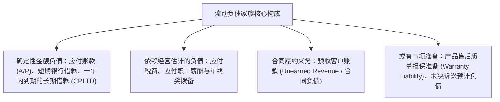
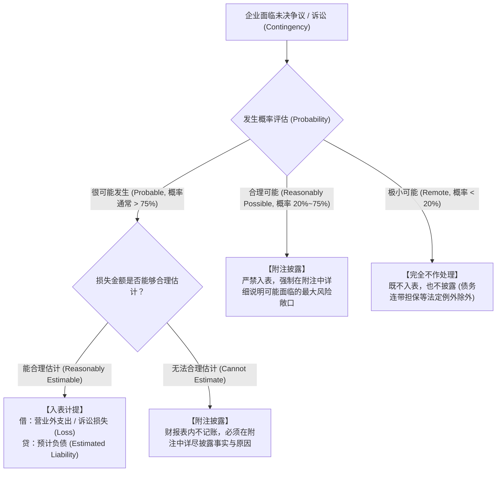

# Lec 18 流动负债与或有事项拨备 (Current Liabilities, Warranties and Contingencies)

> MIT Sloan School of Management · 15.501 Corporate Financial Accounting · 讲义 18

## TL;DR

- 流动负债作为企业短期周转的营运资本对冲项，必须在一年或一个正常营业周期内完成刚性清偿。
- 产品质量担保要求在确认产品销售收入的当期，依据大数法则同步预提预计保修负债与费用。
- 或有损失准则构建了发生概率与金额可测性的双维判定树，唯有很可能且可计量方可正式入表。
- 会计极度稳健性原则对或有收益实行严苛的表内封杀，任何或有利益在实际交割前绝对严禁入账。

## 流动负债的分类与营运结算机制

流动负债（Current Liabilities）是企业资产负债表右侧位于最顶端的债务存量。从法律与会计双重视角界定，流动负债必须满足以下清偿特征之一：
1. 预期在企业的一个正常**营业周期（Operating Cycle）**中清偿或消耗；
2. 主要为交易目的而持有；
3. 自资产负债表日起**一年以内（One Year）**到期应予清偿；
4. 企业无权自主地将清偿推迟至资产负债表日后一年以上。

## 产品售后质量保证的权责发生制配比

现代制造业向客户售出汽车、家用电器或消费电子产品时，通常附带为期 1 至 3 年的免费保修承诺。这种法定或商业质量保证构成了典型的**合同衍生法定义务**：

::: theorem 产品担保预提配比准则 (Warranty Accrual Principle)
根据权责发生制与配比原则：
1. 维修与零部件更换的真实经济成因，是**当期的产品销售行为**；
2. 即使实际的客户维修诉求与零部件耗费发生在 2 年之后，企业**必须在确认销售收入的同一会计期间**，根据历史故障率统计经验预先计提全部预计保修费用；
3. 严禁等到未来实际发生返修时才零星计入费用（收付实现制做法被绝对禁止）。
:::

::: example 质保准备全生命周期分录推演
某电动汽车制造企业当年销售新型智能汽车 1,000 台，单台售价 300,000 元（总营收 3 亿元）。工程风控部门根据路测大数据评估，未来 3 年质保期内平均每台车将发生 6,000 元的保修支出：
1. **销售当期期末计提质保准备**（预计总费用 $1,000 \times 6,000 = 6,000,000$ 元）：
   $$\text{借：销售费用 - 产品质量保证费 (Warranty Expense)} \quad 6,000,000 \quad / \quad \text{贷：预计负债 - 售后保修准备 (Warranty Liability)} \quad 6,000,000$$
   此时，利润表当期净利润如实扣减 600 万元，资产负债表流动负债增加 600 万元。
2. **次年实际发生客户返修**（实际领用备品备件库存 2,000,000 元，支付维修技师工时费现金 800,000 元）：
   $$\begin{aligned}
   \text{借：预计负债 - 售后保修准备 (Warranty Liability)} \quad 2,800,000 & \\
   & \text{贷：原材料 / 备品配件存货 (Inventory)} \quad 2,000,000 \\
   & \text{贷：银行存款 (Cash)} \quad 800,000
   \end{aligned}$$
   **实际发生维修时，仅冲减预提的负债存量，当期利润表利润完全不受任何波动影响**！
:::

## 或有事项准则（Contingencies, ASC 450）判定矩阵

在商业经营中，企业经常陷入各类结果具有高度不确定性的未决争议：专利侵权诉讼、跨国反垄断调查、环保巨额排污罚款或为关联公司提供的贷款连带担保。这类事项被称为**或有损失（Loss Contingencies）**。

会计准则委员会（FASB ASC 450）通过**发生概率（Probability）**与**金额可测性（Estimability）**两大维度构建了刚性判定矩阵：

| 发生概率层级 (Probability) | 法律与经济学概率范畴 | 金额可合理估计时的会计处理 | 金额无法合理估计时的会计处理 |
| :--- | :--- | :--- | :--- |
| **很可能 (Probable)** | 未来不利事件极大概率发生（司法判例明确不利，行业惯例判赔率 $75\%+$） | **强制入表计提**：在表内同时确认负债与利润表损失 | **附注充分披露**：说明未决诉讼进展及无法测算金额的理由 |
| **合理可能 (Reasonably Possible)** | 发生的概率超过微乎其微，但尚未达到很可能（双方各执一词，胜负难料） | **附注充分披露**：严禁在资产负债表列示负债 | **附注充分披露**：披露案件背景与诉讼请求 |
| **极小可能 (Remote)** | 发生赔偿的可能性微乎其微（原告恶意诉讼，缺乏事实依据） | **既不入账，亦无需披露**（豁免披露） | **既不入账，亦无需披露** |

::: pitfall 稳健性原则对“或有收益（Gain Contingencies）”的绝对封杀
初学者常以为会计准则对“或有损失”和“或有收益”是对称处理的。**这是极大的误解**！
- 如果企业起诉竞争对手侵权并在一审中胜诉获赔 5,000 万元，即便二审维持原判的概率高达 95%（Probable），根据**极度审慎原则（Extreme Conservatism）**：
- **企业在终审判决生效且现金实际到账前，绝对严禁在财报表内确认任何“应收赔偿款”或“营业外收入”**！
- 企业仅能在附注中以极其谨慎的措辞进行有限说明，严防向二级市场投资者传递虚假繁荣信号。
:::

## 我的理解

::: insight 或有负债附注是做空机构猎杀财务黑天鹅的藏宝图
在股票市场与信用评级分析中，最致命的灰犀牛往往不是表内已有的几十亿银行借款，而是潜伏在财报附注深处的“或有负债”：
1. **附注措辞的微言大义**：上市公司的法务部门和审计师在披露诉讼时会字斟句酌。一旦发现附注描述由“Management believes the claims are without merit and the likelihood of loss is remote（公司认为诉求毫无根据，败诉概率极小）”转变为“A loss is reasonably possible but cannot be estimated（存在合理发生损失的可能，但金额无法估计）”，这通常意味着司法调解已出现重大恶化，巨额判赔黑天鹅即将在下个季度破壳而出。
2. **表外连带互保链的连锁猝死**：在中国民营制造业与中小企业集中的板块，“为第三方债务提供连带责任保证（Financial Guarantees）”是引发群体性破产的最常见导火索。虽然按正常经营假定担保违约属于 Remote 而无需入表，但一旦互保圈中有一家资金链断裂，银行便会依约要求连带担保人承担代偿责任，原本表外的潜在风险瞬间转化为数亿元的硬兑付挤兑，瞬间将企业拉入清算深渊。
:::
