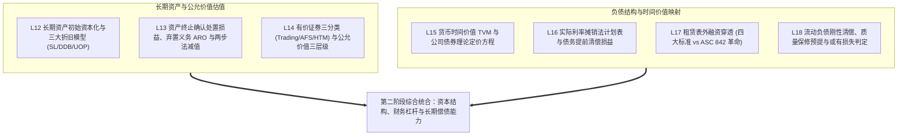
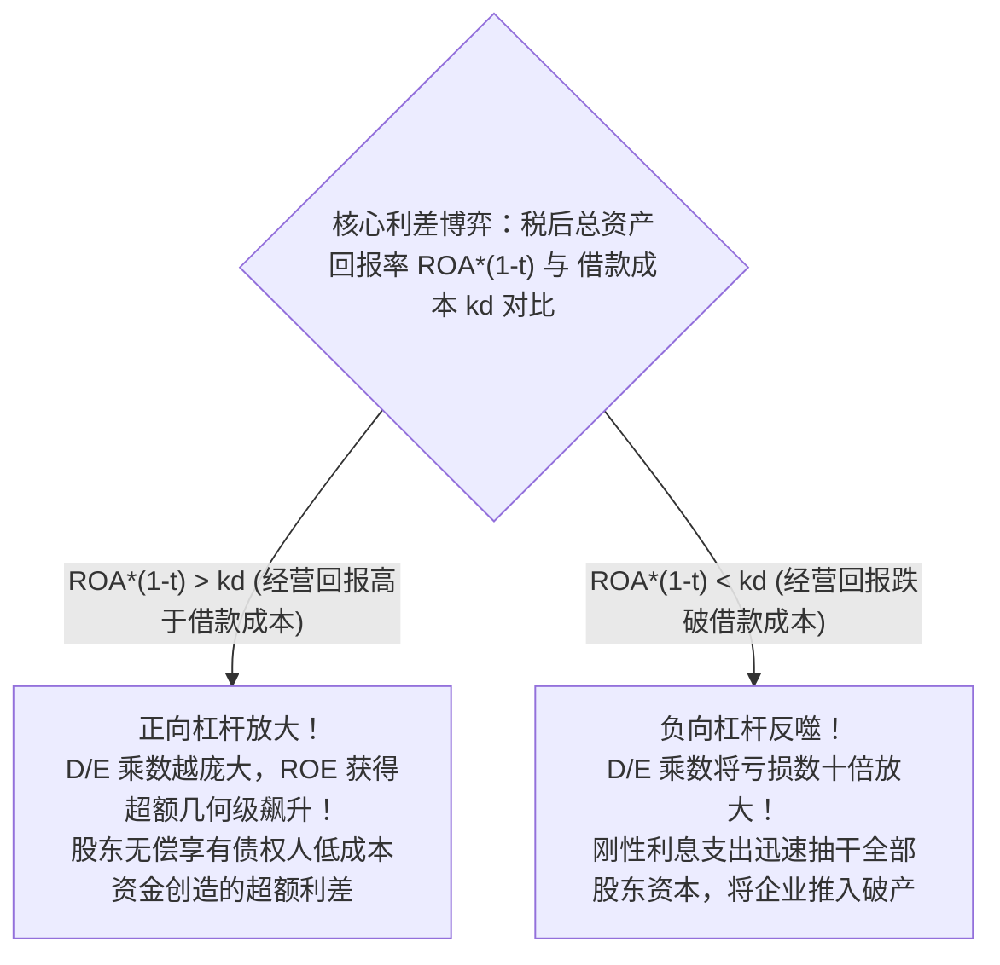

# Lec 19 负债与权益结构期中专题复盘 (Midterm 2 Review: Liabilities, TVM & Lease Valuation)

> MIT Sloan School of Management · 15.501 Corporate Financial Accounting · 讲义 19

## TL;DR

- 期中核心专题全面统合长期营运资产计量、金融证券投资、货币时间价值与负债融资架构。
- 财务杠杆方程揭示了债务资本通过利差放大净资产收益率与加剧财务破产风险的客观双刃剑规律。
- 长期偿债能力评估必须穿透名义资产负债表，综合考量利息保障倍数与不可撤销固定租赁支出。
- 第二阶段考点综合检验跨期摊销计划表的严谨性、两步法减值的边界控制以及表外或有敞口排查。

## 负债与资本结构知识网络拓扑映射

麻省理工学院斯隆管理学院开设的 15.501 第二核心模块，完成了从企业短期流动营运资本（应收、存货、现金流）向长期资本配置与结构化外部融资的重大战略跨越。本专题复盘的核心目标，是将资产端的长期资产沉淀、公允价值计量与负债端的跨期契约承诺、时间价值贴现紧密缝合，构建起一套对现代公司资本全貌的高维透视框架。

从整个会计体系的结构演进来看，企业的资产负债表右侧本质上是对左侧资产所有收益与风险的契约性切分。债权人通过债券与借款合约索取固定的利息与本金回报，优先受偿但放弃了企业超额增长的上行红利；承租人通过租赁契约获得资产的使用权，在避免巨额初始资本开支的同时背负了刚性跨期给付义务；而普通股股东则承担着最底层的经营波动风险，享受扣除一切外部索偿权之后的全部剩余净收益。

贯穿这一模块所有技术细节的唯一下层公理，是**货币时间价值（TVM）**与**复利贴现算法**。无论是在资产端评估重型机器生产线的两步法减值现值、远期海洋钻井平台拆卸弃置义务（ARO）的折现累积，还是在负债端测算公司债券溢折价的实际利率吸收进度、使用权资产与租赁负债的现值入表，学员面对的都是同一套数学逻辑在不同商业场景下的同构映射。

## 长期偿债能力与资本结构比率体系

评估企业长期生存韧性与违约防御纵深，必须运用**偿债能力比率（Solvency Ratios）**：

### 1. 静态资产负债结构比率
- **资产负债率 (Debt to Assets Ratio)**：
  $$\text{资产负债率} = \frac{\text{总负债 (Total Liabilities)}}{\text{总资产 (Total Assets)}}$$
- **产权比率 / 债务权益比 (Debt-to-Equity Ratio, D/E)**：
  $$\text{D/E 比率} = \frac{\text{总负债}}{\text{股东权益总额 (Shareholders' Equity)}}$$
  该比率直接衡量债权人投入资本与股东风险资本的相对安全边际。对于重资产工业，D/E 通常在 $1.0 \sim 1.5$ 之间；而轻资产科技企业往往保持在 $0.5$ 以下。

### 2. 动态现金流与利息覆盖比率
- **利息保障倍数 / 已获利息倍数 (Times Interest Earned, TIE)**：
  $$\text{TIE} = \frac{\text{息税前利润 (EBIT)}}{\text{利息费用 (Interest Expense)}}$$
  该比率表明企业依靠当期经营收益覆盖债权利息的倍数底线。若 $\text{TIE} < 1.0$，意味着企业核心主营利润无法全额支付借款利息，必须依靠变卖资产或借新还旧度日。
- **固定费用保障倍数 (Fixed Charge Coverage, FCC)**：将不可撤销的长期租赁支出纳入考量：
  $$\text{FCC} = \frac{\text{EBIT} + \text{最低租赁支出}}{\text{利息费用} + \text{最低租赁支出}}$$

## 财务杠杆的双刃剑效应数学推导

企业通过负债融资并非仅为了填补资金缺口，更核心的诉求在于利用**财务杠杆（Financial Leverage）**撬动股东回报。净资产收益率（ROE）与总资产报酬率（ROA）之间的数学传导机制如下：

::: theorem 财务杠杆放大方程 (Financial Leverage Equation)
设企业总资产为 $A$，总负债为 $D$，股东权益为 $E$（满足 $A = D + E$）；总资产报酬率为 $\text{ROA}$，税后债务资本成本为 $k_d$，实际企业所得税率为 $t$：

$$\text{ROE} = \frac{\text{税后净利润}}{E} = \frac{[\text{EBIT} - \text{Interest}] \times (1 - t)}{E}$$

由于 $\text{EBIT} = A \times \text{ROA}$，且 $\text{Interest} = D \times \text{债务名义利率}$，代入展开整理可得：

$$\text{ROE} = \text{ROA} \times (1 - t) + \left[ \text{ROA} \times (1 - t) - k_d \right] \times \frac{D}{E}$$
:::

::: example 杠杆效益数值演练
某企业总资产 1,000 万元，税后债务成本 $k_d = 5\%$：
- **方案 A（无杠杆）**：全权益资助（$D = 0, E = 1,000$ 万元）；
- **方案 B（高杠杆）**：债务 800 万，权益 200 万（$\frac{D}{E} = 4.0$）。

1. **宏观景气年份（税后 $\text{ROA} = 10\%$）**：
   - 方案 A 的 ROE：$10\%$；
   - 方案 B 的 ROE：$10\% + (10\% - 5\%) \times 4.0 = 10\% + 20\% = 30\%$（杠杆将股东回报放大了整整 3 倍！）。
2. **宏观衰退年份（税后 $\text{ROA} = 2\%$，跌破借款成本 5%）**：
   - 方案 A 的 ROE：$2\%$（仍保本存活）；
   - 方案 B 的 ROE：$2\% + (2\% - 5\%) \times 4.0 = 2\% - 12\% = -10\%$（股东权益瞬间遭遇重度吞噬）。
:::

## 期中第二模块典型综合陷阱复盘

::: pitfall 容易混淆的长期会计处理误区
1. **折旧与减值的顺序颠倒**：
   - 在测试资产减值前，**必须首先补提当期截至测试日的折旧**，确定当期基准账面净值；
   - 严禁在未结转折旧的情况下直接对比公允价值。
2. **债券提前清偿损益的计算基准**：
   - 清偿利得损失的参照系是“**清偿日当期经实际利率摊销后的最新账面净值**”，而不是发行初期的面值或历史发行价；
   - 账面折价或溢价在清偿日尚未摊销的余额，必须全额同步冲销注销。
3. **经营租赁在附注披露中的现值漏折**：
   - 附注披露的未来 5 年最低租赁付款额是名义金额（Nominal Cash Flows），若要衡量其真实表外负债负担，必须使用增量借款利率折算为现值，严禁直接求和。
4. **或有事项的极度审慎不对称性**：
   - 或有损失很可能且可估计即入表，或有收益即使概率 99% 也只能附注披露甚至不披露。
:::

## 我的理解

::: insight 债务不是罪恶，但错配的债务是商业死穴
在公司金融与财务战略的交叉点上，企业死于负债的案例比比皆是，但根源往往不是负债规模本身，而是资本配置的“三维错配”：
1. **期限错配（以短融长）**：企业将 6 个月到期的短期商业票据，投向建设周期长达 5 年的重工产业园。一旦宏观金融去杠杆导致银行收紧信贷，即便产业园未来盈利前景再广阔，企业也会在项目建到一半时因几千万元短期借款断档而轰然倒闭。
2. **币种与现金流错配**：拉美或东南亚企业借入大量低息美元外债，但主营业务收入完全是本地货币。一旦美联储开启加息周期引发汇率暴跌，本币大幅贬值使得债务本息按本币折算瞬间暴涨数倍，企业被动陷入债务危机。
3. **收益率与成本倒挂的杠杆惯性**：在行业下行期，许多管理层盲目迷信过去的杠杆神话，在总资产回报率已经跌破银行借款利率时依然抱侥幸心理大举借债扩张。根据杠杆方程，这种“负利差下的借债”每一天都在以指数级侵蚀股东仅剩的净资产底线。
:::
