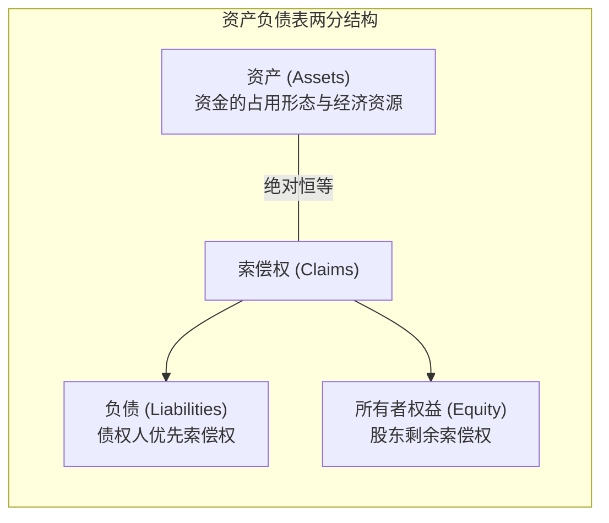

# Lec 02 资产负债表与复式记账机制 (The Balance Sheet and Transaction Recording)

> MIT Sloan School of Management · 15.501 Corporate Financial Accounting · 讲义 02

## TL;DR

- 会计恒等式 $\text{资产} = \text{负债} + \text{所有者权益}$ 是复式记账法维系静态平衡与动态流转的公理基准。
- 资产与负债的确认必须同时满足经济利益流向、法定排他控制或现时不可推卸义务、过去交易源起以及可靠计量四大要件。
- 借贷记账法以借（Debit）和贷（Credit）表达资金占用与来源，借贷必相等确保单笔交易与账户汇总的自洽闭环。
- 交易分析矩阵将复杂的经济活动映射为资产、负债与权益要素的代数增减，构筑财务建模与试算平衡的基石。

## 资产负债表构件与经济学定义

资产负债表（Balance Sheet）是一份反映企业在某一**特定时点（Snapshot）**财务状况的静态报表。从经济学视角看，资产负债表左侧表达企业所支配的经济资源总量，右侧表达外部债权人与内部股东对这些资源所拥有的排他性索偿权（Claims）。



### 1. 资产的确认要件与流动性分类
::: definition 资产 (Assets)
资产是由企业过去的交易或者事项形成的、由企业拥有或者控制的、预期会给企业带来经济利益的资源。
:::

确认为资产必须满足四大硬性边界条件：
1. **过去交易源起**：未来计划签署的采购意向书或潜在商机不得确认为资产；
2. **法定排他控制权**：企业必须拥有该项资源的法定所有权或实质性控制权（排除员工个人智力资本）；
3. **预期经济利益流入**：该资源能直接或间接产生未来净现金流入；
4. **可靠计量属性**：成本或公允价值能够被客观验证。

在报表中，资产按**流动性从高到低（Liquidity）**严格排序：
- **流动资产 (Current Assets)**：预期在一年或一个正常营业周期内变现、出售或耗用的资产（现金及现金等价物、短期有价证券、应收账款、存货、预付款项）。
- **非流动资产 (Non-Current Assets)**：长期投资、厂房与设备（PP&E）、使用权资产、无形资产（专利权、特许经营权）、商誉。

### 2. 负债的现时义务与清偿顺序
::: definition 负债 (Liabilities)
负债是企业过去的交易或者事项形成的、预期会导致经济利益流出企业的现时法定义务或推定不具推卸性的义务。
:::

负债按**到期期限从近到远（Maturity）**排序：
- **流动负债 (Current Liabilities)**：需在一年或一个营业周期内用流动资产清偿或用其他流动负债替换的义务（应付账款、短期借款、应付工资、应付税费、预收账款/合同负债、一年内到期的长期负债）。
- **长期负债 (Long-Term Liabilities)**：长期借款、应付公司债券、长期租赁负债、递延所得税负债。

### 3. 所有者权益与剩余索偿权
所有者权益（Shareholders' Equity / Net Assets）代表扣除全部负债后股东享有的**剩余权益（Residual Interest）**。破产清算时，债权人拥有绝对的优先受偿权，股东承担最终商业风险：

$$\text{股东权益} = \text{实收资本 / 普通股股本 (Common Stock)} + \text{资本公积 (APIC)} + \text{留存收益 (Retained Earnings)} - \text{库存股 (Treasury Stock)}$$

## 会计恒等式与动态拓展方程

财务会计体系构建在唯一的绝对公理之上：

::: theorem 基础会计恒等式 (Fundamental Accounting Equation)
$$\text{资产 (Assets)} = \text{负债 (Liabilities)} + \text{所有者权益 (Shareholders' Equity)}$$
:::

由于当期净利润（Net Income）最终通过期末结账结转至留存收益（Retained Earnings），会计恒等式可以展开为包容经营流量的**动态扩展方程**：

$$\text{期末留存收益} = \text{期初留存收益} + \text{当期净利润} - \text{宣告股利 (Dividends)}$$

$$\text{当期净利润} = \text{收入 (Revenues)} - \text{费用 (Expenses)}$$

代入基础等式可得：

$$\text{资产} = \text{负债} + \text{实收资本} + \text{期初留存收益} + \text{收入} - \text{费用} - \text{宣告股利}$$

移项整理为全部正向增量的形式：

$$\text{资产} + \text{费用} + \text{宣告股利} = \text{负债} + \text{实收资本} + \text{期初留存收益} + \text{收入}$$

该式直接确立了复式记账法借贷平衡规则的代数源头：左侧项目增加记借方，右侧项目增加记贷方。

## 借贷记账法的符号体系与流转规则

借（Debit, Dr.）与贷（Credit, Cr.）在现代会计中纯粹是代数方向符号，没有任何日常语言中的“借钱”或“欠款”褒贬含义：

```mermaid
flowchart TD
    subgraph DebitRule [借方 Debit (Dr.) 增加]
        A1["资产增加 (Assets ↑)"]
        A2["费用发生 (Expenses ↑)"]
        A3["股利宣告 (Dividends ↑)"]
    end

    subgraph CreditRule [贷方 Credit (Cr.) 增加]
        C1["负债增加 (Liabilities ↑)"]
        C2["实收资本增加 (Equity ↑)"]
        C3["收入赚取 (Revenues ↑)"]
    end
```

| 账户大类 | 增加记方 | 减少记方 | 正常余额方向 (Normal Balance) |
| :--- | :--- | :--- | :--- |
| **资产类 (Assets)** | **借 (Debit)** | 贷 (Credit) | **借方余额** |
| **负债类 (Liabilities)** | 借 (Debit) | **贷 (Credit)** | **贷方余额** |
| **所有者权益 (Equity)** | 借 (Debit) | **贷 (Credit)** | **贷方余额** |
| **收入类 (Revenues)** | 借 (Debit) | **贷 (Credit)** | **贷方余额** |
| **费用类 (Expenses)** | **借 (Debit)** | 贷 (Credit) | **借方余额** |
| **备抵账户 (Contra Accounts)** | 与其主账户增减规则严格相反（如累计折旧为资产备抵，贷方增加） | | 贷方余额 |

::: theorem 复式记账守恒定理
1. 每一笔独立经济业务，必须同时且等额登记在至少一个账户的借方和一个账户的贷方；
2. **有借必有贷，借贷必相等**；
3. 全部账户借方发生额合计恒等于全部账户贷方发生额合计；
4. 全部账户期末借方余额合计恒等于全部账户期末贷方余额合计。
:::

## 经典交易分析矩阵实战

以企业初创期八笔代表性经济业务为例，演示交易如何映射至资产负债表各科目：

::: example 典型交易全景拆解
1. **股东现金注资 100,000 元**：
   - 资产（现金）$+100,000$；所有者权益（实收资本）$+100,000$；借贷平衡。
2. **向商业银行借入 3 年期长期借款 50,000 元**：
   - 资产（现金）$+50,000$；负债（长期借款）$+50,000$；资产与负债同增。
3. **购置生产设备一台，价值 60,000 元，现金支付 20,000 元，余款开具应付票据**：
   - 资产（固定资产）$+60,000$；资产（现金）$-20,000$；负债（应付票据）$+40,000$；净资产不变。
4. **赊购原材料 15,000 元**：
   - 资产（存货）$+15,000$；负债（应付账款）$+15,000$。
5. **销售一批商品，售价 30,000 元收到现金，该批商品历史生产成本 18,000 元**：
   - 交易拆分为两步：
     - a. 确认收入：资产（现金）$+30,000$；权益（未分配利润/主营业务收入）$+30,000$；
     - b. 结转成本：资产（存货）$-18,000$；权益（未分配利润/主营业务成本）$-18,000$；
     - 最终净效应：资产净增 $12,000$，权益净增 $12,000$（毛利）。
6. **赊销商品 25,000 元，成本 14,000 元**：
   - 资产（应收账款）$+25,000$；资产（存货）$-14,000$；权益（净利润）$+11,000$。
7. **现金偿还供应商前期货款 10,000 元**：
   - 资产（现金）$-10,000$；负债（应付账款）$-10,000$。
8. **宣告并派发现金股利 5,000 元**：
   - 资产（现金）$-5,000$；权益（留存收益）$-5,000$。
:::

将上述交易汇编为**交易分析矩阵（Transaction Worksheet）**：

| 交易序号 | 现金 (Cash) | 应收 (A/R) | 存货 (Inv) | 设备 (PP&E) | ＝ | 应付 (A/P) | 票据/借款 | ＋ | 股本 (Stock) | 留存收益 (RE) |
| :---: | :---: | :---: | :---: | :---: | :---: | :---: | :---: | :---: | :---: | :---: |
| 1 | +100,000 | | | | ＝ | | | ＋ | +100,000 | |
| 2 | +50,000 | | | | ＝ | | +50,000 | ＋ | | |
| 3 | -20,000 | | | +60,000 | ＝ | | +40,000 | ＋ | | |
| 4 | | | +15,000 | | ＝ | +15,000 | | ＋ | | |
| 5 | +30,000 | | -18,000 | | ＝ | | | ＋ | | +12,000 |
| 6 | | +25,000 | -14,000 | | ＝ | | | ＋ | | +11,000 |
| 7 | -10,000 | | | | ＝ | -10,000 | | ＋ | | |
| 8 | -5,000 | | | | ＝ | | | ＋ | | -5,000 |
| **期末余额** | **145,000** | **25,000** | **-17,000(误)** -> **+15k-32k需补** | **60,000** | ＝ | **5,000** | **90,000** | ＋ | **100,000** | **18,000** |

期末资产合计：$145,000 + 25,000 - 17,000 + 60,000 = 213,000$（假设期初存货为 20,000 元，期末存货为 3,000 元，总资产为 233,000 元）；负债与权益合计：$5,000 + 90,000 + 100,000 + 18,000 = 213,000$。两侧代数和始终严丝合缝。

## 我的理解

::: insight 资产负债表不是企业的市场估值清单
许多非财务专业管理者常犯的一个严重认知错误，是将资产负债表上的“股东权益合计”等同于“公司的真实市场价值”：
1. **历史成本与通胀的遮蔽**：资产按历史成本计提折旧，无法反映土地、核心厂区等不动产随宏观经济环境发生的大幅升值。
2. **最核心无形资产的“表外化”**：根据会计稳健性原则，企业内部自主研发形成的代码库（如 Google 的搜索算法）、品牌商誉（如可口可乐的百年品牌）、企业文化与卓越的员工组织能力，其研发与建设成本在发生当期已全额计入费用，并未形成表内资产。
3. **市净率（P/B Ratio）的经济学内涵**：高科技与轻资产企业的股价往往是每股净资产的数倍乃至数十倍（$P/B \gg 1$）。这个巨大的溢价，正是市场对企业未在资产负债表上列示的“未来超额经济利润创造能力（Economic Goodwill）”的公允贴现。资产负债表提供的是企业资本投入的历史底线防护网，而非市场估值天花板。
:::
