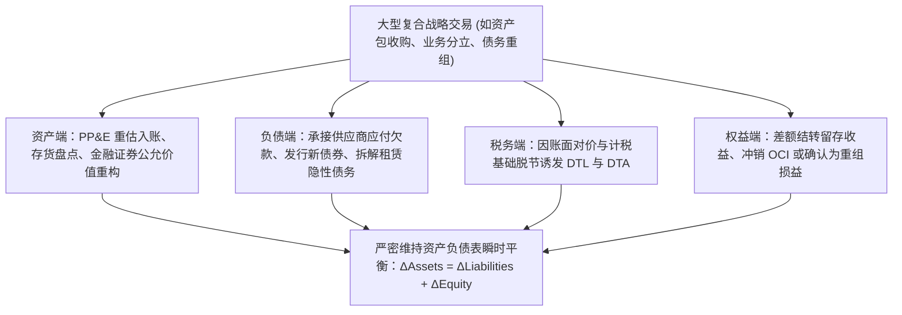
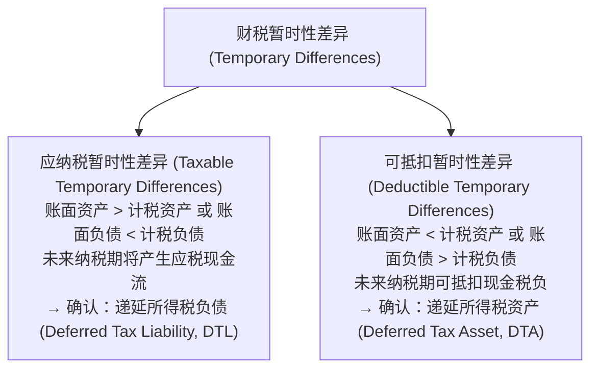

# Lec 20 资产负债综合计量实务检阅 (Midterm 2 Synthesis & Complex Transaction Review)

> MIT Sloan School of Management · 15.501 Corporate Financial Accounting · 讲义 20

## TL;DR

- 复杂商业交易往往跨越多个资产与负债科目，要求分析师具备端到端的代数守恒分解能力。
- 递延所得税体系通过应纳税与可抵扣暂时性差异，精密配平了税法与财务报告的时间性错位。
- 递延所得税资产的确认受到“更有可能（大于 50%）”实现门槛与估值备抵科目的刚性约束。
- 真实商业综合案例全面检阅了有价证券循环转回、债务提前注销与长期租赁穿透的复合分录。

## 复杂经济交易的多要素交叉映射

在实际商业世界的复杂经营环境中，企业的重大经济业务极少表现为教科书式的单一资产或负债科目的孤立增减。当一家跨国公司实施资产包收购、业务分拆上市、战略债务重组或重型生产线整体升级时，其所触及的法律条文与经济实体往往牵一发而动全身。这种复合型战略业务要求财务分析师与管理层具备高超的多要素端到端解构能力。

在一笔典型的一揽子交易中，企业在资产端可能需要同时处理二手固定资产的公允价值评估、存货现行重置成本的盘点核实，以及持有至到期或可供出售金融资产的分类再认定；在负债端，不仅需要清算并继承被收购方遗留的未结商业欠款与供应链票据，还往往伴随着定向发行附带折溢价的新公司债券、对被收购方表外隐性长约租赁的强制穿透并表，以及针对未决诉讼与环保责任的预计负债拨备。

与此同时，上述资产与负债在财务账面上的重估确认，必然与税务机关核定的计税基础（Tax Basis）产生严重脱节，从而自发衍生出巨额的递延所得税负债（DTL）或递延所得税资产（DTA）。如果收购支付的总对价超出了所取得的可辨认净资产公允价值总额，其不可追踪的剩余差额还必须在所有者权益与商誉之间进行精密的代数分配。无论业务链条多么错综复杂，借贷必相等的复式记账法恒等公理始终是维系资产负债表自洽平衡的唯一准绳。

## 递延所得税（Deferred Taxes）综合分析体系

现代企业财务报告中最易引发分析偏差的领域，莫过于**递延所得税（ASC 740）**的资产与负债平衡机制。税法规则（Tax Code）服务于财政收入征管与产业政策刺激，而通用会计准则（GAAP）服务于真实业绩衡量，两者必然产生暂时性差异（Temporary Differences）：

::: definition 递延所得税资产与负债
- **递延所得税负债 (DTL)**：由于当期会计税前利润高于应纳税所得额，企业享受了合法的税款延迟缴纳红利，记录为一项企业未来必须履行的递延税负法定义务（如采用 MACRS 加速折旧）；
- **递延所得税资产 (DTA)**：由于企业在会计上提前计提了费用（如坏账准备、售后质量担保准备、未决诉讼损失），而税法只允许在实际违约或实际维修付现时才准予税前扣除，导致企业当期提前多交了所得税，记录为一项未来可用于抵减应交税款的未来经济利益流入。
:::

### 递延所得税资产的估值备抵（Valuation Allowance）
与应收账款计提坏账准备相同，DTA 作为一项资产，其未来变现完全取决于企业在未来结转期内能否产生充足的税前应税利润：

::: theorem 更有可能实现标准 (More-Likely-Than-Not Criterion)
根据 ASC 740 规定：
1. 如果根据现有可获取的所有积极与消极证据，企业未来无法产生足够应税利润来抵扣该项 DTA 的可能性**超过 50%（More Likely Than Not）**；
2. 企业必须建立对冲备抵账户——**递延所得税资产估值备抵（DTA Valuation Allowance）**；
3. 借记“所得税费用（Income Tax Expense）”，贷记“递延所得税资产估值备抵”，直接冲减当期净利润。
:::

## 复杂综合业务实战：一揽子资产并购与负债承接

以下案例全面检阅了学员对固定资产、存货、债券清偿、租赁入表与所得税的综合处理功底：

::: example 复合交易全景模拟
先锋科技公司以 500,000 美元现金外加发行面值 300,000 美元的 5 年期公司债券（票面利率 6%，此时市场利率为 8%，债券发行价为 276,048 美元），一揽子收购了某破产竞对的特许制造资产包。

该资产包包含：
- 公允价值为 400,000 美元的专用机床生产线；
- 公允价值为 200,000 美元的原材料存货；
- 承接原企业尚未到期的未决产品质量诉讼准备 50,000 美元（很可能败诉且金额确定）；
- 原企业有一项不可撤销厂房租赁（未来 4 年每年末付租金 30,000 美元，按 8% 增量借款利率折现现值为 $30,000 \times 3.3121 = 99,363$ 美元），按 ASC 842 纳入表内核算；
- 适用所得税率为 25%，该收购符合免税重组条款，机器设备的账面价值与计税基础差异产生 25,000 美元递延所得税负债（DTL）；
- 支付总对价公允价值与净资产公允价值差额确认为商誉。

**对价与资产负债拆解**：
1. **实际支付总公允对价**：现金 $500,000$ ＋ 债券实际公允发行价 $276,048 = 776,048$ 美元；
2. **取得的各项净资产公允价值合计**：
   - 资产端：PP&E $400,000$ ＋ 存货 $200,000$ ＋ 租赁使用权资产 $99,363 = 699,363$ 美元；
   - 负债端：诉讼预计负债 $50,000$ ＋ 租赁负债 $99,363$ ＋ 递延所得税负债 $25,000 = 174,363$ 美元；
   - 净资产公允价值：$699,363 - 174,363 = 525,000$ 美元；
3. **确认商誉 (Goodwill)**：
   $$\text{商誉} = \text{支付总对价 } (776,048) - \text{取得的可辨认净资产公允价值 } (525,000) = 251,048 \text{ 美元}$$

**编制复合日记账分录**：
$$\begin{aligned}
\text{借：固定资产 (PP\&E)} \quad 400,000 & \\
\text{借：存货 (Inventory)} \quad 200,000 & \\
\text{借：使用权资产 (ROU Asset)} \quad 99,363 & \\
\text{借：商誉 (Goodwill)} \quad 251,048 & \\
\text{借：应付债券折价 (Discount on Bonds)} \quad 23,952 & \quad (300,000 - 276,048) \\
& \text{贷：银行存款 (Cash)} \quad 500,000 \\
& \text{贷：应付债券面值 (Bonds Payable)} \quad 300,000 \\
& \text{贷：预计负债 - 诉讼准备} \quad 50,000 \\
& \text{贷：租赁负债 (Lease Liability)} \quad 99,363 \\
& \text{贷：递延所得税负债 (DTL)} \quad 25,000
\end{aligned}$$
借方合计：$974,363 + 251,048 = 1,225,411$（含折价）；贷方合计：$1,225,411$。全表严格借贷自洽。
:::

## 我的理解

::: insight 财务复杂性往往是企业管理层掩盖核心危机的烟雾弹
在对上市公司进行深度法证会计调查时，有一个屡试不爽的规律：**企业的资产负债表越复杂，注脚越多，衍生结构越眼花缭乱，其真实的商业模式往往越脆弱**：
1. **用商誉吸收溢价黑洞**：在并购中，只要买方支付了高昂对价，任何算不清、无法落地的未来溢价全部被打包归入“商誉（Goodwill）”。商誉不需要逐年折旧，只在年底做主观性极强的减值测试，这为管理层在并购当年美化报表提供了天然避难所。
2. **DTA 估值备抵的政治博弈**：当陷入亏损的企业突然在某一季度转回大额 DTA 估值备抵时，利润表会凭空出现数千万美元的“所得税收益（负所得税费用）”，使得每股收益奇迹般由负转正。然而这种利润没有一分钱现金支撑，完全源于管理层在模型中调高了对未来盈利的乐观假设。
3. **看穿纸面迷局的核心准绳**：面对任何复杂的资本重组与资产负债调整，分析师必须剥离所有折溢价摊销、商誉公允价值分配与递延税款的账面游戏，直截了当地问三个底线问题：**这笔交易企业究竟实际掏出了多少真金白银？未来每年必须偿付的刚性现金本息是多少？新增业务能否在不依赖外部输血的前提下创造出超越资本成本的自由现金流？**
:::
