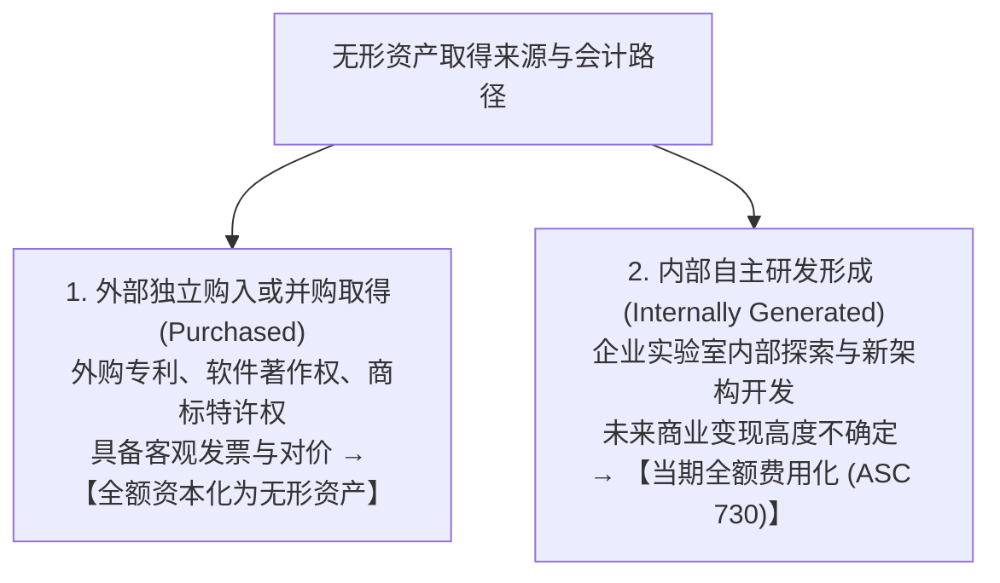
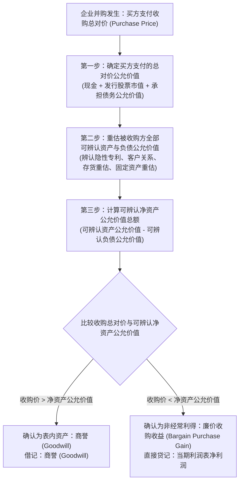
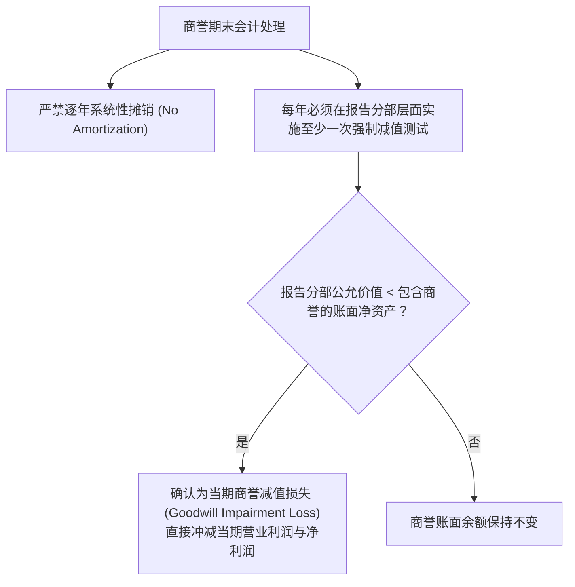

# Lec 21 无形资产、企业合并与商誉减值 (Intangibles, Business Combinations, Purchase Price Allocation & Goodwill)

> MIT Sloan School of Management · 15.501 Corporate Financial Accounting · 讲义 21

## TL;DR

- 无形资产确认遵循内外来源有别的双轨制，自主研发内部形成支出在发生当期强制全额费用化。
- 企业合并必须采用收购法核算，支付总对价必须逐项分摊至被收购方各项可辨认净资产的公允价值。
- 溢价收购中不可辨认的超额溢价沉淀为商誉，商誉严禁逐年摊销而必须每年强制实施减值测试。
- 商誉减值损失一经计提在美股与国际准则下均永久锁定，严防企业借助商誉蓄水池进行利润操纵。

## 无形资产确认的双轨制与自主研发费用化

在现代知识经济中，专利算法、芯片架构、医药配方和品牌商标等**无形资产（Intangible Assets）**构成了头部企业最核心的护城河。然而在会计核算上，无形资产的入表规则却呈现出高度不对称的“双轨制”：

::: theorem 研发支出全额费用化准则 (ASC 730 / US GAAP)
1. 企业在内部进行的所有科学探索、技术研发与方案试制支出（Research and Development, R&D），**在发生当期必须无条件全额计入利润表研发费用**；
2. 即使该项研发最终成功申请了全球垄断性发明专利，其此前投入的数亿元研发资金也**绝对严禁事后重新资本化为资产**；
3. 申请专利时发生的官方注册费、法务律师费等微小直接支出方可资本化；
4. **有限寿命无形资产**（如 20 年专利权）采用直线法逐年摊销；**不确定使用寿命无形资产**（如知名品牌商标）不计提摊销，但每年必须进行减值测试。
:::

::: example 科技巨头的账面“隐性资产”
辉瑞（Pfizer）耗费 20 亿美元研发出革命性专利新药，这 20 亿美元已全额冲减了过去几年的净利润，资产负债表上的专利资产账面值仅为几十万美元的律师注册费；然而若辉瑞以 50 亿美元将该专利卖给诺华制药（Novartis），诺华却能合法地在资产负债表上将这笔资产按 50 亿美元“外购无形资产”资本化入账。这种内外有别的制度设计，体现了会计准则对“可验证性”高于一切的执着。
:::

## 企业合并与收购法（The Acquisition Method）

当一家企业取得另一家企业的控制权时（持股通常超过 50%），根据 FASB ASC 805 准则，必须统一采用**收购法（The Acquisition Method）**进行会计处理（传统的权益结合法已被彻底废除）。

::: definition 购买价格分摊 (Purchase Price Allocation, PPA)
在企业合并日，将买方支付的收购总成本，系统性分摊至所取得的被收购方各项**可辨认有形资产、无形资产以及所承担负债的公允价值**的会计程序。分摊后的剩余溢价差额确认为商誉：
$$\text{商誉 (Goodwill)} = \text{企业合并总对价} - \text{取得的可辨认净资产公允价值 (Fair Value of Identifiable Net Assets)}$$
:::

## 经典并购 PPA 测算全景演练

大洋工业以 1,200 万美元现金全资收购先锋电子 100% 股权。收购日前先锋电子的账面资产负债表与独立评估师核定的公允价值如下：

| 会计报表科目 | 历史账面价值 (Book Value) | 资产评估公允价值 (Fair Value) | 公允价值增减变动原因 |
| :--- | :---: | :---: | :--- |
| 货币资金及应收款 | 100 万美元 | 100 万美元 | 流动性资产，账面等于公允 |
| 存货 (Inventory) | 150 万美元 | 180 万美元 | 原材料现行重置成本上涨 30 万 |
| 厂房与设备 (PP&E) | 300 万美元 | 450 万美元 | 工业地块与核心机床升值 150 万 |
| 未入表专利权 (Patents) | 0 美元 | 200 万美元 | 内部研发被准则费用化的核心芯片算法 |
| 承担的应付及长期负债 | (200 万美元) | (200 万美元) | 负债公允价值等于账面债务 |
| **净资产合计** | **350 万美元** | **730 万美元** | **可辨认净资产公允价值为 730 万** |

::: example PPA 差额分解与商誉确认
1. **可辨认净资产公允价值**：$100 + 180 + 450 + 200 - 200 = 730$ 万美元；
2. **确认商誉金额**：
   $$\text{商誉 (Goodwill)} = \text{收购总对价 (1,200 万)} - \text{净资产公允价值 (730 万)} = 470 \text{ 万美元}$$
3. **合并日会计借贷分录**：
   $$\begin{aligned}
   \text{借：货币资金及应收款} \quad 1,000,000 & \\
   \text{借：存货 (按公允价值)} \quad 1,800,000 & \\
   \text{借：固定资产 (按公允价值)} \quad 4,500,000 & \\
   \text{借：无形资产 - 专利权} \quad 2,000,000 & \\
   \text{借：商誉 (Goodwill)} \quad 4,700,000 & \quad / \quad \text{贷：应付及长期负债} \quad 2,000,000 \\
   & \quad / \quad \text{贷：银行存款 (支付现金)} \quad 12,000,000
   \end{aligned}$$
:::

## 商誉减值测试与永久锁定机制（ASC 350）

在传统会计中，商誉曾被允许在不超过 40 年的期限内逐年平均摊销。然而 FASB 认为商誉代表协同效应与未来超额超额盈利潜能，可能永久保值甚至增值。因此现代准则确立了全新的**商誉减值测试体系**：

::: pitfall 商誉减值的不可转回铁律
与固定资产减值相同，美股 GAAP 与国际 IFRS 达成高度一致的绝对应对：
- **商誉减值损失一旦计提入账，在未来任何会计期间绝对严禁以任何理由转回（No Reversal Ever）**！
- 即使随后该收购业务大获成功、利润爆发，重生的超额盈利能力被判定为“企业自创商誉”，严禁在报表表内重新吹大商誉资产。
:::

## 我的理解

::: insight 商誉是 CEO 帝国野心的纪念碑，也是财务大地震的断层线
在华尔街投行与并购并购咨询中，商誉是极具讽刺意味的财务指标：
1. **CEO 盲目自大的量化证明**：为什么会有 470 万美元的商誉？因为买方管理层向股东吹嘘“1+1 > 3 的协同效应”，为了赢得竞标不惜向被收购方开出天价溢价。商誉本质上是买方在合并日为未来极度不确定的协同效应预先支付的“门票溢价”。
2. **业绩操纵与“洗大澡”终极工具**：由于商誉平时不折旧，并购后的前几年利润表会因为被收购方业务并表而显得格外光鲜。但当行业进入下行周期、收购案被证实彻底失败时，往往伴随着新任 CEO 走马上任。新 CEO 会借机实行巨额商誉一次性减值（如美国在线时代华纳 990 亿美元商誉减值），把全部亏损扣在离任前任头上，为自己在次年实现轻装上阵、业绩反转铺平道路。
3. **识别商誉排雷的生命线**：审阅上市公司资产负债表时，若 $\text{商誉} / \text{净资产}$ 比例超过 $40\%$，且被收购子公司的实际净利润连续三年未达到并购时的业绩对赌承诺，这颗商誉核弹便已进入倒计时引爆阶段。
:::
