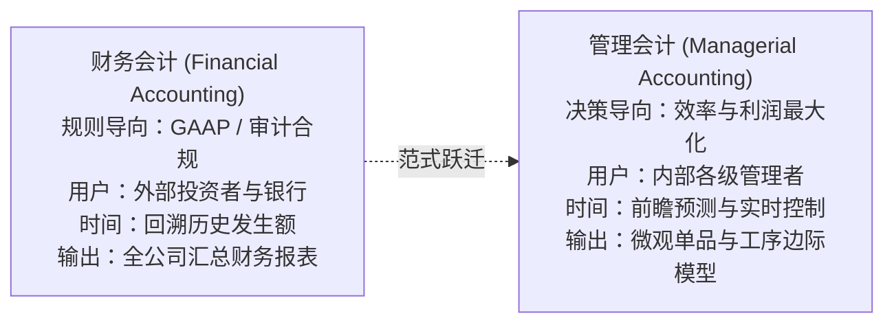
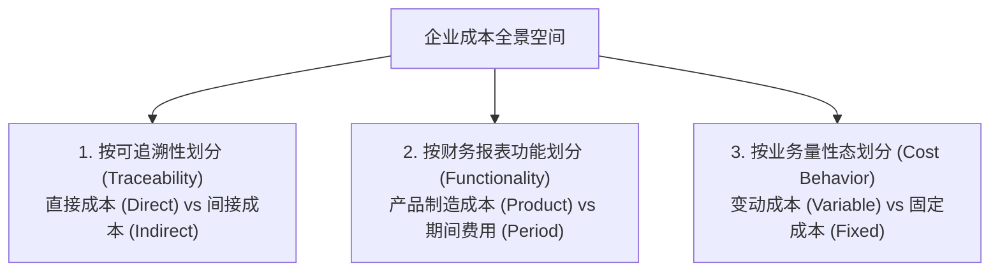
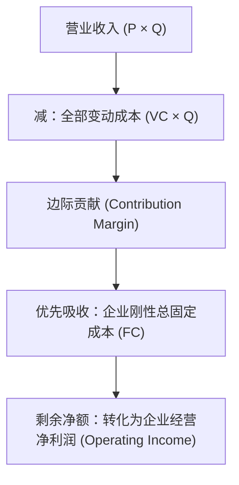

# Lec 22 管理会计成本概念与行为分类 (Introduction to Cost Concepts: Fixed, Variable, Product vs. Period)

> MIT Sloan School of Management · 15.501 Corporate Financial Accounting · 讲义 22

## TL;DR

- 管理会计摆脱了公认会计准则的外部合规束缚，聚焦企业内部资源配置、最优定价与本量利决策。
- 制造费用作为无法直接追踪至单一产品的间接成本，与直接材料、直接人工构成产品制造成本三角。
- 固定成本在总量上保持刚性但在单件上随产能稀释，变动成本在单件上保持恒定但在总量上线性扩张。
- 本量利分析（CVP）确立了边际贡献作为吸收固定成本与锁定盈亏平衡点临界销量的核心决策工具。

## 从外部财务合规到内部管理决策的范式跃迁

在 MIT 15.501 课程体系中，从第 22 讲开始，教学视角发生根本性的转向：从服务于外部股东与审计师的**财务会计（Financial Accounting）**，跃迁至服务于企业内部 CEO、事业部总裁与车间厂长的**管理会计（Managerial Accounting）**。

在管理会计中，“成本”不再是一个机械记账的静态科目，而是需要根据不同的管理决策目标（定价、外包、增产、裁员）进行多维重构的动态工具。

## 成本的三维分类全景架构

为了支撑差异化的商业决策，管理会计确立了三大核心分类维度：

### 1. 按成本可追溯性划分：直接成本 vs. 间接成本
- **直接成本 (Direct Costs)**：能够以符合成本效益的方式，直接且经济地追踪至特定成本对象（Cost Object，如某一特定型号的汽车）的成本。包括：
  - **直接材料 (Direct Materials, DM)**：构成产成品实体的核心零部件（如汽车发动机、挡风玻璃）；
  - **直接人工 (Direct Labor, DL)**：直接操作流水线机床装配工人的工资。
- **间接成本 (Indirect Costs / Manufacturing Overhead, MOH)**：为生产运营所共有，但无法以经济方式直接追踪至具体单件产品的成本。包括厂房折旧、机器润滑油、车间保安工资、工厂水电动力费。

### 2. 按报表功能划分：产品成本 vs. 期间费用
::: definition 产品成本与期间费用
- **产品成本 (Product Costs / Inventoriable Costs)**：制造产品过程中所发生的一切耗费，包括直接材料、直接人工与制造费用（$\text{DM} + \text{DL} + \text{MOH}$）。产品成本首先资本化沉淀在资产负债表的“存货”中，**唯有在产品实际售出时，才随销售结转为利润表的主营业务成本（COGS）**。
- **期间费用 (Period Costs)**：与产品制造过程无直接关联的销售与行政管理支出（SG&A，如总部写字楼租金、销售代表差旅、全国广告费）。**在发生的当期全额计入利润表费用**。
:::

- **主要成本 (Prime Costs)**：$\text{Prime Costs} = \text{直接材料 (DM)} + \text{直接人工 (DL)}$；
- **加工 / 转化成本 (Conversion Costs)**：将原材料转化为产成品所耗费的资源，$\text{Conversion Costs} = \text{直接人工 (DL)} + \text{制造费用 (MOH)}$。

### 3. 按成本性态划分：变动成本 vs. 固定成本
在一定的生产经营规模和时间跨度（相关范围，Relevant Range）内：

| 成本性态 | 总成本变动规律 (Total Cost) | 单位成本变动规律 (Unit Cost) | 典型管理决策含义 |
| :--- | :--- | :--- | :--- |
| **变动成本 (Variable Costs, VC)** | 随业务量产量增加呈**严格线性同比例增加** | **单件变动成本保持完全恒定** | 决定了产品追加生产一件的底线边际成本 |
| **固定成本 (Fixed Costs, FC)** | 在相关范围内**保持绝对固定不变** | 随产销量增加呈**反比例递减稀释** | 带来规模经济效益，但过高会放大经营风险 |
| **混合成本 (Mixed Costs)** | 兼具固定基数与变动加成（$TC = FC + VC_{\text{unit}} \cdot Q$） | 随产量增加逐步收敛于单件变动成本 | 如厂房电费（基础容量费＋实际用电度数费） |

## 本量利分析（CVP）与边际贡献模型

本量利分析（Cost-Volume-Profit Analysis, CVP）是管理会计用于预测销量、成本与利润动态关联的最核心工具。其计算基石是**边际贡献（Contribution Margin, CM）**：

::: theorem 边际贡献与盈亏平衡点方程
设产品单价为 $P$，单位变动成本为 $VC_{\text{unit}}$，企业总固定成本为 $FC$，当期销售量为 $Q$：
1. **单位边际贡献 (Unit Contribution Margin)**：
   $$\text{Unit CM} = P - VC_{\text{unit}}$$
   表达每多售出一件产品，为企业贡献的用于“弥补固定成本并最终创造净利润”的边际资金池。
2. **边际贡献率 (Contribution Margin Ratio)**：
   $$\text{CM Ratio} = \frac{P - VC_{\text{unit}}}{P} = \frac{\text{总边际贡献}}{\text{营业收入总额}}$$
3. **盈亏平衡点销量 (Break-Even Quantity, $Q_{\text{BE}}$)**：当经营利润严格等于零时的底线产销量：
   $$Q_{\text{BE}} = \frac{\text{总固定成本 (FC)}}{\text{单位边际贡献 (Unit CM)}} = \frac{FC}{P - VC_{\text{unit}}}$$
4. **盈亏平衡销售额 (Break-Even Revenue)**：
   $$\text{Revenue}_{\text{BE}} = \frac{FC}{\text{边际贡献率 (CM Ratio)}}$$
5. **目标利润达成销量 (Target Profit Quantity)**：
   $$Q_{\text{Target}} = \frac{FC + \text{目标营业利润 (Target Operating Income)}}{\text{Unit CM}}$$
:::

::: example 边际贡献与盈亏平衡全流程测算
某高科技数码工厂生产智能降噪耳机：
- 单件销售价格 $P = 200$ 美元；
- 单件变动成本（材料＋组装工时）$VC = 80$ 美元；
- 工厂每月固定厂房租金、研发折旧与高管薪酬 $FC = 600,000$ 美元。

**测算分析**：
1. 单位边际贡献：$\text{Unit CM} = 200 - 80 = 120$ 美元；边际贡献率：$\frac{120}{200} = 60\%$；
2. 盈亏平衡临界销量：
   $$Q_{\text{BE}} = \frac{600,000}{120} = 5,000 \text{ 台}$$
   每月必须至少售出 5,000 台耳机才能不亏损（对应平衡销售额 $5,000 \times 200 = 1,000,000$ 美元）；
3. 若董事会要求本月实现 240,000 美元的经营净利润：
   $$Q_{\text{Target}} = \frac{600,000 + 240,000}{120} = \frac{840,000}{120} = 7,000 \text{ 台}$$
:::

## 我的理解

::: insight 财务会计的存货吸纳与管理层的“增产抑亏”陷阱
在制造企业中，财务会计的产品成本资本化规则（GAAP 要求固定制造费用计入存货），与管理会计的理性决策常常发生剧烈的行为冲突：
1. **增产抑亏的虚假暴利（Phantom Profits from Overproduction）**：在财务会计中，车间厂房的 1000 万元固定折旧费用必须平摊计入生产出来的每一件产品存货中。如果工厂本年只生产 10,000 件产品，每件分摊 1,000 元固定折旧；但如果厂长为了在年底粉饰业绩，开足马力超负荷生产 100,000 件，每件分摊的固定折旧便骤降至 100 元。
2. **将折旧藏进仓库**：当年如果只售出 10,000 件，在超负荷生产的情景下，有 90,000 件没有卖出去的滞销产品积压在仓库里。这意味着高达 900 万元的固定制造费用被合法地“锁在资产负债表的存货中”，只有 100 万元进入利润表 COGS，使得当年账面净利润凭空暴增 900 万元。
3. **识别虚假库存繁荣**：管理会计必须坚决打破这种会计幻觉。卓越的 CEO 应该使用**变动成本法（Variable Costing）**考核业务主管：固定制造费用无论生产多少件，一律在当期全额费用化。只有剥离存货资本化的蓄水池，才能彻底杜绝车间为了短期 KPI 盲目增产造成天量存货减值暴雷的毁灭性灾难。
:::
