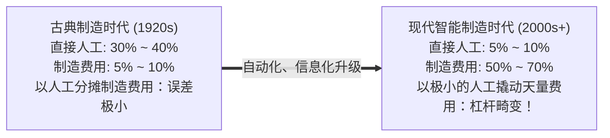
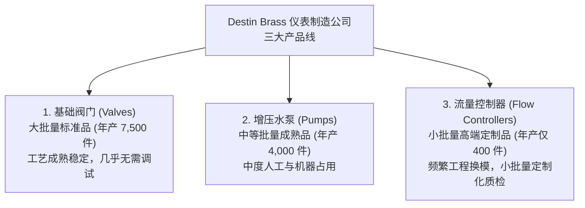
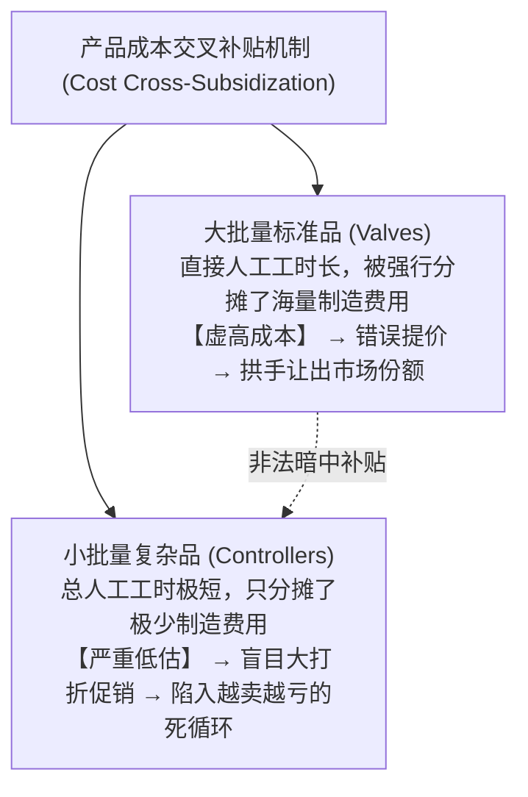

# Lec 23 间接成本分摊与 Destin Brass 案例传统扭曲 (Indirect Allocation of Costs & Destin Brass Problem)

> MIT Sloan School of Management · 15.501 Corporate Financial Accounting · 讲义 23

## TL;DR

- 现代自动化制造使直接人工占比断崖式萎缩，传统以人工工时分配间接制造费用的基准彻底失效。
- 全厂单一分配率建立在产量驱动的虚假假设之上，必然导致大批量标品与小批量定制品的成本系统性扭曲。
- 经典 Destin Brass 案例揭示了传统成本法对小批量复杂产品的恶性交叉补贴与定价战略灾难。
- 错误的高估标准品成本迫使企业在核心主营阵地被动让出市场，同时在虚假暴利的定制品泥潭中越陷越深。

## 制造费用分配的世纪困境与技术变革

在 20 世纪初的福特流水线时代，工业制造的成本结构高度单一：直接材料占 60%，流水线工人的直接人工占 30%，厂房折旧与管理等间接制造费用（Overhead）仅占不到 10%。在这一古典工业地貌下，采用“直接人工工时（Direct Labor Hours）”作为全厂唯一的成本分摊池标尺，简便高效且误差微弱。

然而，随着计算机集成制造（CIM）、数控机床与工业机器人的普及，现代制造业的成本解构发生了颠覆性的倒挂：

当直接人工在整机成本中仅占 5% 甚至更低时，如果依然将数亿元庞大的厂房折旧、产线换模（Setup）、质检与工程维护费用，生硬地按照直接人工工时的比例分摊给各个产品，**任何直接人工上的微小计量扰动，都会被放大成百上千倍，引发毁灭性的成本失真**。

## 传统产量基准分摊法（Volume-Based Costing）原理

传统成本会计普遍采用**预定制造费用分配率（Predetermined Overhead Rate, POHR）**：

::: definition 预定制造费用分配率 (POHR)
在会计年度开启前，根据预算的制造费用总额与预算的业务量基准（如总直接人工工时、机器工时）计算得出的单位分配标准：
$$\text{POHR} = \frac{\text{年度预计制造费用总额 (Estimated Total Overhead)}}{\text{年度预计总分配基准量 (Estimated Total Allocation Base)}}$$
某产品应分摊的间接费用：
$$\text{该产品分摊制造费用} = \text{该产品实际耗用分配基准量} \times \text{POHR}$$
:::

这一核算逻辑隐含了一个致命的前提假定：**所有间接制造费用的发生，都严格与生产的实物产量（或生产时长）成正比**。

## 商业分析经典：Destin Brass 案例解构

哈佛与 MIT 斯隆管理学院共同引为经典的 **Destin Brass Products 案例**，是展示传统成本会计如何将一家优秀制造企业带入战略深渊的教科书范例。

### 企业的战略困局与矛盾表象
Destin Brass 采用全厂统一的“直接人工工时”分摊制造费用，公司管理层陷入了极度困惑的“三大不可解谜团”：
1. **基础大单频频失守**：作为公司立足之本的高产量标准阀门（Valves），市场上突然涌现出大量海外廉价竞争对手，竞品定价甚至低于 Destin Brass 计算出的单位生产成本。公司多次提价保利润，却导致阀门市场份额断崖式暴跌；
2. **定制新品成独家印钞机**：针对工艺极其复杂、小批量定制的流量控制器（Flow Controllers），公司账面显示其毛利率高达惊人的 35%。即便公司随后宣布将售价连续提高 10% 和 20%，不仅没有一个客户流失，反而订单雪片般飞来，客户甚至由衷感谢 Destin Brass 是全美唯一愿意按“如此低廉公道价格”供应高端控制器的厂家；
3. **整体净利润停滞萎缩**：账面毛利丰厚的高端控制器销量暴涨，账面低毛利的传统阀门逐步萎缩，但公司年终财务报表上的总净利润不增反降，陷入越努力经营越失血的怪圈。

## 传统成本法下的产品交叉补贴扭曲

为了查明真相，MIT 会计学者对 Destin Brass 实际发生的资源耗费进行了微观作业还原。传统成本法与微观真实作业的对比如下：

| 产品类别 | 年产量 (Units) | 每次生产批次大小 (Batch Size) | 产线换模调试次数 (Setups) | 传统成本法单位成本 | 真实微观单位成本 | 成本扭曲与战略后果 |
| :--- | :---: | :---: | :---: | :---: | :---: | :--- |
| **基础阀门 (Valves)** | 7,500 件 | 7,500 件 (大批量单批流) | 1 次 | **$37.56** | **$34.12** | **被严重高估 (Over-costed)**！背负了不属于自己的换模费用，误判自身缺乏竞争力 |
| **增压水泵 (Pumps)** | 4,000 件 | 800 件 (常规批次) | 5 次 | **$63.12** | **$63.20** | **基本准确**，成本未发生显著偏移 |
| **流量控制器 (Controllers)** | 400 件 | 40 件 (极小碎单定制) | 10 次 | **$86.74** | **$135.50** | **被严重低估 (Under-costed)**！真实成本比账面高出近 50 美元，实际卖一件亏一件！ |

::: theorem 传统成本分摊扭曲定律 (Cross-Subsidization Theorem)
在采用传统以产量或直接工时为基准的分摊体系下：
1. **大批量、低复杂度的标准产品必然被系统性高估成本（Over-costed）**；
2. **小批量、高定制化、多工艺批次的复杂产品必然被系统性严重低估成本（Under-costed）**；
3. 发生隐性的产品交叉补贴：大批量成熟产品在不知不觉中充当了冤大头，为复杂定制产品沉重而高频的换模、物料搬运和工程变更买单。
:::

## 成本失真引发的商业决策灾难

Destin Brass 的案例证明：**错误的成本数据比没有数据更加危险**。错误的成本会计直接诱导高管层制定了自杀式的竞争战略：
1. **弃守核心现金奶牛**：标准阀门实际上具有极高的真实盈利能力（真实成本仅 $34.12$），竞争对手按 $36$ 美元售价完全能健康盈利。但 Destin Brass 误以为自身成本高达 $37.56$，判定“阀门是不赚钱的鸡肋”，主动放弃了万件规模的护城河市场；
2. **将毒药当美酒**：流量控制器真实成本高达 $135.50$，而 Destin Brass 却以 $97$ 美元的价格在全美甩卖，每卖出一台就产生近 $40$ 美元的真金白银净亏损！客户之所以从不砍价、竞对之所以从不跟进，是因为整个行业只有 Destin Brass 这一个在流血做慈善的傻瓜；
3. **产能被低效碎单挤占**：为了生产这 400 台控制器，工厂工程师整天忙于停机、重新校准模具、采购特殊管件，宝贵的机床产能被极低附加值的定制换模完全占满，整个工厂陷入效率雪崩。

## 我的理解

::: insight 没有免费的定制化，复杂性本身就是最沉重的税负
深入剖析 Destin Brass 的悲剧，可以提炼出跨越制造与互联网软件行业的深刻组织战略法则：
1. **警惕“定制化幻觉”**：前线销售团队最喜欢向管理层汇报：“这个客户只要我们微调几个参数就愿意下单，多接几个这种定制大单毛利率极高！”如果你的成本核算系统依然只看直接工时或服务器算力，你就会被销售牵着鼻子走。你没有看到的是：为了这一笔定制碎单，你的架构师必须单独拉分支、运维团队必须单独部署、测试团队必须手动跑回归，隐藏在组织深处的“隐性协调成本”早已远远吞噬了那点微薄的合同溢价。
2. **大批量标准化才是工业制造的奇迹**：大批量生产之所以具有降本优势，不仅在于原材料采购议价，更在于其极致的“作业稀释（Batch Economy）”。一次模具装夹连续跑三天，单位换模成本趋近于零。
3. **管理者的破局利刃**：要终结这种劣币驱逐良币的内部扭曲，企业必须彻底重构成本底层逻辑，引入以作业和因果关系为核心驱动的全新体系——**作业成本法（Activity-Based Costing, ABC）**。
:::
