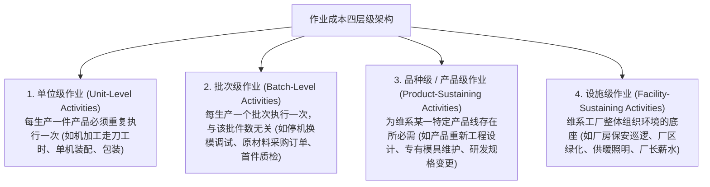
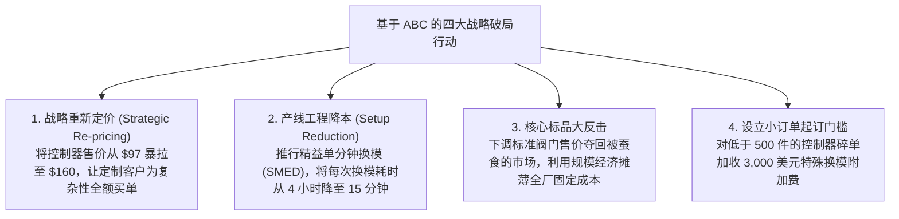
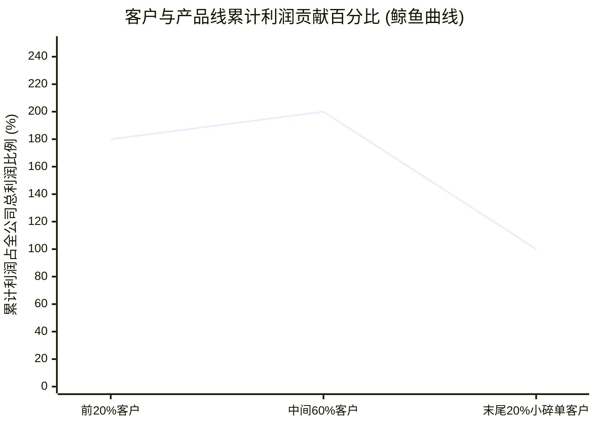

# Lec 24 作业成本法 (ABC) 与战略定价决策 (Activity-Based Costing & Destin Brass Transformation)

> MIT Sloan School of Management · 15.501 Corporate Financial Accounting · 讲义 24

## TL;DR

- 作业成本法确立了“产品消耗作业、作业消耗资源”的因果分配范式，根除了产量基准的交叉补贴。
- 作业层级将企业资源消耗细分为单位级、批次级、品种级与设施级四大独立动力学池。
- 通过为产线换模、物料调度与工程设计建立专有成本动因率，精准还原真实单品经济盈利性。
- 战略定价与鲸鱼曲线分析揭示出少数高价值客户和标品支撑了企业全部利润的商业残酷真相。

## 作业成本法（ABC）的哲学基石与双阶段模型

面对传统成本法在现代制造业的普遍失效，哈佛商学院罗伯特·卡普兰（Robert Kaplan）与罗宾·库珀（Robin Cooper）系统提出了**作业成本法（Activity-Based Costing, ABC）**。

ABC 彻底颠覆了“产量等比例吸收费用”的陈旧观念，确立了全新的**因果两阶段分摊逻辑**：

```mermaid
flowchart TD
    Res["企业总经济资源 (Resources)<br/>厂房折旧、工程师薪酬、机修人工、动力电力"] -->|第一阶段：依据资源动因| Act["微观作业中心 (Activity Cost Pools)<br/>模具调试、物料搬运、首件质检、工程变更"]
    Act -->|第二阶段：依据作业成本动因 (Cost Drivers)| Prod["最终成本对象 (Cost Objects / Products)<br/>高产量标准品 (Valves) vs 小批量定制品 (Controllers)"]
```

::: definition 作业成本法核心公理
1. **产品消耗作业 (Products Consume Activities)**：不同产品由于工艺复杂度和订单形态不同，消耗的具体工序作业量千差万别；
2. **作业消耗资源 (Activities Consume Resources)**：企业的厂房、电力、工人工资等基础资源，是由具体发生的作业行为所拉动并消耗的。
:::

## 作业成本层级（Cost Hierarchy）四分法

ABC 体系将企业内部发生的一切制造作业划分为四大不同属性的层级（Cost Hierarchy）：



::: theorem 批次经济与成本稀释律
在批次级作业（如一次停机换模耗资 2,000 美元）中：
- 若该批次连续批量生产 10,000 件标准品，分摊到每件产品的换模成本仅为 $2,000 / 10,000 = 0.20$ 美元；
- 若该批次为小客户定制生产 20 件非标品，分摊到每件产品的换模成本高达 $2,000 / 20 = 100$ 美元！
**传统成本法将这两类产品的换模费用混在一起按直接工时平均平摊，直接掩盖了小批量定制品的致命高成本。**
:::

## 运用 ABC 破解 Destin Brass 案例谜团

回到上讲 Destin Brass 的真实商业场景，管理层引入 ABC 实施两阶段重构：

### 1. 识别作业池与成本动因率（Activity Rates）
企业将制造费用归集为四个独立的作业成本库，并测算各作业池的成本动因率：
1. **机加工作业 (Machining)**：由机器运转工时（Machine Hours）驱动，总成本 120,000 美元，总工时 12,000 小时，$\text{费率} = \frac{120,000}{12,000} = 10 \text{ 美元/机时}$；
2. **产线换模调试作业 (Setup)**：由换模次数（Number of Setups）驱动，总成本 90,000 美元，全年共 100 次换模，$\text{费率} = \frac{90,000}{100} = 900 \text{ 美元/次}$；
3. **物料接收与调度 (Material Handling)**：由收料与发料次数驱动，总成本 60,000 美元，全年 300 次发料，$\text{费率} = \frac{60,000}{300} = 200 \text{ 美元/次}$；
4. **日常行政支持 (General Support)**：直接按工时分摊，费率 8 美元/直接人工工时。

### 2. 真实成本测算对比与盈利性大反转

| 财务与战略指标 | 基础阀门 (Valves) | 增压水泵 (Pumps) | 流量控制器 (Controllers) |
| :--- | :---: | :---: | :---: |
| **年产销量** | 7,500 件 | 4,000 件 | 400 件 |
| **换模次数** | 仅 10 次 (单批大生产) | 30 次 | 60 次 (高频小批量调试) |
| **直接材料与直接人工** | $26.00 | $40.00 | $52.00 |
| **传统成本法单位总成本** | **$37.56** | **$63.12** | **$86.74** |
| **作业成本法 (ABC) 真实单位总成本** | **$34.12** | **$63.20** | **$135.50** |
| **市场实际现行售价** | $50.00 | $80.00 | $97.00 |
| **传统账面单位毛利与毛利率** | $12.44 (25\%) | $16.88 (21\%) | **$10.26 (11\%，自以为暴利)** |
| **ABC 真实单位毛利与毛利率** | **$15.88 (32\%，真实高暴利)** | $16.80 (21\%) | **-$38.50 (-40\%，惨烈巨亏！)** |

::: example ABC 带来的商业真相震撼
数据一经公布，Destin Brass 管理层震惊地发现：
- 以为“利润微薄、被廉价竞品逼入绝境”的阀门，真实毛利率高达 32%！如果把售价从 50 美元微调至 45 美元，依然拥有每件 11 美元的丰厚健康利润，足以把所有外部竞对横扫出局；
- 以为“客户抢着买、高附加值”的流量控制器，真实生产成本高达 135.50 美元，按 97 美元对外销售，每卖出一台公司就从银行账户净亏损 38.50 美元！过去两年公司在该产品线上卖得越多，失血越严重。
:::

## 战略定价重塑与“鲸鱼曲线”客户洞察

掌握了真实无误的作业成本数据后，企业高管层彻底掌握了扭转竞争颓势的战略主动权。在传统成本法的蒙蔽下，企业往往在盲目裁员与恶性价格战中疲于奔命；而作业成本法通过解构作业动因，为管理层开辟了四条清晰的破局路径：首先是战略定价的重新锚定，不再基于错误的工时成本做廉价慈善；其次是通过工业工程技术改进作业效率，压缩批次级调试的时间消耗；再次是对核心标准化成熟产品实施价格反击以夺回主阵地；最后是通过设定阶梯起订量，将定制碎单的真实成本直接转嫁给客户。



在更宏观的商业客户管理层面，作业成本法推导出极具颠覆性的“客户盈利性鲸鱼曲线”。该模型将全公司的全部客户按照净利润贡献从高到低排列，横坐标为累计客户百分比，纵坐标为累计创造的利润占公司最终总利润的比例。分析表明，企业的利润分布并不是均匀平摊的，而是呈现出极端的头部集中与尾部毁灭特征。

::: theorem 客户盈利性鲸鱼曲线 (The Whale Curve of Customer Profitability)
利用 ABC 分析全公司所有客户与产品线时，通常会绘制出经典的**鲸鱼曲线（The Whale Curve）**：



1. **头部 20% 的大客户与大批量标准产品**，贡献了全公司 **180% 到 200% 的全部利润**；
2. **中间 60% 的普通客户**，在收支平衡线上略有微利；
3. **尾部 20% 热衷于频繁更改设计、超小批量急单定制的恶劣客户**，凭借大量的无偿作业消耗，**活活吞噬了公司 80% 到 100% 的净利润**！
:::

## 我的理解

::: insight 商业竞争的终极防御是“让对手去服务那些烧钱的客户”
ABC 作业成本法带给现代商业领袖的最深刻启示，是关于竞争战略与客户筛选的残酷辩证法：
1. **不要盲目追求“满足客户的一切需求”**：在销售至上的文化中，销售人员会把“有求必应”当作美德。然而，很多客户看似营收贡献巨大，但每次下单都要定制规格、更改批次、推迟提货并要求特殊检测。如果使用传统成本法，你会以为他是 VIP 大客户；如果用 ABC 穿透，你会发现他是一只每天在你血管里吸血的水蛭。
2. **利用 ABC 进行精准战略反制**：在 Destin Brass 案例中，最妙的战略反击不是彻底砍掉控制器，而是**果断将定制控制器提价至 160 美元**：
   - 如果客户接受高价，定制化业务瞬间转化为高利润源泉；
   - 如果客户抱怨太贵转向竞争对手，Destin Brass 应当开香槟庆祝！因为这些带着繁琐换模需求、极低毛利的毒药订单，将把竞争对手的工程团队折磨瘫痪，并暗中吞噬对手的现金流。
3. **大繁至简的极简主义**：乔布斯重返苹果时大刀阔斧砍掉数十款繁杂的打印机与 Macintosh 衍生型号，特斯拉将整车零部件极致通用化并取消选配，本质上都是深谙作业成本法的宗师级实践。削减非必要的复杂度，才是现代制造业最不可逾越的成本护城河。
:::
