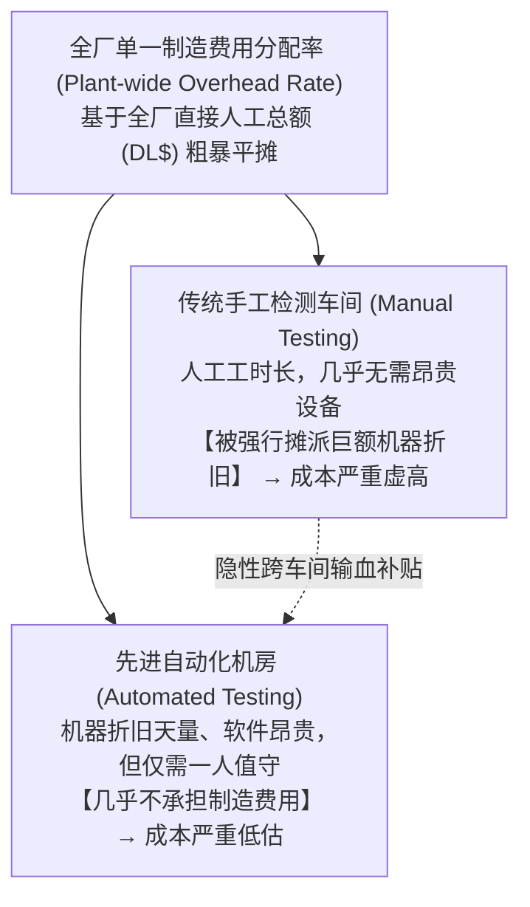
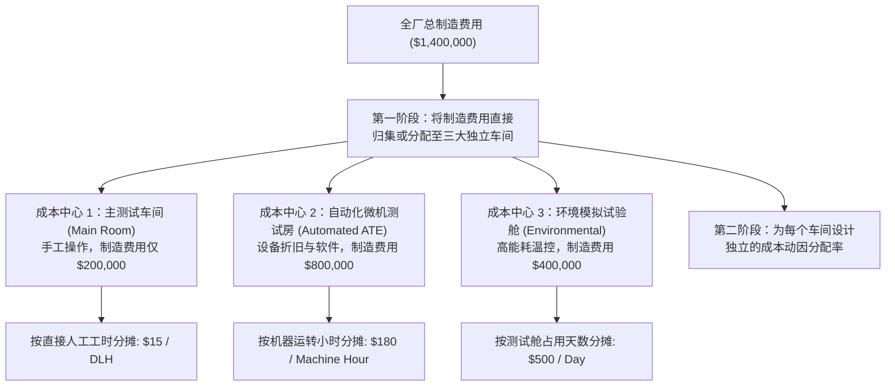

# Lec 25 多阶段制造费用分配与 Seligram 案例启示 (Advanced Cost Allocation & Seligram Automation Case)

> MIT Sloan School of Management · 15.501 Corporate Financial Accounting · 讲义 25

## TL;DR

- 自动化设备的大规模引入打破了车间同质性假定，全厂单一费用分配率将诱发严重的部门间成本扭曲。
- 经典 Seligram 案例展现了机器密集型车间对人工密集型传统车间的隐性寄生与掠夺机制。
- 多阶段成本中心重构通过隔离自动化测试与传统手工检测，消除了竞对“精准摘樱桃”的商业绞杀。
- 成本系统必须与企业资本开支的重型技术演进保持协同，否则错误的会计指标将扼杀自动化投资回报。

## 自动化浪潮与车间同质性假定的破灭

在现代工业制造企业推进技术升级与数字化改造的漫长进程中，生产现场极少能够在短时间内完成一刀切式的全流程自动化。更为普遍的现实状态是，工厂内部在相当长的一段过渡期内呈现出“冰火两重天”的异构混合地貌：在一侧的现代化无尘恒温车间里，运转着动辄数百万美元的高精度数控机床、工业机器人与自动化全功能检测台；而在另一侧的传统老厂房里，依然驻扎着依赖熟练工人和钳工师傅进行手工装配、打磨调试与目视检查的劳动密集型生产线。

在这种异质化极端显著的生产环境下，如果企业的财务与成本核算系统依然固守过去的惯性，继续沿用陈旧的**全厂单一分配率（Plant-wide Overhead Rate）**，实际上就默认了一个极其脱离实际的前提假定——即假定车间内生产的所有产品或工序，在消耗企业昂贵的间接设备折旧、软件授权、技术维护与动力电力等制造费用时，其消耗强度与工人所付出的直接人工工时是完全等比例同质的。

这种粗放的均摊主义分配逻辑，在现代高资本开支环境下会演变成一场企业内部的“成本抢劫”。那些纯粹依靠人工劳动、几乎不占用昂贵机床的传统老产品，因为耗费了较多的人工工时，被动背负了成倍于自身消耗的庞大机器折旧费用，导致其账面核算成本严重虚高；而那些高度依赖千万级精密设备、仅仅由一两名操作工按按钮巡视的所谓“高科技自动化产品”，却因为直接人工极少，几乎无需分摊昂贵的机器持有成本，在账面上呈现出令人惊叹的极低虚假成本。这种因技术环境异质化导致的成本扭曲，正是企业陷入恶性竞争与战略误判的致命温床。

## 经典教案解构：Seligram 电子测试事业部危机

哈佛与 MIT 斯隆管理学院共同推崇的 **Seligram, Inc. 案例**，是研究现代技术转型中成本系统滞后导致企业几乎灭顶的殿堂级教案。

### 1. 业务转型与巨额资本开支
Seligram 公司的电子测试事业部（ETO）专门为美国航空航天与国防军工承包商提供高可靠性元器件检测服务：
- **历史传统业务**：主要依赖测试工程师手动连接示波器、电压表进行人工读数与检测，属于典型的**劳动密集型业务**；
- **技术升级投资**：为应对新一代航天微处理器的高复杂度，ETO 斥资数百万美元采购了多台大型**全自动元器件测试系统（ATE）**与高低温振动环境测试箱（Chambers），转型为高技术**资本密集型业务**；
- **陈旧的会计核算系统**：事业部依然使用 1970 年代确立的规则——全厂所有间接制造费用（包括新买的巨型自动化设备折旧、专用测试软件许可费、恒温机房空调电费），**统一按照直接人工工时成本（Direct Labor Dollars, DL$）进行 100% 比例分摊**。

### 2. 外部市场的致命绞杀：“摘樱桃”陷阱
这一滞后的成本核算规则，迅速在公开市场上引爆了灾难性的商业危机：
1. **传统手工检测业务被竞争对手“精准摘樱桃（Cherry-Picking）”**：市场上涌现出一批简陋的小型独立实验室，它们只做传统手工检测。由于没有昂贵机器折旧，小作坊的报价比 Seligram 低了 30% 到 40%。Seligram 的销售主管惊恐地发现，公司最稳定、客户黏性最高的传统军工手工订单正在成批流失；
2. **自动化测试业务“门庭若市却巨额亏损”**：全美军工客户将最繁重、最耗费机房电力与机器寿命的微处理器自动化检测订单全砸向 Seligram。Seligram 的机器 24 小时超负荷连轴转，管理层沾沾自喜，然而年底财务决算时，ETO 事业部的经营亏损却创下历史新高！

## 多阶段成本中心（Multi-Stage Cost Centers）重构

为了挽救濒临破产的 ETO 事业部，MIT 咨询顾问协助 Seligram 拆解了全厂成本流，设计了**多阶段车间成本中心模型**：

### 多阶段分摊法对单件测试成本的重估冲击

| 测试服务类型 | 传统全厂单一分配率成本 | 多阶段车间成本中心真实成本 | 商业市场竞争策略转变 |
| :--- | :---: | :---: | :--- |
| **传统手工晶体管测试 (10 人工工时，0 机器工时)** | **$550 美元** | **$210 美元** | **被严重虚增！** 真实成本仅 210 元，此前报价 600 元被竞对打得溃不成军；重新降价至 350 元即可横扫市场并获取暴利 |
| **高端芯片全自动检测 (0.5 人工工时，8 机器工时)** | **$120 美元** | **$1,480 美元** | **被严重低估！** 真实成本近 1500 元，此前以 200 元超低价向市场甩卖，每测一片芯片净亏损 1280 元！ |

::: theorem 多阶段分摊隔离公理 (Separation of Heterogeneous Cost Centers)
当企业内部不同生产车间的资本密集度（Capital Intensity）与自动化程度存在显著结构性差异时：
1. 必须将厂房切分为相互独立的成本中心（Cost Centers）；
2. 每一个成本中心必须独立归集自身的直接制造费用，并选用与其工艺特性直接绑定的动因（机器工时驱动机器费用，人工工时驱动人工费用）；
3. 严禁使用全厂平均费率，坚决切断自动化车间对传统劳动密集型车间的成本寄生链条。
:::

## 自动化资本预算与管理会计的战略协同

Seligram 案例为现代企业的技术升级与数字化转型敲响了警钟：
1. **自动化投资的虚假高回报与隐性风险**：在评估是否采购自动化流水线时，若成本系统无法精确追踪折旧与软件维护费用，管理层往往低估新技术的全生命周期持有成本（TCO）；
2. **定价防御机制的建立**：多阶段成本核算使得企业在参与重大项目竞标时，能够制定精准的阶梯式报价（对劳动密集型业务报具有侵略性的低价，对高精密机器业务报足额覆盖折旧的高价）；
3. **推动精益化产能利用**：当机器工时被明确标价为“180 美元/小时”时，车间主管才会产生真正的动力去减少设备停机待料时间，提高昂贵资产的时间稼动率（OEE）。

## 我的理解

::: insight 会计系统滞后是企业死于技术转型的无形杀手
许多商学院教授习惯将技术转型失败归咎于“技术不成熟”或“组织文化抵触”，但 Seligram 揭示了一个令人胆寒的隐形杀手：**技术跑进了数字化时代，成本会计系统却死死停留在蒸汽机时代**：
1. **把金牛业务当累赘，把吸血业务当未来**：在 Seligram 案例中，传统手工测试业务原本是一头源源不断贡献正现金流的黄金奶牛。但由于陈旧会计系统的误导，管理层一度认为“手工业务成本太高、濒临淘汰”，甚至计划关停传统车间。如果真的关停，企业将瞬间失去赖以生存的唯一真实造血引擎，随之而来的将是全线破产。
2. **错误的指挥棒逼死一线销售**：当销售人员把真实的客户反馈“外部小作坊报价极低”汇报给管理层时，信奉旧报表的高管往往武断斥责销售“能力不行、只会打价格战”。实际上，不是销售打不过小作坊，而是总部的财务系统给一线武器库塞满了掺着巨额机器折旧的虚高哑弹。
3. **数字化必须伴随会计重构**：任何企业在引入工业 4.0、云原生或 AI 自动化流程时，第一天就必须同步重构管理会计核算体系。如果不用微观精确的作业动因取代粗放的均摊主义，最先进的技术投资最终只会沦为财报上无法消化的致命商誉与折旧包袱。
:::
