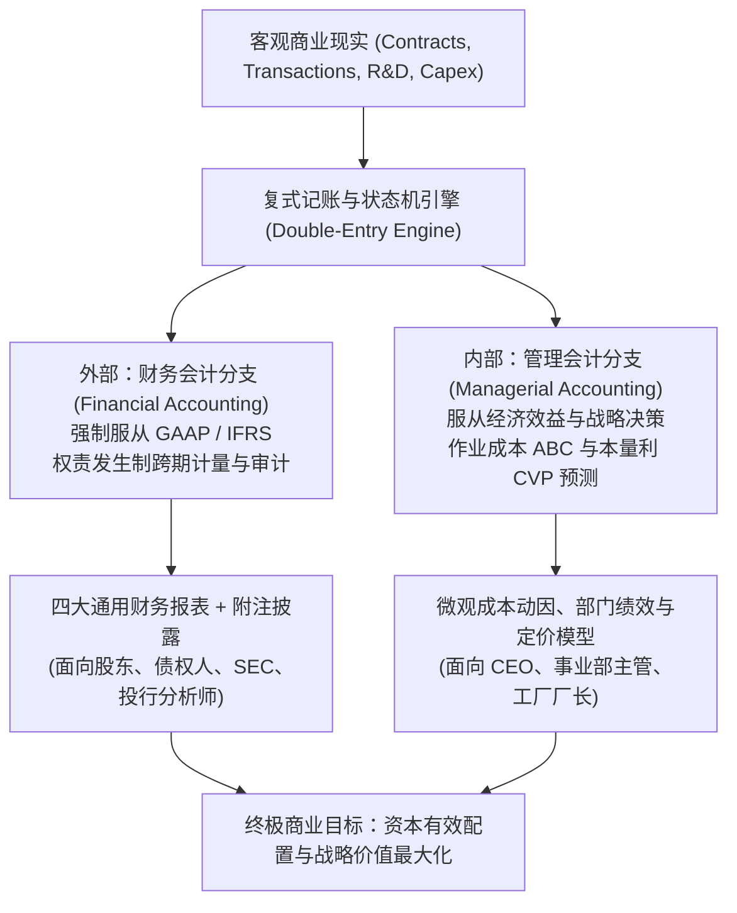
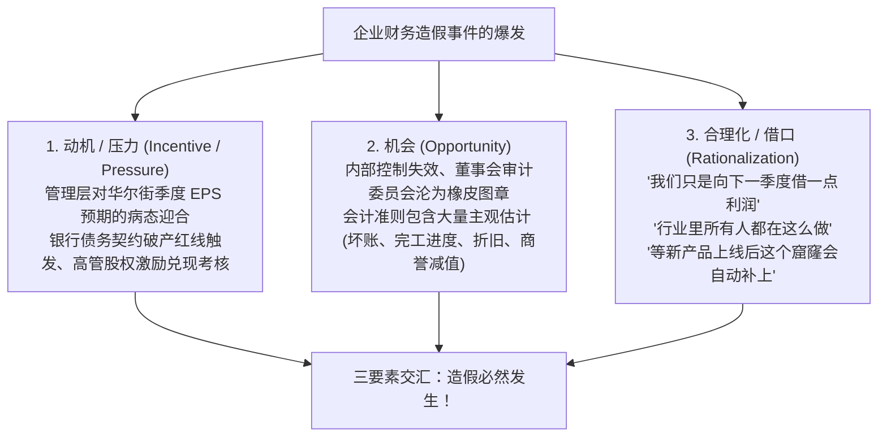
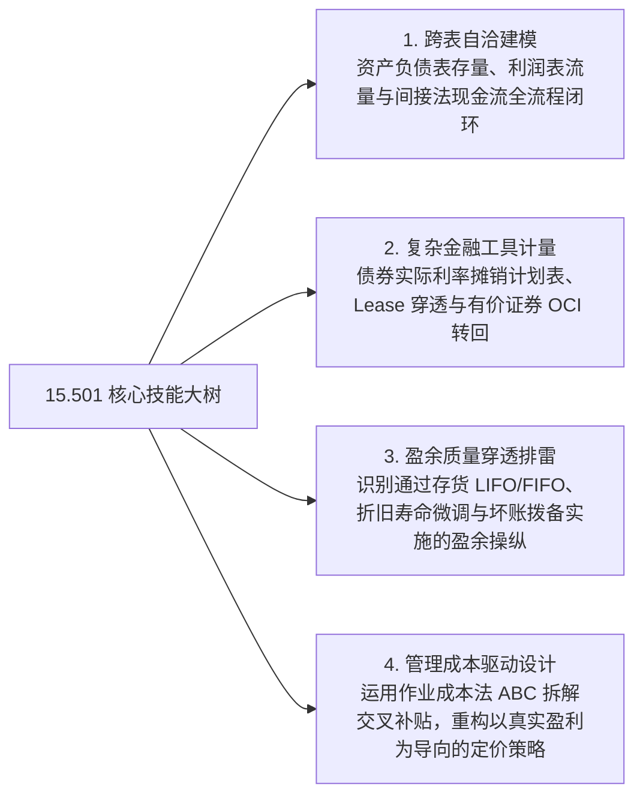

# Lec 26 财务与管理报告体系大统合 (Course Review, Holistic Reporting & Strategic Integration)

> MIT Sloan School of Management · 15.501 Corporate Financial Accounting · 讲义 26

## TL;DR

- 财务会计与管理会计共同构成了现代商业企业全景信息架构的双螺旋支柱。
- 外部财务报告以受托责任与资本配置为核心，内部管理会计以因果动因与战略控制为导向。
- 舞弊三角理论揭示了压力、机会与借口三要素交汇对会计信息忠实表述的制度性侵蚀。
- 贯通四大报表勾稽与微观作业成本，方能以报表阅读者与企业战略家的双重视角驾驭商业决策。

## 会计信息系统的全景大一统图谱

历经 26 讲的系统演进，MIT 15.501 完整构建了企业经济活动的量化大厦。会计不仅是一套记账技术，更是现代资本市场与微观企业治理的**通用信息协议（Universal Information Protocol）**：

::: definition 会计信息系统的双螺旋定义
- **财务会计维度 (The Financial Dimension)**：以“历史受托责任（Stewardship）”与“决策有用性（Decision Usefulness）”为锚，通过严格的公认会计准则与独立外部审计，向资本市场传递可靠的标准化存量与流量信号，降低企业股权与债务融资成本；
- **管理会计维度 (The Managerial Dimension)**：以“资源消耗因果性（Causality）”为锚，穿透会计分摊的人工迷雾，追踪每一项作业与流程的真实边际贡献，为技术升级、产品组合取舍与战略定价提供无偏见的量化罗盘。
:::

## 财务欺诈动力学：舞弊三角理论（The Fraud Triangle）

在资本市场的历史长河中，从安然（Enron）、世通（WorldCom）到瑞幸咖啡与 FTX，财务造假周而复始。社会学家唐纳德·克雷西（Donald Cressey）提出的**舞弊三角理论（The Fraud Triangle）**揭示了财务造假的微观发生机理：

::: theorem 萨班斯-奥克斯利法案 (SOX 404) 的制度防线
为斩断舞弊三角中的“机会”要素，美国国会于 2002 年通过了里程碑式的《萨班斯法案》（Sarbanes-Oxley Act）：
1. **CEO 与 CFO 个人刑事背书**：上市公司最高管理层必须以个人法律责任签署财务报表保证书，凡故意虚假陈述面临最高 20 年监禁；
2. **SOX 404 内控审计**：强制要求独立审计师对企业的财务报告内部控制有效性出具独立审计意见，消灭利用系统后门伪造日记账分录的漏洞。
:::

## 课程核心考点与技能大树终极收敛

通盘掌握 MIT 15.501 体系，学员必须在期末完成四大维度的技能全面收敛：

| 核心专题模块 | 关键核算工具与核心公式 | 战略洞察与管理层决断点 |
| :--- | :--- | :--- |
| **基础与营运资本** | $\text{Assets} = \text{Liabilities} + \text{Equity}$；间接法 CFO 还原 | 营运资本异常膨胀预示经营性现金失血与坏账风险 |
| **收入与存货流转** | 完工百分比法；$\text{COGS}_{\text{FIFO}} = \text{COGS}_{\text{LIFO}} - \Delta \text{Reserve}$ | 严防未完工合同提前开票塞货；平衡税收红利与账面利润 |
| **长期资产与减值** | 直线法/DDB；两步法减值：$\sum \text{Undiscounted CF} < \text{BV}$ | 警惕频繁变更折旧年限与推迟计提巨额商誉减值 |
| **负债与时间价值** | 债券定价：$M \cdot c \times PVOA + M \times PV$；实际利率摊销 | 穿透表外长期经营租赁，把控财务杠杆利差双刃剑 |
| **成本与微观控制** | $Q_{\text{BE}} = \frac{FC}{P - VC}$；ABC 动因费率分配两阶段模型 | 砍掉虚假繁荣的定制碎单，保护高周转标准品现金奶牛 |

## 我的理解

::: insight 财务不是冰冷的后视镜，而是驾驶商业航母的前向雷达
站在 MIT 15.501 全课的终点回望，最重要的一堂课是建立对“报表读者视角（Viewpoint of the Users）”的终极顿悟：
1. **不要做被动的账簿奴隶**：合格的会计师记录过去，而卓越的商业领袖看财报，永远在寻找“预期差”。通过审阅存货周转天数、合同负债池的蓄水速度与实际利息保障倍数，你必须比董事会其他成员早 6 到 12 个月预判出企业的战略转折点与流动性悬崖。
2. **守住常识与真实现金流**：无论华尔街投行包装出多么炫目的“经调整后非 GAAP 指标（Adjusted EBITDA）”，无论管理层讲的故事多么宏大动听，商业世界底层运转的物理法则从未改变——每一家最终走向破产清算的企业，账面上都曾经拥有过漂亮的会计净利润，但没有一家企业能在现金耗尽的次日继续存活。
3. **商业智慧的合流**：理解了外部财务准则的博弈边界，你便拥有了防范市场风险的坚固盾牌；掌握了内部管理会计的作业动因，你便握紧了重构生产效率与战略突围的锐利长矛。这正是麻省理工学院斯隆管理学院将本门课程赋予未来领袖的最核心价值所在。
:::
