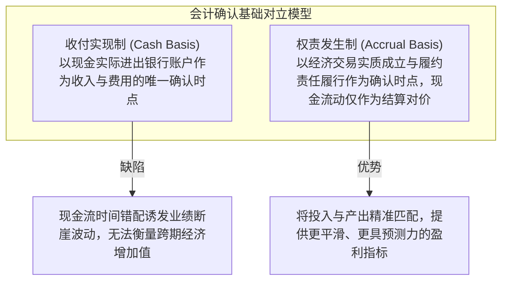
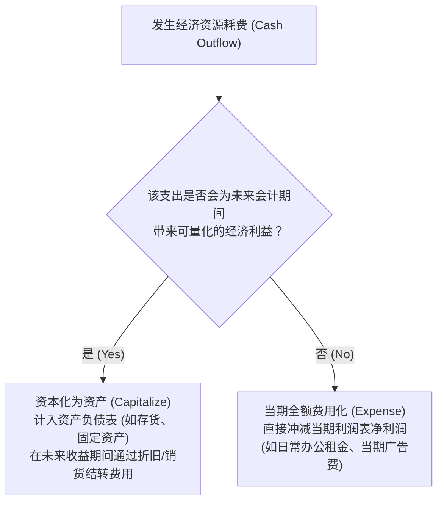

# Lec 03 权责发生制与利润表确认逻辑 (The Income Statement and Principles of Accrual Accounting)

> MIT Sloan School of Management · 15.501 Corporate Financial Accounting · 讲义 03

## TL;DR

- 权责发生制以经济权利与义务的实质成立而非现金收付为准绳，化解了收付实现制的业绩锯齿状失真。
- 多步式利润表通过分层揭示毛利、营业利润、息税前利润与净利润，严谨区分核心经营与非经常损益。
- 收入确认必须满足已实现或可实现以及已赚取两大基本前提，配比原则要求将投入成本与对应产出收入同期结转。
- 支出资本化与费用化的权衡是管理层平滑盈余的核心窗口，资本化不当将严重高估当期资产与经营净利润。

## 收付实现制与权责发生制的经济学抉择

在评估企业特定期间的经营成就时，存在两种根本对立的会计确认基础：



::: definition 权责发生制 (Accrual Accounting)
一种会计核算方法，要求企业凡是当期已经实现的收入和已经发生或应当负担的费用，不论款项是否收付，都应当作为当期的收入和费用计入利润表；凡是不属于当期的收入和费用，即使款项已在当期收付，也不应当作为当期的收入和费用。
:::

考虑一家造船企业：耗时三年建造一艘货轮，前两年发生巨额钢材与人工现金支出，第三年交付货轮并一次性收到全部货款。在收付实现制下，前两年将呈现荒谬的巨额亏损，第三年呈现暴利；而在权责发生制下，前两年的建造成本被计入存货/在建工程（资产化），直至第三年交付所有权时，收入与相匹配的全部建造成本同时计入利润表，真实展现合同的净经济回报。

## 多步式利润表的分层架构与盈利质量

利润表（Income Statement）衡量企业在**一段时间内（Flow）**由经营活动驱动的净财富创造。现代财务报告采用多步式利润表，旨在层层剥离、向市场展示各层级盈利能力的健康度：

```mermaid
flowchart TD
    Rev["营业收入 (Revenues / Sales)"] -->|减：主营业务成本 COGS| GP["毛利润 (Gross Profit)"]
    GP -->|减：销售、管理与行政费用 SG&A| Op1["营业费用扣除"]
    GP -->|减：研发费用 R&D| Op2["研发投入费用化"]
    GP -->|减：资产折旧与摊销 D&A| Op3["长期资产消耗"]
    Op1 & Op2 & Op3 --> EBIT["营业利润 / 息税前利润 (Operating Income / EBIT)"]
    EBIT -->|加/减：利息支出、投资收益等非经常项目| EBT["税前利润 (Pre-Tax Income / EBT)"]
    EBT -->|减：所得税费用 (Income Tax Expense)| NI["净利润 (Net Income)"]
```

### 多步式利润表核心层级解析
1. **毛利润 (Gross Profit = Revenues - COGS)**：衡量企业产品或服务的基本商业溢价能力。若毛利率持续下滑，通常意味着行业竞争加剧、原材料成本无法转嫁或遭遇价格战。
2. **营业利润 (Operating Income / Operating EBIT)**：扣除销售、营销、行政、一般研发及设备折旧后的经营溢价，反映企业核心主营业务的独立造血功能，是股权分析师评估企业经营价值的最核心指标。
3. **税前利润 (EBT)**：纳入了资本结构影响（利息支出）与非主营投资损益（处置子公司收益、证券买卖损益）。
4. **净利润 (Net Income)**：归属于全体股东的最终经营底线（The Bottom Line），通过留存收益进入资产负债表。

## 权责发生制的两大支柱原则

权责发生制大厦主要依赖两大操作性原则支撑：

### 1. 收入确认原则 (Revenue Recognition Principle)
在传统 GAAP 框架下，确认收入必须同时满足两大刚性检验：
- **已实现或可实现 (Realized or Realizable)**：商品或服务已经换取为现金，或换取为具有高确定性可变现价值的资产（如信誉良好的应收账款）；
- **已赚取 (Earned)**：企业已经完成了赚取该项收益所必须履行的绝大部分实质性义务（即货物已经发出且风险已转移给买方，或服务已交付完毕）。

### 2. 配比原则 (Matching Principle)
::: theorem 配比原则 (The Matching Principle)
与产生当期收入相关的一切资源消耗和成本支出，必须在同一会计期间与该项收入相互配比并予以费用化。
:::

配比逻辑分为两类机制：
- **直接产品配比 (Direct Association / Cause-and-Effect)**：成本与收入之间存在明确因果关联。例如：售出一台电脑确认销售收入时，该台电脑的制造出厂成本（COGS）必须在同一笔分录中确认为营业成本。
- **系统合理期间配比 (Systematic and Rational Allocation / Period Costs)**：支出为企业多个期间创造收益，但无法直接追踪至具体哪一笔订单。例如：总部厂房的购置成本通过折旧在预计使用寿命（如 20 年）内系统分摊；办公人员工资、品牌广告费等则直接计入发生当期的期间费用（Period Expenses）。

## 资本化与费用化的核心抉择

当企业支付一笔现金或承担一笔债务时，财务总监必须面临核心判断：**将其计入资产负债表（Capitalize）还是直接计入利润表（Expense）？**



::: pitfall 资本化操纵与世界通信 (WorldCom) 财务丑闻
2000 至 2002 年间，电信巨头世界通信（WorldCom）为掩盖核心业务盈利能力的崩塌，将支付给第三方电信运营商的约 38 亿美元普通网络租用线路使用费（Line Costs，性质上是典型的当期运营费用），违规计入资产负债表的“资本化资产/在建工程”。

这一操纵带来了两大灾难性后果：
1. **虚构当期净利润**：将 38 亿美元费用移出利润表，直接将巨额实际亏损包装为靓丽的数十亿营业利润；
2. **粉饰经营性现金流**：在现金流量表上将原本属于经营活动现金流出（CFO）的项目伪装为投资活动资本开支（CFI），彻底欺骗了华尔街投行与信用评级机构，最终导致美国历史上最大规模的破产案之一。
:::

## 我的理解

::: insight 净利润是管理层的主观估计模型，现金流才是客观物理现实
初涉商业决策的人往往把财报上的净利润（Net Income）当成真金白银。但深入权责发生制机理后便会明白：**净利润本质上是一个高度依赖会计估计与管理层自由裁量权的“理论推导值”**：
1. **折旧年限的主观性**：一套价值 10 亿元的半导体设备，管理层若将其折旧年限从 5 年调整为 8 年，每年计入利润表的折旧费用便从 2 亿元锐减至 1.25 亿元，凭空凭“一行字”为净利润增加 7500 万元，而工厂里机器的物理磨损没有丝毫改变。
2. **应计项与利润质量 (Quality of Earnings)**：当一家公司的净利润高速增长，但经营现金流净额（CFO）持续低迷甚至为负时，意味着利润增长绝大部分由“未收到现金的应收账款（应计利润）”驱动。这种靠放宽赊销信用催肥的纸面繁荣，往往预示着随之而来的坏账爆雷与流动性危机。看报表必须穿透利润表，用现金流量表对其进行“水分核验”。
:::
