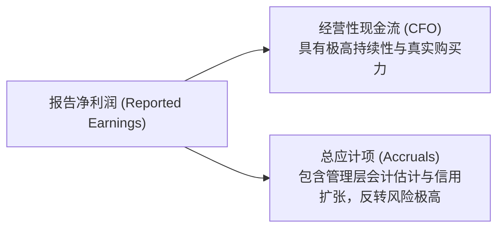

# Lec 04 权责发生制深化与应计项拆解 (Accrual Accounting Principles cont. & Working Capital Adjustments)

> MIT Sloan School of Management · 15.501 Corporate Financial Accounting · 讲义 04

## TL;DR

- 权责发生制的精髓在于跨期时间解耦，现金收付与经济实质的先后关系衍生出四类基础应计/递延科目。
- 递延项目（预收收入、预付费用）处理现金在先、实质在后的交易，形成资产负债表缓冲垫并随时间结转。
- 应计项目（应计收入、应计费用）处理实质在先、结算在后的交易，必须在期末通过调整分录准确捕捉现时义务与债权。
- 净利润与经营现金流之差定义了应计项总量，应计项占比过高（斯隆异象）往往预示着盈余持续性低劣。

## 现金流与履约事件的时间解耦矩阵

在商业世界中，现金的物理流动与产品或服务的实际交付很少发生在同一瞬间。两者在时间轴上的先后错位，构成了权责发生制处理的全部复杂性。根据**现金流先于还是后于经济实质**，会计学确立了经典的四象限分类：

```mermaid
flowchart TD
    subgraph TimeMismatch [时间错配四象限矩阵]
        direction TB
        subgraph CashFirst [现金在前 (Deferrals / 递延)]
            D1["预收款项 / 递延收入 (Unearned/Deferred Revenue)<br/>先收客户现金，后提供服务 → 先确认负债，后转收入"]
            D2["预付款项 / 递延费用 (Prepaid Expenses)<br/>先付供应商现金，后享用利益 → 先确认资产，后摊销费用"]
        end
        subgraph CashLater [现金在后 (Accruals / 应计)]
            A1["应计收入 / 应收利息 (Accrued Revenues)<br/>先完成服务或让渡资产，后收现金 → 先确认收入与资产"]
            A2["应计费用 / 应付薪酬 (Accrued Expenses)<br/>先消耗劳务或借入资金，后付现金 → 先确认费用与负债"]
        end
    end
```

| 业务类型 | 现金流动时点 | 经济实质履约时点 | 资产负债表初始科目 | 后续利润表影响科目 | 典型商业场景 |
| :--- | :--- | :--- | :--- | :--- | :--- |
| **递延收入 (Deferred Revenue)** | **先**收到现金 | **后**交付货物/服务 | **负债**（合同负债/预收账款） | 履约时确认**营业收入** | SaaS 软件预收年费、航空机票预订 |
| **递延费用 (Prepaid Expense)** | **先**付出现金 | **后**消耗经济利益 | **资产**（预付账款/预付租金） | 消耗时确认**营业费用** | 提前预付全年仓库租金、企业财产险 |
| **应计收入 (Accrued Revenue)** | **后**收到现金 | **先**履行服务完毕 | **资产**（应收账款/应收利息） | 履约当期确认**营业收入** | 未结算的律所咨询工时、已到期应收债券利息 |
| **应计费用 (Accrued Expense)** | **后**付出现金 | **先**享用员工/资金 | **负债**（应付职工薪酬/应付利息） | 发生当期确认**营业费用** | 12 月员工工资本年消耗次年 1 月发放、借款利息 |

## 四类应计/递延事项的期末调整分录实战

企业在日常经营中通常只记录原始凭证，在会计分期截断日（月底或年底），必须通过**调整分录（Adjusting Journal Entries, AJE）**使报表真实反映当期权责：

::: example 四大调整分录全景演练
1. **递延收入结转 (Deferred Revenue)**：
   - 10 月 1 日，微软向某企业销售 Office 365 商业订阅，预收全年订阅款 120,000 元，款项已存入银行；
   - 初始记账（10 月 1 日）：
     $$\text{借：银行存款 (Cash)} \quad 120,000 \quad / \quad \text{贷：合同负债 (Deferred Revenue)} \quad 120,000$$
   - 年末调整（12 月 31 日，履行了 3 个月服务，金额 $120,000 \times \frac{3}{12} = 30,000$ 元）：
     $$\text{借：合同负债 (Deferred Revenue)} \quad 30,000 \quad / \quad \text{贷：软件订阅收入 (Subscription Revenue)} \quad 30,000$$
2. **递延费用摊销 (Prepaid Expense)**：
   - 7 月 1 日，企业为研发实验室购买为期两年的设备火灾财产保险，一次性支付保费 24,000 元；
   - 初始记账（7 月 1 日）：
     $$\text{借：预付保险费 (Prepaid Insurance)} \quad 24,000 \quad / \quad \text{贷：银行存款 (Cash)} \quad 24,000$$
   - 年末调整（12 月 31 日，消耗了 6 个月保险保障，金额 $24,000 \times \frac{6}{24} = 6,000$ 元）：
     $$\text{借：保险费用 (Insurance Expense)} \quad 6,000 \quad / \quad \text{贷：预付保险费 (Prepaid Insurance)} \quad 6,000$$
3. **应计收入确认 (Accrued Revenue)**：
   - 企业在 12 月为客户完成了定制软件系统架构设计，合同约定次年 1 月 15 日出具最终验收报告并开票收款 50,000 元；
   - 年末调整（12 月 31 日）：
     $$\text{借：应收账款 / 应计未开票收入 (A/R - Unbilled)} \quad 50,000 \quad / \quad \text{贷：技术咨询服务收入 (Consulting Revenue)} \quad 50,000$$
4. **应计费用计提 (Accrued Expense)**：
   - 企业向银行借入 100 万元流动资金借款，年利率 6%，利息于次年 3 月 31 日到期一次性支付。12 月份该笔借款在当期被占用整月，产生应计利息支出 $1,000,000 \times 6\% \times \frac{1}{12} = 5,000$ 元；
   - 年末调整（12 月 31 日）：
     $$\text{借：财务费用 - 利息支出 (Interest Expense)} \quad 5,000 \quad / \quad \text{贷：应付利息 (Interest Payable)} \quad 5,000$$
:::

::: pitfall 忽略期末调整分录的系统性后果
若会计人员在期末遗漏了应计利息的调整分录：
- 利润表：少计费用 5,000 元，直接导致当期净利润被虚增 5,000 元；
- 资产负债表：少计负债 5,000 元，导致期末负债被低估，留存收益连带被虚增 5,000 元。虽然借贷在表面上仍然平衡，但报表数据已严重失真。
:::

## 应计项与盈余质量：斯隆异象解析

在资本市场实证会计学中，理查德·斯隆（Richard Sloan, 1996）的研究奠定了现代基本面量化投资的重要基石。净利润在数学上严格分解为两部分：

$$\text{净利润 (Net Income)} = \text{经营活动现金流量净额 (CFO)} + \text{净应计项 (Total Accruals)}$$

其中，净应计项主要反映了非现金营运资本的净扩张及长期折旧摊销影响：

$$\text{Total Accruals} = (\Delta \text{Non-Cash Current Assets} - \Delta \text{Non-Debt Current Liabilities}) - \text{Depreciation \& Amortization}$$



::: theorem 斯隆应计异象 (Sloan's Accrual Anomaly)
1. **盈利持续性分流**：现金流成分（CFO）对企业未来盈利能力的预测持续性显著高于应计成分（Accruals）；
2. **市场定价比率偏差**：股票市场投资者普遍存在功能锁定（Functional Fixation），往往过度关注最终公布的每股收益（EPS），而无法完全识别高应计项背后的未来反转风险；
3. **长期超额回报**：做空高应计项公司（净利润远高于 CFO）、做多低应计或负应计项公司（净利润包含巨额现金且保守计提），能获得稳定的跨周期市场超额阿尔法（Alpha）。
:::

## 我的理解

::: insight 营运资本的异常膨胀是企业经营失速的早期警报
在审阅企业财务报表时，许多财务总监只关注销售收入和毛利率的百分比变动，却忽略了资产负债表营运资本项目的微妙异动：
1. **应收账款增速远超营收增速**：若企业营收增长 15%，而应收账款（A/R）暴增 60%，意味着公司为了维持表面业绩增长，在渠道端进行了大幅度的“渠道塞货（Channel Stuffing）”或大幅放宽了客户信用账期，这些收入本质上是高风险的应计泡沫。
2. **存货周转天数的隐性拉长**：存货的异常堆积不仅占用现金，更暗示产品可能在市场上遭遇滞销；若管理层迟迟不计提存货跌价准备，就是在借助延迟费用化来虚增资产与利润。
3. **合同负债（预收款）的萎缩**：对于订阅制或平台型公司，合同负债是未来营收的最硬核先行指标。即使当期利润表因前期预收结转而显得利润丰厚，但如果预收账款池子在枯竭，下一季度的业绩断崖已不可逆转。
:::
