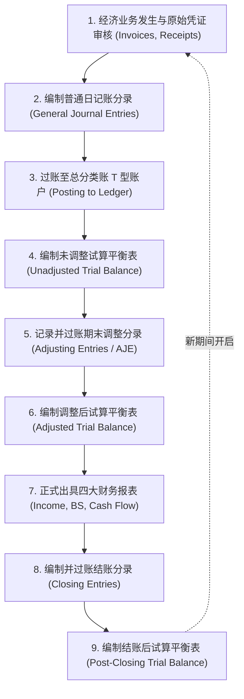

# Lec 05 会计循环与试算平衡全流程 (The Accounting Process: Journal Entries to Trial Balance)

> MIT Sloan School of Management · 15.501 Corporate Financial Accounting · 讲义 05

## TL;DR

- 会计循环是将异构原始交易凭证有序转化为标准化通用财务报表的闭环工程控制流程。
- 试算平衡表通过校验借贷总额相等验证分录机械自洽，但无法检出漏记、重记或科目误用等逻辑缺陷。
- 账户体系严格区隔跨期滚存的永久性资产负债表科目与期末必须归零清空的临时性损益科目。
- 结账分录通过损益汇总中介将当期经营净成果注入留存收益，完成资本存量与经营流量的逻辑合流。

## 会计循环全景九步工程流水线

在企业日常运营中，各种商业往来产生海量的异构原始凭证（如采购发票、出库单、银行对账单、销售合同）。会计循环（The Accounting Cycle）正是将这些杂乱无章的外部经济活动，转化为结构统一、符合 GAAP 准则的四大财务报表的规范化流水线。这一流程必须在每个报告周期内严格按照固定的先后次序单向执行，任何跳步或颠倒顺序都会破坏账簿数据的严密性与审计证据链。



::: definition 会计循环 (The Accounting Cycle)
企业从接受原始业务凭证开始，经过交易确认、日记账登记、分类账过账、期末调账、试算平衡、出具报表，直至清空临时性损益账户并进入下一会计周期的标准化、连续性业务处理全流程。
:::

整个九步流程可提炼为三个关键阶段：
1. **日常记录阶段（步骤 1 至 3）**：实时捕获外部交易，按发生时间顺序录入日记账，并按科目维度离散过入分类账；
2. **期末调整与报告阶段（步骤 4 至 7）**：在分期截断日启动试算平衡，运用权责发生制编制预收、预付、应计项目的调整分录，生成调整后试算平衡表，并输出正式报表；
3. **期末收尾结账阶段（步骤 8 至 9）**：通过结账分录归零当期损益流量，将最终留存收益固化到结账后试算平衡表，为下一个周期的独立核算做好准备。

## 永久性账户与临时性账户的边界划分

总账系统之所以能够长期稳定运行，核心在于其对不同性质账户的生命周期进行了明确的隔离设计。如果允许经营费用或收入跨年度无休止地累加，企业的单年经营业绩将完全失去可比性；相反，如果每到年底把银行存款或应付欠款也清零，企业将彻底丧失资产与负债的法定追索权。因此，会计学确立了永久性账户与临时性账户的刚性界限。

```mermaid
flowchart LR
    subgraph Permanent [永久性账户 (Permanent Accounts)]
        direction TB
        P1["资产账户 (Assets)"]
        P2["负债账户 (Liabilities)"]
        P3["股本与留存收益 (Equity)"]
        P_Desc["期末余额不归零<br/>滚存进入下一会计期间的期初余额"]
    end

    subgraph Temporary [临时性账户 (Temporary Accounts)]
        direction TB
        T1["营业收入 (Revenues)"]
        T2["营业费用与成本 (Expenses)"]
        T3["利得与损失 (Gains & Losses)"]
        T4["宣告现金股利 (Dividends)"]
        T_Desc["仅衡量当期流量<br/>期末必须全额清零并结转至留存收益"]
    end
```

永久性账户反映的是历史累积至今的存量状态（Cumulative Stock），包括资产、负债和所有者权益中的投入资本与留存收益，其期末余额会原封不动地成为下一会计期的期初余额。与此相反，临时性账户（名义账户）仅用于度量当前特定时间段内的经济流量（Flow），包括营业收入、主营业务成本、研发支出、管理费用以及股利分配。临时性账户是联结前后两个资产负债表时点的“流量管道”。

::: theorem 账户重置定理 (Account Reset Theorem)
1. 任何临时性损益科目（收入、费用）及股利科目，在会计期末的终值必须清零；
2. 临时性账户的净代数和（净利润减去已宣告股利）通过结账程序一次性注入资产负债表的“留存收益（Retained Earnings）”；
3. 新会计期间开启时，所有损益表科目期初余额严格为零，确保业绩统计周期隔离。
:::

## 试算平衡表的校验逻辑与盲区识别

在编制调整分录前后，财务人员会出具试算平衡表（Trial Balance）：

$$\sum \text{全部借方余额 (Debits)} = \sum \text{全部贷方余额 (Credits)}$$

| 账户名称 | 借方余额 (Debit) | 贷方余额 (Credit) |
| :--- | :---: | :---: |
| 现金及现金等价物 | 120,000 | |
| 应收账款 | 45,000 | |
| 存货 | 30,000 | |
| 预付租金 | 6,000 | |
| 生产设备 | 150,000 | |
| 累计折旧 (设备备抵) | | 30,000 |
| 应付账款 | | 25,000 |
| 应付票据 | | 50,000 |
| 普通股股本 | | 100,000 |
| 期初留存收益 | | 60,000 |
| 营业收入 | | 180,000 |
| 主营业务成本 | 90,000 | |
| 销售与管理费用 | 35,000 | |
| 折旧费用 | 10,000 | |
| 利息费用 | 4,000 | |
| 宣告股利 | 5,000 | |
| **合计** | **445,000** | **445,000** |

::: pitfall 试算平衡表的检错盲区
试算平衡表借贷相等，**仅仅证明了借贷记账的数学自洽性，绝不能证明账目没有发生严重错误**。以下五类典型错误无法通过试算平衡表检出：
1. **整笔交易完全遗漏 (Omission)**：发生的一笔 10 万元销售业务未作任何记录，借贷两边同时少记 10 万，总额依然平衡；
2. **整笔交易重复记账 (Duplication)**：同一笔采购业务被录入两次，借贷两边同时虚增，依然平衡；
3. **借贷科目颠倒或金额对称录错 (Reversal / Transposition Error)**：应借记现金 54 元、贷记收入 54 元，误录为借记现金 45 元、贷记收入 45 元；
4. **串户记错 (Misposting to Wrong Account)**：本应借记“管理费用”，误借记“销售费用”，费用大类借贷总额无差错；
5. **相互抵消的补偿性差错 (Compensating Errors)**：现金账户少借 1000 元，应收账款账户恰好多借 1000 元。
:::

## 期末结账分录（Closing Entries）全流程推导

期末结账通过中介账户“**本年利润/损益汇总 (Income Summary)**”完成标准四步分录：

::: example 四步结账分录标准模板
1. **结转全部收入账户至本年利润**（清空收入账户借方）：
   $$\text{借：营业收入 (Revenues)} \quad 180,000 \quad / \quad \text{贷：本年利润 (Income Summary)} \quad 180,000$$
2. **结转全部费用账户至本年利润**（清空费用账户贷方）：
   $$\begin{aligned}
   \text{借：本年利润 (Income Summary)} \quad 139,000 \quad / \quad & \text{贷：主营业务成本 (COGS)} \quad 90,000 \\
   & \text{贷：销售与管理费用 (SG\&A)} \quad 35,000 \\
   & \text{贷：折旧费用 (Depreciation)} \quad 10,000 \\
   & \text{贷：利息费用 (Interest Expense)} \quad 4,000
   \end{aligned}$$
   此时，本年利润账户贷方余额为当期净利润：$180,000 - 139,000 = 41,000$ 元。
3. **结转本年利润净额至留存收益**：
   $$\text{借：本年利润 (Income Summary)} \quad 41,000 \quad / \quad \text{贷：留存收益 (Retained Earnings)} \quad 41,000$$
4. **结转已宣告股利至留存收益**（清空股利账户贷方）：
   $$\text{借：留存收益 (Retained Earnings)} \quad 5,000 \quad / \quad \text{贷：已宣告现金股利 (Dividends)} \quad 5,000$$
:::

经过上述处理后，所有收入、费用、损益汇总与股利账户期末余额全额清零；期末留存收益由期初的 60,000 元更新为：

$$\text{期末留存收益} = 60,000 + 41,000 - 5,000 = 96,000 \text{ 元}$$

## 我的理解

::: insight 会计循环是企业软件工程的状态机范式
对于具备计算机系统背景的工程管理者而言，会计循环可以直接映射为一个高可靠性的**分布式有限状态机（Finite State Machine）**：
1. **日记账是不可篡改的事件日志（Event Sourcing / WAL）**：日记账严格按时间戳线性追加（Append-only），记录了所有原子交易事件的 Payload，保证了任何故障状态均可完整回溯。
2. **分类账是物化视图（Materialized View）**：T 型账户是将日志事件按实体聚合的视图快照，试算平衡则是视图之间的一致性校验（Consistency Check）。
3. **结账分录是版本快照与 Epoch 推进（State Snapshotting）**：清空临时账户并将净收益写入留存收益，等同于在内存中冻结一个 Epoch 的状态并将其持久化为快照。这种自文艺复兴时期由卢卡·帕乔利（Luca Pacioli）系统总结的复式记账法，不仅是现代商业金融的基石，更在五百年前就蕴含了现代分布式系统状态共识的深邃数学美感。
:::
