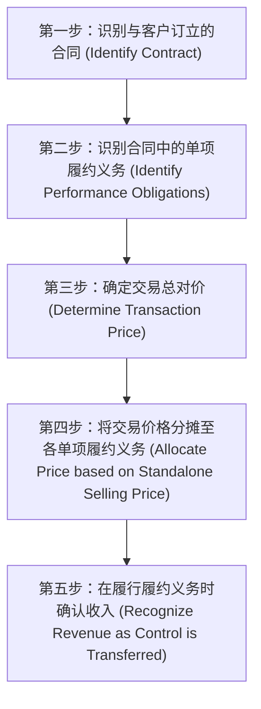

# Lec 06 收入确认准则与长期合同计量 (Revenue Recognition Criteria & Long-Term Contracts)

> MIT Sloan School of Management · 15.501 Corporate Financial Accounting · 讲义 06

## TL;DR

- 收入确认是驱动利润表首行与盈余质量的关键闸门，严禁将未履约订单或非确定性对价计入当期收入。
- 现代收入准则确立五步法分析框架，核心聚焦履约义务的识别与控制权转移（单一时点与持续期间）。
- 长期建造合同采用完工百分比法，基于投入成本发生比例将工程毛利系统平摊至建设各会计期间。
- 预期合同总成本一旦超出合同总价，必须立即全额计提合同预计损失，恪守会计稳健性防线。

## 收入确认的经济实质与传统准则防线

营业收入（Revenue / Top Line）是企业利润表的第一行，也是资本市场对企业增长潜能最敏感的指标。因此，管理层拥有强烈的动机通过激进确认收入（如提前开票、虚构出库、渠道塞货）来粉饰财报。为防范滥用，美国证券交易委员会（SEC SAB 101/104）在传统 GAAP 下构筑了四道刚性防线：

::: theorem 传统收入确认四大充分必要条件 (SAB 104 Criteria)
1. **存在有说服力的商业协议证据 (Persuasive evidence of an arrangement exists)**：必须有正式签署的有效合同或经法律认可的客户采购订单，口头承诺无效；
2. **产品已交付或服务已履行 (Delivery has occurred or services have been rendered)**：货物的所有权及主要风险与报酬已实质转移给买方，或者服务已全部提供完毕；
3. **销售价格固定或可明确确定 (Seller's price to buyer is fixed or determinable)**：合同金额明确，不存在附带无条件退货退款或重大未决价格调整条款；
4. **款项回收具有合理确定性 (Collectibility is reasonably assured)**：客户具备充足的信用资质与履约清偿能力。
:::

## 现代收入准则核心：五步法分析模型

针对软件许可、多要素捆绑销售（如苹果 iPhone 硬件 + iOS 免费更新 + iCloud 存储）等复杂商业模式，FASB 与 IASB 联合发布了革命性的新一代收入准则（ASC 606 / IFRS 15），统一推行**五步法分析框架（Five-Step Model）**：

::: definition 单项履约义务 (Performance Obligation)
合同中企业向客户转让可明确区分商品（Distinct Goods）或服务（Distinct Services）的承诺。如果商品服务能使客户单独受益，且企业向客户转让该商品的承诺与合同中的其他承诺可单独区分，则该商品构成单项履约义务。
:::

在第五步确认时点上，准则明确区分为**时点履约（Point in Time）**与**时期履约（Over Time）**：
- **时点确认**：以客户获得商品**法定控制权（Control）**的瞬时确认（如商场收银台商品过机交割）；
- **时期确认**：客户在企业履约的同时即取得并消耗经济利益（如保洁服务），或客户控制履约过程中的在建资产（如定制大楼建设），按履约进度确认。

## 长期工程合同会计：完工百分比法 vs. 完全合同法

对于跨越多个会计年度的重型基础设施建设、造船或大型防御装备合同，会计上存在两种经典的核算方法：

| 核算方法 | 完工百分比法 (Percentage-of-Completion Method) | 完全合同法 (Completed-Contract Method) |
| :--- | :--- | :--- |
| **收入与利润确认时点** | 建设期内每个会计期间**按完工进度分期确认** | 直至项目**最终竣工并经验收时一次性确认** |
| **适用准则前提** | 合同价格固定、买卖双方均有履约能力、工程总成本与完工进度能够**合理可靠估计** | 无法可靠估计工程最终总成本或存在重大履约不确定性 |
| **对财务报表的影响** | 收入与利润平滑，真实反映各年度的经济产出 | 前期呈现零毛利，竣工年份利润断崖式集中爆发 |
| **国际准则接纳度** | US GAAP 与 IFRS 广泛推荐作为首选基准 | IFRS 彻底禁止；US GAAP 仅在无法可靠测算时被动允许 |

### 完工百分比法（成本比例法）计算公式推导
在实践中，最常用的完工进度衡量指标是**成本比例法（Cost-to-Cost Method）**：

$$\text{当期累计完工比例} = \frac{\text{截至当期累计已发生成本 (Cumulative Costs Incurred)}}{\text{预计合同总成本 (Total Estimated Contract Costs)}}$$

$$\text{截至当期累计应确认收入} = \text{合同总价} \times \text{当期累计完工比例}$$

$$\text{当期应确认营业收入} = \text{截至当期累计应确认收入} - \text{以前各期已累计确认收入}$$

$$\text{当期应确认营业成本} = \text{当期实际发生成本}$$

$$\text{当期应确认毛利} = \text{当期应确认营业收入} - \text{当期应确认营业成本}$$

::: example 完工百分比法全流程测算
某建设公司签署一份固定总价 1,000 万元的桥梁建造合同。工程跨期 3 年：
- **第一年**：实际发生成本 200 万元，预计尚需发生成本 600 万元（预计总成本 800 万元）；
  - 完工进度：$\frac{200}{800} = 25\%$；
  - 第 1 年确认收入：$1,000 \times 25\% = 250$ 万元；毛利：$250 - 200 = 50$ 万元。
- **第二年**：当年实际发生成本 400 万元（累计发生 600 万元），由于原材料涨价，预计尚需发生成本 200 万元（预计总成本修正为 800 万元）；
  - 累计完工进度：$\frac{600}{800} = 75\%$；
  - 累计应确认收入：$1,000 \times 75\% = 750$ 万元；
  - 第 2 年应确认收入：$750 - 250 = 500$ 万元；毛利：$500 - 400 = 100$ 万元。
- **第三年**：当年实际发生成本 210 万元（累计发生成本 810 万元），工程全部竣工交付；
  - 第 3 年确认收入：$1,000 - 750 = 250$ 万元；毛利：$250 - 210 = 40$ 万元。
- **三年总计**：确认总收入 1,000 万元，总成本 810 万元，实现总毛利 190 万元。
:::

## 会计稳健性与预期合同亏损的立即全额计提

如果外部环境发生剧烈变动（如特大通胀或地质灾害），导致预计合同总成本超过了合同固定总价，会计准则触发无条件的**稳健性惩罚机制**：

::: theorem 预期合同损失立即计提原则 (Loss on Long-Term Contracts)
一旦工程最新测算的预计总成本超出合同固定总价，不论当前处于工程的哪一阶段（即使完工进度仅有 10%），**整个合同全生命周期的全部预期净亏损必须在发现当期全额确认为损失**，严禁按完工比例分期递延。
:::

::: example 预计亏损分录处理
在上述案例第二年中，若预计尚需发生成本飙升至 500 万元（累计已发生 600 万，总成本预计达 1,100 万元，合同总价 1,000 万元，全生命周期预期净亏损 100 万元）：
- 第二年应确认收入：$1,000 \times \frac{600}{1100} - 250 = 545.45 - 250 = 295.45$ 万元；
- 第二年应确认成本：实际发生 400 万元，外加预计合同剩余期间的未发生成本减值准备，确保第一年确认的 50 万元毛利被彻底冲回，且让第二年累计净亏损直接达到 100 万元。
:::

## 我的理解

::: insight 完工百分比法是审计造假与业绩操纵的重灾区
在财务分析实务中，重工制造与工程建设行业的“完工百分比法”是专业做空机构重点解剖的目标：
1. **分母的主观操纵性**：完工比例公式的分母是“预计总成本”。在管理层薪酬考核的关键年份，如果项目出现重大延误，管理层只需在系统里将“预计尚需发生成本”人为下调，分母变小，完工百分比瞬间被人为拉高，便可在当期合法确认大笔虚假收入与毛利。
2. **存货在建工程与预收结算的剪刀差**：看工程承包商的资产负债表，必须紧盯“已完工未结算款（Costs and Estimated Earnings in Excess of Billings，属于资产）”和“已结算未完工款（Billings in Excess of Costs and Estimated Earnings，属于负债）”。如果一家工程企业的“已完工未结算款”常年居高不下且增速远超行业，说明公司一直在纸面上确认收入，但业主方根本不同意按其进度开票支付，极可能在工程后期爆发巨额减值冲销暴雷。
:::
