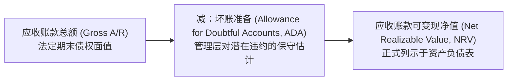
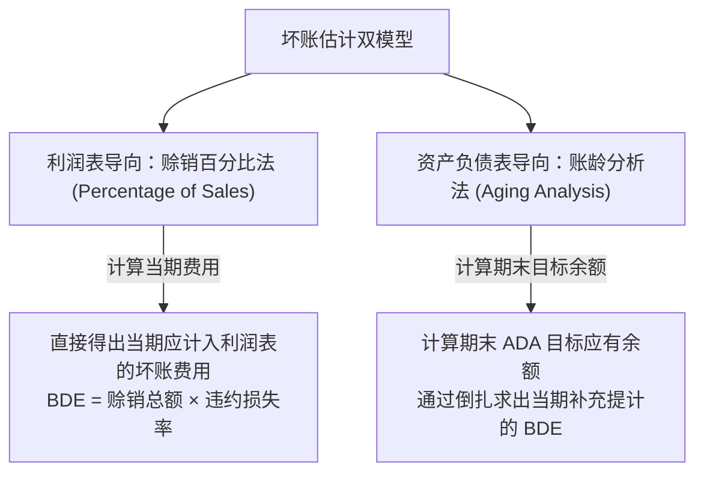

# Lec 07 应收账款估值与坏账准备计提 (Revenue Recognition cont.: Accounts Receivable & Bad Debt Allowances)

> MIT Sloan School of Management · 15.501 Corporate Financial Accounting · 讲义 07

## TL;DR

- 赊销商业模式在加速营收扩张的同时引入了客户违约风险，必须通过备抵法实现资产负债表可变现净值计量。
- 利润表法（赊销百分比法）聚焦当期收入与信用损失的精准配比，直接测算当期应计提的坏账费用。
- 资产负债表法（账龄分析法）聚焦应收账款期末存量违约概率，推导坏账准备目标余额并反求当期费用。
- 实际核销呆账只涉及应收账款总额与坏账准备的内部抵消，不会对当期资产净值或净利润产生任何冲击。

## 赊销信用与资产可变现净值（NRV）

在现代商业竞争中，极少有企业能够完全依靠一手交钱一手交货的现金结算模式运营。为了扩大销售规模、维系渠道黏性，企业普遍向客户提供 30 至 90 天的商业信用，由此产生**应收账款（Accounts Receivable, A/R）**。然而，商业信用必然伴随客户破产、欺诈或财务困境导致的坏账违约损失。

::: definition 应收账款可变现净值 (Net Realizable Value, NRV)
企业预期从其未结清的应收账款总额中最终能够实际收回的现金净额：
$$\text{应收账款净额 (Net A/R)} = \text{应收账款总账面值 (Gross A/R)} - \text{坏账准备 (ADA)}$$
其中，“坏账准备”是应收账款的**对冲备抵账户（Contra-Asset Account）**，其正常余额在贷方。
:::

## 直接转销法与备抵法的会计原理冲突

处理潜在信用损失在会计上有两种机制：

| 核算机制 | 直接转销法 (Direct Write-Off Method) | 备抵法 (Allowance Method) |
| :--- | :--- | :--- |
| **记账时点** | 仅在确认某特定客户**彻底违约破产时**直接冲销应收并记入费用 | 在**确认赊销收入的同一会计期间**，根据历史经验预先计提坏账 |
| **配比原则遵循度** | **严重违反配比原则**：往往在次年或第三年确认损失，与早期收入脱节 | **完全符合配比原则**：将信用风险成本与当期激进赊销收益同期对冲 |
| **资产负债表真实性** | 导致未到期应收账款常年按名义全额高估列示 | 始终按扣除预期违约后的可变现净值真实列示 |
| **GAAP 准则认可度** | **严禁在正式财务报表中使用**（仅在税法征税时允许） | **GAAP 与 IFRS 强制要求的唯一合规方法** |

## 坏账准备计提的两大计量模型

在备抵法下，管理层主要运用两种量化模型估计坏账准备与坏账费用（Bad Debt Expense）：

### 1. 赊销百分比法（利润表导向）
该方法基于历史经验违约率（如历史上 2% 的赊销款无法收回），侧重于收入与费用的同期配比：

$$\text{当期坏账费用 (Bad Debt Expense)} = \text{当期赊销总额 (Credit Sales)} \times \text{历史估计损失率}$$

::: example 赊销百分比法核算
某公司当年实现赊销收入 1,000,000 元，历史统计坏账率为 1.5%。期初坏账准备贷方余额为 3,000 元。
- 当期坏账费用：$1,000,000 \times 1.5\% = 15,000$ 元；
- 记账分录：
  $$\text{借：资产减值损失 - 坏账费用 (Bad Debt Expense)} \quad 15,000 \quad / \quad \text{贷：坏账准备 (ADA)} \quad 15,000$$
- 期末坏账准备累计贷方余额：$3,000 + 15,000 = 18,000$ 元。
:::

### 2. 账龄分析法（资产负债表导向）
该方法认为：账款逾期时间越长，发生违约的概率呈非线性指数级上升。企业根据期末应收账款明细账，按逾期天数将其划入不同账龄组（Buckets）：

| 账龄分组 (Aging Category) | 应收账款余额 (Gross A/R) | 历史违约概率 (Loss Rate) | 目标坏账准备 (Target ADA) |
| :--- | :---: | :---: | :---: |
| **未逾期 (Current, 1-30天)** | 500,000 元 | 1% | 5,000 元 |
| **逾期 31-60 天** | 200,000 元 | 5% | 10,000 元 |
| **逾期 61-90 天** | 80,000 元 | 15% | 12,000 元 |
| **逾期 90 天以上** | 40,000 元 | 50% | 20,000 元 |
| **合计** | **820,000 元** | — | **47,000 元** |

::: theorem 账龄分析法倒扎调整方程
$$\text{当期应补提坏账费用} = \text{期末目标 ADA 贷方余额} - \text{调整前现有 ADA 贷方余额 (若为借方则相加)}$$
:::

假设调账前坏账准备已有贷方余额 12,000 元，则当期需追加补提：$47,000 - 12,000 = 35,000$ 元。

## 坏账实际核销与核销后重新收回

### 1. 实际核销呆账（Write-Off of an Account）
当某特定客户被法院宣告实质破产、确认无法收回任何款项（如欠款 8,000 元）时，经风控审批执行核销：

$$\text{借：坏账准备 (ADA)} \quad 8,000 \quad / \quad \text{贷：应收账款 (Accounts Receivable)} \quad 8,000$$

::: pitfall 核销对净资产与净利润零影响的机理
很多初学者误以为“核销 8,000 元坏账”会导致公司当年利润表发生亏损。**实际上，核销对利润表与净资产没有任何影响**：
- 在核销前：Gross A/R 为 820,000 元，ADA 为 47,000 元，$\text{Net A/R} = 820,000 - 47,000 = 773,000$ 元；
- 在核销后：Gross A/R 降为 812,000 元，ADA 降为 39,000 元，$\text{Net A/R} = 812,000 - 39,000 = 773,000$ 元。
损失早在前期计提坏账准备时就已经计入利润表；核销仅是消除资产与其备抵科目的存量名义泡沫。
:::

### 2. 已核销账款的意外重新收回（Recovery of a Write-Off）
如果已核销的客户后期因资产重组意外偿还了 8,000 元欠款，会计上采用标准两步法还原：
- 第一步：冲回原核销分录，恢复法定债权：
  $$\text{借：应收账款 (A/R)} \quad 8,000 \quad / \quad \text{贷：坏账准备 (ADA)} \quad 8,000$$
- 第二步：按正常清偿记录现金收取：
  $$\text{借：银行存款 (Cash)} \quad 8,000 \quad / \quad \text{贷：应收账款 (A/R)} \quad 8,000$$

## 我的理解

::: insight 坏账准备是管理层操控利润的“蓄水池 / 饼干盒”
在现代财务报表排雷分析中，坏账准备（ADA）是典型的“饼干盒储蓄（Cookie-Jar Reserves）”温床：
1. **顺周期操控**：在公司业绩爆发的景气年份，管理层出于“平滑未来”的诉求，会故意调高账龄违约率，超额计提巨额坏账准备，将当期暴利悄悄藏入资产负债表水底（压低当期税收与基数）；
2. **危机年份释放“大清洗”**：当行业遭遇逆风、业绩必然无法达标时，新上任的管理层往往实行“洗大澡（Big Bath）”，一口气计提天量坏账准备将前任的所有潜在烂账打满；而在下一年度，通过调低坏账率或宣告坏账意外收回，瞬间释放数千万“转回收益”，不费吹灰之力创造出扭亏为盈的虚假管理神话。
3. **识别方法**：分析师应持续跟踪 $\text{ADA} / \text{Gross A/R}$ 的比例走势。若宏观违约率攀升而该比例却反常下行，或者应收账款周转天数（DSO）大幅拉长但拨备率纹丝不动，必须高度警惕其虚减坏账费用以粉饰净利润的重大舞弊嫌疑。
:::
