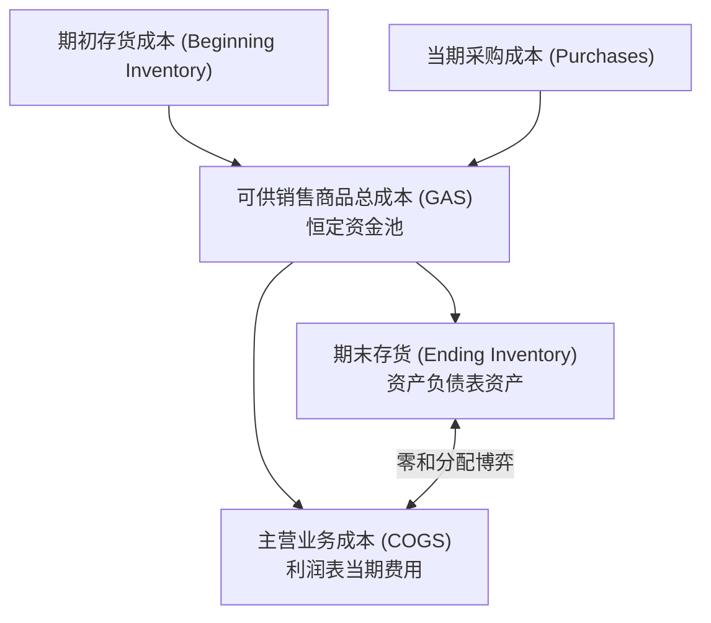
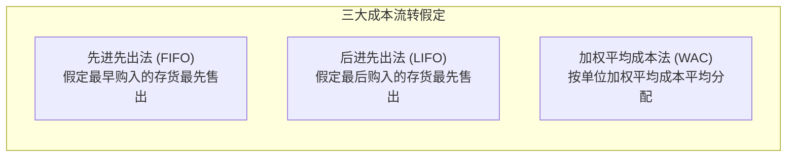

# Lec 08 存货计价流转与销货成本分析 (Inventory Valuation: FIFO, LIFO, LCM & LIFO Reserves)

> MIT Sloan School of Management · 15.501 Corporate Financial Accounting · 讲义 08

## TL;DR

- 存货会计恒等式决定了可供销售商品成本在期末存货资产与当期营业成本之间的零和分配博弈。
- 在物价上涨环境下，FIFO 报告更高的纸面利润却增加现金税负，LIFO 节约真实所得税但压低账面资产。
- 美国税法强制约束 LIFO 一致性规则，企业通过披露 LIFO 准备让分析师在两套会计方法间实现无缝还原。
- LIFO 清算会因为消耗古代超低成本存货层级而触发虚假暴利，成本与市价孰低法构筑了存货减值防御底线。

## 存货流转基本方程与零和博弈

存货（Inventory）是大多数制造与零售企业的核心营运资产。在一个完整的会计期间内，存货的流动严格受制于**存货成本恒等式**：

$$\text{期初存货 (BI)} + \text{当期净采购 (Purchases)} = \text{可供销售商品总成本 (GAS)} = \text{期末存货 (EI)} + \text{主营业务成本 (COGS)}$$

::: theorem 存货零和分配定理 (Inventory Zero-Sum Theorem)
对于给定的可供销售商品总成本（GAS）：
1. 赋予期末存货（EI）的每一元成本，就会使主营业务成本（COGS）减少一元，从而使当期毛利与净利润增加一元；
2. 反之，将更多成本分配给主营业务成本（COGS），就会使期末存货资产（EI）等额缩水，从而压低当期报告利润。
:::

## 存货成本流转假定（Cost Flow Assumptions）

企业购入的同质化商品往往因采购批次不同而价格各异。会计上并不强求实物移动路径与记账成本路径一一对应，而是允许采用以下成本流转假定：

::: definition 三大存货计价法
1. **先进先出法 (FIFO, First-In, First-Out)**：假定最早购入的存货单元最先售出或耗用。因此，期末结存的存货反映的是最近采购批次的市场成本，而计入 COGS 的是最早批次的历史陈旧成本。
2. **后进先出法 (LIFO, Last-In, First-Out)**：假定最近购入的存货单元最先售出。计入 COGS 的是当前最新采购成本，而期末结存存货反映的是较早时期的历史成本。
3. **加权平均成本法 (Weighted Average Cost)**：将可供销售总成本除以可供销售总件数得出加权单位成本，以此统一计量销货成本与期末存货。
:::

### 通货膨胀环境下的财务与税务特征对比

在绝大多数经济体所经历的物价持续上涨（Inflation）周期中，三大计价法呈现出截然相反的财务特征：

| 评估维度 | 先进先出法 (FIFO) | 后进先出法 (LIFO) | 财务影响与战略评价 |
| :--- | :--- | :--- | :--- |
| **主营业务成本 (COGS)** | **最低**（结转早期低成本） | **最高**（结转最新高成本） | LIFO 更好地实现了当前收入与当前重置成本的配比 |
| **毛利润与净利润 (Net Income)** | **最高**（纸面繁荣） | **最低**（被高成本压制） | FIFO 虚增了包含通胀溢价的持有损益（Holding Gain） |
| **资产负债表存货估值 (Ending Inv)** | **紧跟现实**（反映最新现货价格） | **严重失真**（沉淀数十年前古老价格） | FIFO 资产负债表更具经济真实性与相关性 |
| **实际所得税支出 (Income Tax)** | **最高**（净利润高导致交税多） | **最低**（合法压低应纳税所得额） | **LIFO 为企业创造了实质性的无息税收贷款现金流** |

::: pitfall 美国税法 LIFO 一致性规则 (LIFO Conformity Rule)
根据美国国税局（IRS IRC Sec 472）法律规定：如果企业为了节税在纳税申报表上采用了 LIFO，则在向股东发布的公开财务报表中**必须且只能同时采用 LIFO**。企业不能在报税时采用 LIFO 少交税，而在向股市发布财报时改用 FIFO 吹大每股收益。
:::

## LIFO 准备与报表还原分析

由于 IFRS 国际准则全面禁止使用 LIFO，而美国 GAAP 允许使用 LIFO，为了维护资本市场的横向可比性，SEC 强制要求采用 LIFO 的上市公司在财报附注中披露 **LIFO 准备（LIFO Reserve）**：

::: definition LIFO 准备 (LIFO Reserve)
企业在同一时点上，若采用 FIFO 计量所得到的存货价值与实际在资产负债表上列示的 LIFO 存货账面价值之间的累计差额：
$$\text{存货}_{\text{FIFO}} = \text{存货}_{\text{LIFO}} + \text{LIFO 准备 (LIFO Reserve)}$$
:::

根据上述关系，分析师可以通过 LIFO 准备的当期变动额，将两家采用不同存货政策的公司的利润表还原至同一口径：

$$\text{COGS}_{\text{FIFO}} = \text{COGS}_{\text{LIFO}} - \Delta \text{LIFO 准备}$$

$$\text{当期税前利润增加额}_{\text{FIFO vs LIFO}} = \Delta \text{LIFO 准备} = \text{LIFO 准备}_{\text{期末}} - \text{LIFO 准备}_{\text{期初}}$$

::: example LIFO 准备还原实战
卡特彼勒（Caterpillar）在财报中披露：
- 采用 LIFO 计量的期末存货账面值为 80 亿美元；
- 附注披露期初 LIFO 准备为 20 亿美元，期末 LIFO 准备为 24 亿美元；
- 当期按 LIFO 报告的 COGS 为 300 亿美元，实际所得税率为 25%。

**分析师还原步骤**：
1. **真实存货重置价值**：若按 FIFO，期末存货实际应为 $80 + 24 = 104$ 亿美元；
2. **COGS 调整**：LIFO 准备当期增加 $\Delta = 24 - 20 = 4$ 亿美元，若按 FIFO，当年 COGS 应下调至 $300 - 4 = 296$ 亿美元；
3. **税前利润修正**：FIFO 下税前利润将增加 4 亿美元；
4. **累计现金税收红利**：采用 LIFO 至今，累计为公司节约的现金所得税达 $24 \times 25\% = 6$ 亿美元。
:::

## LIFO 清算危机与成本与市价孰低法（LCM）

### 1. LIFO 清算的负面冲击 (LIFO Liquidation)
在正常情况下，企业每年采购量大于或等于销售量，LIFO 存货池（Pools）不断追加新层级。但如果遭遇供应链断裂或突发清仓削减库存，当期销售量超过了当期采购量，企业将被迫**消耗多年前沉淀在底层的极低成本存货层（Diiping into Base Layers）**。
- 这会导致当期结转的 COGS 异常骤降；
- 利润表瞬间暴增巨额非经常性虚假纸面毛利；
- 带来惨烈的即期现金所得税补缴账单，这被称为 **LIFO 清算（LIFO Liquidation）**。

### 2. 成本与市价孰低法 (Lower of Cost or Market, LCM)
无论采用哪种成本流转假定，存货在资产负债表日都必须接受可变现能力的检验：

::: theorem 成本与市价孰低原则 (LCM Rule)
当存货因物理损坏、过时变质或市场需求坍塌导致其市场可变现净值（NRV）跌破账面历史成本时，企业必须按照可变现净值计量，并将账面价值与公允价值的差额确认为当期**存货跌价损失（Inventory Impairment Loss）**计入利润表。
:::

## 我的理解

::: insight 存货计价是观察 CFO 资本配置理性的一面明镜
在金融和战略分析中，评估一家制造业管理层的真正成色，看其存货政策的抉择就能洞若观火：
1. **虚荣的 CEO 选择 FIFO**：在长期通胀和稳步扩张的传统重工业中，如果一家美国企业坚持选择 FIFO，往往说明管理层极度虚荣、极度迎合华尔街短期每股收益（EPS）预期。为了向股东呈现更高的纸面账面利润，他们不惜每年多向国税局白白缴纳数千万甚至数亿美元真金白银的所得税。
2. **理性的资本家选择 LIFO**：选择 LIFO 的管理层虽然承受着被散户误解为“盈利能力平庸”的压力，却将省下来的大笔税收现金流重新投入到高回报的产能升级或股票回购中。
3. **警惕存货异常积压与减值滞后**：在消费电子和半导体行业，芯片与数码产品的生命周期极短，跌价速度呈指数级。若一家硬件公司的存货周转率连续四个季度恶化，管理层却坚称“存货没有贬值风险”拒绝计提减值准备，这往往是重大财务雷暴的前奏，一旦新一代架构发布，老库存只能按废铁计价全额冲销。
:::
