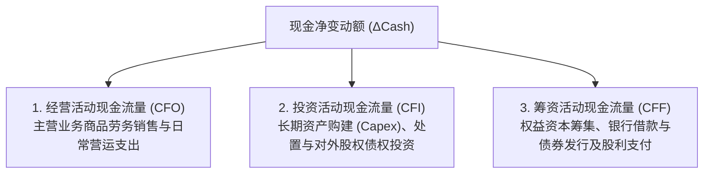
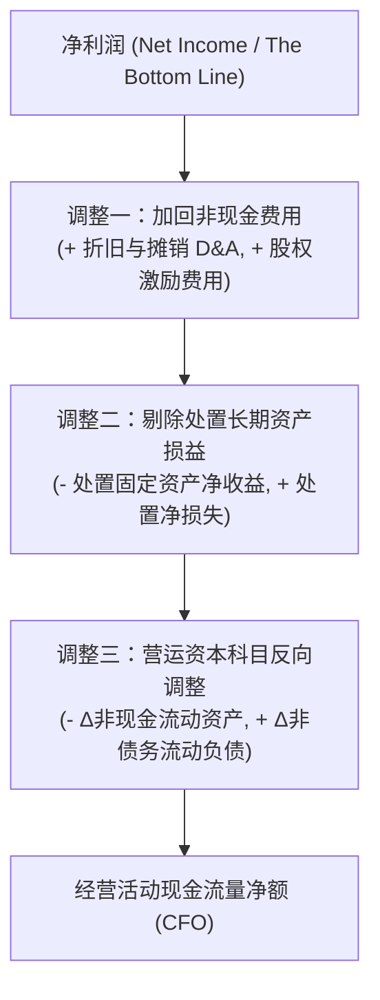

# Lec 09 现金流量表编制逻辑与三类活动 (Statement of Cash Flows: Operating, Investing, Financing)

> MIT Sloan School of Management · 15.501 Corporate Financial Accounting · 讲义 09

## TL;DR

- 现金流量表穿透权责发生制的人为估计与跨期平滑，直接度量企业真实的现金创造与偿付流动性。
- 现金流变动在代数上由非现金资产、负债及股东权益的期间净变动严格推导推算闭环。
- 企业现金流严格区隔为经营活动（CFO）、投资活动（CFI）与筹资活动（CFF）三大独立功能模块。
- 间接法以净利润为起点，通过剔除非现金支出、剥离处置损益并校正营运资本变动重构经营现金流。

## 现金流量表的数学推导源起

利润表展现的是由权责发生制推导出的“理论盈利流量”，而企业清偿债务、支付员工工资、缴纳税款和发放股利，必须依赖最底层的硬通货——现金。现金流量表（Statement of Cash Flows）正是解释企业银行账户在期初至期末之间**净变化量（$\Delta \text{Cash}$）**的权威报表。

现金流量表的编制逻辑并非凭空创造，而是直接从资产负债表恒等式中推导而来：

$$\Delta \text{资产} = \Delta \text{负债} + \Delta \text{所有者权益}$$

将资产细分为现金资产与非现金资产：

$$\Delta \text{现金 (Cash)} + \Delta \text{非现金资产 (Non-Cash Assets)} = \Delta \text{负债 (Liabilities)} + \Delta \text{股本} + \Delta \text{留存收益}$$

因为 $\Delta \text{留存收益} = \text{当期净利润 (Net Income)} - \text{宣告股利 (Dividends)}$，移项整理可得：

$$\Delta \text{现金} = \text{净利润} + \Delta \text{负债} + \Delta \text{股本} - \Delta \text{非现金资产} - \text{已宣告股利}$$

## 三大现金流活动的经济内涵与边界界定

::: definition 现金流三大功能分类
1. **经营活动现金流量 (Cash Flows from Operating Activities, CFO)**：与企业生产、交付核心产品和劳务直接相关的一切现金交易（销售商品收到的现金、购买原材料付出的现金、支付员工薪酬、支付日常税费与利息）。
2. **投资活动现金流量 (Cash Flows from Investing Activities, CFI)**：与长期资产（厂房、设备、无形资产）的购建（资本开支 Capex）与处置、购买与处置其他实体的股票与债券等金融资产相关的现金流动。
3. **筹资活动现金流量 (Cash Flows from Financing Activities, CFF)**：导致企业权益资本及债务资本规模和结构发生变化的现金交易（发行股票收到的现金、回购股份、举借与偿还长期借款、发行与赎回债券、支付现金股利）。
:::

| 业务场景 | 交易属性分类 | 现金流量表列示大类 | 常见分析混淆点 |
| :--- | :--- | :--- | :--- |
| **向客户销售货物收到现金** | 核心日常主营活动 | **经营活动流入 (CFO+)** | 无争议 |
| **购置生产用数控机床** | 资本开支形成固定资产 | **投资活动流出 (CFI-)** | 是为了创造未来长期产能，而非当期消耗 |
| **发行企业可转换债券募资** | 负债资本扩张 | **筹资活动流入 (CFF+)** | 属于债务融资行为 |
| **向股东派发现金股利** | 对所有者资本回报 | **筹资活动流出 (CFF-)** | 股利不是费用，不在利润表，属于筹资变动 |
| **支付银行借款利息** | 借款资金占用代价 | **经营活动流出 (CFO-)** | US GAAP 规定利息计入 CFO；IFRS 允许计入 CFF |

## 经营活动现金流的间接法（Indirect Method）编制全解

编制经营活动现金流量有两种方法：直接法（Direct Method，逐笔罗列收现与付现全额）与间接法（Indirect Method，从净利润调整还原）。在美股与 A 股上市公司中，超过 98% 的企业采用**间接法**列示 CFO。

::: theorem 营运资本项目调节法则 (Working Capital Adjustment Rules)
在将净利润调节为经营现金流时：
1. **非现金流动资产增加 $\rightarrow$ 扣减（$-$）**：如应收账款（A/R）增加，意味着部分营收尚未收回现金；存货（Inventory）增加，意味着现金被沉淀在仓库中；
2. **非现金流动资产减少 $\rightarrow$ 加回（$+$）**：存货减少说明销售中消耗了旧库存且换回了现金；
3. **经营性流动负债增加 $\rightarrow$ 加回（$+$）**：如应付账款（A/P）增加，意味着占用了供应商资金，变相节约了现金支出；
4. **经营性流动负债减少 $\rightarrow$ 扣减（$-$）**：如偿还了供应商欠款，发生了实际现金流出。
:::

### 间接法经典核算全景案例
某制造公司当年财务数据如下：
- 当期净利润：$200,000$ 元；
- 计提固定资产折旧：$40,000$ 元；计提无形资产摊销：$10,000$ 元；
- 处置旧运输货车获得收益（已计入净利润）：$5,000$ 元（该资产变现现金全额进入投资活动 CFI）；
- 应收账款（A/R）期末比期初增加：$30,000$ 元；
- 存货（Inventory）期末比期初减少：$15,000$ 元；
- 预付款项增加：$5,000$ 元；
- 应付账款（A/P）增加：$20,000$ 元；
- 应付工资减少：$10,000$ 元。

计算经营活动现金流量净额（CFO）：

$$\begin{aligned}
\text{CFO} &= 200,000 \quad (\text{净利润}) \\
&\quad + 40,000 + 10,000 \quad (\text{加回非现金折旧摊销}) \\
&\quad - 5,000 \quad (\text{剔除资产处置收益}) \\
&\quad - 30,000 \quad (\text{应收增加扣减}) \\
&\quad + 15,000 \quad (\text{存货减少加回}) \\
&\quad - 5,000 \quad (\text{预付增加扣减}) \\
&\quad + 20,000 \quad (\text{应付增加加回}) \\
&\quad - 10,000 \quad (\text{应付工资减少扣减}) \\
&= 235,000 \text{ 元}
\end{aligned}$$

## 重大非现金投资与筹资活动披露

并非所有重大资本运作都直接通过银行账户结算。例如：企业直接向设备厂商定向发行 5,000 万元股票换取整套大型生产线，或者通过开具 3,000 万元长期应付票据购入土地。
- 这些交易既不产生即期现金流入，也不产生即期现金流出，因此**严禁计入现金流量表正文**；
- 但由于其显著重构了企业的资产与负债结构，准则强制要求在**现金流量表补充资料或财报附注中进行专题披露**，确保外部分析师能完整追踪资本全貌。

## 我的理解

::: insight 现金流的真实含金量与商业模式话语权
许多商业分析师过分迷信净利润，但在经验丰富的价值投资者眼中，现金流量表才是洞察企业产业链真实地位的“照妖镜”：
1. **净现比（CFO / Net Income）**：优秀的护城河企业（如茅台、苹果、微创软件），其每年的 $\text{CFO} / \text{净利润}$ 常年维持在 $1.1 \sim 1.3$ 之间。由于折旧费用的存在，健康的商业模式应当创造出远高于会计净利润的经营现金流。
2. **“无息贷款”的负营运资本模式**：戴尔（Dell）和京东等平台零售商，通过强势的供应链掌控力，将应付账款账期拉长至 90 天，而向消费者提供即时现金支付或极短账期。这使得经营性流动负债持续高于流动资产（负营运资本），企业可以在自身业务规模扩张中，自发形成庞大的免息现金流资金池，用供应商的钱为自身开疆拓土。
3. **警惕“假繁荣、真失血”的庞氏特征**：如果一家公司的利润表每季度都在发布喜报，净利润连创新高，但 CFO 连续多年为负，依靠不断在二级市场增发股票或借新还旧维持账面资金，其本质是典型的“吞金怪兽”。一旦信用环境收紧或银行抽贷，即便其账面留存收益再丰厚，也会在几天之内因流动性枯竭而瞬间猝死。
:::
