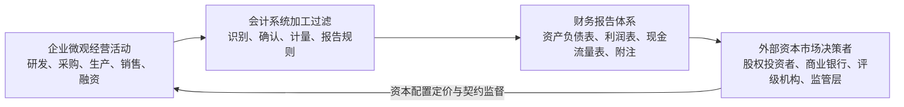
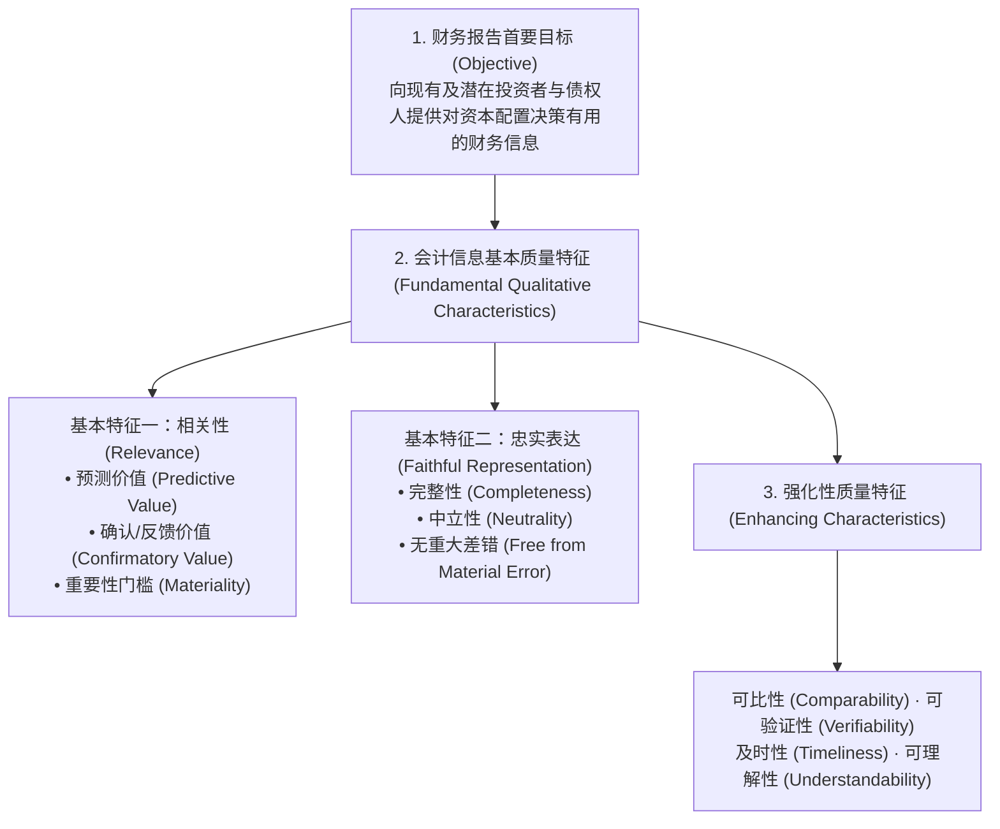
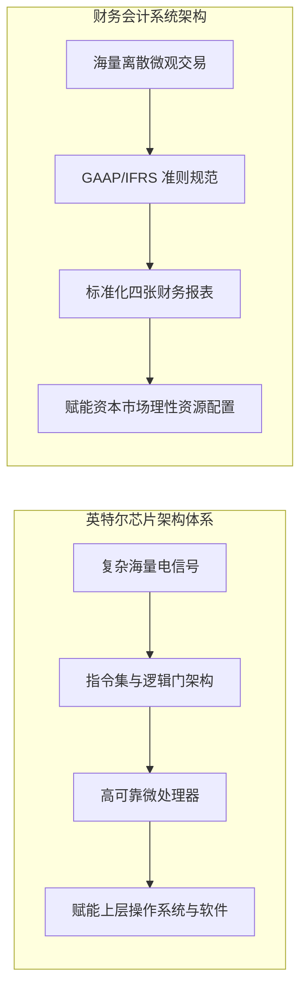

# Lec 01 财务会计概念框架与商业决策基石 (Overview and Conceptual Framework: Objectives, Qualitative Characteristics & 5 Challenges)

> MIT Sloan School of Management · 15.515 Financial Accounting · 讲义 01

## TL;DR

- 财务会计是连接企业微观经济活动与外部资本市场资源配置的核心量化契约沟通语言。
- 财务报告的目标是向外部现有及潜在投资者、债权人提供有助于做出理性投资和信贷决策的增量有用信息。
- 会计信息的两大基本质量特征是相关性（预测与反馈价值）与忠实表达（完整性、中立性与无差错）。
- 彼得·威尔逊教授五大挑战框架确立了从商业事件穿透至报表数字、再由报表逆向重构商业现实的分析范式。

## 会计的本质：商业活动的量化映射与契约中介

现代经济学与公司金融理论表明，企业的经营活动本质上是一系列充满不确定性的契约组合。由于管理层与外部资本所有者之间存在天然的信息不对称、逆向选择与道德风险，外部资本市场无法直接观察到车间工人的劳动强度、研发团队的技术突破或客户合同的履约进度。

**财务会计（Financial Accounting）**正是为了弥合这一信任鸿沟而演进出的标准化度量与报告系统：

财务会计不仅承担“记账员”的角色，更是现代市场经济有效运转的底层制度支柱：
1. **估值与定价功能（Valuation Role）**：为资本市场参与者提供无偏的高质量财务指标，帮助股票市场发现企业内在公允价值，引导全社会的流动性资本流向生产率最高的高效实体；
2. **契约与治理功能（Stewardship / Contracting Role）**：充当管理层与董事会、企业与债权人之间债务契约（Debt Covenants）和高管股权激励契约的履约裁决基准，防止内部人侵占股东财富。

## FASB 概念框架体系与会计信息质量特征

美国财务会计准则委员会（FASB）构建的**财务会计概念框架（Conceptual Framework）**，是所有公认会计准则（US GAAP）制定的“宪章”。它确立了从终极报告目标到具体要素确认计量的金字塔结构：

::: definition 会计要素三阶确认准则 (Recognition Criteria)
一项经济事项要被正式确认为资产负债表或利润表内的会计要素，必须同时满足四项严密门槛：
1. **符合定义（Definition）**：该项目符合资产、负债、权益、收入或费用的法定经济学定义；
2. **可计量性（Measurability）**：该项目具有能够以货币单位可靠计量的相关计量属性（如历史成本、现行公允价值）；
3. **相关性（Relevance）**：关于该项目的信息能够显著影响财务报告使用者的投资决策；
4. **可靠性/忠实表达（Reliability / Faithful Representation）**：信息真实、中立、可经由独立第三方审计师验证。
:::

## 彼得·威尔逊教授五大挑战框架

MIT Sloan 商学院彼得·威尔逊（G. Peter Wilson）教授为 15.515 课程确立了享誉全球商学教育界的**财务会计五大挑战（The Five Challenges Framework）**，指导学生从机械记账跃迁至战略分析：

| 挑战维度 | 核心探索问题 | 管理学与商业实战启示 |
| :--- | :--- | :--- |
| **1. 记录挑战 (Record Keeping Challenge)** | 微观经济事件如何通过复式记账法转化为借贷平衡表内科目？ | 理解资产负债表方程式（$A = L + E$）的刚性代数守恒与期末调账闭环。 |
| **2. 使用挑战 (Usage Challenge)** | 外部决策者（投行、基金、银行家）如何利用报表数字进行定价与风控？ | 穿透权责发生制应计项，利用杜邦分析分解企业核心竞争优势与流动性风险。 |
| **3. 规则挑战 (Rules Challenge)** | 为什么会计准则允许管理层存在判断空间？GAAP 与税法有何根本不同？ | 理解一致性（Consistency）与统一性（Uniformity）的权衡，把握准则演进脉络。 |
| **4. 搜寻挑战 (Search Challenge)** | 如何在数以百计的 10-K 年报脚注与附注披露中挖掘隐蔽的商业雷区？ | 掌握表内确认与表外披露的区别，识别未结清诉讼、表外租赁与表外关联方交易。 |
| **5. 洞察挑战 (Judgment / Insight Challenge)** | 管理层在会计政策选择中隐藏了怎样的战略动机与盈余操纵意图？ | 识破洗大澡（Big Bath）、Cookie Jar 准备金与激进收入确认背后的逆向选择。 |

这五大挑战形成了一个完美的双向认知闭环：
- **正向工程（Forward Engineering）**：商业现实发生 $\implies$ 会计系统记录 $\implies$ 财务报告呈现；
- **逆向工程（Reverse Engineering）**：阅读财务报告与脚注 $\implies$ 剥离会计政策噪音 $\implies$ 重构真实微观经营事实。

## 英特尔与会计师：芯片制造与会计系统的同构隐喻

在 15.515 第一讲的经典研讨中，威尔逊教授提出了一个发人深省的思想实验：**“世界顶级半导体巨头英特尔（Intel）与会计师究竟有什么共同之处？”**

两者的深层系统哲学高度同构：
1. **抽象与信息压缩能力**：英特尔微处理器将数以万亿计的底层无序电子物理运动，通过极度精密的指令集架构抽象为纯净的逻辑“0”与“1”；会计系统同样面对全世界上万个复杂的离散商业交易，通过权责发生制和借贷法则，将其高度精炼为标准统一的四张财务报表。
2. **标准化的接口协议**：如果每一个芯片制造商都使用专有且不公开的微代码，现代软件行业将瞬间瓦解；同样，如果每家企业都依据自己的主观意愿编制报表，资本市场将沦为充满欺诈的阿克洛夫“柠檬市场（Lemons Market）”。GAAP 就是商业世界不可或缺的通用操作系统。

## 我的理解

::: insight 会计不是刻板的技术手册，而是现代商业文明最优雅的逆向信息工程
深入理解财务会计的概念框架，能够彻底颠覆传统的认知偏见：
1. **没有中立的规则，准则制定本质上是社会财富的再分配**：许多初学者误以为会计准则像牛顿运动定律一样是纯粹的自然科学客观真理。然而，FASB 准则委员会历史上每一次重大准则变迁（如股票期权费用化 SFAS 123R、租赁上表 ASC 842、公允价值计量 ASC 820），背后都是硅谷高管、华尔街投行与游说集团在国会听证会上的激烈政治博弈。一个会计规则的轻微修正，能够瞬间让全美科技公司的纸面净利润蒸发数百亿美元。理解会计，本质上是理解商业社会的制度经济学。
2. **财报阅读者必须化身为逆向侦探**：企业编制的财务报表永远不是微观物理现实的简单复印件，而是经过管理层意图“折射”与“调味”后的叙事作品。优秀的分析师绝不会仅仅满足于看懂表内净利润增长了几个百分点，而是能够像顶级侦探一样，从看似枯燥的会计政策变更声明、坏账准备计提比例的微调以及递延所得税资产的增减中，敏锐捕捉到管理层竭力掩盖的商业基本面裂痕。
:::
