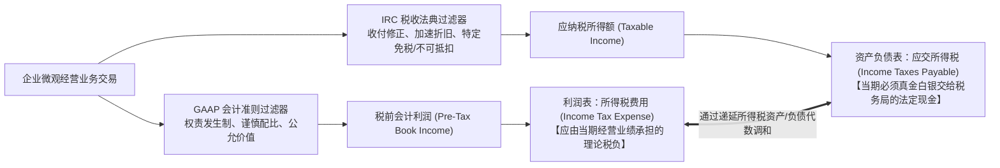
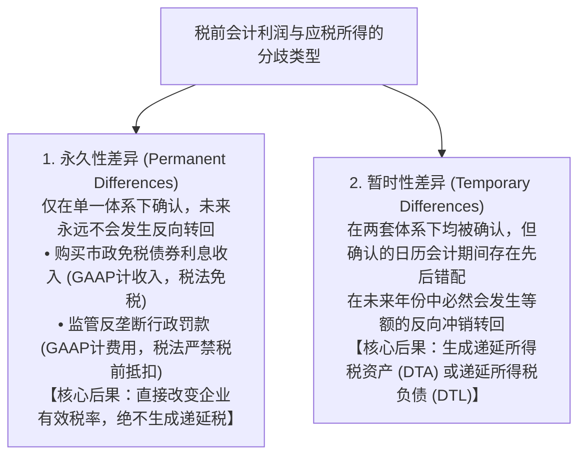
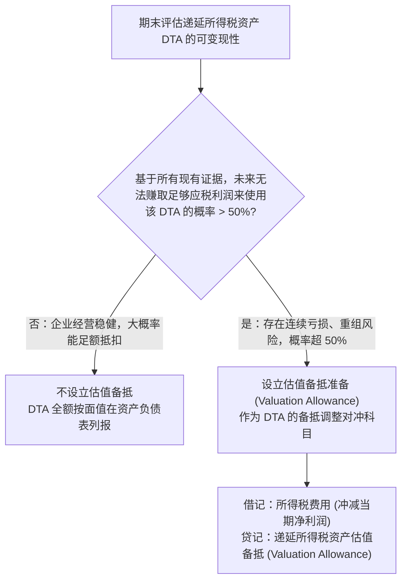

# Lec 10 所得税会计与递延税项核算 (Taxes and Deferred Tax Accounting: Temporary vs. Permanent Differences, DTA, DTL & Valuation Allowance)

> MIT Sloan School of Management · 15.515 Financial Accounting · 讲义 10

## TL;DR

- 财务会计准则（GAAP）以公允衡量经营业绩为目标，而国家税法（IRC）以财政征管与产业政策激励为导向。
- 永久性差异不跨期转回，直接改变有效税率；暂时性差异源自时间错配，生成递延税资产或负债。
- 递延所得税负债（DTL）本质是企业从政府获取的无息递延纳税杠杆，源于税法加速折旧与资产增值。
- 递延所得税资产估值备抵（Valuation Allowance）基于概率检验，常沦为管理层平滑盈余的战略工具。

## 财税分离原则：财务报告会计准则 vs. 国家税法典

在现代市场经济中，企业必须编制两套具有完全不同法律效力与核算逻辑的“账本”：
1. **对外财务报告账簿（Financial Accounting Books）**：遵循公认会计准则（US GAAP / IFRS），目标是向资本市场、现有及潜在股东、债券投资人提供关于企业真实经济价值与盈利能力的公允信息；
2. **法定纳税申报账簿（Tax Reporting Books）**：严格遵循国家国内税收法典（Internal Revenue Code, IRC），目标是向国税局（IRS）合规计征财政税收，并贯彻国家特定的宏观产业调控政策（如通过允许高新技术设备加速折旧来激励企业扩大资本投资）。

正是由于两套体系在收入确认与成本扣除时间节点上的巨大鸿沟，导致了**当期利润表应承担的“所得税费用”**与**当期实际向税务局支付的“应交税费”**发生显著脱节。这一差额在资产负债表中催生了**递延所得税（Deferred Taxes）**。

## 永久性差异 vs. 暂时性差异深度辨析

税前会计利润与应纳税所得额之间的所有分歧，在经济学与会计准则上被严格划分为两大根本类别：

这两类差异在财务分析中具有截然不同的经济学意义与报表影响：

1. **永久性差异（Permanent Differences）的制度刚性**：
   永久性差异是指某一交易事项在一个体系中被确认为收益或费用，但在另一个体系中**永远不被承认、且在未来任何会计期间都绝不会发生反向转回（Reversal）**的非对称项目。
   - 例如，企业为配合地方政府基础设施建设而认购的市政公债（Municipal Bonds），其产生的利息收入在财务报表上全额确认为投资收益，但根据税法被永久免除一切所得税；
   - 再如，企业因环境污染或不正当竞争被司法机关处以的巨额反垄断罚款，在财务报表上确认为营业外支出，但税法为了彰显惩戒意志，严禁在计算所得税时作为成本在税前列支。
   - **核心财务特征**：永久性差异在资产负债表中**绝对不会产生任何递延所得税资产或负债**！它唯一的财务影响，是永久性地拉高或压低企业的实际有效税率（Effective Tax Rate, ETR）。

2. **暂时性差异（Temporary Differences）的跨期守恒**：
   暂时性差异是指某项收入或支出在两套体系中**都被承认为合法的经济要素，但双方确认具体入账的日历年份存在先后的时间差（Timing Differences）**。
   - 只要时间跨度足够长，在资产的全生命周期内，财务报表累计确认的总费用与税法累计允许扣除的总成本在代数上完全相等；
   - 正是因为这种跨期错配在未来必然会“原路转回”，企业在当期少缴或多缴的税款，才具备了在资产负债表中确认为一项“未来负债（DTL）”或“未来资产（DTA）”的严密法律索偿权基础。

## 递延所得税负债（DTL）与递延所得税资产（DTA）代数模型

美国公认会计准则（ASC 740 / SFAS 109）强制要求采用**资产负债表债务法（Asset-Liability Method）**核算递延所得税。其核算基点是比较资产或负债科目的**账面价值（Carrying Book Value）**与其**计税基础（Tax Basis）**：

| 暂时性差异类型 | 资产负债表核心判别条件 | 微观经典商业交易场景 | 经济实质与未来现金流影响 | 最终会计确认科目 |
| :--- | :--- | :--- | :--- | :--- |
| **应纳税暂时性差异 (Taxable Temporary)** | **资产账面价值 > 资产计税基础** 或 负债账面价值 < 负债计税基础 | 税法采用加速折旧（MACRS），而财务报表采用直线法折旧；金融资产公允价值上升。 | **早缴税更少，晚缴税更多**。 企业当期获得了税收递延红利，但未来必须向税务局补缴现金税款。 | **递延所得税负债 (Deferred Tax Liability, DTL)** |
| **可抵扣暂时性差异 (Deductible Temporary)** | **资产账面价值 < 资产计税基础** 或 负债账面价值 > 负债计税基础 | 预提产品售后质保费用；计提应收账款坏账准备（税法仅在实际发生核销时才准扣除）。 | **早缴税更多，晚缴税更少**。 企业当期提前向税务局多缴了税款，换取了未来年度抵扣税费的法定权利。 | **递延所得税资产 (Deferred Tax Asset, DTA)** |

::: example 税法加速折旧引发 DTL 的全生命周期测算
某高科技公司购置一台价值 **10,000 万元**的精密设备，预计服役 2 年，残值为零。法定企业所得税税率为 **$25\%$**。
- **财务报表折旧（直线法）**：每年计提折旧 5,000 万元；
- **税法申报折旧（加速折旧）**：第 1 年扣除 8,000 万元，第 2 年扣除 2,000 万元。
- **第 1 年末资产负债表时点比对**：
  - 资产账面价值（Book Value）：$10,000 - 5,000 = 5,000$ 万元；
  - 资产计税基础（Tax Basis）：$10,000 - 8,000 = 2,000$ 万元；
  - **应纳税暂时性差异**：$5,000 - 2,000 = +3,000$ 万元。
- **会计确认分录**：
  $$\text{确认递延所得税负债 (DTL)} = 3,000 \text{ 万元} \times 25\% = 750 \text{ 万元}$$
  - 借：所得税费用（Income Tax Expense - Deferred） 750 万元
  - 贷：递延所得税负债（Deferred Tax Liability） 750 万元
- **第 2 年转回机制**：第 2 年财务折旧（5,000 万）大于税法折旧（2,000 万），产生反向差额 3,000 万元，DTL 被全额借记冲回清零。
:::

## 递延所得税资产估值备抵（Valuation Allowance）

对于企业形成的递延所得税资产（DTA，如因历史累计亏损形成的税款抵扣结转 NOL Carryforwards），它能否在未来真正转化为真金白银的减税红利，**完全取决于企业在未来几年内能否赚取到足够的应税利润来抵扣它**。

准则为此确立了极其审慎的**“更有可能发生”检验标准（More-Likely-Than-Not Criterion）**：

::: pitfall 释放估值备抵：CFO 瞬间创造暴利的合法法门
估值备抵（Valuation Allowance）不仅是一个风险缓冲垫，更是华尔街许多困境反转企业（Turnaround Companies）实施合法“会计魔法”的神奇开关：
- 某芯片企业在重组前几年连续巨亏，账面设立了 5 亿美元的 DTA 估值备抵，使得净资产几乎归零；
- 几年后新产品研发成功，新任 CFO 立即在年报中宣布：“由于公司连续两季度盈利且在手订单饱满，经专业评估，未来无法抵扣的风险已低于 50%”；
- 财务部**一次性冲销全额 5 亿美元的估值备抵**：
  - 借：递延所得税资产估值备抵 5 亿美元；
  - 贷：所得税费用（Income Tax Benefit） 5 亿美元！
- **后果**：没有任何真实的外部客户付款，该公司的账面净利润在当季**凭空暴增 5 亿美元**，管理层顺利赚取天价业绩期权奖金。
:::

## 商业实战案例：英特尔所得税附注深度穿透

在麻省理工 15.515 课程中，彼得·威尔逊教授带领学生深度解剖了**英特尔公司（Intel 2002）年度报告中的所得税附注（Tax Footnote）**：

::: example 英特尔法定税率与有效税率调节表穿透
美国联邦法定公司所得税基准税率为 **$35\%$**。
但在 2002 财年，英特尔报告的税前会计利润为 43.14 亿美元，所得税费用为 11.96 亿美元，其**实际有效税率（Effective Tax Rate, ETR）仅为 $27.7\%$**！

这 $7.3\%$（为公司直接节省超过 3.1 亿美元净现金）的税负节约究竟来自何处？
查看其所得税附注中的**法定税率调节表（Statutory to Effective Tax Rate Reconciliation）**：
1. **联邦法定税率基准**：$+35.0\%$；
2. **州与地方所得税（扣除联邦抵扣后）**：$+1.1\%$；
3. **研发税收抵免（R&D Tax Credits）**：$-3.8\%$（国家对高科技半导体前沿研发的法定永久性补贴）；
4. **海外避税港子公司低税率收益（Foreign Tax Rate Differential）**：$-4.6\%$（爱尔兰与哥斯达黎加等低税率封测基地的利润留存，无需按 35% 全额补缴美税）；
5. **综合实际有效税率**：$\mathbf{27.7\%}$。
:::

## 我的理解

::: insight 递延税负债不是真正要还的债务，而是国家发给卓越扩张者的免息永续贷款
解构所得税会计的深层金融逻辑，可以发现现代商业中最反直觉的资本运作杠杆：
1. **DTL 的“永久不偿还”假象**：在教科书理论中，递延所得税负债（DTL）似乎是一笔在未来几年必须归还税务局的刚性欠款。但在现实的资本扩张浪潮中，**一家不断扩大产能、持续进行高额资本开支（CapEx）的成长型工业巨头，其资产负债表上的 DTL 往往不但不会减少，反而会像雪球一样越滚越大**！因为当第一批设备的加速折旧红利到期转回时，企业新采购的第二批、第三批更大规模机床又产生了更加庞大的新 DTL。这种滚动循环使得 DTL 在经济实质上沦为了国家财政向工业先锋发放的一笔**“永不催收、永不付息的隐形股权资本”**。
2. **有效税率（ETR）是检验跨国架构真实能力的核心护城河**：许多外行投资者只盯毛利率与研发费率，却对所得税附注不屑一顾。然而，全球顶尖跨国巨头（如苹果、英特尔、辉瑞）最精密的竞争优势之一，正是其由全球顶尖国际税法专家构建的知识产权转移定价与海外利润调配网络。将综合有效税率长期稳定压制在法定基准线以下 10 个百分点，其为股东创造的底线净利润现金增量，丝毫不亚于任何一次重大技术突破。
:::
