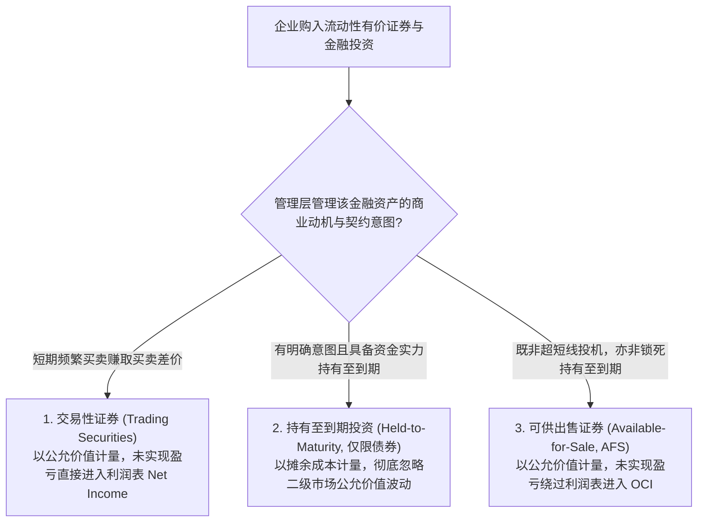
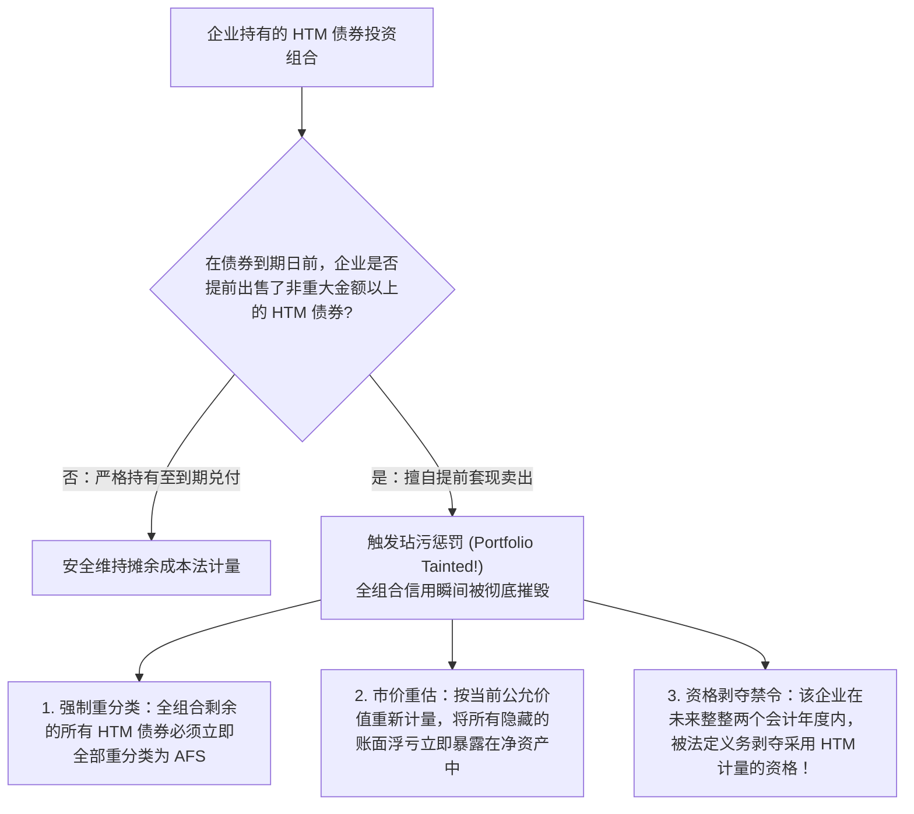
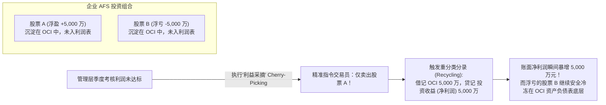

# Lec 11 有价证券投资与公允价值计量 (Marketable Securities and Valuation Adjustments: Trading, AFS, HTM & Mark-to-Market)

> MIT Sloan School of Management · 15.515 Financial Accounting · 讲义 11

## TL;DR

- 储贷危机重创了传统历史成本原则，推动会计系统向按市值计价（Mark-to-Market）公允价值转型。
- 金融资产依据管理层持有动机严格三分为交易性证券、可供出售证券（AFS）与持有至到期投资（HTM）。
- AFS 证券未实现公允价值变动绕过利润表进入其他综合收益（OCI），赋予管理层择机出售操纵盈余的空间。
- 持有至到期投资受严厉的“玷污规则（Tainting Rule）”约束，提前处置将导致全组合强制定价重分类。

## 历史成本计量的动摇与“按市值计价”革命

在传统的工业时代会计哲学中，**历史成本（Historical Cost）**原则享有绝对的霸权地位。一项资产一旦入账，除非发生减值或物理处置，其账面价值始终锚定在最初的交易发票金额上。

然而在 20 世纪 80 年代爆发的美国储蓄贷款协会危机（Savings & Loan Crisis）中，这一基石遭遇了毁灭性动摇：
- 储贷机构在利率低位时大肆买入了数千亿美元的长期固定利率政府债券与抵押贷款支持证券（MBS）；
- 随后美联储为了治理恶性通胀大幅加息至 $20\%$，导致这批债券的二级市场真实交易价格暴跌 $40\%$ 以上；
- 但由于历史成本会计的掩护，这些金融机构在账面上依然假装这些资产“毫发无损”，同时利用所谓的**“利益采摘（Cherry-Picking）”**策略——专门卖出那些微幅上涨的盈利债券刷取当期报表利润，而将巨亏的债券深埋在资产负债表历史成本中，最终引爆了全美数百家金融机构的灾难性倒闭。

为了粉碎这种制度性粉饰，美国财务会计准则委员会（FASB）出台了第 115 号准则（现 ASC 320），正式确立了**按市值计价（Mark-to-Market）公允价值计量框架**：

## 金融资产三分类框架与会计计量规则

在公认会计准则下，企业所持有的债权类证券（Debt Securities）必须严格按照管理层的意图划入三类投资组合：

| 证券分类类型 | 资产负债表时点计量属性 | 未实现持有公允价值变动 (Unrealized Gains/Losses) | 现金股利与利息收入处理 | 处置时的重分类转回 (Recycling) |
| :--- | :--- | :--- | :--- | :--- |
| **交易性证券 (Trading)** | **期末公允市价 (Fair Value)** | **计入利润表净利润 (Net Income)** 直接影响当期每股收益 EPS | 计入利润表投资收益 | 无需转回；由于前期已在利润表中确认过公允变动，处置时仅确认当期增量变动 |
| **可供出售证券 (AFS)** | **期末公允市价 (Fair Value)** | **绕过利润表，计入其他综合收益 (OCI)** 累积于资产负债表股东权益“AOCI”专栏 | 计入利润表投资收益 | **重分类转回**：在证券真正售出时，将此前沉淀在 AOCI 中的历史累计盈亏清空并注入净利润 |
| **持有至到期 (HTM)** | **摊余成本 (Amortized Cost)** 通过实际利率法摊销溢折价 | **完全不作任何账面确认** （二级市场暴涨暴跌在报表上隐形） | 计入利润表利息收入 | 持有至到期收回本金，无处置损益 |

::: definition 其他综合收益 (Other Comprehensive Income, OCI)
其他综合收益是一个专门为了吸收那些“虽然已经发生、但尚未真金白银变现且极易随宏观波动逆转”的未实现利得与损失（如 AFS 证券公允价值变动、养老金计划精算损益、外币报表折算差额）而设立的权益缓冲池。它列报在利润表下方的“综合收益表”中，直接增减所有者权益，**绝对不允许污染当期的核心净利润（Net Income）**。
:::

## 玷污规则（The Tainting Rule）的制度刚性

既然持有至到期（HTM）投资能够完全免疫二级市场价格波动的惊涛骇浪，许多企业管理层出于美化报表的考量，往往倾向于将所有债券统统打上“HTM”的标签。

为了制止这种“名义上宣称持有至到期、暗地里伺机高抛低吸”的投机违约，准则确立了极其严酷的**“玷污规则（The Tainting Rule）”**：

::: pitfall 玷污规则的免责例外情形
仅在极少数无法预见的法定不可抗力事件下，提前出售 HTM 债券才不会触发玷污惩罚：
1. 债券发行方信用评级发生灾难性断崖暴跌（如从 AAA 跌至垃圾级违约边缘），继续持有将面临本金全无的清偿风险；
2. 国家的税法发生重大法案修改，取消了该类债券的原有利息免税地位；
3. 监管机构法定资本充足率要求发生颠覆性提高，迫使银行必须出售资产以满足资本金硬约束。
:::

## 利润表 vs. 其他综合收益的“采摘”博弈

可供出售金融资产（AFS）的设计初衷是保护利润表免受金融波动的剧烈冲击，但在现实微观博弈中，AFS 却沦为了 CFO 进行**盈余操纵（Earnings Management）**最顺手的合法后门：

为了遏制这种利用 AFS“选择性报喜、隐瞒报忧”的道德风险，准则制定了**非暂时性减值（Other-Than-Temporary Impairment, OTTI）**惩戒：
- 当某只 AFS 股票的市场价格发生深幅暴跌、且在可预见的未来没有任何回升希望时，企业**绝对不允许继续将其亏损藏在 OCI 中**；
- 必须强制将其认定为 OTTI，**将该项公允价值浮亏从 OCI 中硬生生强行撕扯出来，直接作为减值损失全额砸入当期的利润表净利润中**！

## 商业实战推演：英特尔战略投资组合（Intel 2002）深度穿透

在麻省理工 15.515 课程中，分析师通过剖析**英特尔风险投资部（Intel Capital）**在 2002 年 10-K 年报中的证券附注，还原了其在高科技资本运作中的真实财务足迹：

::: example 英特尔战略可供出售有价证券组合体检
英特尔不仅是一家芯片制造商，更是全球科技领域规模最庞大的企业战略风投（CVC）之一。在 2002 财年：
- **组合规模与构成**：英特尔账面持有数十亿美元的高科技上市公司股票与可转债，绝大部分被归类为**可供出售证券（AFS）**；
- **公允价值变动对净资产的冲击**：在经历了 2000-2001 年互联网泡沫破裂的余波后，英特尔 AFS 投资组合的公允价值从巅峰时期的上百亿美元剧烈缩水。通过查验其所有者权益变动表中的“累积其他综合收益（AOCI）”科目，可以发现数亿美元的未实现持有净损失正在资产负债表深处被动消化，而没有在日常季度营业利润中造成连续的报表恐慌；
- **递延所得税互动机制**：英特尔在确认 AFS 证券未实现浮亏时，同步确认了一笔丰厚的**递延所得税资产（DTA）**——因为一旦未来实际卖出发生真实亏损，这些资本损失在税法上可以用来冲抵其他的资本利得，从而为公司节约大笔未来的现金所得税。
:::

## 我的理解

::: insight 会计意图是一面由管理层涂写的滤镜，真实的公允价值从不服从主观意愿
审视公允价值计量的演进历史，揭示出财务哲学在客观性与主观性之间的深度纠缠：
1. **“管理层意图”是现代会计准则最危险的妥协**：两家企业在同一秒钟、以完全相同的 100 美元价格买入了同一只美国国债，只因为 A 企业的 CEO 声称“我打算持有到期”，它就可以在资产负债表上完全无视接下来的暴跌；而 B 企业的 CEO 诚实承认“若市场有更好机会我可能会调仓”，它就必须在每个季度接受市价波动的严厉拷打。这种将底层资产计量属性完全寄托于不可观测的“高管内心想法”上的制度妥协，使得意图分类在诞生之初就注定成为管理层与审计师无休止博弈的灰色战场。
2. **综合收益（Comprehensive Income）是全景审视资本真相的终极底牌**：许多平庸的投资者在阅读年报时依然只盯净利润（Net Income），而华尔街最精明的秃鹰基金总是第一时间翻开“所有者权益变动表”和“综合收益表”。只有把净利润与藏在 OCI 抽屉里的所有未实现公允损益、外币折算差额合并审视，你才能看清企业在过去 365 天里，其真实的净资产到底是真正经历了内生价值的繁荣，还是在宏观周期的洗礼下正在发生隐蔽的冰川融化。
:::
