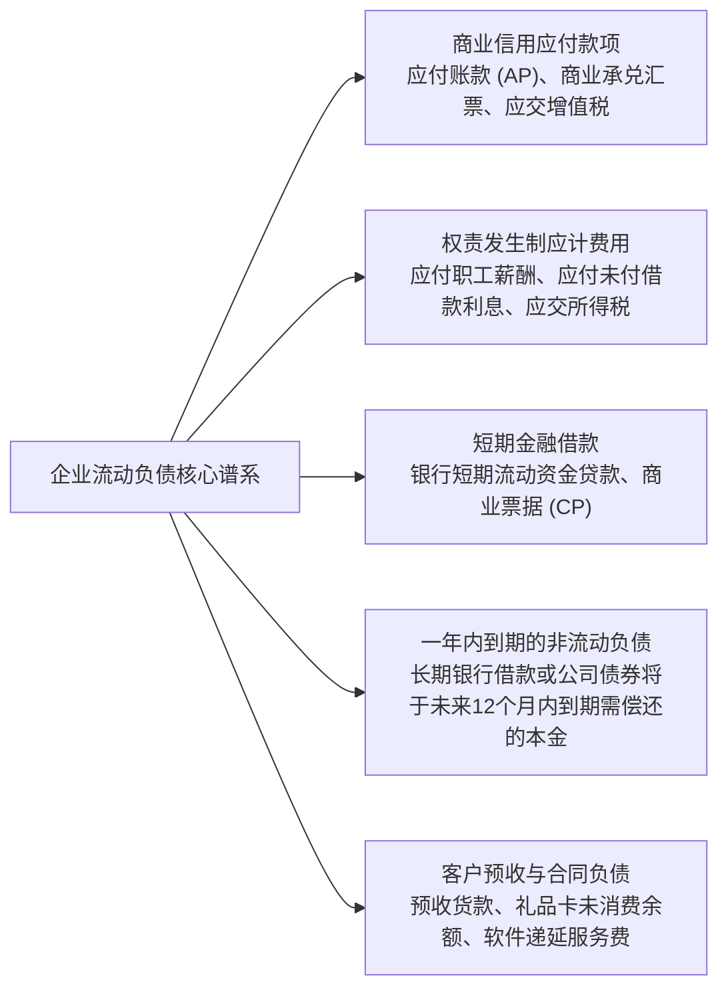
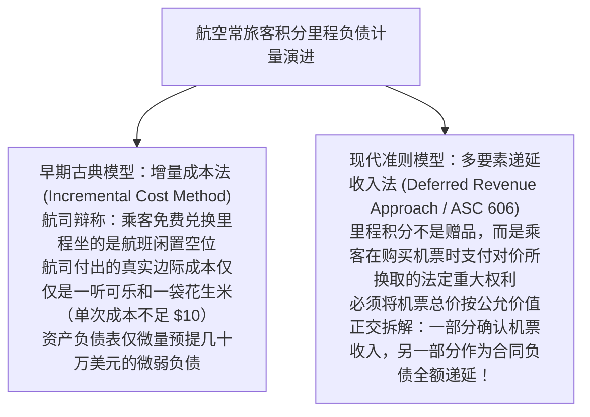

# Lec 12 流动负债、或有事项与货币时间价值 (Current Liabilities, Contingencies & Time Value of Money Foundations)

> MIT Sloan School of Management · 15.515 Financial Accounting · 讲义 12

## TL;DR

- 流动负债是预期将在一年或一个正常营业周期内通过消耗流动资产或发生新流动负债来清偿的现实义务。
- 或有损失依据发生概率（很可能、合理可能、极小可能）与金额可估计性构建三阶法定披露与预提决策矩阵。
- 或有收益遵循极致稳健主义，严禁在表内提前预提确认，仅允许在确定性极高时在表外附注作审慎披露。
- 货币时间价值（TVM）折现模型为长期债券、经营与融资租赁、退休金精算负债提供了跨期估值的统一度量衡。

## 流动负债的法律边界与清偿周期

在资产负债表右侧，**负债（Liabilities）**代表企业因过去的交易或事项而承担的、预期会导致经济利益流出企业的现时法定或推定经济义务。

其中，**流动负债（Current Liabilities）**的划分标准严格依附于企业的**正常营运周期（Operating Cycle）或一年（以较长者为准）**：



流动负债构成了企业短期偿债流动性压力的直接源头。如果企业资产负债表上的流动比率（$\frac{\text{流动资产}}{\text{流动负债}}$）或现金比率跌破安全警戒线，即便企业长期资产雄厚，也会在商业信用的连锁挤兑中瞬间丧失再融资能力。

## 或有事项（Contingencies）三阶决策矩阵

在企业经营过程中，经常面临一系列结果充满高度不确定性的未决法律与商业纠纷（例如未结清的知识产权专利侵权诉讼、产品环境污染行政追偿、商业合同担保责任）。这些事项在会计准则上被统称为**或有事项（Contingencies）**。

美国公认会计准则（SFAS 5 / ASC 450）为**或有损失（Loss Contingencies）**构建了一套严密的三阶逻辑判定矩阵：

```mermaid
flowchart TD
    ContingencyEvent[企业面临重大或有负债事件<br/>例如：收到竞争对手发起的 10 亿元侵权索赔诉讼] --> ProbCheck{该事件导致企业未来发生经济利益流出的概率水平?}
    
    ProbCheck -->|很可能发生 Probable (概率通常 > 75%-80%)| EstCheck{损失赔偿金额是否能够被合理可靠地估计?}
    ProbCheck -->|合理可能发生 Reasonably Possible (概率介于极小与很可能之间)| FootnoteOnly["方案 B：表外披露 (Disclosure Only)<br/>严禁在表内预提负债，但必须在附注中详细披露诉讼事实与可能损失区间"]
    ProbCheck -->|极小可能发生 Remote (偶发微弱噪音，概率 < 5%-10%)| Pass["方案 C：系统默认通过 (No Action)<br/>既不需要表内记账，亦无需在附注中作任何说明（担保除外）"]

    EstCheck -->|是：金额可合理确定或存在合理估计区间| Accrue["方案 A：表内全额预提确认 (Accrual)<br/>借记：营业外支出 / 诉讼损失 (冲减利润)<br/>贷记：预计负债 / 或有负债准备 (表内负债增加)"]
    EstCheck -->|否：虽然很可能败诉但金额完全不可预测| FootnoteOnly
```

针对或有事项的处理规则体现了两项深层的准则设计铁律：

### 1. 损失区间的最小值规则（US GAAP 特色）
当某项诉讼“很可能（Probable）”败诉，且经专业法律团队精算评估，最终赔偿金额落在一个区间内（如 **1,000 万至 5,000 万元**），且区间内没有任何一个数字比其他数字更加合理时：
- **US GAAP 强制规定**：必须且仅按区间的**最低金额（Minimum of the Range，即 1,000 万元）**在表内预提确认负债，同时将剩余的 4,000 万元潜在风险敞口在附注中完整披露；
- （注：国际财务报告准则 IFRS 则要求按中位数或期望值预提，即 3,000 万元）。

### 2. 或有资产与或有收益的绝对禁区（不对称稳健主义）
如果企业起诉竞争对手并一审胜诉获赔 2 亿元，但在对方提出终审上诉前：
- **公认会计准则绝对严禁在表内确认任何“或有收益（Gain Contingency）”或“应收诉讼赔偿款”**！
- 准则强制要求：必须等到案件终审判决生效、所有上诉期完全届满且赔偿款实际到账（或毫无清偿疑义）时，才准确认营业外收入。在判决彻底落定之前，最多仅允许在附注中进行极其克制的定性描述，严防对广大投资人传递虚假的乐观预期。

## 航空常旅客里程案例：增量成本法 vs. 递延收入法

在麻省理工 15.515 课程中，威尔逊教授通过**全美各大航空公司常旅客飞行里程计划（Frequent Flyer Programs）**长达二十年的会计准则拉锯战，生动展现了现代负债确认理念如何从传统的“成本补偿观”向现代“合同履约义务观”发生历史性蜕变：



在 20 世纪末，达美航空、美联航与美国航空等巨头普遍采用**增量成本法（Incremental Cost Method）**：
- 航空公司的财务顾问在国会听证会与准则委员会辩称：绝大多数旅客是用积累的积分去兑换原本卖不出去的冷门航线闲置空座（Standby Empty Seats）；
- 因此，航司为了履行兑换义务所实际需要额外付出的真实增量自付成本，仅仅是多消耗的一点点航油、一份免费机上盒饭与一听软饮料（平均每次飞行成本被精算评估为不足 $15 美元）；
- 这种核算方法使得各家航司在向旅客发放了高达数千亿飞行里程积分的同时，资产负债表上仅仅轻描淡写地挂账了几百万美元的微量预提费用，将上百亿美元未来实质性的航空运输义务完全隐形化。

进入 21 世纪后，国际财务报告解释公告（IFRIC 13）与美国新收入准则（ASC 606）彻底粉碎了这一抗辩，强制确立了**递延收入法（Deferred Revenue Method）**：
1. **里程积分的独立权利属性**：旅客之所以愿意支付全价购买昂贵的高级经济舱或商务舱机票，其支付的票款对价中天然包含了一部分用于换取“未来免费飞行的重大法定权利（Material Right）”；
2. **相对公允价值分拆**：企业必须将旅客支付的票款，按照“单次航班运输服务公允价值”与“飞行里程公允价值（考虑历史过期失效比例 Breakage）”的相对比例进行正交切分；
3. **负债的真实回归**：用于购买里程积分的款项被强制全额记入资产负债表作为**合同负债（Contract Liability / Deferred Revenue）**，只有当旅客在未来真正拿积分兑换并飞完了新航班、或者该积分最终由于到期未兑现而正式失效时，才能按比例将负债释放为营业收入。

在全面转向递延收入法后，全美主流航空公司的资产负债表上瞬间凭空**补记了高达数十亿美元的“常旅客合同负债”**。这彻底终结了航司通过发行虚高积分掩盖机票真实折扣的财技漏洞，将隐蔽的远期履约义务强制暴露在阳光之下。

## 货币时间价值（TVM）数学公理与折现工程

只要一项负债或资产的清偿结算周期跨越了一年以上的漫长岁月，**货币的时间价值（Time Value of Money, TVM）**就构成了其会计计量的绝对数学基础。今天的一美元由于具备即时投资产生利息的生产力，其价值在数学上严格大于未来的一美元。

```mermaid
flowchart LR
    PV["现值 (Present Value, PV)<br/>未来现金流折算到今天的真实经济价值"]
    FV["终值 (Future Value, FV)<br/>今天的一笔资金在复利计息后的期末累积总值"]
    
    PV -->|按复合实际利率 $(1 + r)^n$ 复合增值| FV
    FV -->|按折现因子 $(1 + r)^{-n}$ 跨期折现| PV
```

在财务会计与公司金融中，五大核心 TVM 数学模型构成了所有长期负债（公司债券、融资租赁、退休金精算、资产弃置义务 ARO）计量的底层公式库：

1. **单利复利单笔现金流量折现**：
   $$PV = \frac{FV}{(1 + r)^n} = FV \times (1 + r)^{-n}$$
2. **普通年金现值（Ordinary Annuity，每期期末等额支付）**：
   $$PVA = PMT \times \left[ \frac{1 - (1 + r)^{-n}}{r} \right]$$
3. **先付年金现值（Annuity Due，每期期初等额支付）**：
   $$PVAD = PVA \times (1 + r)$$
4. **永续年金现值（Perpetuity，无限期等额支付）**：
   $$PV_{\infty} = \frac{PMT}{r}$$
5. **有效年化利率（Effective Annual Rate, EAR）对名义名义名义名义年利率（APR）的非线性修正**：
   $$\text{EAR} = \left( 1 + \frac{\text{APR}}{m} \right)^m - 1 \quad (m \text{ 为一年内的计息复利频次})$$

企业在资产负债表上列示的长期应付款或弃置负债，绝非简单将未来 10 年需要支付的支票金额相加，而是必须经由上述年金公式，将所有未来现金流严格折现为当期的现值入账，并在存续期间内通过实际利率法按期计提**利息累加费用（Accretion / Interest Expense）**。

## 我的理解

::: insight 负债是关于未来的承诺，时间价值与谨慎原则共同筑起了企业信任的基石
深入流动负债与货币时间价值的体系，可以提炼出深刻的制度智慧：
1. **谨慎原则构成了会计学最深沉的悲观主义防御**：在或有事项的处理上，会计准则展现出了近乎苛刻的非对称性——对损失极其敏锐（哪怕只是大概率要赔，就要立刻提负债砸利润），对收益极其迟钝（哪怕胜券在握，也绝不准在账面上记一分钱收入）。外行人批评这种设计过于悲观僵化，但正是这种制度化的悲观主义，守护了资本市场免受人类贪婪与过度自信的摧毁。它强迫高管层在每张资产负债表中为潜在的商业黑天鹅预留出充足的资本防线。
2. **折现率是衡量人类耐心与信用的终极标尺**：引入货币时间价值模型后，会计学彻底从静止的平面算术跃迁为立体的时空动力学。一笔将在 30 年后支付的 1 亿元核电站退役拆除费用，在 5% 的折现率下，今天在资产负债表上只需要挂账 2,313 万元。折现率的每一次微调，都在无声地重构着企业数以百亿计的净资产结构。理解了现值折现，你才真正拿到了通往长期负债、复杂衍生品与企业内在价值终极估值的金钥匙。
:::
