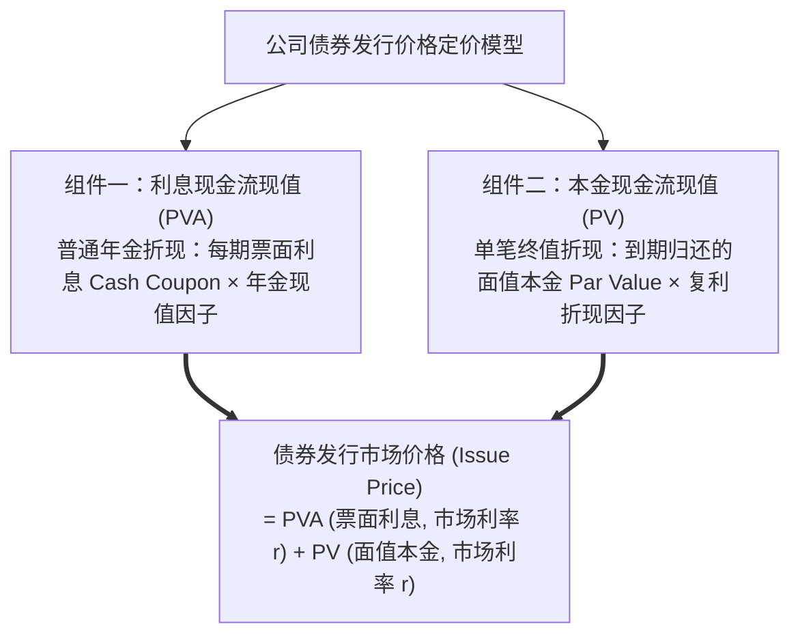
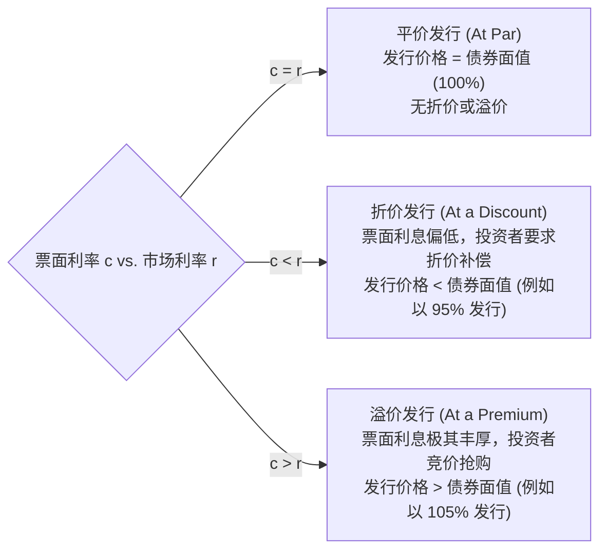
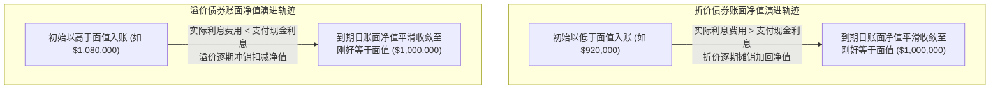

# Lec 13 长期负债契约、公司债券定价与实际利率法 (Long-Term Debt, Bond Valuation & The Effective Interest Method)

> MIT Sloan School of Management · 15.515 Financial Accounting · 讲义 13

## TL;DR

- 公司债券的发行价格严格由票面利息年金现值与到期面值本金现值的市场折现和决定。
- 票面利率与市场有效利率的利差在债券发行端派生出平价、折价与溢价发行三大形态。
- 实际利率法通过当期期初账面净值乘以发行时市场收益率，精准反映真实经济利息费用与溢折价摊销。
- 债务契约（Debt Covenants）构成了对企业净资产与利息保障倍数的硬性外部制度约束。

## 长期负债契约与公司债券定价数学模型

在现代公司金融中，当企业需要筹集数以十亿计的巨额资金用于建设新晶圆厂或跨国并购时，除了向商业银行申请银团贷款，最核心的直接融资渠道是在公开资本市场上向机构投资人发行**公司债券（Bonds Payable）**。

公司债券在法律上是一份具有严格法律强制力的长期债务契约（Bond Indenture）。其在发行当天的二级市场公允价格，完全服从**现金流折现（DCF）数学定价模型**：

$$\text{债券发行价格} = \sum_{t=1}^{n} \frac{\text{票面利息 } (FV \times c)}{(1 + r)^t} + \frac{\text{到期面值 } FV}{(1 + r)^n} = (FV \times c) \times \left[ \frac{1 - (1 + r)^{-n}}{r} \right] + \frac{FV}{(1 + r)^n}$$

其中：
- $FV$ 为债券到期偿付的法定**面值（Face / Par Value）**；
- $c$ 为契约约定的**票面利率（Stated / Coupon Rate）**，决定了每期实际向投资者支付的现金利息金额；
- $r$ 为资本市场在发行时点根据企业信用风险所要求的**市场有效收益率（Market Rate / Yield to Maturity, YTM）**；
- $n$ 为债券的总计息期数。

## 平价、折价与溢价发行的内在机理

票面利率（$c$）与市场利率（$r$）的相对大小关系，直接支配了债券发行时点是平价、折价还是溢价：

::: definition 债券折价与溢价的经济学本质
- **债券折价（Bond Discount）**：不是管理层的发债损失，而是企业在发行时提前向投资者承诺的**利息追加补偿**。因为日常给的票面利息低于市场平均水平，企业少拿了发行现金，但在到期日必须全额按面值偿付本金，这部分差额构成了追加的隐性利息；
- **债券溢价（Bond Premium）**：不是发债企业的横财暴利，而是企业由于未来承诺支付超额票面利息，而在发行当天提前从投资者手中**预收的利息调节备用金**。
:::

## 摊销核心工程：实际利率法 (Effective Interest Method)

公认会计准则强制要求企业采用**实际利率法（The Effective-Interest Method）**对债券存续期间的折价或溢价实施逐期摊销（仅在差异不重大时允许采用简化的直线摊销法）。

实际利率法的核算逻辑遵循严密的四步动力学递推：

$$\text{第 } t \text{ 期实际利息费用 (Interest Expense)}_t = \text{第 } t \text{ 期期初债券账面净值 (Beginning Carrying Value)}_t \times \text{发行时市场有效利率 } r$$

$$\text{第 } t \text{ 期支付的现金利息 (Cash Coupon)}_t = \text{债券票面面值 } FV \times \text{票面利率 } c$$

$$\text{第 } t \text{ 期折价/溢价摊销额 (Amortization)}_t = |\text{当期实际利息费用} - \text{当期实际现金利息}|$$

$$\text{第 } t \text{ 期期末债券账面净值}_t = \text{期初净值} + \text{折价摊销额 (或 } - \text{溢价摊销额)}$$

::: example 5 年期折价公司债券实际利率法完整摊销推算
某科技企业平价发行面值为 **$1,000,000 美元**、票面利率为 **$8\%$**、每年末支付一次利息的 5 年期公司债券。发行当天市场有效收益率为 **$10\%$**。
- **发行定价测算**：
  - 票面现金利息年金现值：$\$80,000 \times \left[ \frac{1 - (1.10)^{-5}}{0.10} \right] = \$80,000 \times 3.79079 = \$303,263$；
  - 面值本金复利现值：$\$1,000,000 \times (1.10)^{-5} = \$1,000,000 \times 0.62092 = \$620,921$；
  - **发行价格**：$\$303,263 + \$620,921 = \$924,184$ 美元（折价 $\$75,816$ 发行）。
- **第 1 年度财务分录**：
  - 借记：利息费用（Interest Expense） = $\$924,184 \times 10\% = \$92,418$ 美元；
  - 贷记：现金（Cash Coupon） = $\$1,000,000 \times 8\% = \$80,000$ 美元；
  - 贷记：应付债券折价（Discount on Bonds Payable） = $\$92,418 - \$80,000 = \$12,418$ 美元；
  - **第 1 年末债券账面净值**：$\$924,184 + \$12,418 = \$936,602$ 美元。
:::

## 债券提前赎回损益与债务契约控制

当外部宏观利率暴跌时，企业往往有强烈的意愿行使契约中的赎回权（Call Option），在二级市场提前回购或强制赎回老旧高息债券，并置换发行新的低息债券（Debt Refinancing）：

$$\text{债券账面净值 (Carrying Value)} = \text{债券面值} - \text{未摊销折价余额 (或 } + \text{未摊销溢价余额)}$$
$$\text{提前清偿损益 (Gain / Loss on Early Extinguishment)} = \text{实际支付的赎回现金对价} - \text{被清偿债券在赎回日的账面净值}$$

- 若实际赎回对价低于账面净值，确认为**债务重组收益（Gain on Debt Extinguishment）**；
- 若为了提前解约支付了高额违约金溢价，确认为**债务重组损失（Loss on Debt Extinguishment）**，全额计入当期利润表营业外损益。

同时，为了约束管理层的借贷行为，债券投资人通常在发行契约中设置严格的**保护性债务契约（Debt Covenants）**：
1. **消极限制条款（Negative Covenants）**：限制企业单方派发巨额现金股利、限制新增更高顺位的次级债务、限制高风险兼并收购；
2. **积极财务指标维持条款（Affirmative Covenants）**：强制要求企业的利息保障倍数（TIE）常年不低于 2.5 倍、流动比率不低于 1.2、有形净资产规模维持在法定安全底线以上。一旦企业因经营恶化跌破契约红线，债权人有权立即宣布债务发生技术性违约，强制要求立即提前全额清偿所有本金！

## 我的理解

::: insight 债务不是单纯的还本付息，而是资本结构与破产风险的精确天平
解构长期负债与债券摊销的数学本质，揭示出公司金融最深邃的杠杆法则：
1. **实际利率法彻底剥离了名义利率的遮羞布**：许多初级管理者以为低票面利率可以帮公司“省钱”。但在资本市场的理性定价下，投资人早已通过在发行时少付给企业数千万元现金折价，精确弥补了利差损失。实际利率法之所以是会计学中最严谨的杰作，正是因为它穿透了表面支票的现金数字，以发行时的无偏市场收益率为尺度，精准还原了企业每一分每一秒真实背负的资本资金成本。
2. **债务契约是悬在高管头顶的达摩克利斯之剑**：许多企业之所以在年末大肆实施盈余管理（如推迟设备检修、激进确认收入），其根本动机往往不是为了单纯推高股价，而是为了**不跌破债务契约的考核红线**。一旦净资产比率失守，引发银团抽贷挤兑，即便拥有百年历史的工业航母也会在几天之内因资金链猝死而灰飞烟灭。读懂长期负债附注中的契约限制，是评估企业终极财务抗风险韧性的关键锁钥。
:::
