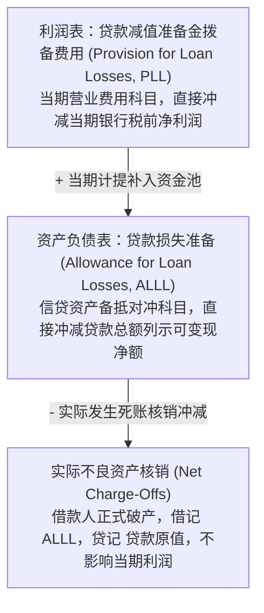
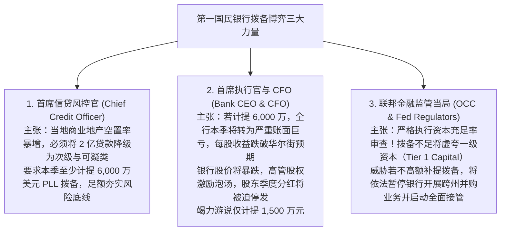

# Lec 14 银行信贷风险、不良贷款与估值备抵实务 (Debt, Credit Risk, and Valuation Allowances: First National Bank Case)

> MIT Sloan School of Management · 15.515 Financial Accounting · 讲义 14

## TL;DR

- 商业银行资产负债表呈现独特的金融中介拓扑结构，发放的客户贷款构成其最庞大的生息资产组合。
- 贷款损失准备（ALLL）通过与利润表拨备费用（PLL）及实际坏账核销的动态勾稽抵御信用风险。
- 第一国民银行案例深刻揭示了信贷风控、高管季度考核、监管资本充足率三方围绕拨备的白热化博弈。
- 现代预期信用损失模型（CECL）终结了后知后觉的已发生损失法，强制前瞻性计量资产全周期违约敞口。

## 商业银行资产负债表解构与信贷中介模型

不同于传统的制造业或互联网企业，**商业银行与金融机构（Banking Institutions）**的资产负债表呈现出极其独特的颠倒镜像特征：
- **资产端（Assets）**：绝大部分不是厂房或存货，而是由**客户商业贷款、个人住房抵押贷款、信用卡透支以及自营金融证券投资**构成的庞大**生息资产组合（Earning Assets）**；
- **负债端（Liabilities）**：不是应付供应商账款，而是由成千上万企业与居民存入的**活期支票存款、定期储蓄存款与向央行的短期同业拆借**构成的**付息负债组合（Interest-Bearing Liabilities）**；
- **核心商业模式**：依赖**净息差（Net Interest Margin, NIM = 净利息收入 / 平均生息资产总额）**生存，以极高负债杠杆（通常权益乘数高达 12 至 20 倍）撬动微薄利差。

```mermaid
flowchart LR
    Depositors[千家万户存款人] -->|吸收存款 (银行负债)| Bank[商业银行核心资产负债表]
    Bank -->|发放信贷 (银行资产)| Borrowers[工商业企业与购房个人]
    
    Borrowers -.->|本息偿付违约风险 Credit Risk| Bank
    Bank -.->|备抵冲销与资本侵蚀| Equity[银行一级资本 Tier 1 Capital]
```

由于银行的净资产权益极度薄弱（资本充足率通常仅有 $8\%-12\%$ 左右），资产端发放的数以千亿计的贷款中只要有 $3\%$ 发生实质性违约坏账，就能瞬间将全行的所有股东权益彻底打穿并触发破产清算。因此，**对信贷资产组合的估值备抵与减值拨备**，构成了全行业生死存亡的核心命门。

## 贷款损失准备（ALLL）会计循环与双层架构

为了应对不可避免的借款人违约，公认会计准则强制银行设立**贷款损失准备（Allowance for Loan and Lease Losses, ALLL）**双层核算机制：



贷款损失准备（ALLL）在资产负债表底层的期初至期末生命周期演进，遵循严谨的动态守恒方程式：

$$\text{期末 ALLL 余额} = \text{期初 ALLL 余额} + \text{当期利润表计提拨备 (PLL)} - \text{当期实际净核销额 (Net Charge-Offs)}$$

$$\text{当期实际净核销额} = \text{当期正式核销的死账贷款原值} - \text{收回以前年度已核销的坏账本金 (Recoveries)}$$

通过这一机制，信贷违约对利润表的冲击被前置到了“计提拨备费用（PLL）”的当期，从而使得资产负债表对外列示的“贷款净额（Net Loans）”能够公允反映该信贷资产包的**预期可回收现值**。

## 经典商业案例：第一国民银行（First National Bank Corporation）

麻省理工 15.515 课程通过解构全美经典教学案例——**第一国民银行（First National Bank Corp.）**的真实财报与信贷审查会，展现了估值备抵背后惊心动魄的多方利益博弈：

::: example 第一国民银行信贷风险五级分类与拨备决战
第一国民银行持有 20 亿美元的商业房地产（Commercial Real Estate, CRE）信贷组合。
按照美国联邦货币监理署（OCC）与美联储的监管指引，信贷资产被划分为**信贷五级分类**：
1. **正常类（Pass）**：借款人财务健康，本息偿还毫无疑义（建议拨备率 $0.5\%-1.0\%$）；
2. **关注类（Special Mention）**：存在微弱潜在风险，但不构成重大实质性缺陷（建议拨备率 $2\%-5\%$）；
3. **次级类（Substandard）**：借款人出现明显的还款能力不足，正常经营收入已无法足额偿还本息（建议拨备率 $15\%-25\%$）；
4. **可疑类（Doubtful）**：本息全额收回已极其困难，发生严重损失不可避免（建议拨备率 $50\%-75\%$）；
5. **损失类（Loss）**：被判定为彻底无法收回的垃圾死账（必须立即 $100\%$ 全额核销）。
:::

围绕该季度应当计提多少 PLL 拨备费用，银行内部与外部监管者陷入了剧烈冲突：



这一真实案例深刻证明：**贷款损失拨备从来不是一个纯数学的统计公式，而是一场在高管个人职业生存、资本市场短期预期与金融体系终极系统性安全之间的政治经济学妥协**。

## 现代预期信用损失模型（CECL / ASC 326）革命

历史上，银行在计算坏账准备时采用的是**“已发生损失模型（Incurred Loss Model）”**——只有当借款人正式逾期数月、违约事件实质性爆发时，银行才被允许计提拨备。
- 这一规则直接导致了 2008 年全球次贷危机的急剧恶化（顺周期性 Pro-cyclicality）：在繁荣期银行因看不到违约而不计提拨备、制造虚假繁荣暴利；而在危机爆发时又被迫在同一个季度集中断崖式计提巨额坏账，导致资本金瞬间被抽干，引发全美银行连环倒闭。

为了彻底纠偏这一致命缺陷，美国 FASB 于 2016 年正式发布 ASC 326，推行革命性的**现行预期信用损失模型（Current Expected Credit Losses, CECL）**：

::: theorem CECL 模型的划时代核心变革
根据 CECL 准则，**银行在一笔贷款发放立项的第一天起，就必须基于宏观经济前瞻性预测（Forward-Looking Economic Forecasts），立即对该贷款在未来整个存续期内的全部终生预期违约损失（Lifetime Expected Losses）进行全额计提拨备**！
彻底终结了“不见棺材不落泪”的拖延计提恶习，将风险定价强制嵌入信贷资产的生命周期起点。
:::

## 我的理解

::: insight 银行的资本充足率是关于信心的精巧谎言，拨备是唯一真实的防波堤
解构商业银行的会计与估值备抵实务，可以洞察金融文明运转的最深层逻辑：
1. **银行会计在本质上是一场精密的集体信心游戏**：由于高额杠杆的存在，一家银行到底“是健康盈利还是早已技术性破产”，在很多时候完全取决于审计师和监管者在那张信贷五级分类表上签下的笔迹。如果银行将 50 亿元不良商业地产硬性归类为“正常类”，它就可以向公众展示高达 15% 的股本回报率；而一旦外部审计师强制要求将其归入“可疑类”，这家银行的一级资本充足率就会瞬间穿底。银行的真实生命线，永远系于其拨备计提的公信力之上。
2. **平滑业绩是人性的本能，但前瞻性审计是制度的救赎**：在没有严密外部审计的约束下，所有的银行家都会在顺境时藏匿拨备作为“饼干罐（Cookie Jar）”，在逆境时掩耳盗铃拒绝承认坏账。CECL 模型的伟大之处，在于它用量化算法与宏观情景压力测试，强行剥夺了管理层“假装看不见坏账”的自由裁量空间。唯有把潜在违约风险以最冷酷、最前瞻的方式写进资产负债表，现代金融体系才可能在下一次全球债务海啸中保留一丝生存的方舟。
:::
