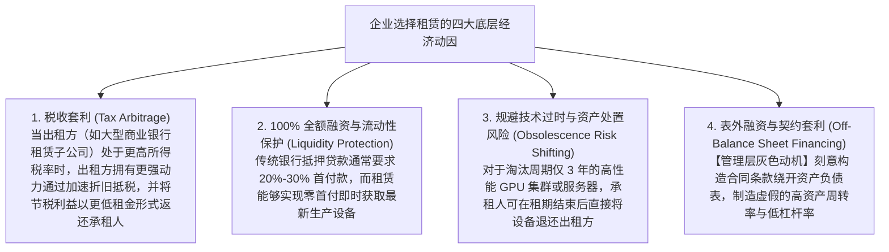

# Lec 15 租赁会计演进：经营租赁与融资租赁表外化博弈 (Lease Accounting: Operating vs. Capital Leases & Intel Case)

> MIT Sloan School of Management · 15.515 Financial Accounting · 讲义 15

## TL;DR

- 租赁是企业获取长期生产要素核心使用权、规避技术过时风险并享受税收套利的经典金融工具。
- 传统 SFAS 13 准则的四项明线测试诱发了极其猖獗的表外工程，数以万亿计的刚性负债被隐匿于附注。
- 资本化租赁在资产负债表内全额确认资产与负债，且在存续前期呈现折旧叠加利息的费用前荷特征。
- 现代新租赁准则（ASC 842 / IFRS 16）确立了使用权资产（ROU）全量上表原则，终结了长达半个世纪的表外幻象。

## 租赁经济学：为什么企业选择租赁而非全资购置？

在现代工业实体与跨国航空、零售巨头的资产负债管理中，**租赁（Leases）**占据着极其庞大的比重。企业为什么宁愿向租赁公司持续支付租金，也不愿意直接斥资一次性买断一架波音 777 客机或一栋核心商场大楼？

微观经济学与税收金融理论揭示了推动租赁蓬勃发展的四大深层动因：



从公司金融契约视角审视，租赁不仅是一种单纯的资产获取手段，更是一种独特的**风险重构与信用增级设计**：
1. **破产隔离与抵押追偿优势**：在破产清算法律框架下，如果企业违约，普通担保债权人往往需要耗费数年时间在法庭漫长排队才能处置抵押厂房；而出租方在法律上自始至终保留着设备的法定所有权，一旦承租人发生违约欠租，出租方有权依据契约立即在几天内强行收回机组并转租给其他客户。这种物权上的确定性使得出租方愿意向资信较弱的企业提供比普通银行信用贷款更优惠的综合融资利率；
2. **债务契约条规的制度规避**：在许多大型工业集团的历史银团借款合同中，往往明确约定了“企业不得新增加任何银行借款或发行新债券（Negative Debt Covenants）”。然而在传统的法律定义中，“经营租赁”被界定为一种日常运营商业合同而非显性借贷债务。管理层通过大举签订不可撤销经营租赁，在形式上完全不违反贷款协议的前提下，实质上实现了数百亿元的杠杆扩张。

## 传统准则 SFAS 13 四项明线测试与表外工程

在历史上，美国财务会计准则第 13 号公告（SFAS 13 / 原 ASC 840）确立了一套著名的**四项明线测试（Bright-Line Criteria）**。承租人（Lessee）在签订不可撤销租赁合同时，只要**满足以下任意一项**，该租赁就必须被定性为**资本化租赁（Capital Lease / 融资租赁）**；如果**四项全部不满足**，则归类为**经营租赁（Operating Lease）**：

```mermaid
flowchart TD
    LeaseContract[签订不可撤销长期设备租赁合同] --> C1{1. 所有权转移条款?<br/>租期结束时设备法定所有权是否无偿自动移交承租人?}
    
    C1 -->|是| Cap[强制确认为：资本化租赁 Capital Lease<br/>资产负债表：确认设备资产与长期负债<br/>利润表：计提折旧费用与利息费用]
    C1 -->|否| C2{2. 廉价购买选择权 (BPO)?<br/>合同是否包含允许承租人以显著低于届时市价的价格买断的条款?}
    
    C2 -->|是| Cap
    C2 -->|否| C3{3. 经济寿命 75% 规则?<br/>合同租期是否 ≥ 该设备预计经济寿命的 75%?}
    
    C3 -->|是| Cap
    C3 -->|否| C4{4. 现值 90% 规则?<br/>最低租金付款额现值 (PV of MLP) 是否 ≥ 租赁期初设备公允市价的 90%?}

    C4 -->|是| Cap
    C4 -->|否：四项明线测试全部未触发| Oper[确认为：经营租赁 Operating Lease<br/>资产负债表：零资产、零负债！仅表外披露<br/>利润表：均匀按期计入租金费用 Rent Expense]
```

::: pitfall 华尔街“74.9% 与 89.9%”表外金融工程的制度灾难
SFAS 13 确立的绝对数值标准，直接引发了人类公司金融史上最壮观的监管套利：
- 华尔街投行与租赁精算师联手，为达美航空、沃尔玛等巨头精心定制长达数百页的租赁协议；
- 精算师将租期精确设计为设备寿命的 **74.9%**，将租金折现值精确控制在资产市价的 **89.9%**，并通过设立复杂的残值第三方担保来人为压低承租人的最低付款额；
- **财务后果**：航空公司明明拥有由数百架喷气式客机组成的庞大机队并背负着未来 15 年数十亿美元不可违约的刚性租金支付义务，但在资产负债表上，这些债务**完全隐形消失**！全美航空业与零售业的资产负债率被人工制造出严重低估的虚假繁荣。
:::

## 资本化租赁 vs. 经营租赁财务报表全方位对比推导

两种不同的租赁会计定性，会对企业的财务报表体系产生颠覆性的系统级重构：

| 财务报表维度 | 经营租赁 (Operating Lease) | 资本化租赁 (Capital Lease) | 差异深层经济动因剖析 |
| :--- | :--- | :--- | :--- |
| **资产负债表 (Balance Sheet)** | **零资产、零负债**（纯表外）<br/>仅在附注中列报未来最低租金承诺 | **表内确认等额资产与长期负债**<br/>初始入账金额 = 租金最低付款额现值 | 资本化租赁将企业的真实资产规模与债务杠杆乘数显性化暴露。 |
| **利润表：费用跨期形态** | **各期费用恒定平滑**<br/>每年均匀确认固定金额的租金费用（Rent Expense） | **早期费用高企，后期逐步衰减**<br/>每年费用 = **直线折旧 + 递减的债务利息** | 资本化租赁前期承担高额利息费用，呈现典型的**费用前荷（Front-Loaded Expense）**特征。 |
| **息税折旧摊销前利润 (EBITDA)** | **显著偏低**<br/>租金费用属于运营支出，在 EBITDA 之前全额扣除 | **大幅虚增膨胀**<br/>租金被替换为利息与折旧，二者均位于 EBITDA 之下！ | 采用资本化租赁能让企业在私募股权投资人眼中看起来拥有更强劲的 EBITDA。 |
| **现金流量表：经营活动现金流 (CFO)** | **CFO 显著偏低**<br/>支付的全部租金被整体作为经营活动现金流出 | **CFO 显著增厚暴涨**<br/>仅利息部分计入 CFO 流出，本金清偿部分计入筹资活动 CFF 流出！ | 资本化租赁通过将偿还本金划入筹资活动，人为粉饰了主营业务现金流。 |

## 现代新租赁准则革命（ASC 842 / IFRS 16）

为了终结长达四十年的表外掩耳盗铃，美国 FASB 与国际准则理事会 IASB 联手出台了划时代的**新租赁准则（US GAAP ASC 842 / IFRS 16）**：

::: theorem 使用权资产（ROU）全量上表铁律
新准则彻底废除了传统经营租赁的表外特权。**凡是租期超过 12 个月的一切不可撤销租赁合同，承租人必须在资产负债表首日，全额确认一项“使用权资产（Right-of-Use Asset, ROU）”以及一项等额的“租赁负债（Lease Liability）”**！
:::

新准则生效的第一天，全美标普 500 指数成分股公司的资产负债表上凭空**新增了超过 3 万亿美元的“上表租赁债务”**。长期依靠经营租赁美化资产负债率的零售便利店（如星巴克、麦当劳）与全球大型航司，其真实的长期债务杠杆终于被全景还原。

## 商业实战案例：英特尔（Intel 2002）不可撤销租赁附注深度剖析

在 15.515 课程中，分析师通过研读**英特尔公司 2002 财年年报附注中的租赁披露**，学习了华尔街投行如何通过**“表外租赁负债现值还原模型”**对企业进行信用重构：

::: example 英特尔表外租金承诺资本化还原测算
翻阅英特尔 2002 财年 10-K 附注第 8 项“Commitments”，英特尔披露其所有厂房与设备全部采用经营租赁，未来各年度不可撤销最低租金承诺（Minimum Lease Commitments）如下表：

$$\text{2003年: \$1.50 亿} \quad \text{2004年: \$1.20 亿} \quad \text{2005年: \$0.95 亿} \quad \text{2006年: \$0.75 亿} \quad \text{2007年: \$0.60 亿} \quad \text{2008年及以后累计: \$2.00 亿}$$

**华尔街信用分析师的表外负债资本化还原三步法**：
1. **确定增量借款利率（Incremental Borrowing Rate）**：查验英特尔同期长期优先公司债券的市场无偏发行收益率，确定合理折现率假设（如 $6\%$）；
2. **逐期现金流贴现求和**：将未来 5 年及后续年度的租金承诺，按 $6\%$ 折现率计算年金现值总和：
   $$PV = \frac{1.50}{1.06} + \frac{1.20}{(1.06)^2} + \frac{0.95}{(1.06)^3} + \frac{0.75}{(1.06)^4} + \frac{0.60}{(1.06)^5} + \frac{2.00}{(1.06)^7} \approx 5.62 \text{ 亿美元}$$
3. **资产负债表与偿债指标重校**：
   - 将这 **5.62 亿美元**直接加回资产负债表，使得英特尔的真实总资产与总负债同步上升 5.62 亿美元；
   - 重新计算英特尔真实的“全口径资产负债率”与“净负债 / EBITDA”，还原半导体巨头在表外维系全球物流中心与封测厂房的真实资本承诺。
:::

## 我的理解

::: insight 资产的本质不是物理所有权，而是对未来经济利益的排他性控制权
反思租赁会计半个世纪以来的进化史，展现了现代会计认识论的伟大跨越：
1. **从“物权法思维”向“控制权思维”跃迁**：在传统农业和早期工业社会，人们固执地认为“唯有房产证或设备产权归我，它才配叫我的资产”。然而在现代金融市场中，这一观念显得极其幼稚。如果一家航司通过排他性租赁合同将一架客机连续飞了 20 年，并在整个生命周期内独享了该客机产生的所有客运收入，那么在经济实质上，这家航司就是该客机的真实拥有者。新租赁准则引入“使用权资产（ROU）”，彻底打破了物权与债权的虚妄分野，确立了“控制未来经济现金流即为资产”的现代契约哲学。
2. **准则的妥协最终都会被更高级的准则所埋葬**：SFAS 13 的四项明线测试曾经被视为准则制定者最得意的“工程化杰作”，但它最终沦为了全华尔街竞相嘲弄与规避的靶子。每一次人为设定一个刚性百分比（如 75%、90%），就是在向博弈对手公开设立套利的分界线。唯有放弃机械的条条框框，回归“交易是否实质上转移了资产所有权绝大部分风险与报酬”的商业实质原则，财务报告才能真正穿越层出不穷的金融工程迷宫。
:::
