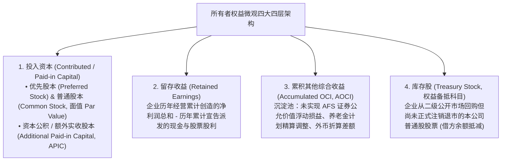
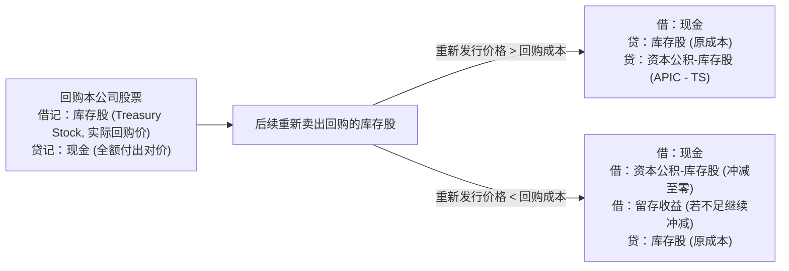
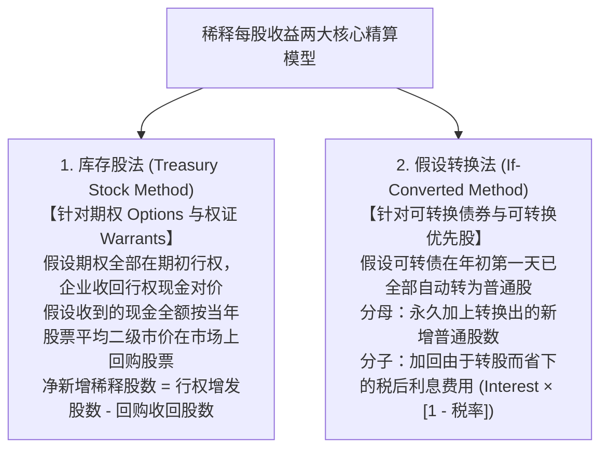

# Lec 16 所有者权益架构、每股收益与股票期权 (Stockholders' Equity, Earnings Per Share & Stock Option Accounting)

> MIT Sloan School of Management · 15.515 Financial Accounting · 讲义 16

## TL;DR

- 所有者权益代表股东对企业全部资产扣除所有债务后的剩余索偿权，遵循严格的资本维持公理。
- 库存股采用成本法列示为所有者权益的备抵抵减项，买卖本公司股票绝对严禁在利润表中确认任何损益。
- 稀释每股收益（Diluted EPS）通过库存股法与假设转换法，测算可转债与期权在最坏情景下的股权稀释底线。
- 股票期权会计从 APB 25 零费用漏洞向 SFAS 123R 布莱克-斯科尔斯公允价值费用化演进，捍卫了报表真实性。

## 所有者权益微观四层架构与资本维持原则

在资产负债表结构中，**所有者权益（Stockholders' Equity）**是企业资产总额扣减全部外部负债后的**剩余索偿权（Residual Claim）**。它忠实记录了从企业创立初始外部股东注入的真金白银，到历年经营积累沉淀的净利润，以及尚未变现的市场估值波动的全景图谱：



在审阅所有者权益变动时，必须牢记公司金融与破产法的**法定资本维持原则（Capital Maintenance Doctrine）**：
- **普通股票面值（Par Value）**：在现代法律中通常仅具有名义象征意义（如每股 $0.01 美元），它构成了企业向债权人承诺的“法定注册股本底线”；
- 投资者认购新股时支付的溢价部分（例如以每股 $20 美元买入面值 $0.01 美元的股票），其中的 $19.99 美元被全额记入**资本公积（APIC）**；
- 企业依法派发股利时，绝大多数州法律强制规定**仅能以“留存收益”为限额向股东分红**，严禁侵蚀实收股本，以保护外部债权人的法定受偿安全。

## 库存股（Treasury Stock）两大会计核算范式

当企业现金流充沛、且管理层认为二级市场股价被严重低估时，企业经常启动**股份回购（Share Repurchase）**。回购后尚未予以法律注销的股票被称为**库存股（Treasury Stock）**。

在全美工业界中，绝大多数企业采用最为简洁规范的**成本法（Cost Method）**进行核算：



::: theorem 自身股权交易损益禁入利润表铁律
公认会计准则（GAAP）与国际准则确立了一条神圣不可侵犯的铁律：**企业与自身股东之间开展的任何资本性交易（包括买卖、回购或增发本公司股票），绝对、永远不允许在利润表中确认为任何“投资收益”或“营业外损失”**！
- 企业高抛低吸回购自身股票赚取了差价，只能作为股东权益内部的“资本公积（APIC）”增厚，绝不能粉饰为经营净利润；
- 亏本重新卖出库存股，只能依次冲减资本公积与留存收益。企业绝对不可能通过“炒作自己的股票”来向资本市场创造合法的营业利润。
:::

## 每股收益（EPS）：基本与稀释双轨制模型

在二级公开证券市场中，**每股收益（Earnings Per Share, EPS）**是华尔街分析师评估上市公司盈利含金量、计算动态市盈率（P/E）最核心的单一财务指标。公认会计准则强制上市公司在利润表最下方同时列报**基本每股收益（Basic EPS）**与**稀释每股收益（Diluted EPS）**：

### 1. 基本每股收益 (Basic EPS)
$$\text{Basic EPS} = \frac{\text{净利润 (Net Income)} - \text{优先股股利 (Preferred Dividends)}}{\text{加权平均发行在外面额普通股数 (Weighted-Average Shares Outstanding, WASO)}}$$

计算 WASO 时，必须以每一批股票实际发行在外流通的**物理时间天数/月数**作为权重进行加权平均计算；而发放股票股利（Stock Dividends）或进行股票拆细（Stock Splits）时，准则强制要求**在全年度内进行追溯溯及既往调整**（即视同该拆股在年初第一天就已经发生）。

### 2. 稀释每股收益 (Diluted EPS)
现代企业普遍向高管与债权人发放了大量的**潜在稀释性证券（Potentially Dilutive Securities）**，如高管股票期权（Stock Options）、认股权证（Warrants）、可转换公司债券（Convertible Bonds）与可转换优先股。稀释每股收益是在“最坏假设情景”下，测算若所有持有人同时全部行权转股，现有普通股股东的每股收益将被摊薄稀释到何种地步：



::: pitfall 反稀释证券（Antidilutive Securities）的强制剔除规则
如果在将某批高息可转债进行“假设转换法”运算后，发现计算出的 EPS **不降反升（即变得更漂亮了）**：
- 准则强制判定该证券属于**反稀释证券（Antidilutive）**；
- 严禁将反稀释证券纳入稀释每股收益的计算！稀释每股收益的唯一法律使命是向公众揭示最悲观的稀释底线，绝不允许被用来反向美化报表。
:::

## 股票期权会计风暴：从 APB 25 漏洞到 SFAS 123R 革命

在 20 世纪 90 年代硅谷互联网科技股的狂飙突进中，高管股票期权（Stock Options）演变为了全美最具争议的会计丑闻风暴眼：

```mermaid
flowchart LR
    subgraph APB25_Era [早期 APB 25 漏洞时代 (1972-2004)]
        A1["采用内在价值法 (Intrinsic Value Method)"] --> A2["内在价值 = 授予日股票市价 - 约定的行权价"]
        A2 --> A3["硅谷潜规则：故意将行权价精确设定为市价 (At-the-Money)<br/>使得内在价值刚好为 $0！"]
        A3 --> A4["财务后果：硅谷高管拿走了数百亿美元期权财富<br/>而公司利润表上的期权薪酬费用永久为 0！"]
    end

    subgraph SFAS123R_Era [现代 SFAS 123R 革命时代 (2004 至今)]
        S1["强制推行布莱克-斯科尔斯公允价值模型 (Black-Scholes Model)"] --> S2["期权在授予日必然具有时间价值与波动率价值，公允价值 > 0"]
        S2 --> S3["在员工服务等待期 (Vesting Period) 内逐年借记薪酬费用、贷记资本公积"]
        S3 --> S4["彻底终结'零成本股权激励'的华尔街谎言，还原真实人力资源成本"]
    end
```

现代股票期权会计准则确立了严密的公允价值分摊流水线：
1. **授予日公允价值锁定（Grant-Date Fair Value）**：在期权授予给员工的当天，企业必须调用布莱克-斯科尔斯期权定价模型（Black-Scholes-Merton Model）或二叉树模型（Binomial Lattice Model），综合输入当前股票二级市价、约定行权价、历史股价波动率（Volatility $\sigma$）、无风险基准利率与期权存续期限，测算出每份期权的公允价值单价；
2. **在服务等待期内直线摊销**：如果该批期权约定员工必须在公司连续全职工作 4 年才能正式解锁归属（Vesting），那么测算出的期权公允总价值，必须在未来 48 个月内按直线法逐期确认为**管理费用与研发薪酬支出**，同时贷记股东权益一栏的“资本公积——股票期权（APIC - Stock Options）”；
3. **真实反映离职失效调整（Forfeitures）**：若部分员工在期权归属等待期内主动离职跳槽，导致尚未解锁的期权被依法注销废止，企业此前已经累计计提确认的薪酬费用必须冲销转回。

在准则修订期间，硅谷数百名科技巨头 CEO 联名向美国国会施压，声称“如果要求期权计入费用，美国的高科技创新将被彻底毁灭”。但随着安然与世通财务欺诈相继暴雷，资本市场终于清醒认识到：**管理层通过零费用期权疯狂套现并操纵短期每股收益，是对普通股民最严重的隐性掠夺**。FASB 顶住政治压力出台 SFAS 123R（现 ASC 718），被公认为现代财务会计独立性历史上最辉煌的里程碑。

## 我的理解

::: insight 股权激励从来不是免费的午餐，稀释是真实发生的所有权转让
解构所有者权益与每股收益的制度演进，可以看清公司治理中最核心的委托代理博弈：
1. **纸面不记账不代表财富没有被稀释**：在 APB 25 时代，硅谷科技公司自欺欺人地宣称向员工派发期权不需要花公司一分钱现金，因此费用为零。但外部流通股股东却清清楚楚地看到，每次高管行权套现，公司就必须凭空印出数千万股新股票，原有股东的每股收益和分红索偿权被稀释得千疮百孔。将期权公允价值以期权定价模型强制费用化，本质上是用会计的语言，将老股东向管理层出让的隐形所有权价值在利润表上做了公允的量化赎买。
2. **所有者权益是商业帝国的终极堡垒**：阅读资产负债表时，资产展示了你掌握多少资源，负债揭示了你背负多少枷锁，而唯有所有者权益，才定义了这家企业到底属于谁。无论是回购注销、可转债博弈还是员工期权池的设立，所有的战略资本运作最终都交汇在所有者权益这张平静的表格深处。理解了权益层级的精密联动，你才算真正参透了现代股份有限公司关于权力、责任与财富分配的终极契约蓝图。
:::
