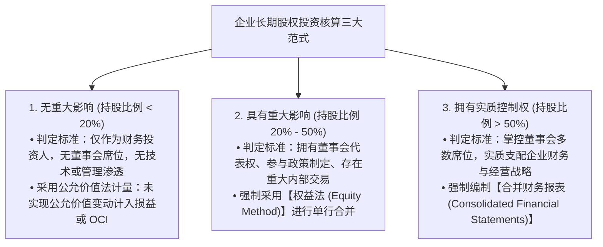
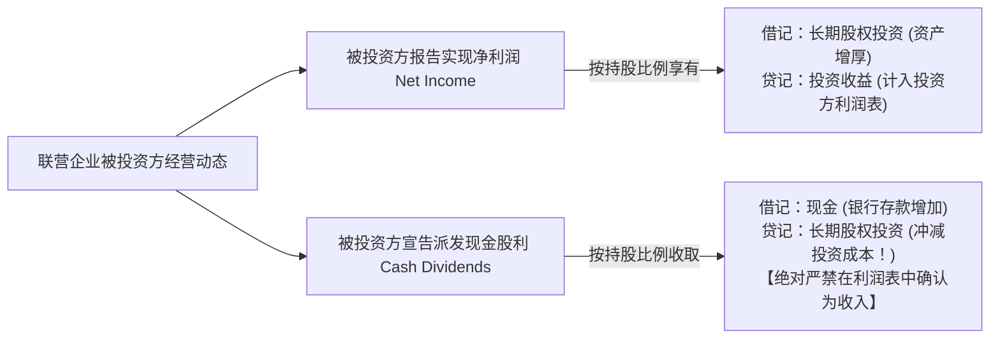
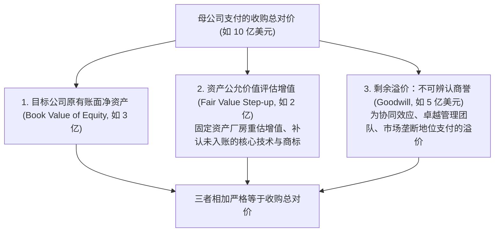

# Lec 17 企业合并与长期股权投资 (Intercorporate Investments, Acquisitions & Business Combinations)

> MIT Sloan School of Management · 15.515 Financial Accounting · 讲义 17

## TL;DR

- 长期股权投资核算范式严格取决于投资方对被投资方的实际控制与重大影响程度。
- 权益法（持股 20%-50%）将投资方净利润与被投资方实际经营业绩绑定，收到现金股利冲减投资账面。
- 控制权收购（持股 > 50%）强制执行全面合并报表，公允价值收购对价超出净资产公允价值部分确认为商誉。
- SFAS 142 彻底废除了商誉系统性逐年摊销，强制推行报告单元层级的年度减值测试机制。

## 长期股权投资三阶连续统一体模型

在现代大型企业集团的资本运作中，对外战略投资与兼并收购（M&A）是实现产业链垂直整合、获取关键专利与拓展国际市场的核心手段。公认会计准则依据**投资方对被投资方经营与财务决策的影响力深度（Degree of Influence）**，确立了三阶连续核算统一体：

::: pitfall 股权比例仅仅是经验推定，经济实质重于法律形式
20% 与 50% 的数字界限并非绝对僵化的铁律：
- 若投资方持股仅有 $15\%$，但派驻了核心执行董事、或者被投资方 $90\%$ 的核心芯片专利均由该投资方独家授权，准则判定其具备“重大影响”，必须强制采用**权益法**；
- 反之，若持股 $25\%$ 但被对方创始股东通过双重投票权结构彻底剥夺了表决权，则退化为公允价值法。

:::

## 权益法（Equity Method）核算机理与现金股利悖论

当投资方对联营企业具备重大影响时，其采用的**权益法（Equity Method）**在本质上是一种**“单行表内合并（One-Line Consolidation）”**：

在权益法下，初学者最常陷入的认知困惑是**“为什么收到被投资方发放的现金股利时，不能确认为投资收益？”**：
- **经济学实质解释**：在被投资方赚取利润的瞬间，投资方已经在其自身的利润表上确认了全额的投资收益，并在资产负债表上借记了等额的长期股权投资资产；
- 当被投资方随后将这笔利润以现金股利形式分发给投资方时，联营企业的净资产池等额缩水；
- 投资方收到的股利，本质上是其此前已经确认过的投资资产的**现金变现与本金返还（Return of Capital）**！若此时再次借记现金、贷记投资收益，就会在利润表中产生严重的**双重重复计入**。

## 控股合并、合并抵销与商誉（Goodwill）形成

当持股比例超过 $50\%$ 实现实质控制时，投资方（母公司）必须将两家独立法律实体的财务报表在会计意义上合并为单一经济实体。

在合并报表编制流水线上，必须执行两大核心程序：
1. **内部交易与股权全额抵销**：
   母公司的“长期股权投资”科目与子公司的“所有者权益（实收资本、留存收益）”在母子合并报表内部属于自我循环交易，必须编制合并抵销分录予以**对冲清零**；
2. **收购对价分摊（Purchase Price Allocation, PPA）与商誉计量**：
   在 2001 年 FASB 出台 SFAS 141 彻底废除了充满舞弊漏洞的“权益结合法（Pooling of Interests）”后，所有企业合并强制采用**购买法（Purchase Method / Acquisition Method）**：

$$\text{企业收购总对价 (Purchase Price)} = \text{现金支付} + \text{发行股份公允市价} + \text{承接的负债公允价值}$$

$$\text{并购商誉 (Goodwill)} = \text{收购总对价} - \text{被收购方各项可辨认净资产的【现行公允价值总和】}$$

$$\text{可辨认净资产公允价值} = \sum \text{可辨认资产公允市价 (PP&E、专利、客户关系)} - \sum \text{被收购方负债公允价值}$$

## 少数股东权益（Non-Controlling Interest, NCI）的会计属性

当母公司仅收购了子公司 $80\%$ 的股权时，子公司剩余 $20\%$ 的股权由外部独立第三方持有。在合并财务报表中：
- **资产与负债全额合并（100% 并表）**：无论持股比例是 $80\%$ 还是 $51\%$，子公司的全部机器、厂房、应收账款与债务 $100\%$ 原汁原味并入合并资产负债表（因为母公司拥有全盘支配权）；
- **设立少数股东权益（NCI）平衡对冲**：
  - **资产负债表**：在所有者权益专栏内部，单独列示一门**“少数股东权益（Non-Controlling Interest）”**，代表那 $20\%$ 不属于母公司的子公司净资产公允份额；
  - **利润表**：合并净利润在最底部分割为**“归属于母公司所有者的净利润”**与**“归属于少数股东的损益”**。

## 商誉减值测试替代逐年摊销的制度变迁

在历史上（2001 年之前），企业在收购中形成的商誉必须在最长 40 年内按年进行直线折旧摊销（Amortization），每年持续侵蚀企业的报表利润。

美国 FASB 颁布的第 142 号准则（SFAS 142 / 现 ASC 350）废除了这一规则，确立了**现代商誉会计范式**：

::: theorem 商誉终止摊销与年度强制减值测试公理
**商誉作为一项无确定使用寿命的特殊无形资产，绝对严禁进行系统性的定期逐年摊销（No Amortization）**！
企业必须在每个会计年度末，在**报告单元（Reporting Unit）**层级执行严格的**两步法商誉减值测试（Impairment Test）**：
1. **第一步**：比较该报告单元的整体公允市场价值与其包含商誉在内的账面净资产价值。若公允价值 $\ge$ 账面价值，商誉安全无恙，通过测试；
2. **第二步**：若公允价值跌破账面价值，必须测算商誉的隐含公允价值（Implied Fair Value），将商誉账面余额直接减记至隐含公允价值，**差额全额确认为当期资产减值损失（Impairment Loss）砸入利润表**。
:::

商誉减值一旦确认，**在任何后续年度绝对不允许转回**！

## 商业实战案例：英特尔战略并购全景

在麻省理工 15.515 课程中，彼得·威尔逊教授剖析了**英特尔公司 2002 财年年报附注中的收购与商誉披露**：

::: example 英特尔并购通信半导体企业的商誉体检
在互联网泡沫顶峰时期，英特尔为了拓展其在光通信与网络处理器领域的疆界，斥资数十亿美元连续溢价收购了一系列初创通信芯片设计公司：
- **巨额商誉确认**：由于初创科技公司往往除了几张电路图与研发团队之外几乎没有任何厂房和存货，其净资产账面价值微乎其微。英特尔支付的高达数十亿美元的现金与股票对价中，有整整 **$70\%-80\%$ 被确认为合并商誉**；
- **减值核弹引爆**：随着 2001-2002 年全球电信基础设施泡沫彻底崩溃，这些通信芯片初创公司的外部市场估值缩水超过 $90\%$。在 2002 财年，英特尔依据 SFAS 142 准则执行年度强制减值测试，被迫在第四季度对部分报告单元引爆了高达数亿美元的**一次性商誉非现金减值巨额计提**，直接将当期的营业利润打落低谷。
:::

## 我的理解

::: insight 商誉是并购溢价的停机坪，也是管理层为过度自信预付的迟到罚单
解构企业合并与商誉计量的演进历史，揭示出资本市场最冷酷的周期真相：
1. **商誉不是具有独立生产力的实体资产**：在资产负债表的所有科目中，商誉是唯一一个无法脱离企业整体而单独变卖变现的幽灵科目。它本质上是管理层在并购谈判桌上，由于狂热的竞价博弈或对“协同效应（Synergies）”过度乐观的幻想，而向被收购方股东多付出的真金白银溢价。将这一巨额差价在资产负债表上命名为“商誉资产”，本质上是会计准则为了维持资产负债平衡而设立的一块临时记账海绵。
2. **商誉减值是高管自大症的清算仪式**：当一家跨国企业的资产负债表上商誉占比超过净资产的 50% 时，它已经变成了一座脆弱的悬空楼阁。在经济繁荣期，高管层凭借不摊销商誉的制度红利，享受着并购带来的规模营收虚假繁荣；但当行业周期一旦逆转、协同效应证伪时，商誉减值就会化身为一颗毁灭性的财务核弹。读懂合并报表中的 PPA 分拆与商誉减值敏感性测试，是穿透跨国兼并神话、评估管理层资本配置能力的最强试金石。
:::
