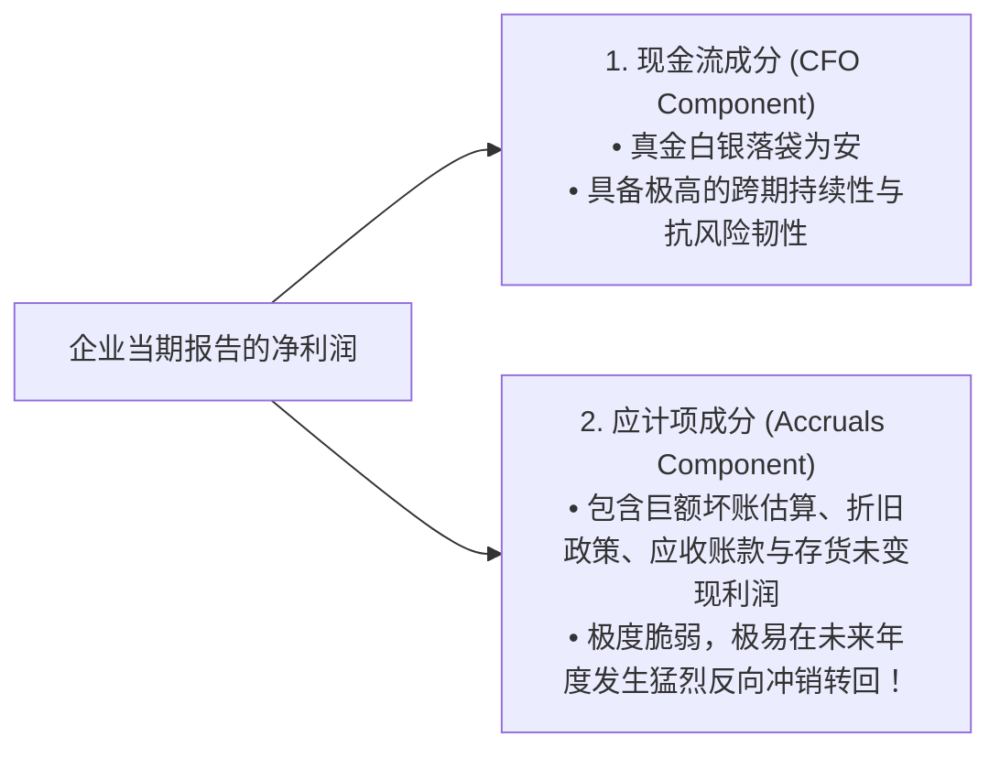
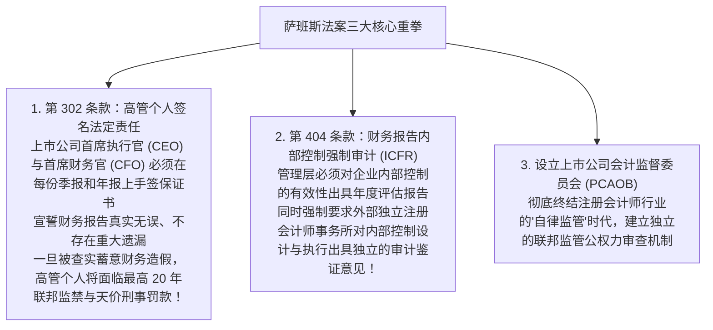

# Lec 18 财务报告前沿、特殊目的实体与盈余质量 (Current Issues in Financial Reporting: SPEs, VIEs & Earnings Quality)

> MIT Sloan School of Management · 15.515 Financial Accounting · 讲义 18

## TL;DR

- 安然事件暴露出传统准则下特殊目的实体（SPE）3% 外部股权非并表规则的灾难性系统漏洞。
- 现代可变利益实体准则（VIE / ASC 810）依据主要受益人模型，彻底粉碎了利用壳公司藏匿债务的通道。
- 斯隆应计异象证明：高度依赖非现金应计项驱动的净利润，其未来持续性与现金转化率显著偏低。
- 《萨班斯-奥克斯利法案》（SOX 404）将内部控制审计提升至法定刑责高度，重建了资本市场信任基石。

## 表外融资的终极演变：特殊目的实体（SPE）与安然之殇

在 2001 年美国安然公司（Enron Corporation）破产倒闭之前，华尔街投行与休斯敦能源巨头联手将**表外融资（Off-Balance Sheet Financing）**推向了登峰造极的金融工程幻境。其核心载体是**特殊目的实体（Special Purpose Entities, SPE）**。

在旧有的公认会计准则下，存在一条极其荒谬但合法的微观裁决漏洞——**“3% 独立股权免于并表规则”**：
- 如果一家发起人企业设立了一家法律上独立的 SPE 壳公司；
- 只要有外部独立第三方投资者向该 SPE 注入了占其总资产最低仅 **$3\%$** 的股权资本并承担了名义风险；
- 发起人企业就**完全不需要将该 SPE 纳入自己的合并财务报表**！

```mermaid
flowchart LR
    Enron[安然母公司 (Enron Corp.)] -->|转移亏损与暴跌资产| SPE["表外特殊目的实体 (SPE)<br/>(如 Chewco, LJM, Raptors)<br/>表面满足 3% 外部注资"]
    
    SPE -->|向华尔街银行举债借款| WallStreet[外部银团贷款数十亿美元]
    Enron -.->|背对背秘密股权回购兜底协议| SPE
    
    Enron --> FakeProfit["安然利润表确认虚假按市值计价利润<br/>数十亿美元刚性债务被完全藏在表外"]
```

安然前首席财务官安德鲁·法斯托（Andrew Fastow）利用该规则构建了极其庞大的影子帝国：
1. **藏匿巨额负债**：安然将原本属于母公司的数十亿美元银行借款与管道债务，全部塞入未并表的表外 SPE 中，使得母公司的账面资产负债率维持在令人艳羡的健康低位；
2. **制造虚假交易与暴利**：安然将账面上严重套牢、发生暴跌的科技初创股权和未完工电厂资产，以高昂的虚构市价“高位出售”给自身控制的表外 SPE，从而在母公司利润表上强行确认数十亿美元的“资产转让投资收益”；
3. **隐秘的母公司信用兜底**：所谓的 3% 外部投资人实际上全是由法斯托控制的关联方合伙企业，其承担的风险全部由安然母公司的普通股股票秘密质押兜底。当安然自身股价一旦暴跌，整个连锁兜底链条瞬间发生多米诺骨牌式坍塌，导致这家全美第七大巨头在数周之内灰飞烟灭。

## 现代可变利益实体（VIE / FIN 46R / ASC 810）控制权准则

安然丑闻引爆后，美国准则委员会彻底废除了 3% 的机械规则，发布了具有划时代意义的解释公告 FIN 46R（现纳入 ASC 810），正式确立了**可变利益实体（Variable Interest Entities, VIE）合并框架**。

传统会计并表以“法定表决权股权（Voting Rights）”为唯一标尺，即谁持有 50% 以上有表决权的普通股谁就负责并表。然而，现代金融工程可以通过无投票权优先股、结构性债务合同、排他性技术管理协议或全额兜底担保，使得一家机构在法律上未持有任何股权，却在经济上完全支配该实体并承担其全部破产损失。

针对这种“有形无实”的壳公司架构，ASC 810 准则构建了穿透法律外衣的**主要受益人双重检验模型**：

```mermaid
flowchart TD
    EntityCheck[评估一个法律实体是否构成 VIE] --> Test1{1. 权益投资总额是否充足?<br/>该实体的全部股权投资是否足以支撑其正常业务运作，而无需额外从属财务支持?}
    
    Test1 -->|是：传统正常实体| VotingModel["适用传统表决权模型：按 > 50% 股权判定控制"]
    Test1 -->|否：股权资本薄弱，属于薄记空壳| ConfirmVIE[确认为：可变利益实体 VIE]

    ConfirmVIE --> PB_Test{评估发起人是否属于主要受益人 (Primary Beneficiary)?}
    PB_Test --> Power["维度一：主导权 (Power)<br/>是否拥有指导对该 VIE 经济绩效产生最重大影响的业务决策的实质权力?"]
    PB_Test --> Economics["维度二：经济利益敞口 (Obligation / Benefits)<br/>是否有义务吸收其重大潜在损失，或有权享有其重大剩余回报?"]

    Power & Economics -->|同时满足两项核心维度| Consolidate["强制法定要求：必须 100% 纳入合并财务报表并表！<br/>无论你在该实体中持有 0% 还是 100% 的名义表决权股权！"]
```

在 VIE 体系下，无论企业如何设计离岸群岛的股权代持或复杂的夹层债务，只要发起人同时具备对该实体的**实质运营主导权（Power）**与**重大可变回报敞口（Significant Economic Exposure）**，该发起人就会被法定义务认定为“主要受益人（Primary Beneficiary）”。这种实质穿透准则彻底终结了跨国巨头将高危资产与有毒负债剥离至表外空壳公司的投机通道。

::: theorem VIE 主要受益人控制权公理
新准则确立了一条深刻的现代会计公理：**实质重于形式，风险与回报的归属超越了法定股票表决权**！
只要你在经济实质上承担了一个实体的终极破产风险并享有其绝大部分造血回报，即便你在法律上一股都没有持有，你就是它的**主要受益人（Primary Beneficiary）**，它的每一分负债与资产就必须完整写进你的合并资产负债表中。
:::

## 盈余质量与斯隆应计异象（Sloan Accrual Anomaly）

在后安然时代，证券分析界从单纯崇拜“净利润每股收益”彻底转向了深度考察**盈余质量（Quality of Earnings）**。

密歇根大学会计学泰斗理查德·斯隆（Richard Sloan，1996）在《会计学评论》上发表了一项震撼华尔街的实证发现——**斯隆应计异象（The Accrual Anomaly）**：

$$\text{当期净利润 (Net Income)} = \text{经营活动现金流量净额 (CFO)} + \text{全口径净应计项总和 (Total Accruals)}$$



斯隆通过对全美上市公司长达数十年的大样本量化回测证明：
- 资本市场参与者（包括绝大多数明星基金经理）普遍存在严重的**“功能性锁定（Functional Fixation）”**心理偏差——他们只盯着底层的净利润数字，而盲目假定净利润中包含的“现金流”与“应计项”具有完全相同的未来持续性；
- **量化规律**：如果一家企业的净利润增长主要由**高额应计项（Accruals）**驱动，那么该企业在未来 1 至 3 年内的真实净利润必然会发生**断崖式衰退**；
- 依据“做空高应计项股票、做多高现金流股票”构建的多空对冲量化策略，在长达三十年里能够持续斩获惊人的无风险超额 Alpha 收益。

在实务排雷中，分析师总结出了**劣质盈余质量的七大经典财务红旗（Red Flags）**：

| 财务异动红旗指标 | 微观财务异动表征 | 底层潜在财务造假或激进激进包装动机 |
| :--- | :--- | :--- |
| **1. 应收账款增速失控** | DSO 持续异常拉长，应收账款增幅远超营收增幅 | 存在渠道塞货、向资质极其恶劣的客户滥放账期虚增当期收入 |
| **2. 存货恶性堆积** | 存货周转天数（DSI）单调飙升，存货增速远超销货成本 | 盲目超产以稀释固定制造费用（制造虚假利润），或拒绝计提跌价准备 |
| **3. 资本化边界异动** | 将大量软件开发、日常线路维护、广告宣传支出违规资本化 | 将当期利润表费用强行包装为资产负债表资产（如世通丑闻） |
| **4. 一次性洗大澡频发** | 动辄在管理层换届时计提巨额“重组与资产减值损失” | 提前将未来几年的成本集中砸在当年，为后续轻装上阵刷利润铺路 |
| **5. 财税脱节与有效税率失常** | 账面税前会计利润暴增，但有效税率却莫名出现大幅度跳水 | 利润表确认了海量未获税法认可的虚假应计收入（应税所得未跟进） |
| **6. 利润与经营现金流背离** | 净利润连续三年为正且连创新高，但经营活动现金流（CFO）常年为负 | 企业处于严重的无现金虚胖状态，暴雷清算仅仅是时间问题 |
| **7. 频繁修改会计估计** | 临近年末频繁宣布延长机队或产线折旧年限、调低坏账计提率 | 纯粹依靠纸面参数修正完成管理层当年的季度考核利润指标 |

## 萨班斯-奥克斯利法案（SOX 2002）与现代内控审计

为了终结资本市场的信任危机，美国国会于 2002 年以压倒性多数通过了被誉为 20 世纪 30 年代大萧条以来影响最深远的金融改革法案——**《萨班斯-奥克斯利法案》（Sarbanes-Oxley Act, SOX）**。

该法案从法律责任、内部控制与独立监管三个维度，对全球上市公司治理结构施加了前所未有的制度刚性约束：



在执行第 404 条款（SOX 404）时，企业与独立审计师必须建立分层的内控缺陷诊断标准：
1. **控制缺陷（Control Deficiency）**：内部控制的设计或运行无法防止或及时发现财务报表偏差，属于轻微孤立问题；
2. **重大缺陷（Significant Deficiency）**：内部控制存在负面缺陷，其严重程度低于重大缺陷，但足以引起负责公司财务监督人员的注意；
3. **实质性漏洞（Material Weakness）**：内部控制存在一个或多个缺陷的组合，导致存在合理的可能性使得企业财务报表的**重大错报（Material Misstatement）无法被企业内部控制及时预防或发现**。一旦被外部审计师出具关于内控“存在实质性漏洞”的否定意见（Adverse Opinion），企业将面临极为严重的资本市场信任惩戒与借贷利息上浮。

## 我的理解

::: insight 财务造假的尽头从来不是技术的精妙，而是人性的贪婪与制度的博弈
解构表外融资与安然破产的悲剧，可以获得深刻的商业认识论启迪：
1. **当 CFO 的精力超越了工程师，企业就已经走向衰亡**：在安然最狂热的岁月里，全美商学院的 MBA 高材生将法斯托奉为天神，竞相学习如何利用数百个嵌套的 SPE 和衍生品合同在资产负债表上玩隐身术。然而，所有的金融结构在物理世界面前都轻如鸿毛。一家能源企业的真正价值，最终只取决于它到底能不能安全、高效地把天然气输送到千家万户。当一家公司的核心竞争力演变为在会计准则边缘游走套利时，它就已经被死神打上了倒计时的烙印。
2. **制度建设必须用不可妥协的法律刚性替代善良假设**：在安然和世通之前，美国监管界天真地假设只要给出原则指引，理性的职业经理人就会自觉维护股东利益。萨班斯法案最大的制度贡献，在于它用最冷酷的刑责红线（CEO 亲笔签名坐牢条款）彻底打碎了内部人的侥幸心理。透明度不是资本市场的选配装饰，而是现代商业文明赖以存续的氧气。唯有将内部控制深植于组织运行的每一道神经末梢，企业的基业长青才不至于沦为建造在沙滩上的摩天大厦。
:::
