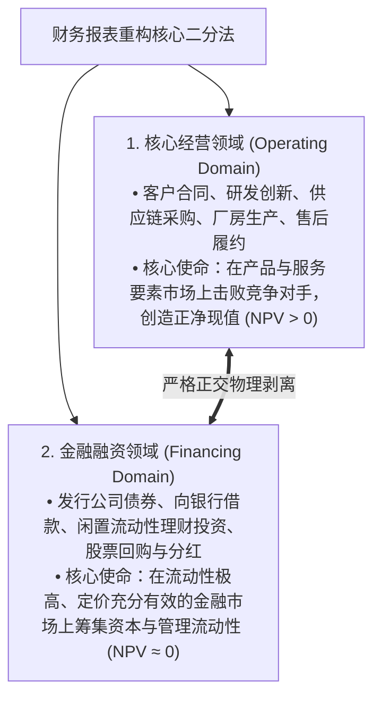
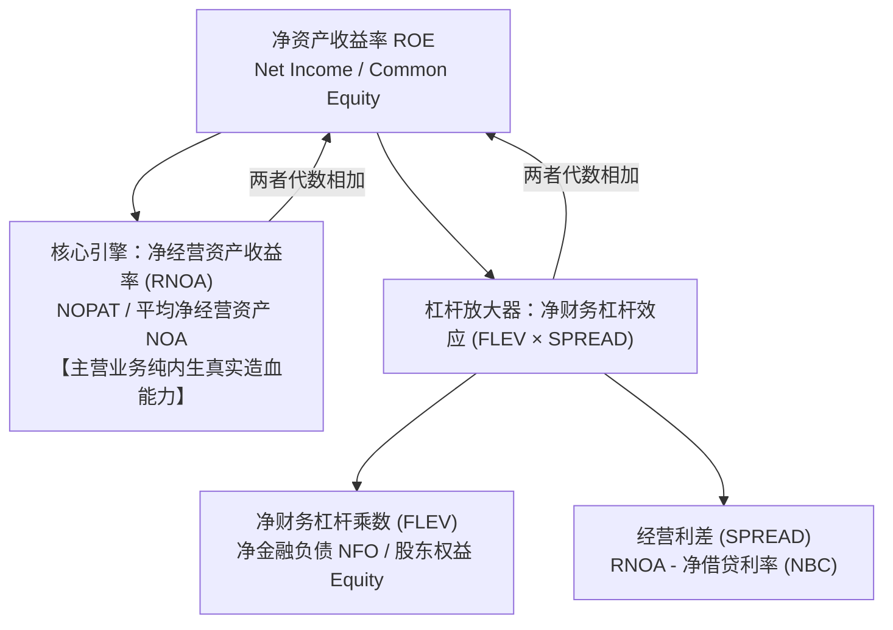
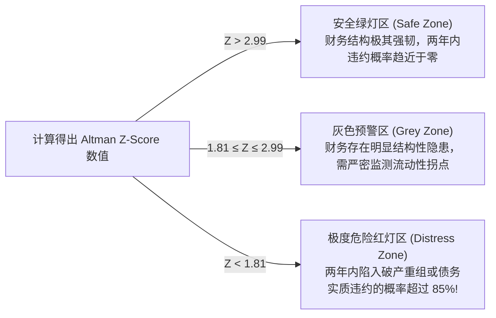

# Lec 19 财务报表综合分析框架 (Comprehensive Financial Statement Analysis: Reformulation & Credit / Equity Valuation)

> MIT Sloan School of Management · 15.515 Financial Accounting · 讲义 19

## TL;DR

- 传统 GAAP 报表混淆了经营与金融活动，必须通过报表重构（Reformulation）实现二者的严格物理剥离。
- 净经营资产（NOA）与税后净经营利润（NOPAT）构成了企业核心商业价值创造的独立度量基石。
- 进阶 ROE 展开式将股东回报精确解构为核心经营收益率（RNOA）与财务杠杆利差驱动效应。
- 阿特曼 Z-Score 多元判别模型将流动性、累积盈余、资产周转与资本结构聚合为破产预警标尺。

## 财务报表重构哲学：经营活动 vs. 金融活动彻底解耦

在传统的公认会计准则（GAAP）资产负债表与利润表中，存在一个重大的信息结构缺陷——**将属于企业主营业务价值创造的“经营活动（Operating Activities）”与仅仅负责资金过桥结算的“金融融资活动（Financing Activities）”无差别混杂在一起**：
- 资产负债表将超额闲置现金投资与厂房机器统统划为“资产”，但闲置现金在经济实质上是一笔随时可用于冲抵借款的“负债务（Negative Debt）”；
- 利润表将向债权人支付的利息费用与产品生产成本混在一起扣除，导致两个核心主营业务盈利能力完全相同的企业，仅仅因为一家发了债券、另一家发了股票，其表观营业利润与净利润就呈现巨大差异。

为了还原商业竞争的最纯净真相，哥伦比亚大学佩恩曼（Stephen Penman）教授与哈佛商学院帕勒普（Krishna Palepu）教授构建了**财务报表重构框架（Financial Statement Reformulation）**：

## 资产负债表与利润表重构代数模型

通过对每一个财务报表科目进行经营与金融维度的正交穿透分类，分析师构建起**重构资产负债表与重构利润表**：

### 1. 重构资产负债表（Reformulated Balance Sheet）
$$\text{净经营资产 (Net Operating Assets, NOA)} = \text{经营性资产 (OA)} - \text{经营性负债 (OL)}$$
$$\text{净金融负债 (Net Financial Obligations, NFO)} = \text{金融性负债 (FO)} - \text{金融性资产与闲置现金 (FA)}$$

由此推导出重构资产负债表的核心恒等式：
$$\mathbf{\text{净经营资产 (NOA)}} = \mathbf{\text{净金融负债 (NFO)}} + \mathbf{\text{普通股股东权益 (Common Equity)}}$$

该公式清晰揭示了企业的资产负债拓扑真相：**企业所拥有的一切能够创造超额商业价值的净经营实体资产（NOA），其终极资金来源仅仅是由净债务债权人（NFO）和股权投资者（Equity）共同出资支撑的**。

### 2. 重构利润表（Reformulated Income Statement）
$$\text{税后净经营利润 (NOPAT)} = \text{核心营业收入} - \text{核心经营营业成本费用} - \text{经营利润对应实际税负}$$
$$\text{净金融费用 (Net Financial Expenses, NFE)} = (\text{债权借款利息支出} - \text{闲置金融资产利息收益}) \times (1 - \text{所得税税率 } \tau)$$

由此推导出重构综合收益恒等式：
$$\mathbf{\text{综合净利润 (Comprehensive Income)}} = \mathbf{\text{税后净经营利润 (NOPAT)}} - \mathbf{\text{净金融费用 (NFE)}}$$

## 进阶净资产收益率（ROE）与利差（SPREAD）方程

在重构框架下，传统的杜邦分析被彻底升级为公司金融领域最为严密的**股东价值创造终极方程**：

$$\mathbf{\text{ROE}} = \mathbf{\text{RNOA}} + \left[ \mathbf{\text{FLEV}} \times \mathbf{\text{SPREAD}} \right] = \text{RNOA} + \left[ \left( \frac{\text{NFO}}{\text{Equity}} \right) \times (\text{RNOA} - \text{NBC}) \right]$$

其中：
- $\text{RNOA} = \frac{\text{NOPAT}}{\text{NOA}}$：衡量企业动用的每一元纯经营实体资本所赚取的税后经营收益；
- $\text{NBC} = \frac{\text{NFE}}{\text{NFO}}$：企业承担的**净综合借贷融资成本率（Net Borrowing Cost）**；
- $\text{SPREAD} = \text{RNOA} - \text{NBC}$：**核心经营利差**。

::: theorem 财务杠杆的双刃剑公理
**负债对股东回报（ROE）的拉升作用，完全取决于经营利差（SPREAD）的正负符号**：
1. **正利差增厚区（SPREAD > 0 即 RNOA > NBC）**：当企业主营业务的资本回报率能够稳定跑赢银行借款利率时，扩大净财务杠杆（提高 FLEV）能够成倍放大股东的最终 ROE；
2. **负利差毁灭区（SPREAD < 0 即 RNOA < NBC）**：一旦行业下行导致主营利润率跌破借款利率，**净财务杠杆将化身为凶猛的价值粉碎机**，杠杆越高，对股东净资产的侵蚀速度越呈指数级飙升，迅速将企业拖入破产深渊！
:::

## 信用风险与财务危机预测：阿特曼 Z-Score 模型

除了评估股东价值，财务报表分析的另一大支柱是评估企业的**违约与破产风险（Credit & Bankruptcy Risk）**。纽约大学斯特恩商学院爱德华·阿特曼（Edward Altman）教授通过多变量判别分析（MDA），构建了享誉全球近六十年的**阿特曼 Z-Score 预测模型**：

$$Z = 1.2 X_1 + 1.4 X_2 + 3.3 X_3 + 0.6 X_4 + 0.999 X_5$$

各项指标的微观含义与财务密码如下：
- $X_1 = \frac{\text{营运资本 (Working Capital)}}{\text{总资产}}$：短期流动性缓冲垫；
- $X_2 = \frac{\text{留存收益 (Retained Earnings)}}{\text{总资产}}$：企业历史跨周期盈利造血积累厚度（年轻企业该指标偏低，破产率天然偏高）；
- $X_3 = \frac{\text{息税前营业利润 (EBIT)}}{\text{总资产}}$：总资产生产率与最纯粹的内生运营盈利能力；
- $X_4 = \frac{\text{股东权益二级市场公允市值}}{\text{总负债账面价值}}$：资本市场对企业抵御债务违约缓冲垫的公允信心；
- $X_5 = \frac{\text{销售营业收入}}{\text{总资产}}$：总资产在终端市场的周转效率与商业竞争力。

## 我的理解

::: insight 财务重构剥离了金融幻觉，把企业逼回创造真实商业价值的原始擂台
深入研读财务报表综合分析体系，可以获得穿透一切估值迷雾的高阶洞察：
1. **金融操作不创造超额价值**：在有效资本市场中，借钱、发债、配股或炒作理财，在数学期望上都是净现值等于零（NPV = 0）的零和交易，没有任何一家企业可以通过高超的玩弄负债结构而真正成为商业巨头。企业终极竞争力的唯一策源地，永远是**净经营资产（NOA）与核心税后经营利润（NOPAT）**。重构报表的伟大之处，在于它像外科手术刀一样剔除了所有的财务修饰，逼迫高管层直面“脱去杠杆外衣后，你的主营业务到底能不能赚到超越资金成本的利润”。
2. **Z-Score 揭示了企业生命力的全景代数和**：为什么简单的五个比率加权就能准确预测数十万家企业的生死？因为这五个变量分别锁定了**即时血液循环（流动性）、历史骨骼密度（留存收益）、当期器官代谢（EBIT）、外部肌肉防御（权益市值）与捕食效率（周转率）**。任何一处肌体病变，都会在 Z-Score 的线性判别方程中产生不可抵消的警报。掌握了这一综合透视框架，财务分析师才能真正超越事后的统计员角色，升维为商业世界中能够洞见未来的顶级诊断医生。
:::
