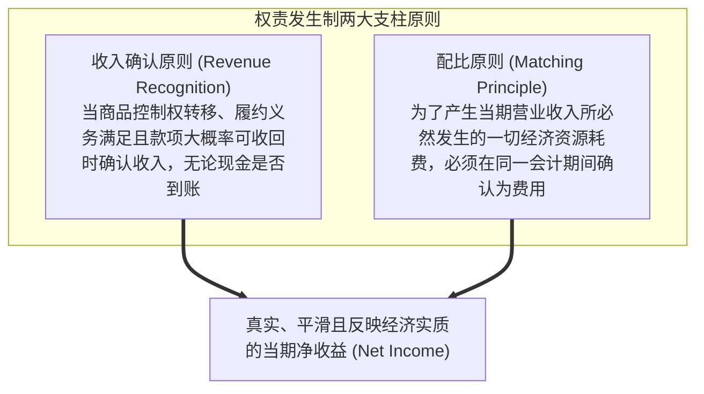
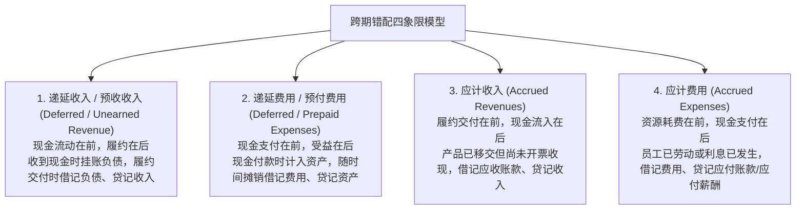
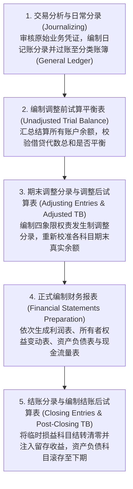

# Lec 02 权责发生制原理与会计循环全貌 (Principles of Accrual Accounting: The Bookkeeping Model, 4 Types of Accruals & The Accounting Cycle)

> MIT Sloan School of Management · 15.515 Financial Accounting · 讲义 02

## TL;DR

- 权责发生制依据经济权利与义务的发生归属确认收支，消除了收付实现制下现金收付波动的严重噪音。
- 应计项分类四象限模型将跨期错配解构为预收收入、预付费用、应计收入与应计费用四类期末调整。
- 资产负债表动态扩展方程实现了资产、负债、实收资本、留存收益与期间损益科目的代数刚性守恒。
- 留存收益是企业历史经营净成果在权益端的沉淀，与资产端当前的可用货币资金余额具有本质区别。

## 权责发生制 vs. 收付实现制：现金流与经济实力的时间错配

在商业世界的微观交易中，现金的物理流动（Cash Inflow/Outflow）与经济价值的真实创造或消耗（Economic Performance）往往存在严重的跨期错配。企业可能在今天收到客户支付的未来三年软件服务全额预付款，也可能在半年前就已经交付了大型机床但客户至今仍未支付尾款。

若采用最为原始的**收付实现制（Cash-Basis Accounting）**：
- 只要银行账户收到钞票就确认为收入，只要支票兑付就确认为费用；
- 这会导致企业的月度利润曲线呈现极端的悬崖式锯齿波动——某月因集中采购一台可用十年的核心光刻机而账面“巨额亏损”，次月又因客户提前打款而账面“爆发式暴利”；
- 这种锯齿状的短期现金波动彻底掩盖了企业真实的持续经营盈利能力。

现代会计由此确立了**权责发生制（Accrual-Basis Accounting）**：

## 应计项分类四象限模型与期末调整分录

在每个会计期间结束日，企业账簿由于日常交易记录仅跟踪了显性业务单据，必须执行**期末调整分录（Adjusting Journal Entries, AJE）**。期末调整在本质上是解决“现金收付时间”与“履约/消耗时间”错配的四象限映射：

四类调整分录的操作机理与影响如下表所示：

| 调整分类 | 初始交易记账逻辑 | 期末调整分录 (AJE) | 漏记该调整分录的报表后果 |
| :--- | :--- | :--- | :--- |
| **预收账款 (Unearned Revenue)** | 借：现金；贷：预收账款（负债） | 借：预收账款（负债减少）；贷：营业收入（收入增加） | 负债被高估，当期收入与净利润被严重低估 |
| **预付账款 (Prepaid Expense)** | 借：预付租金/保险（资产）；贷：现金 | 借：租金/保险费用（费用增加）；贷：预付账款（资产减少） | 资产被虚夸高估，当期费用低估导致净利润虚胖 |
| **应计收入 (Accrued Revenue)** | （无日常初始分录，经济实质已发生） | 借：应收账款/应计未开票收入；贷：营业收入 | 资产被低估，当期营业收入与净利润被低估 |
| **应计费用 (Accrued Expense)** | （无日常初始分录，劳务或利息持续消耗） | 借：工资费用/利息费用；贷：应付工资/应付利息 | 负债被瞒报隐匿，当期费用被低估，净利润被虚夸 |

::: theorem 期末调整分录的纯粹性公理
**任何合法的期末调整分录（AJE）绝对不允许涉及“现金（Cash）”账户**！
调整分录的纯粹目的在于修正资产负债表科目与利润表科目之间的权责权属映射。凡是在期末调整中出现现金借贷记账的，必然是错把日常收付交易混入了期末权责调整。
:::

## 资产负债表方程式与记账模型推导

复式记账法（Double-Entry Bookkeeping）是商业文明史上最伟大的数学发明之一。其核心公理是**资产负债表恒等式（Balance Sheet Equation, BSE）**：

$$\text{资产 (Assets)} = \text{负债 (Liabilities)} + \text{所有者权益 (Stockholders' Equity)}$$

在经营过程中，所有者权益进一步解构为外部股东注入的原始股本与企业自我滚存累积的留存收益。资产负债表方程式由此演进为**动态完全扩展方程**：

$$\text{Assets} = \text{Liabilities} + \text{实收股本 (Contributed Capital)} + \text{期初留存收益} + \text{营业收入 (Revenues)} - \text{营业费用 (Expenses)} - \text{现金股利 (Dividends)}$$

每一笔发生的经济业务，都如同在方程两端施加了代数守恒变换：要么是一项资产增加伴随另一项资产等额减少（如现购设备）；要么是一项资产增加伴随一项负债等额增加（如赊购原材料）；要么是一项资产减少伴随一项费用增加（如计提折旧冲减留存收益）。系统在任何物理时间节点，两端借贷总额恒等成立。

## 会计循环四大阶段流水线工程

企业每一个财报周期的推进，都严格遵循规范的**会计循环流水线（The Accounting Cycle）**：

::: definition 临时性账户 vs. 永久性账户结账隔离
- **永久性账户（Permanent / Real Accounts）**：包含资产、负债与实收资本等科目。这些科目的期末余额**绝对不能清零**，而是作为下一周期的期初余额持续滚存跨期结转；
- **临时性账户（Temporary / Nominal Accounts）**：包含所有收入、费用、损益汇总（Income Summary）与宣告股利科目。由于其仅衡量“特定单一会计期间”的增量经营流量，在财报编制完成后，必须编制结账分录（Closing Entries）将其**借贷发生额全额冲销清零**，并将净差额（当期净利润减当期股利）永久结转注入“留存收益（Retained Earnings）”账户。
:::

## 财报连通性深层推导：为什么期末留存收益不等于期末现金？

在麻省理工 15.515 的课堂研讨中，初学者最常陷入的认知误区是把资产负债表上的“留存收益”当成是趴在银行账户里的“现金闲钱”。

::: example 留存收益与货币资金脱钩的微观机理
某高科技半导体企业创立首年，实现营业收入 5,000 万元，总营业费用 3,000 万元，净利润为 2,000 万元。公司未分发任何股利，期末**留存收益账面余额为 2,000 万元**。
然而，在检视期末资产负债表时，首席执行官震惊地发现：**公司的银行存款现金余额仅剩下区区 50 万元**！

钱到底去哪里了？
通过查验资产负债方程式的动态平衡可以发现：
- 2,000 万元的留存收益代表的是**企业在历史上凭借自身经营从外部市场创造出的“净资产权益索偿权总和”**；
- 但是，企业管理层在当年将赚取的资金进行了再投资配置：
  - 花费 1,200 万元现款购置了高精度晶圆刻蚀机（转化为固定资产 PP&E）；
  - 花费 600 万元现款采购了稀有特种气体与化学试剂（转化为存货 Inventory）；
  - 有 150 万元的销售货款尚未被客户结清（转化为应收账款 Accounts Receivable）；
- 最终：
  $$\text{净资产增量 (2,000 万)} = \Delta \text{现金 (50 万)} + \Delta \text{固定资产 (1,200 万)} + \Delta \text{存货 (600 万)} + \Delta \text{应收款 (150 万)}$$
- **结论**：留存收益在资产端早已幻化成了厂房、机器和仓库中的半成品。留存收益的高低只代表企业历史造血总量的多寡，绝不代表企业当下的即时偿债流动性。
:::

## 我的理解

::: insight 权责发生制是商业世界的信息滤波器，它用估算的不确定性换取了经济实质的确定性
审视会计循环的底层哲学，权责发生制揭示了深刻的认识论权衡：
1. **现金流是最客观的，但也是最笨拙的**：收付实现制最大的美德是“铁证如山”——银行流水不会撒谎，没有任何主观操纵的空间。但这种机械的客观性是以彻底丧失商业洞察力为代价的。如果仅仅因为一家造船厂在长达三年的工期中只有在第三年交船时才收到全款，就在前两年将其判定为濒临破产的亏损企业，这种会计信息对资本市场毫无决策价值。
2. **权责发生制引入了主观判断，也开辟了代理人操纵的战场**：为了将收入与成本在经济实质发生时精准配比，权责发生制不得不依赖大量的主观估计（如设备预计能用几年、应收账款预计有百分之几收不回来、质保维修预计要花多少钱）。**正是这些为了追求“真实配比”而引入的估计，成为了管理层粉饰财报、实施盈余管理（Earnings Management）的天然温床**。理解权责发生制，就是要在拥抱其信息平滑价值的同时，时刻保持对主观应计项（Accruals）的警惕审计目光。
:::
