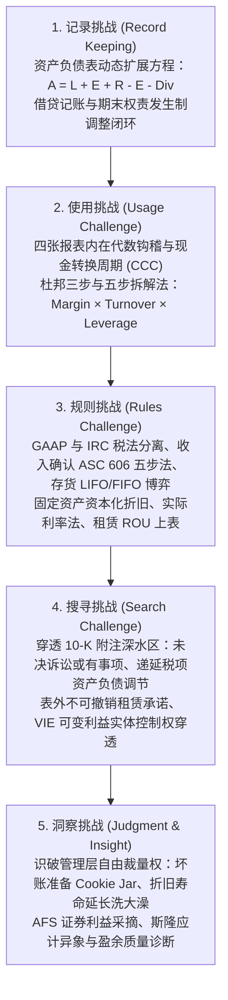
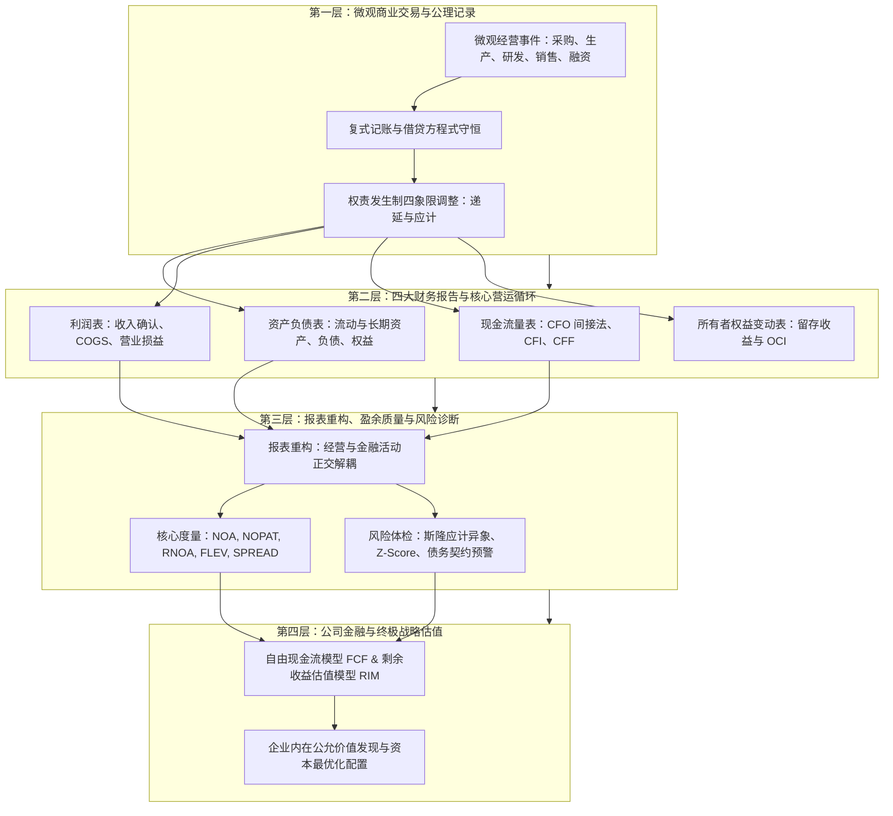

# Lec 20 财务会计公理统合与价值创造未来 (Course Review, Framework Integration & Transition to Corporate Finance)

> MIT Sloan School of Management · 15.515 Financial Accounting · 讲义 20

## TL;DR

- 彼得·威尔逊教授五大挑战在全课程中完成了从基础记账守恒至顶层战略洞察的完整认知闭环。
- 全景会计知识体系实现了从微观离散商业交易、标准化财务报告到企业内在公允价值的纵深跃迁。
- 财务会计报表通过税后净经营利润（NOPAT）与自由现金流（FCF），无缝对接公司金融估值模型。
- 会计是现代商业文明不可或缺的量化操作系统，掌握逆向重构能力是穿透一切商业迷雾的终极护城河。

## 财务会计五大挑战的终极闭环

历经 20 讲的高强度研讨与实战案例推演，麻省理工 15.515 课程在彼得·威尔逊（G. Peter Wilson）教授确立的**财务会计五大挑战（The Five Challenges Framework）**中实现了完美的逻辑闭环。

在初入会计之门时，多数人误以为会计仅是一套机械的数字记账规则；然而在遍历了复杂收入确认、LIFO 税收博弈、递延税项负债、商誉减值与表外实体之后，我们清晰地看到这五大挑战分别锁定了人类理解商业系统时的**五个不可逾越的认识论关口**：

这五大挑战不仅是学术上的训练大纲，更构成了商业领袖面对纷繁复杂市场信息时的**五阶认知升维阶梯**：
- 初级账房先生止步于第一与第二挑战（机械记账与套用公式）；
- 资深专业审计师精通第三与第四挑战（严守准则与排查附注）；
- 唯有顶级战略投资家与卓越商业领袖能够通达第五挑战——在看似枯燥的会计数字背后，一眼洞穿管理层的人性贪婪、战略企图与企业终极命运。

## 全景会计知识地图：微观交易向战略估值的跃迁

将整门课程涵盖的核心模块按因果演进规律整合，呈现出一张精密咬合的**全景商业量化操作系统拓扑图**。

整个知识大厦从底层的微观经济交易出发，经过会计系统的抽象压缩，逐步向上升华为宏观资本市场的资源配置定价决策：

这一四层递进结构确立了从数据到洞察的完整转化流水线：

1. **微观公理层（The Micro-Foundation Layer）**：
   这是整个商业信息系统的物理事实起点。利用复式记账法借贷平衡的刚性代数守恒（$A = L + E$）与四象限权责发生制调整（递延收入、预付费用、应计收入与应计费用），系统将无序、分散、充满主观噪音的现实微观商业交易，严密编码为具备不可否认性、可追溯性和内部自洽性的复式账簿记录。

2. **报表汇报层（The Financial Reporting Layer）**：
   这是企业向外部资本市场交付的标准信息接口。通过资产负债表（存量快照）、利润表（流量损益）、所有者权益变动表（留存沉淀）与现金流量表（流动性流向）之间的内在勾稽关系，系统将企业的跨期生产运营、供应链回款与长期资产折旧，完整、透明地呈现在投资人与监管机构的聚光灯下。

3. **重构分析层（The Reformulation and Diagnostics Layer）**：
   这是专业证券分析师穿透 GAAP 会计表象的核心手术刀。通过打破传统准则混淆经营与金融活动的局限，将资产与负债严格重构为净经营资产（NOA）与净金融负债（NFO），精准提炼出排除利息杂音的税后净经营利润（NOPAT）。在此基础上，结合杜邦利差展开式（$\text{ROE} = \text{RNOA} + \text{FLEV} \times \text{SPREAD}$）、斯隆应计异象检验与阿特曼 Z-Score 模型，实现对企业真实造血能力与财务暴雷风险的无偏体检。

4. **终极估值层（The Corporate Valuation and Strategy Layer）**：
   这是财务分析与公司金融战略决策的集大成殿堂。通过将清洗重构后的会计指标转化为企业自由现金流（FCFF）与奥尔森剩余收益（Residual Income），资本市场得以对企业的内在公允价值建立严格的数理定价模型，进而驱动全社会数以万亿美元计的稀缺储蓄资本，精确投向生产率最高、技术护城河最深的卓越实体。

## 财务会计向公司金融与战略决策的无缝接口

财务会计从不孤立存在，它是整个现代公司金融（Corporate Finance）与投资学（Investments）的母体数据源。通过对财务会计科目进行无偏清洗，分析师可以直接导出估值模型的核心输入变量：

### 1. 自由现金流（Free Cash Flow, FCF）的精确导出
自由现金流是企业在满足了所有净现值为正的资本投资后，能够完全不受限制地分发给出资人（债权人与股东）的纯粹真金白银：

$$\mathbf{\text{企业自由现金流 (FCFF)}} = \text{税后净经营利润 (NOPAT)} + \text{折旧与摊销 (D\&A)} - \Delta \text{经营营运资本 (OWC)} - \text{资本开支 (CapEx)}$$

- **NOPAT** 来自重构利润表，消除了资本结构利息干扰；
- **D&A** 来自现金流量表经营活动间接法调整项；
- **$\Delta \text{OWC}$** 来自应收账款、存货与应付账款变动；
- **CapEx** 来自现金流量表投资活动中购置固定资产的现金净流出。

### 2. 剩余收益估值模型（Residual Income Valuation / Ohlson Model）
除了现金流折现（DCF），现代财务学派广泛采用直接锚定于会计数字的**奥尔森估值模型（Ohlson 1995）**：

$$\mathbf{\text{企业股权内在价值 (Intrinsic Value)}} = \text{当前账面净资产 (Book Value}_0) + \sum_{t=1}^{\infty} \frac{\text{预期未来剩余收益 (Residual Income)}_t}{(1 + r_e)^t}$$

$$\text{其中，第 } t \text{ 期剩余收益} = \text{第 } t \text{ 期净利润} - (\text{股权资本成本率 } r_e \times \text{第 } t-1 \text{ 期账面净资产})$$

该模型在数学上与 DCF 完全等价，其划时代意义在于：**它直接将资产负债表上的账面净资产（历史存量）与未来预期的会计超额利润（未来流量）统一在同一张估值矩阵中**，证明了只要会计核算遵循严格的“清洁盈余关系（Clean Surplus Relation）”，账簿数字就能精确推导出股票的内在公允价值。

## 会计的真理：商业文明的定量操作系统

在 15.515 课程的终章，我们终于可以对“会计是什么”给出一个最高维度的定义：

::: definition 会计的本质 (The Essence of Accounting)
**会计不仅是一门技术，更是人类为了在充满不确定性与信息不对称的去中心化社会中维系大规模商业协作，所共同演进出的一套严密的定量语言、契约度量网络与制度操作系统**。
:::

正是有了借贷记账法的代数守恒，人类才得以告别封建家族作坊，孕育出所有权与经营权彻底分离的现代开放式股份有限公司；正是有了权责发生制与 GAAP 准则的全球通行，数以万亿美元计的全球储蓄才敢于跨越重洋，注入远隔万里、互不相识的企业家手中去探索前沿科技。

掌握了财务会计的逆向工程范式，你就拥有了穿透一切宏观喧嚣与商业包装的 X 光透视眼。无论未来商业模式演进为元宇宙、人工智能还是星际航运，底层的资本流动、契约博弈与价值创造，都将永恒回响在这套古老而优美的会计公理体系之中。

## 我的理解

::: insight 会计不是刻板的记账历史，而是穿透人性与认知商业真实的终极罗盘
在完成 15.515 的全景探索后，我们对财务会计的认知完成了终极升华：
1. **会计是商业现实的投影几何学**：现实世界的商业运行极其复杂喧嚣，充满了几十万名员工的日常决策、供应链的动态交割与客户情绪的微妙起伏。会计系统就像一套精密的投影几何学（Projective Geometry），通过资产、负债、权益与权责发生制四象限，将无限维度的物理现实高度压缩投影到有限的四张二维报表上。在这个投影过程中，既不可避免地丢失了部分细节信息，又赋予了人类以前所未有的全局视野去审视一家企业的终极经济健康度。
2. **读懂财报是商业领袖最顶级的战略修养**：沃伦·巴菲特曾反复告诫：“会计是商业世界的通用语言；如果你不能熟练运用这门语言思考，你就无法在投资与企业经营的竞技场中保持清醒”。掌握财务会计，绝不是为了去争当一名机械的账目合规员，而是为了在面对任何宏大商业叙事时，能够瞬间启动逆向工程模型——穿透华丽的公关词汇与概念包装，直接去查验其资产负债表的资产沉淀纯度、经营性现金流的真实造血能力以及附注深处隐藏的潜在契约敞口。唯有拥有这种洞察力，你才算真正获得了驾驭商业帝国的定力与智慧。
:::

---

*后续进阶学习导航：*
- 深入探索财务报表在证券分析与公司估值中的量化应用，请前往 **[MIT 15.535 财务报表商业分析](../15535_business_analysis_using_financial_statements/index.md)**；
- 深入探索全球跨国架构下的复杂税务筹划与商业战略博弈，请前往 **[MIT 15.518 税收与商业战略](../15518_taxes_and_business_strategy/index.md)**。
