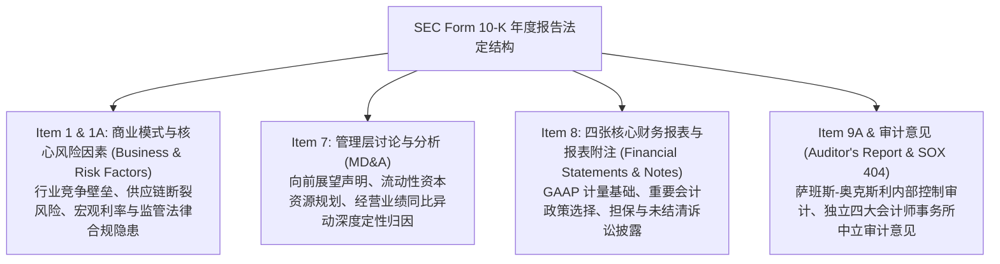
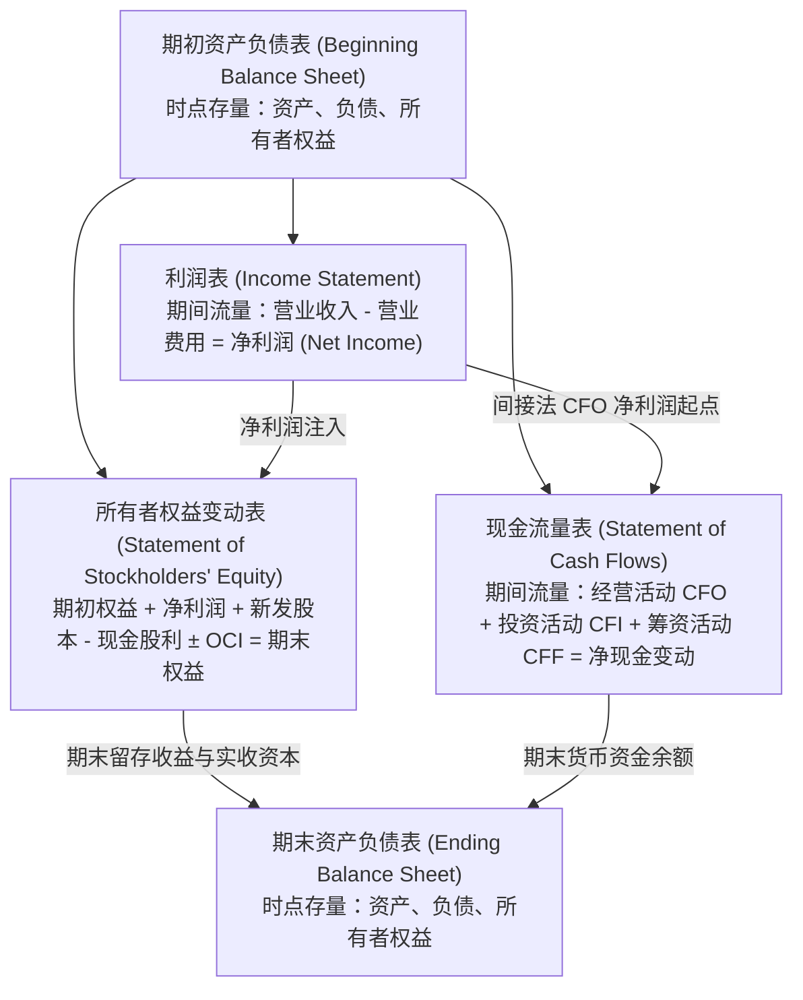
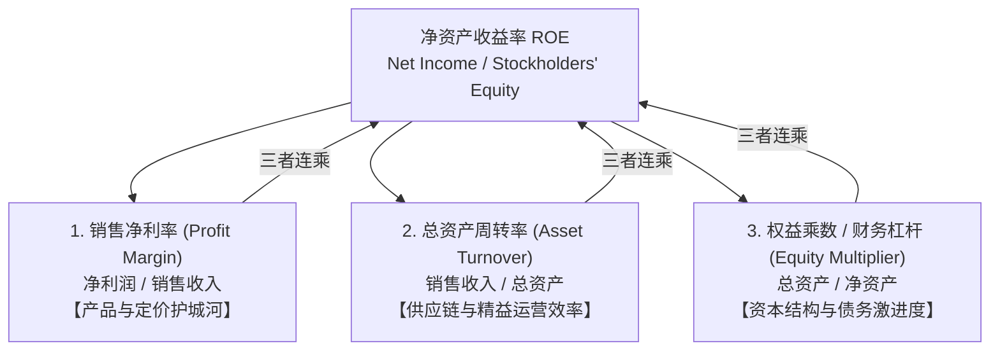

# Lec 03 年度报告架构、四张报表与财务比率透视 (Elements of an Annual Report, Four Financial Statements & DuPont Ratio Analysis)

> MIT Sloan School of Management · 15.515 Financial Accounting · 讲义 03

## TL;DR

- 10-K 年度报告由管理层讨论与分析（MD&A）、独立审计意见、四张核心报表及附注构成完整法定披露闭环。
- 四张财务报表通过留存收益与期末现金科目实现严密的动态代数勾稽，共同刻画存量与流量全貌。
- 营运资本周期（CCC）量化了从现金投入采购、生产、销售到最终收回现金的全流程营运效率。
- 杜邦分析体系将净资产收益率（ROE）正交解构为盈利能力、营运资产周转与财务杠杆三大驱动力。

## 10-K 年度报告法定组成与信息架构

在美国证券交易委员会（SEC）的法定监管框架下，所有公开上市企业必须在每个财年结束后提交规范严苛的**年度报告（Form 10-K）**。一份完整的年度报告并非杂乱数据的罗列，而是具备严密信息层级的战略披露文献：

在审读年度报告时，分析师必须深刻理解**表内确认（Recognition）**与**表外披露（Disclosure）**的法律与经济学边界：
- **表内确认**：一项经济事项必须同时满足定义、可计量性、相关性与可靠性四项标准，其具体金额直接参与资产负债表与利润表算术汇总（如计提坏账准备直接冲减当期净利润）；
- **表外披露**：当某项不确定性事项（如尚未终审的数十亿元知识产权侵权诉讼）无法可靠估计具体损失金额时，准则严禁将其强行确认为表内负债，但必须在附注（Footnotes）中进行极其详尽的事实阐述与定性预警。

::: pitfall 附注是隐藏商业雷区的最大深水区
许多初级分析师只关注报表正文的大字利润，完全忽略了数十页密密麻麻的小字附注。
- 管理层若想粉饰核心财务数据，受限于审计师的合规把关，往往不敢在表内公然造假，而是在附注中通过极其晦涩繁复的法律条文披露极其激进的“表外特殊目的实体（SPE）负债”、“向关联方出让高风险应收账款”或“巨额不可撤销租赁合同”；
- 读懂附注，是区分顶级价值投资者与业余散户的决定性分水岭。
:::

## 四张核心财务报表的逻辑嵌套与内在钩稽

在财务报告体系中，资产负债表、利润表、所有者权益变动表与现金流量表并非孤立的四个汇报孤岛，而是由复式记账法所派生出的、如同精密钟表齿轮般紧密咬合在一起的**存量与流量动态闭环网络（Financial Statement Articulation）**。

资产负债表提供的是企业在特定日历时点（如 12 月 31 日）财务状况的静态截面（Stock），宛如一张高分辨率的资产负债快照；而利润表、所有者权益变动表与现金流量表则是跨越整个会计周期的动态流量电影（Flow），负责完整记录企业净资产在两个时点截面之间是如何发生质变与位移的：

现代宏观经济学与微观会计学中的**存量-流量一致性公理（Stock-Flow Consistency）**，在企业四张报表间体现为无缝的代数封闭性。任何单张报表中的数字出现篡改，必然会在其他三张报表中引发不可协调的逻辑断裂。这种深层同构性确立了三大不可动摇的刚性钩稽关系：
1. **利润表与权益变动表的钩稽**：利润表最底行的“净利润（Net Income）”，直接作为所有者权益变动表中“留存收益”的年度核心流入项；
2. **权益变动表与资产负债表的钩稽**：经由净利润增厚、扣减宣告派发现金股利后的“期末留存收益总额”，精确回填至期末资产负债表的所有者权益一栏；
3. **现金流量表与资产负债表的钩稽**：现金流量表最终核算出的“期末现金及现金等价物净增加额”，与资产负债表上“货币资金期末余额减期初余额”分毫不差。

## 财务比率分析体系与核心维度

财务比率分析是将报表绝对金额标准化、消除体量规模差异，从而实现跨时期纵向趋势对标与跨企业横向竞争对标的经典工具：

| 比率大类 | 核心比率指标名称 | 经典代数计算公式 | 经济学衡量内涵与健康基准 |
| :--- | :--- | :--- | :--- |
| **短期流动性 (Liquidity)** | 流动比率 (Current Ratio) | $\frac{\text{流动资产 (Current Assets)}}{\text{流动负债 (Current Liabilities)}}$ | 衡量企业以短期流动资产清偿一年内到期债务的兜底能力；工业企业传统基准约在 1.5 ~ 2.0 之间。 |
| **短期流动性 (Liquidity)** | 速动比率 (Quick Ratio) | $\frac{\text{现金} + \text{有价证券} + \text{应收账款}}{\text{流动负债}}$ | 剔除变现周期长、易跌价减值的存货，测算最纯净的即时偿债防线；基准通常在 1.0 左右。 |
| **长期资本结构 (Solvency)** | 资产负债率 (Debt-to-Assets) | $\frac{\text{总负债 (Total Liabilities)}}{\text{总资产 (Total Assets)}}$ | 揭示企业全部资产中有多少比例是由债权人资金提供的；比率过高意味着面临严重的破产重组清算风险。 |
| **长期资本结构 (Solvency)** | 利息保障倍数 (TIE) | $\frac{\text{息税前利润 (EBIT)}}{\text{当期利息支出 (Interest Expense)}}$ | 检验企业日常经营利润对硬性刚性付息义务的覆盖厚度；低于 1.5 倍通常引发债务违约信用降级。 |
| **资产周转效率 (Activity)** | 存货周转天数 (DSI) | $\frac{365 \times \text{平均存货}}{\text{销货成本 (COGS)}}$ | 衡量原材料入库到产成品售出的平均仓储周期；天数过长意味着积压减值风险剧增。 |
| **资产周转效率 (Activity)** | 应收账款周转天数 (DSO) | $\frac{365 \times \text{平均应收账款}}{\text{赊销营业收入 (Sales)}}$ | 衡量商品交付到客户真金白银回款的实际平均账期；DSO 异常拉长是下游客户财务恶化的警报。 |

在此基础上，现代企业极度重视**现金转换周期（Cash Conversion Cycle, CCC）**：

$$\text{CCC} = \text{存货周转天数 (DSI)} + \text{应收账款周转天数 (DSO)} - \text{应付账款周转天数 (DPO)}$$

CCC 刻画了企业从现款支付上游供应商原材料货款开始，到最终从下游客户手中收回销售现金为止，**企业自有流动资金被硬性占用的净物理时间跨度**。卓越的供应链巨头（如苹果、戴尔）通过极速的存货流转与对供应商强大的议价能力（压低 DSI、DSO，大幅拉长 DPO），能够实现**负数 CCC**——这意味着它们不仅不需要垫付营运资金，反而在源源不断地无偿占用供应商的免息商业信用为自身扩张输血！

## 杜邦分析体系（DuPont Analysis）三步与五步拆解法

由杜邦公司（E.I. du Pont de Nemours）在 20 世纪初开创的**杜邦分析体系**，是公司金融与财务分析领域的皇冠级工具。它将衡量股东资本终极盈利效率的核心指标——**净资产收益率（Return on Equity, ROE）**，通过纯代数恒等变形正交拆解为三大底层引擎：

$$\text{ROE} = \frac{\text{Net Income}}{\text{Equity}} = \left( \frac{\text{Net Income}}{\text{Sales}} \right) \times \left( \frac{\text{Sales}}{\text{Assets}} \right) \times \left( \frac{\text{Assets}}{\text{Equity}} \right) = \text{销售净利率} \times \text{总资产周转率} \times \text{权益乘数}$$

在高端证券分析中，杜邦体系进一步深化为**五步拆解法**，将税收负担与利息负担彻底解耦：

$$\text{ROE} = \underbrace{\left( \frac{\text{NI}}{\text{EBT}} \right)}_{\text{税收负担因子}} \times \underbrace{\left( \frac{\text{EBT}}{\text{EBIT}} \right)}_{\text{利息负担因子}} \times \underbrace{\left( \frac{\text{EBIT}}{\text{Sales}} \right)}_{\text{息税前营业利润率}} \times \underbrace{\left( \frac{\text{Sales}}{\text{Assets}} \right)}_{\text{总资产周转率}} \times \underbrace{\left( \frac{\text{Assets}}{\text{Equity}} \right)}_{\text{财务杠杆乘数}}$$

通过这一透镜，分析师可以精准识别企业利润增长的“纯度”：
- **苹果公司模式（高 Margin + 高 Turnover）**：凭借顶级的品牌溢价与无与伦比的极简代工周转，在低杠杆下实现惊天 ROE；
- **大型商业银行模式（极低 Margin + 极高 Leverage）**：存贷款利差仅有 $1\%-2\%$，完全依赖放大 15 至 20 倍的债务负债杠杆搏取高 ROE，抗风险韧性极其脆弱。

## 商业实战案例：英特尔（Intel 2002）年度报告透视

麻省理工 15.515 课程通过对**英特尔公司 2002 财年 10-K 报告**的实战推演，展现了典型半导体先锋的财务基因：

::: example 英特尔 2002 财年财务特征深度体检
- **研发费用的超高强韧度**：英特尔在 2002 年实现营收 268 亿美元，但其研发支出（R&D）高达 40 亿美元（营收占比近 $15\%$）。根据 US GAAP 准则，这些研发开支在发生当期被**全部全额费用化**，直接压低了当期报表净利润。然而，这恰恰构成了英特尔在微处理器微架构领域持续领先 AMD 的最核心护城河；
- **保守稳健的资产负债表防御堡垒**：英特尔账面持有超过 100 亿美元的高流动性现金与可变现短期有价证券，资产负债率不足 $20\%$，几乎没有任何长期银行借款。极低的财务杠杆（权益乘数接近 1.2）意味着英特尔选择以极其纯粹的“产品高毛利率”和“重资产周转效率”来驱动 ROE；
- **巨大的资本开支（CapEx）与折旧加速**：半导体制造工厂（Fabs）的先进光刻与刻蚀设备淘汰周期仅为 3-5 年。英特尔每年计提数十亿美元的巨额折旧，导致固定资产原值与净值之间存在极大的扣减鸿沟，这构成了理解其经营性现金流量表间接法调整的关键密码。
:::

## 我的理解

::: insight 财务比率不是打分模板，而是诊断商业模式底层基因的问诊听诊器
在财务报表分析的实战中，必须高度警惕对财务比率的教条化崇拜：
1. **比率是提问的起点，永远不是结论本身**：当发现一家企业的净资产收益率（ROE）从 15% 飙升至 35% 时，缺乏经验的分析师会盲目吹捧该企业的经营神话。然而，如果通过杜邦拆解发现，该公司的销售利润率与资产周转率全在下滑，ROE 的上升完全是因为管理层借入了巨额短期高息高利贷、导致分母净资产被严重侵蚀，那么这个亮眼的 ROE 不仅不是利好，反而是一颗即将引爆债务危机的定时炸弹。
2. **会计指标服从于战略竞争生态**：商业世界中根本不存在一个放之四海而皆准的“健康比率及格线”。软件 SaaS 企业的流动比率可能常年处于低位甚至为负数，但这是因为其拥有巨额先款后货的递延预收账款；重工业钢铁企业哪怕流动比率高达 2.5，如果存货里全是一年都卖不出去的滞销钢胚，其真实变现偿债能力依然命悬一线。唯有将财务数字深度锚定在企业所处的产业竞争格局与商业契约上下文中，财务分析才能真正焕发出洞见商业生死的穿透力。
:::
