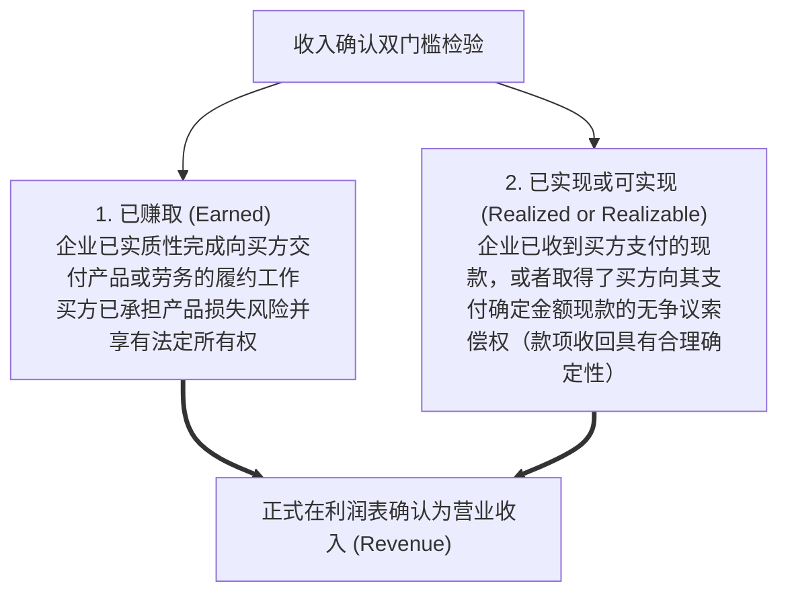
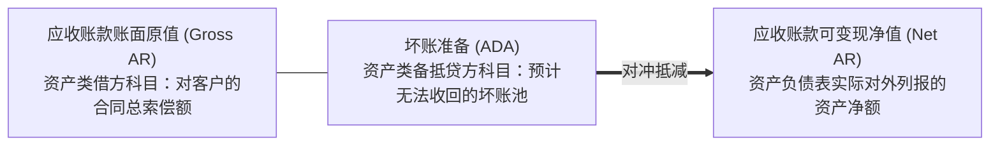
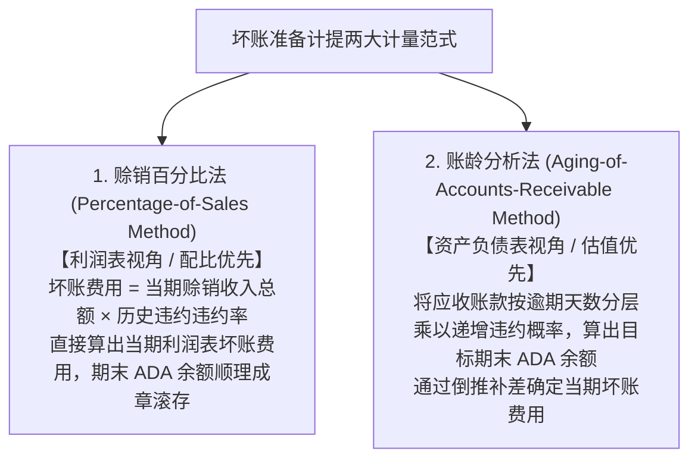
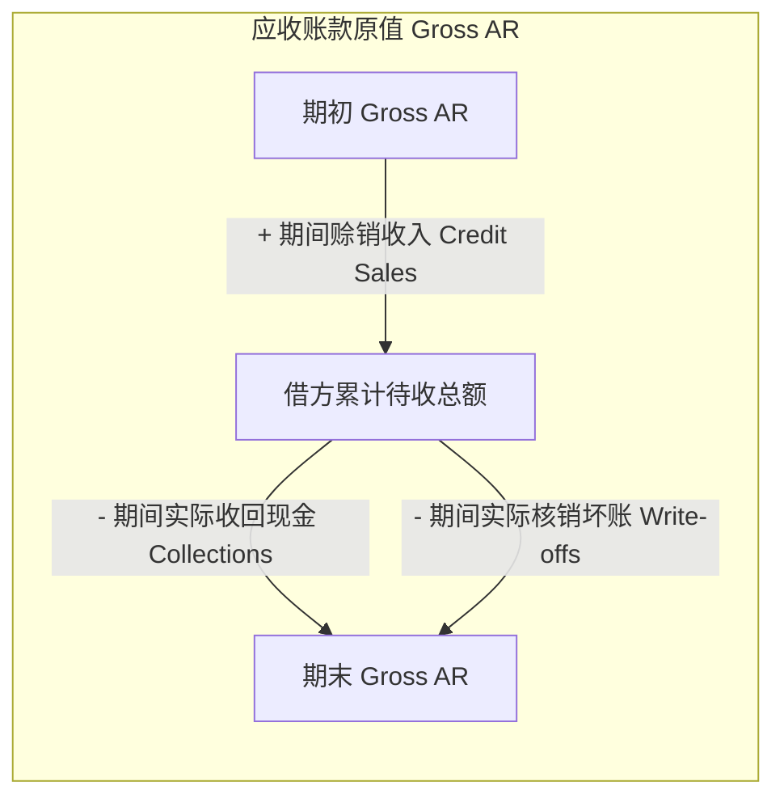

# Lec 04 收入确认准则、商业信用与应收账款估值 (Revenue Recognition, Accounts Receivable & Valuation Allowances / Intel Case)

> MIT Sloan School of Management · 15.515 Financial Accounting · 讲义 04

## TL;DR

- 收入确认的经济实质要求企业已完成核心履约义务（已赚取），且客户具备合理的付款保障（可收回）。
- 坏账备抵法遵循配比原则，在确认销售收入的当期预估坏账费用，真实反映应收账款可变现净值（NRV）。
- 实际核销呆账时借记坏账准备、贷记应收账款，对企业总资产、营运资本及当期净利润产生零变动影响。
- 利用应收账款总额、坏账准备与核销发生额的勾稽方程，分析师可精准逆向反推真实的客户销售现金回款。

## 收入确认核心基准：已赚取与可实现

在企业所有会计科目中，**营业收入（Revenue）**是资本市场衡量企业成长性、行业扩张速度与商业模式成立与否的绝对首要指标。正因如此，收入也是历史上管理层实施财务舞弊、虚增利润最频繁的重灾区。

在公认会计准则（US GAAP）的经典框架下，确认收入必须经受两大核心经济学检验：

美国 SEC 发布的第 104 号员工会计公告（SAB 104）进一步将上述双门槛细化为四项不可逾越的法定刚性条件：
1. **存在具有法律约束力的正式协议安排（Persuasive evidence of an arrangement exists）**；
2. **商品实物已交付或劳务已完全提供（Delivery has occurred or services have been rendered）**；
3. **销售价格固定或可合理确定，不存在重大未定价格变数（Seller's price is fixed or determinable）**；
4. **应收款项的可回收性具有合理的经济确定性（Collectibility is reasonably assured）**。

::: pitfall 渠道塞货（Channel Stuffing）与提前确认收入的法律陷阱
在面临季度业绩考核压力时，销售副总裁最常用的激进手段是在每季度最后一个工作日，强行将数万件未经客户正式签署采购单的芯片或整机产品发往外部经销商仓库（甚至强行堆放在第三方公用物流货场）：
- 销售部门辩称“货物已经出库，满足了交付条件”，并在当季财报上虚增数千万元收入；
- 但由于客户享有无条件退货权（Right of Return）且协议价格尚未最终锁定，这完全违背了 SAB 104 的已赚取与价格确定准则；
- 这种“渠道塞货”在次季度往往会爆发雪崩式的客户集中退货，引爆严重的监管立案与集体诉讼。
:::

## 商业信用与备抵账户机制

现代 B2B 商业交易绝大部分建立在赊销信用（Credit Sales）基础之上。企业向客户发货后，确认**应收账款（Accounts Receivable, AR）**。然而在不确定的信用市场中，必然有一部分客户会因经营破产、行业衰退或商业欺诈而最终无法偿付货款。

为了忠实反映资产的真实价值，资产负债表上的应收账款严禁按合同票面总额列示，必须以**可变现净值（Net Realizable Value, NRV）**进行保守估值：

$$\text{应收账款可变现净值 (Net AR)} = \text{应收账款原值 (Gross AR)} - \text{坏账准备备抵 (Allowance for Doubtful Accounts, ADA)}$$

::: definition 备抵账户 (Contra-Asset Account)
坏账准备（ADA）是一个特殊的资产备抵账户。它的正常余额在**贷方**，其唯一的物理职能是作为“附着在应收账款原值上的调节垫片”，在资产负债表内部直接冲减应收账款总额，从而在不破坏底层各明细客户台账原值的同时，向资本市场揭示资产的预期真实变现价值。
:::

## 坏账准备计提两大实务范式：利润表法 vs. 资产负债表法

在确定当期应当计提多少坏账费用时，公认会计准则彻底禁止了违背配比原则的“直接转销法（Direct Write-off Method）”，强制要求采用**备抵法（Allowance Method）**。备抵法主要存在两大流派：

### 1. 赊销百分比法（利润表视角）
该方法认为坏账是企业赊销经营所必然付出的伴生代价。当期坏账费用直接与当期赊销收入挂钩：
$$\text{当期坏账费用 (Bad Debt Expense)} = \text{当期赊销净额 (Credit Sales)} \times \text{历史平均坏账损失率 } k$$
- **会计分录**：
  - 借：资产减值损失 / 坏账费用（Bad Debt Expense，利润表费用类科目增加）
  - 贷：坏账准备（Allowance for Doubtful Accounts，资产备抵贷方科目增加）
- 该方法计算极其迅捷，但在多年累积后，资产负债表上的 ADA 余额可能与实际存量应收账款的真实风险发生漂移脱节。

### 2. 账龄分析法（资产负债表视角）
账龄分析法是国际投行与审计师更为推崇的严密范式。其基本假设是：**账款逾期时间越长，最终沦为呆账死账的概率就呈指数级飙升**：

| 账龄分组区间 (Aging Bucket) | 应收账款原值金额 | 统计违约概率假设 | 目标应计坏账准备额 (Target ADA) |
| :--- | :--- | :--- | :--- |
| **未逾期正常款项 (Current)** | 10,000,000 元 | $1.0\%$ | 100,000 元 |
| **逾期 1 - 30 天** | 3,000,000 元 | $5.0\%$ | 150,000 元 |
| **逾期 31 - 60 天** | 1,000,000 元 | $15.0\%$ | 150,000 元 |
| **逾期 61 - 90 天** | 500,000 元 | $30.0\%$ | 150,000 元 |
| **逾期 90 天以上超期呆账** | 200,000 元 | $80.0\%$ | 160,000 元 |
| **全组合计** | **14,700,000 元** | — | **目标期末准备金：710,000 元** |

通过账龄表计算出的 **710,000 元** 是期末资产负债表**所必须达到的目标贷方余额**。因此，当期利润表应计提的坏账费用，必须通过“倒轧补差”确定：
$$\text{当期坏账费用分录额} = \text{账龄表测算的目标期末 ADA 余额} - \text{调整前原有的 ADA 贷方余额（若为借方则相加）}$$

::: example 实际核销特定死账对财务报表的“零冲击”定理
假设某客户正式宣告破产清算，法院确认其所欠的 50,000 元货款彻底无法追偿。财务部正式执行坏账核销：
- **核销会计分录**：
  - 借：坏账准备（ADA） 50,000（备抵账户冲销减少）
  - 贷：应收账款（Accounts Receivable） 50,000（应收原值直接注销）
- **财务报表震撼真相**：
  - 核销前：$\text{Net AR} = \text{原值 } 100 \text{ 万} - \text{准备金 } 10 \text{ 万} = 90 \text{ 万元}$；
  - 核销后：$\text{Net AR} = \text{原值 } 95 \text{ 万} - \text{准备金 } 5 \text{ 万} = 90 \text{ 万元}$！
- **经济结论**：**实际核销坏账时，既不增加当期费用，也不影响净利润，更不改变资产负债表上的总资产与可变现净值**！因为这笔坏账的损失早在销售发生、计提准备金的那一刻就已经全额确认过了；核销仅仅是一道把坏账从“准备金池”中正式对冲注销的清理手续。
:::

## 商业实战推演：逆向重构英特尔销售现金回款

在 15.515 课程中，彼得·威尔逊教授展示了如何利用应收账款与坏账准备的“T 型账户”勾稽网络，**逆向工程解构英特尔（Intel）真实的客户现金回款流**：

根据资产负债表与利润表账户期初期末变动守恒定理：
$$\text{期初 Gross AR} + \text{当期销售收入 (Revenues)} - \text{实际坏账核销 (Write-offs)} - \text{期末 Gross AR} = \text{向客户收取的现金回款 (Cash Collections)}$$

同时，坏账准备（ADA）账户的生命周期演进方程为：
$$\text{期初 ADA 余额} + \text{当期计提坏账费用 (Bad Debt Expense)} - \text{实际坏账核销 (Write-offs)} = \text{期末 ADA 余额}$$

由此解出：
$$\text{实际坏账核销 (Write-offs)} = \text{期初 ADA} + \text{当期坏账费用} - \text{期末 ADA}$$

将该核销额反代回第一式，即可在不需要调阅企业内部银行流水的情况下，仅凭公开 10-K 财报与附注披露，以分子级的精度还原出英特尔全年在全球市场上真正落袋为安的现金总规模。

## 我的理解

::: insight 坏账准备是 CFO 的“蓄水池”，越主观的地方越隐藏着盈余管理的玄机
剖析应收账款与坏账备抵的制度设计，可以洞察财务控制的深层博弈：
1. **Cookie Jar（饼干罐）准备金操纵**：坏账准备计提比例本质上是由管理层自主设定的主观概率模型。在某些经营大年，企业超额完成盈利预算，CFO 往往会突然宣称“宏观不确定性上升、客户违约风险加剧”，极其激进地拔高账龄损失率，一口气多计提 1 亿元坏账准备。这不仅可以在当年将暴增的利润隐匿平抑，更在资产负债表里储备了一个庞大的“饼干罐”；到了次年行业萧条、业绩面临暴跌时，CFO 再悄悄将坏账计提率下调、或者将以前计提的坏账作为“超额回收”予以转回，瞬间将暗藏的数千万元利润释放入利润表。
2. **净额掩盖了原值的劣质化衰竭**：只看净额（Net AR）极易被制造出的稳定假象蒙骗。如果一家企业的应收账款原值从 1 亿暴增到 3 亿，而坏账准备仅从 1,000 万被微调至 1,200 万，表面的净资产看似高歌猛进，实际上底层资产早已严重劣质化。穿透净额、穿透准备金比例的微小变动，审查应收账款原值的账龄结构演变，是防止踩中商业暴雷最坚实的防线。
:::
