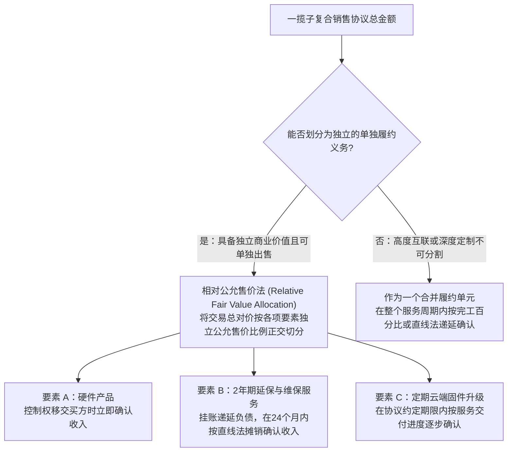
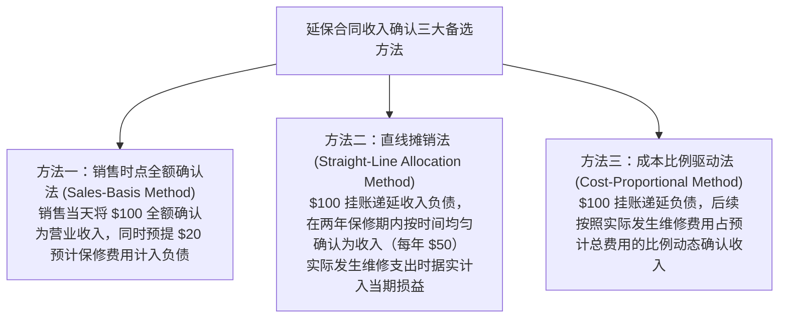
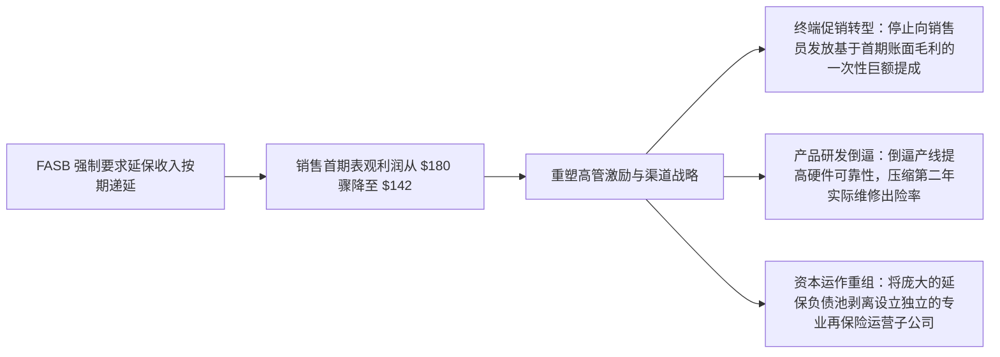
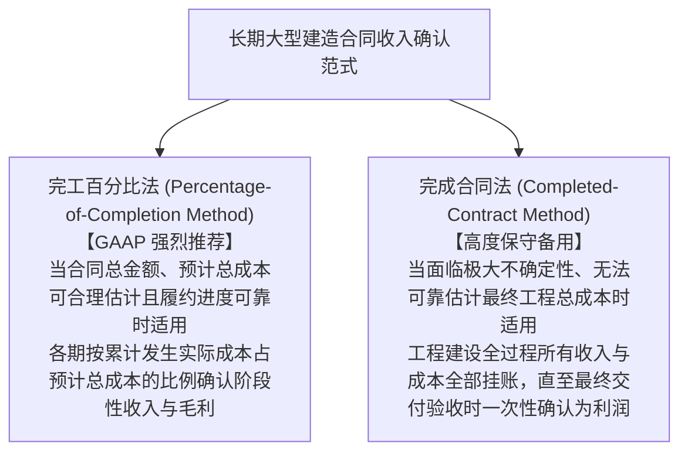

# Lec 05 复杂收入确认进阶与经营决策联动 (Advanced Revenue Recognition: Warranties, Circuit City Case & Multi-Element Contracts)

> MIT Sloan School of Management · 15.515 Financial Accounting · 讲义 05

## TL;DR

- 延长保修合同等附随衍生服务具有独立于商品实物交付的跨期履约属性，必须递延确认收入。
- 电器零售巨头电路城（Circuit City）案例揭示了不同保修收入确认模型对各期盈利轨迹的颠覆性重构。
- 多要素捆绑销售协议要求将交易总对价依据各项独立履约义务的相对公允价值实施正交拆解。
- 会计规则的变更绝非纯粹的账簿数字重编，而是会直接反向扭曲和重塑企业的终端商业经营战略。

## 复杂收入确认进阶：多要素合同与衍生履约义务

在现代复合商业模式中，企业极少只向客户销售单一的纯物理硬件。典型的交易往往将硬件设备、延长质保维护协议、后续软件升级权限以及现场运维培训打包成一揽子**多要素综合协议（Multiple-Element Arrangements）**。

公认会计准则（US GAAP）要求企业打破“全单一次性确认”的粗暴习惯，对合同要素实施**正交拆解与履约进度隔离**：

::: definition 递延收入与合同负债 (Deferred / Unearned Revenue)
当企业在向买方实际履行交付义务之前，已经提前收取了现款或取得了不可撤销的收款权利时，该款项在资产负债表中被确认为一项**合同负债（Contract Liability / Deferred Revenue）**。它代表企业未来必须向客户移交商品或劳务的法定经济义务，绝对不能提前计入当期利润表。
:::

## 经典商业案例：电路城（Circuit City）延长质保会计实验

麻省理工 15.515 课程引入了全美著名消费电子连锁巨头**电路城（Circuit City）案例**，深度剖析附随延长保修合同（Extended Warranties）的三种会计备选核算范式：

::: example 电路城立体声音响与延保销售情景测算
- **销售交易背景**：1990 年 1 月 1 日，电路城向顾客现款售出一套高保真立体声音响，售价为 **$1,000 美元**，该音响的采购存货历史成本为 **$900 美元**。
- **延保合同签订**：同时，顾客额外现款支付了 **$100 美元**，购买了一份为期两年的“全保维修及保养延保协议”（覆盖 1990 年至 1991 年）。电路城精算评估预计未来两年总共需为此音响付出 $20 美元的人工与配件维修成本。
- **后续真实履约成本发生**：
  - 1990 年 12 月，顾客首次送修保养，电路城实际发生的检修与零配件成本为 **$8 美元**；
  - 1991 年 12 月，顾客再次送修调试，电路城实际发生的维修成本为 **$15 美元**；
  - 两年累计实际履约成本为 **$23 美元**。
:::

围绕该笔交易，历史上主要存在三种截然不同的会计处理范式：

我们对三种方法下 Circuit City 两年的营业利润变动进行严密的财务报表方程推导：

| 会计确认方法 | 1990 年度净利润变动 | 1991 年度净利润变动 | 两年全周期累计净利润 | 对财务报表使用者传递的信息实质 |
| :--- | :--- | :--- | :--- | :--- |
| **方法一：销售时点全额确认** | 硬件毛利 $100 + (延保收入 $100 - 预提费用 $20) = **$180** | 实际追加支出超出预提的差额冲减利润：**-$3** | **$177** | 极其激进。将未来两年未发生的利润全部提前贴现透支在销售首年，严重扭曲后续业绩。 |
| **方法二：直线时间摊销 (GAAP 要求)** | 硬件毛利 $100 + (分摊延保收入 $50 - 实际成本 $8) = **$142** | 延保收入 $50 - 实际成本 $15 = **$35** | **$177** | 客观中立。遵循配比原则与履约义务时间分布，忠实反映企业在各年份维系售后服务的经营贡献。 |
| **方法三：成本比例驱动** | 硬件毛利 $100 + (延保收入 $\$100 \times \frac{8}{20} - \$8) = **$132** | 延保收入 $\$100 \times \frac{12}{20} - \$15 = **$45** | **$177** | 严谨追踪物理作业成本消耗，但在实务中预测总成本极其依赖主观估计，易被操纵。 |

::: theorem FASB 准则裁决公理
美国财务会计准则委员会（FASB）在第 105 号技术公告中明确裁定：**独立售出的延长保修与产品维护合同，严禁在销售时点全额确认收入（废除方法一），强制要求采用直线递延法（方法二）进行逐期摊销**。
企业向顾客收取的延保现金，在尚未随时间流逝而解除履约风险之前，本质上是借用客户资金形成的一项法定服务负债。
:::

## 会计信息对底层经营决策的反向塑造

会计系统绝不仅仅是微观经营活动的被动反光镜，**会计核算规则的微小变迁，会产生巨大的制度外溢效应，直接反向重塑高管层的核心商业决策**：

当电路城的高级管理层习惯于方法一带来的“当期首发暴利”时，整个公司的组织文化被彻底异化为“疯狂压迫前线销售员向任何买音响的顾客死缠烂打推销延保合同”；而一旦会计准则强制将其转变为分期递延确认，公司短期刷高利润的捷径被瞬间斩断。高管层不得不重新审视延保业务的长期精算违约率，进而重构了全公司的产品线定价与客服售后体系。

## 长期建造合同：完工百分比法 vs. 完成合同法

针对工期长达数年的大型商业建筑、航空母舰制造与定制化企业级 ERP 系统，会计准则确立了另一项核心博弈范式：

- **完工百分比确认公式**：
  $$\text{本期累计完工进度} = \frac{\text{截至本期末累计实际发生的建造合同成本}}{\text{预计合同完工总成本 (Current Estimated Total Cost)}}$$
  $$\text{本期确认营业收入} = (\text{合同交易总对价} \times \text{本期累计完工进度}) - \text{以前各期已累计确认的营业收入}$$

::: pitfall 预期合同损失立即全额计提铁律
完工百分比法下隐藏着一条极度严苛的非对称稳健性法则：
- 如果工程进展顺利，利润必须严格随着工期进度按百分比分期小步确认；
- **但如果在某一时点，由于原材料暴涨或设计缺陷，预计工程完工总成本超过了合同总对价（即整个合同注定要亏损）：**
  准则强制要求企业**在发现亏损迹象的当期，立即、全额计提该合同未来全生命周期的全部预期亏损（Accrual of Expected Contract Loss）**，绝对不允许按完工进度分期摊延！这种“对利润极度吝啬、对潜在亏损极度警惕”的态度，构成了稳健主义原则的典型投射。
:::

## 我的理解

::: insight 会计不是静态的观赏鱼缸，而是包含强烈反馈回路的动力学机器
深度研读复杂收入确认的博弈，可以体悟到商业系统设计的深刻机理：
1. **合同负债是科技巨头的隐形金矿**：在传统工业思维中，“负债（Liabilities）”是一个带有负面破产色彩的词汇。然而在苹果公司、微软与 Adobe 的资产负债表上，高达数百亿美元的“合同负债 / 递延收入”却是全市场最令人垂涎的优质资产——它意味着客户早已把未来数年的现金全额塞进了企业的保险柜，且企业在未来无需支付任何利息或偿还本金，只需按期推送云服务和软件更新即可将负债源源不断地转化为纯利润。
2. **制度设计者必须预判被考核者的反抗与异化**：古德哈特定律（Goodhart's Law）指出——“当一个指标被选为考核目标时，它就不再是一个好指标”。在收入确认准则的演化史中，每一次会计准则委员会试图用更加严密的文字堵住收入操纵漏洞时，华尔街投行与企业律师就会设计出更加错综复杂的多方兜底协议和衍生结构。真正卓越的财务架构师绝不满足于被动遵循准则字面的教条，而是具备穿透合同繁复法律包装、敏锐还原底层经济利益交换本质的 X 光透视眼。
:::
