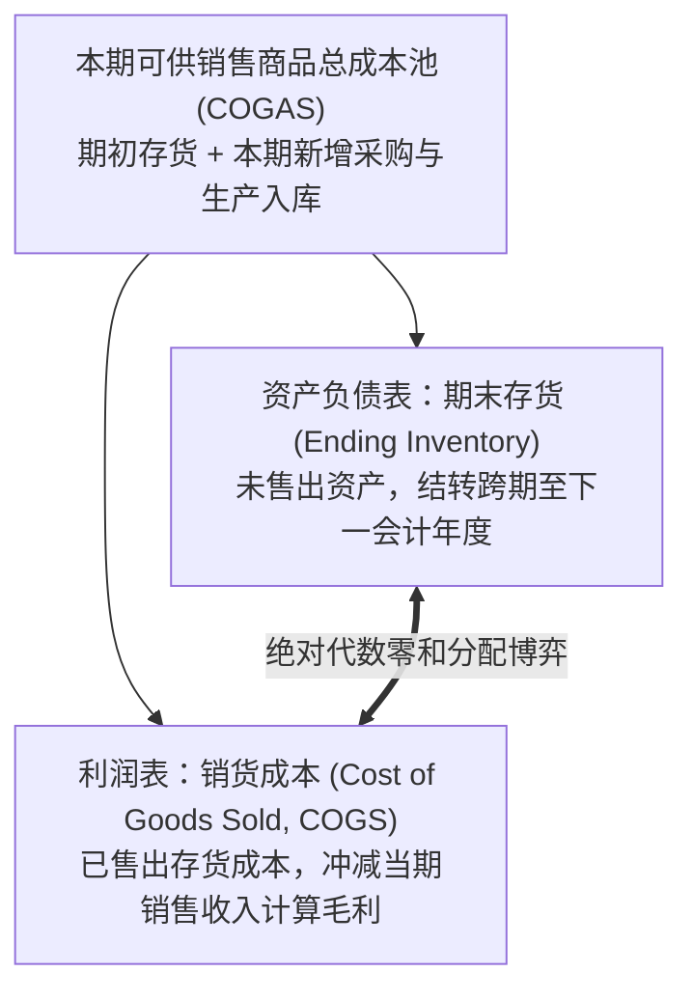
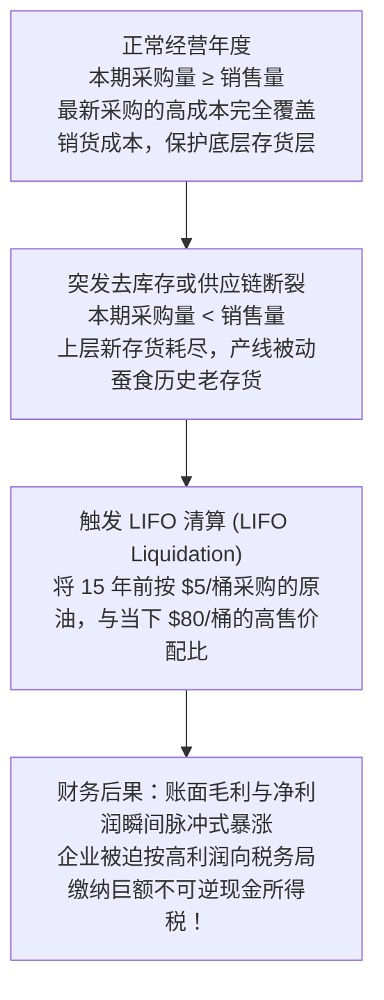
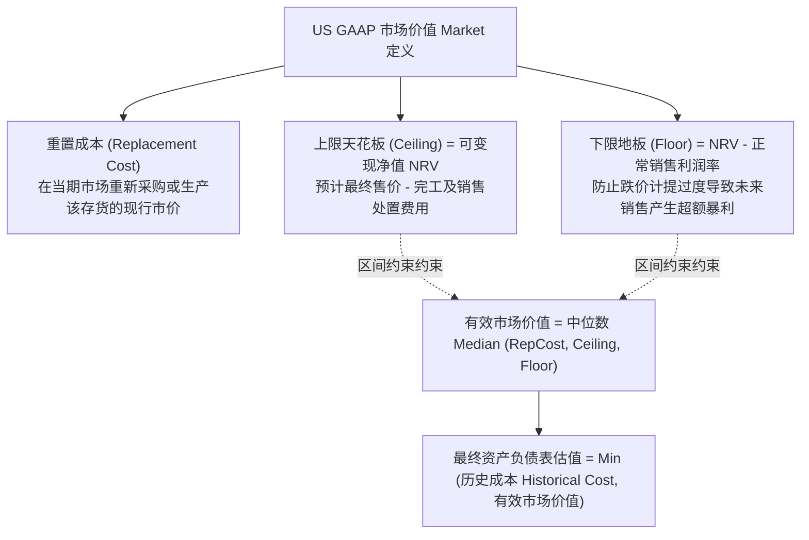

# Lec 06 存货计价流转、销货成本与税收博弈 (Accounting for Inventory and Cost of Goods Sold: LIFO, FIFO, LIFO Reserve & LCM)

> MIT Sloan School of Management · 15.515 Financial Accounting · 讲义 06

## TL;DR

- 可供销售商品总成本在资产负债表期末存货与利润表销货成本之间的切分，构成了严格的代数零和博弈。
- 通胀环境下先进先出法（FIFO）报告更高账面利润但多缴现金税款；后进先出法（LIFO）实现合法节税。
- LIFO 准备金（LIFO Reserve）是连接不同存货会计政策的转换桥梁，其年度变动量直接调和两类销货成本。
- 存货后进先出清算（LIFO Liquidation）会强制释放历史廉价存货层，引发账面利润虚高与巨额突发税负。

## 存货流转核心恒等式与成本分配的零和博弈

在制造业与商品流通零售业中，**存货（Inventory）**是占用营运资金规模最大、变现周期最敏感的流动资产科目。企业在一个会计周期内所持有的所有存货成本总池，服从不可动摇的**存货实物与成本守恒公理**：

$$\text{期初存货成本 (Beginning Inventory)} + \text{本期采购与入库生产总成本 (Purchases)} = \text{本期可供销售商品总成本 (COGAS)}$$

$$\text{可供销售总成本 (COGAS)} = \text{期末留存存货 (Ending Inventory)} + \text{当期已售商品成本 (Cost of Goods Sold, COGS)}$$



这一守恒关系揭示了存货核算中的**零和分配本质**：
- 在可供销售总成本（COGAS）既定的前提下，**任何一美元成本究竟是被划入期末存货还是销货成本，直接决定了当期财务报表的健康假象**；
- 若管理层通过高估期末存货成本，就会等额压缩当期的销货成本（COGS），进而人为虚增毛利、推高当期净利润与每股收益；反之，若压低期末存货，就会放大当期成本、压低当期盈余。

## 四大成本流转假设与通货膨胀效应

在微观实物管理中，除非是销售具有独立唯一序列号的高价值定制品（如豪华游艇、特定钻石首饰，采用**个别计价法 Specific Identification**），对于成千上万件无差异混放的大宗标准品（如原油、小麦、芯片），会计准则允许企业采用**成本流转假设（Cost Flow Assumptions）**。

需要格外警惕的是：**成本流转假设完全不需要与商品实物的实际物理出库流向保持一致**！主流核算方法主要有先进先出法与后进先出法：

```mermaid
flowchart LR
    subgraph FIFO_Flow [先进先出法 FIFO (First-In, First-Out)]
        direction TB
        F1["最早入库的历史采购批次成本"] -->|优先流向| F_COGS["当期销货成本 (COGS)"]
        F2["最新采购的高价批次成本"] -->|保留在| F_End["期末存货资产 (Ending Inventory)"]
    end

    subgraph LIFO_Flow [后进先出法 LIFO (Last-In, First-Out)]
        direction TB
        L1["最新采购的高价批次成本"] -->|优先流向| L_COGS["当期销货成本 (COGS)"]
        L2["最早入库的历史低价批次成本"] -->|保留在| L_End["期末存货资产 (Ending Inventory)"]
    end
```

在持续物价上涨（通货膨胀 Inflation）的现实经济环境中，FIFO 与 LIFO 会产生戏剧性的财务与税务分歧：

| 财务与经济指标 | 先进先出法 (FIFO) | 后进先出法 (LIFO) | 宏观通胀环境下的根本经济动因剖析 |
| :--- | :--- | :--- | :--- |
| **销货成本 (COGS)** | **显著偏低** | **显著偏高** | FIFO 将过去买的便宜存货计入成本；LIFO 将当下最贵的新采购计入成本。 |
| **账面净利润 (Net Income)** | **虚高繁荣** | **保守低迷** | FIFO 利润中包含了由于物价自然上涨带来的“纸面持有损益（Holding Gains）”。 |
| **资产负债表期末存货** | **贴近现行市价** | **严重脱节低估** | FIFO 存货由近期采购构成，反映重置成本；LIFO 存货可能挂账着 20 年前的原始极低成本。 |
| **现金所得税支出 (Taxes)** | **大幅多缴税款** | **显著合法节税** | 真实的现金流流向！LIFO 报告更低应税所得，为企业合法截留了真金白银的流动性。 |

::: theorem 美国国内税收法典第 472 条：LIFO 一致性规则 (LIFO Conformity Rule)
美国国税局（IRS）确立了一条著名的铁律：**如果企业在报税时选择采用 LIFO 来降低应税所得、减少现金税收，那么该企业在向股东和公众披露的对外财务报告中，也必须强制采用 LIFO 报告利润**！
这逼迫企业高管在“向资本市场展示漂亮的纸面每股收益（选 FIFO）”与“在现实世界中省下数亿美元的真实现金税款（选 LIFO）”之间做出残酷的灵魂抉择。
:::

## LIFO 准备（LIFO Reserve）与存货可比性还原

由于不同竞争对手可能选择不同的存货计价政策（例如通用电气采用 LIFO，而另一些工业企业采用 FIFO），为了消除政策噪音、恢复财务指标的横向可比性，SEC 强制要求所有使用 LIFO 的美股上市公司在报表附注中全额披露 **LIFO 准备（LIFO Reserve）**：

::: definition LIFO 准备 (LIFO Reserve)
LIFO 准备是企业在同一资产负债表时点，如果将存货全部按 FIFO（或现行重置成本）核算时所应体现的存货价值，与实际采用 LIFO 所列示的存货账面价值之间的**累积代数差额**：
$$\text{LIFO Reserve} = \text{Inventory}_{\text{FIFO}} - \text{Inventory}_{\text{LIFO}}$$
:::

利用披露的 LIFO 准备，证券分析师可以无缝重构两类报表：
1. **资产负债表存货还原**：
   $$\text{Inventory}_{\text{FIFO}} = \text{Inventory}_{\text{LIFO}} + \text{LIFO Reserve}$$
2. **利润表销货成本还原**：
   根据可供销售总成本守恒定理，两套体系下的销货成本存在以下严密微分关系：
   $$\text{COGS}_{\text{FIFO}} = \text{COGS}_{\text{LIFO}} - \Delta \text{LIFO Reserve}$$
   $$\text{其中 } \Delta \text{LIFO Reserve} = \text{期末 LIFO 准备} - \text{期初 LIFO 准备}$$

::: example LIFO 报表还原全真推算
某工程机械巨头在 2002 财年报告的 LIFO 销货成本为 50 亿元，期末 LIFO 存货为 10 亿元。
翻阅其 10-K 附注发现：期初 LIFO 准备为 2 亿元，期末 LIFO 准备飙升至 3.5 亿元。
- **计算准备金增量**：$\Delta \text{LIFO Reserve} = 3.5 - 2.0 = +1.5 \text{ 亿元}$；
- **还原 FIFO 销货成本**：$\text{COGS}_{\text{FIFO}} = 50 - 1.5 = 48.5 \text{ 亿元}$；
- **结论**：若该企业采用 FIFO，其当期账面销货成本将下降 1.5 亿元，税前利润将暴增 1.5 亿元；而其资产负债表期末真实的现代存货重置价值实际应为 $10 + 3.5 = 13.5 \text{ 亿元}$。
:::

## 存货清算（LIFO Liquidation）与隐形利润炸弹

在 LIFO 体系下，随着企业多年经营，资产负债表深处沉淀了许多极其古老的历史成本层（LIFO Layers）。**当外部供应链中断、企业罢工减产或主动去库存，导致本期采购量严格小于当期销售量时**，企业就不得不开仓动用这些深埋底层的古董级存货——这种现象被称为**后进先出清算（LIFO Liquidation）**：



::: pitfall 虚假利润引发的现金流失血危机
LIFO 清算所带来的利润爆发完全是一场空头支票：
- 账面暴增的数千万元净利润并没有任何真实的增量现金支撑，而只是几十年前历史通胀账面差额的被动释放；
- 但国税局却会依据这笔虚高的账面利润，毫不留情地从企业抽走真金白银的企业所得税现金，导致企业在遭遇去库存危机的同时面临严重的现金流失血打击。
:::

## 成本与市价孰低法（Lower of Cost or Market, LCM）

无论采用何种成本流转假设，财务会计的核心稳健性基石始终是**成本与市价孰低法（LCM）**。当存货遭受物理损坏、陈旧过时或市场终端跌价时，账面成本必须向下修正：



::: pitfall 跌价准备的单向不可逆性（US GAAP 铁律）
在 US GAAP 准则下，一旦某批芯片因市场波动计提了 5,000 万元的 LCM 存货跌价准备、将成本基数打落至新低点：
- **即便次年全球半导体周期强劲反弹、芯片现货价格暴涨十倍，GAAP 绝对严禁将已计提的存货跌价准备原路转回（Reversal of Write-down is Prohibited）**！
- （注：国际财务报告准则 IFRS 允许在特定受限条件下转回）。跌价后的新低价被法定确立为该批存货永久性的新历史成本基数。
:::

## 我的理解

::: insight 现金是国王，会计政策的选择本质上是时间偏好与流动性的终极博弈
深入存货计价的制度演化，揭示出公司高管层最深层的博弈心理：
1. **LIFO 是聪明的自抑，FIFO 是虚荣的狂欢**：在通胀时代，选择 LIFO 需要极大的管理定力与战略穿透力。采纳 LIFO 意味着 CEO 必须顶住华尔街分析师对“当期财报净利润为何比同行低 20%”的无端指责，换取企业在内部沉淀数十亿美元不用缴税的真实现金流。相反，那些为了维持股价狂热而坚守 FIFO 的公司，虽然赢得了财报上的漂亮光环，却每年将大笔宝贵的自由现金流以税金形式白白拱手送出。
2. **IFRS 废除 LIFO 的认识论根源**：为什么欧洲主导的国际会计准则（IFRS）坚决禁止使用 LIFO？因为欧洲准则制定者更偏向“资产负债表观（Balance Sheet Approach）”——他们无法容忍一家跨国车企的资产负债表上挂着 30 年前的钢材价格，认为这种严重脱离重置成本的信息是对资产真实价值的背叛。而美国 GAAP 则更尊重“经济实质观与税收保护效应”。理解两套准则体系的碰撞，本质上是理解财务计量在“时点存量保真”与“跨期期间流量匹配”之间的永恒妥协。
:::
