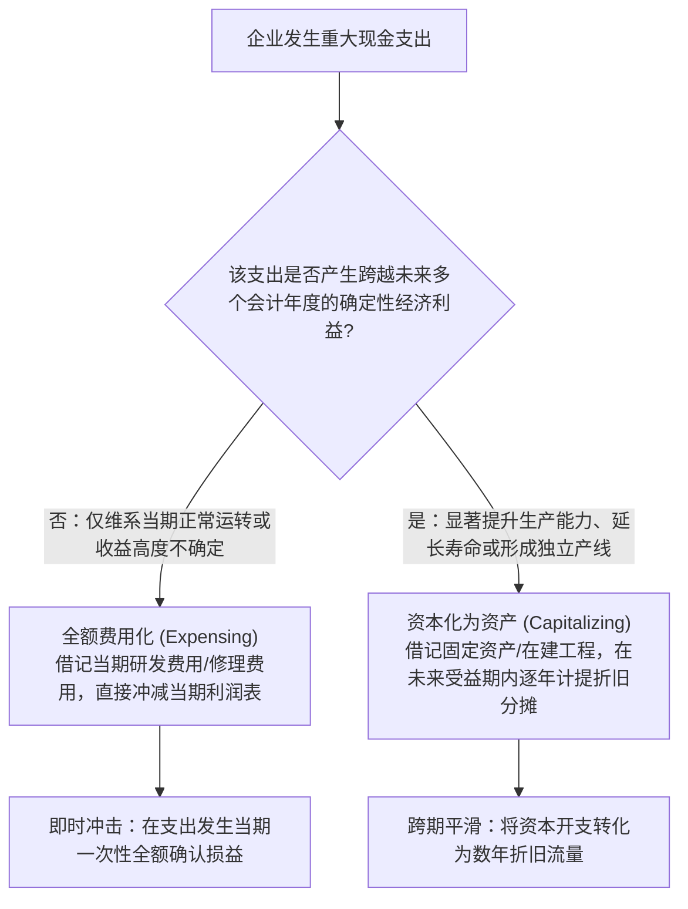
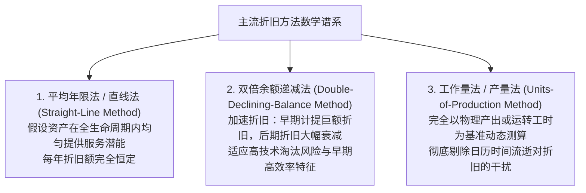
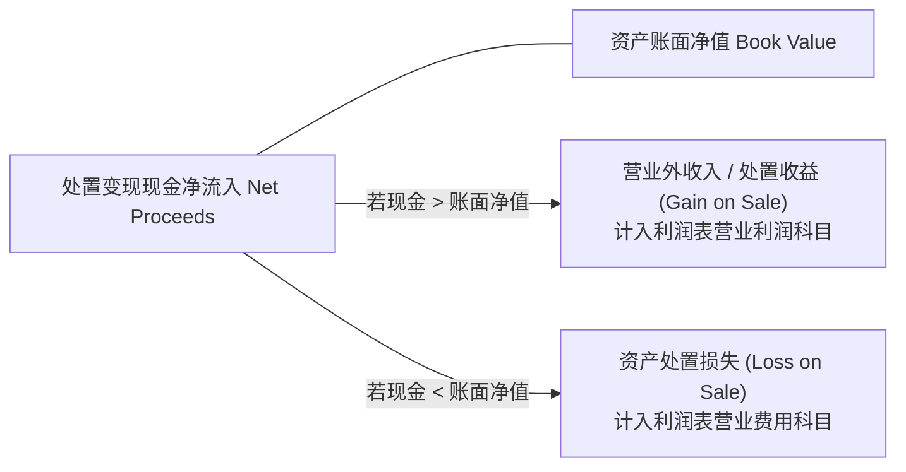
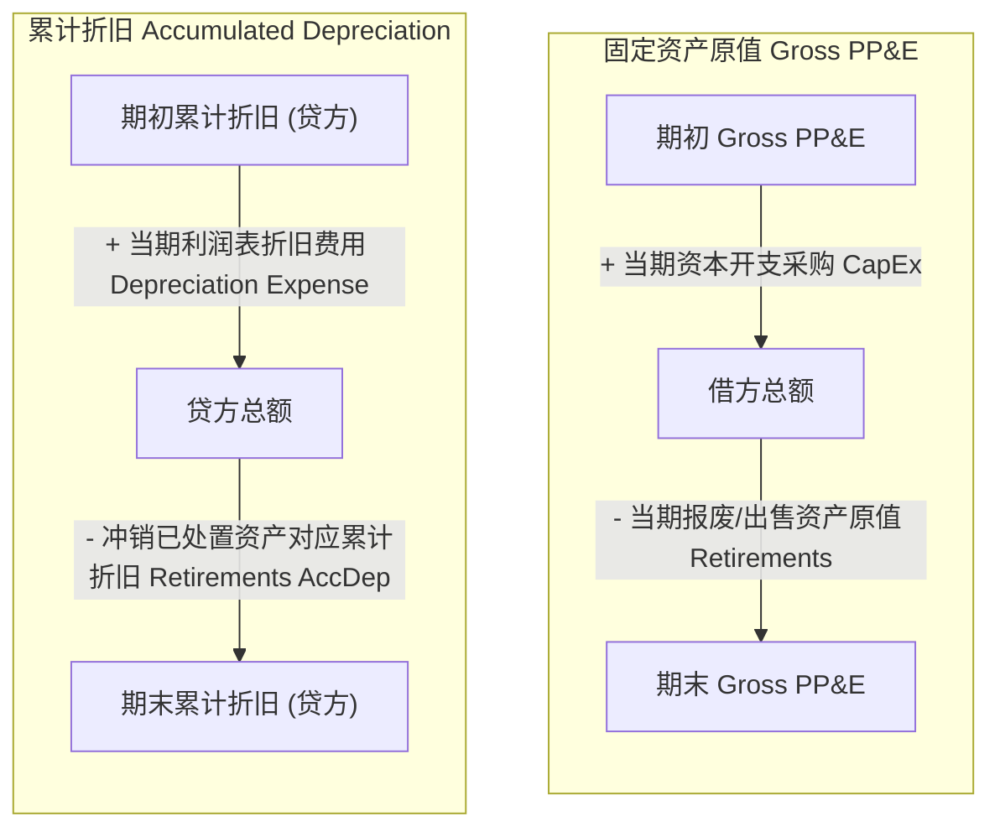

# Lec 07 配比原则与长期资产资本化折旧 (The Matching Principle, Long-Lived Assets & Depreciation Mechanics)

> MIT Sloan School of Management · 15.515 Financial Accounting · 讲义 07

## TL;DR

- 长期资产资本化要求支出必须能带来超越当期会计年度的未来经济利益，否则必须全额费用化。
- 初始确认的固定资产入账原值涵盖使资产达到预定可使用状态所发生的一切必要合理附随支出。
- 折旧在本质上是历史成本在各受益期之间的系统性分摊过程，绝非对资产市场公允价值的估值修正。
- 资产处置损益等于现金净流入与账面净值的差额，在现金流量表中需在经营与投资活动间正交调整。

## 资本化 vs. 费用化的经济学分水岭

在企业庞大的日常现金支出中，管理层面临的最核心会计决策之一，是将一笔大额款项确认为**当期费用（Expensing）**还是**长期资产资本化（Capitalizing）**。这一判定的唯一理论基石是**配比原则（Matching Principle）**与未来经济利益的跨期分布：

固定资产（Property, Plant, and Equipment, PP&E）的初始入账成本基数，必须包含为了使该资产达到预定使用状态所必需的一切合理附随开支：
$$\text{PP&E 初始入账原值} = \text{合同购买价款} + \text{不可抵扣税费与进口关税} + \text{运输及装卸费} + \text{专业场地勘探与地基平整费} + \text{安装调试与试运转净支出} + \text{法律弃置义务现值 (ARO)}$$

::: pitfall 资本化违规操纵：世通公司（WorldCom）38 亿美元造假案
在 2002 年美国电信行业泡沫破裂期间，全美第二大电信运营商世通公司（WorldCom）的 CEO 与 CFO 为了掩盖经营崩溃：
- 蓄意将原本属于日常网络租用费用的 38.5 亿美元“线路成本（Line Costs）”，通过虚假调整分录违规记入资产负债表上的“固定资产（PP&E）”科目进行资本化；
- 这一操作将原本应当直接冲减当期利润表的巨额现金费用，伪装成了可以分摊 20 年的长期设备资产，瞬间凭空凭空捏造出数十亿美元的虚假净利润；
- 这一人类商业史上最恶劣的资本化舞弊最终导致世通崩盘破产，并直接催生了《萨班斯-奥克斯利法案》（SOX Act）。
:::

## 常见折旧方法数学推导与经济机理

在固定资产入账后，企业必须在预计使用寿命内，通过计提**折旧（Depreciation）**将资产成本逐期配比至其协助产生的营业收入中。折旧在本质上是**成本分摊（Cost Allocation）**，而非资产市场转售价值的重新测算。

### 1. 直线法（Straight-Line Method）
$$\text{年折旧额 (Annual Depreciation)} = \frac{\text{资产原值 (Cost)} - \text{预计净残值 (Salvage Value)}}{\text{预计使用年限 (Useful Life)}}$$
直线法逻辑直观、计算简便，是全美 $90\%$ 以上制造与科技上市公司在对外公开财务报表中最广泛采用的默认方法。

### 2. 双倍余额递减法（Double-Declining-Balance, DDB）
双倍余额递减法是**加速折旧（Accelerated Depreciation）**的经典代表。其折旧率设定为直线法年折旧率的两倍，且直接乘以**期初未扣减残值的账面净值**：
$$\text{DDB 折旧率} = \frac{2}{\text{预计使用年限 } N}$$
$$\text{第 } t \text{ 年折旧费用} = \text{第 } t \text{ 年期初账面净值 (Beginning Book Value)}_t \times \text{DDB 折旧率}$$
$$\text{账面净值 (Book Value)} = \text{资产原值} - \text{累计折旧 (Accumulated Depreciation)}$$

::: theorem DDB 折旧计提终极约束（残值硬底限规则）
在应用双倍余额递减法时，计算公式在期初计算中**故意忽略预计净残值**；
**但在资产使用年限的最后阶段，资产账面净值绝对不允许被折旧至低于预计净残值**！当计算出的折旧额会导致期末净值跌破残值底线时，系统必须强制停止乘法运算，仅计提刚好将净值降低至残值水平的差额（Plug Number），或者在该年份转回直线法。
:::

## 长期资产处置损益与现金流重构

当固定资产报废、转让或出售时，企业必须在账簿中彻底终止确认该资产的原值与相伴随的累计折旧，并核算**处置损益（Gain / Loss on Disposal）**：

$$\text{资产处置时点的账面净值 (Book Value)} = \text{资产历史原值} - \text{处置日累计已计提折旧}$$
$$\text{处置损益 (Gain / Loss)} = \text{实际收取的处置现金净流入 (Net Proceeds)} - \text{资产账面净值}$$

在财务报表体系中，处置损益会引发**现金流量表的双重勾稽与调整**：
- **投资活动现金流（CFI）**：变卖资产所收到的**全部真金白银现金全额（Net Cash Proceeds）**，必须 $100\%$ 归入投资活动现金流入；
- **经营活动现金流（CFO 间接法）**：由于利润表中的净利润已经包含了这笔处置收益（Gain）或损失（Loss），为了防止在经营活动与投资活动中发生重复双重记账，在间接法调节表里，**处置收益必须作为非经营收益予以全额减除，处置损失必须作为非现金损失全额加回**！

## 逆向工程实战：重构英特尔固定资产全生命周期

在 15.515 课程中，分析师通过固定资产（PP&E）原值与累计折旧两个联动“T 型账户”，能够精准反推企业内部未公开的资产动态：

利用上述双重方程组：
1. 从资产负债表提取 Gross PP&E 的期初与期末值，从现金流量表投资活动提取真实的资本开支采购金额（Capital Expenditures），即可精准倒轧解出**当年退役报废资产的原始成本（Retirements Cost）**；
2. 结合累计折旧期初期末变动及利润表年度折旧支出，即可精准算出**已处置资产历史上所提取的全部累计折旧**，进而以显微镜般的精度还原出企业固定资产真实的更新淘汰节奏与物理磨损程度。

## 我的理解

::: insight 折旧绝非对资产老化的物理记录，而是人类在时间维度上的成本分配艺术
深入审视固定资产折旧的本质，可以拨开工业会计的迷雾：
1. **折旧不产生一分钱现金**：许多非财务背景的高管常会产生一种错觉——“公司今年计提了 5 亿元折旧，所以我们手里有 5 亿元折旧基金可以用来买新设备”。这种观点荒谬至极。计提折旧只是一笔借记费用、贷记备抵的纸面会计分录，没有任何货币资金在银行之间流转。折旧能够给企业带来的唯一现实财务好处，是在纳税申报表中充当合法的非现金抵税屏障（Tax Shield），减少企业的真实现金税款流出。
2. **账面净值与真实市场价值彻底脱节**：一台精密数控机床在资产负债表上可能经过 8 年直线折旧净值仅剩下 10 万元残值，但在二级二手设备现货市场上可能依然能拍卖出 200 万元的高价；相反，一条斥资数十亿元建造的传统燃油发动机生产线，账面净值可能高达 15 亿元，但在新能源转型浪潮下其真实市场公允价值可能已经归零。财务报表上的账面净值只是未摊销历史成本的历史遗迹，绝不可将其机械等同于资产的真实经济变现价值。
:::
