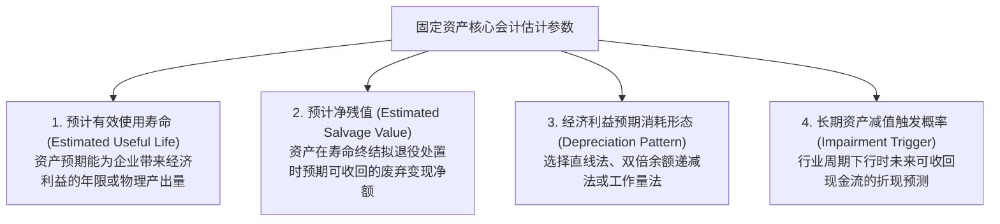
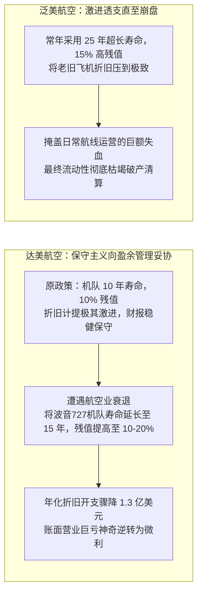

# Lec 08 固定资产会计估计、主观判断与航空案例 (Property, Plant, and Equipment: Estimation, Judgment & Delta vs. Pan Am Case)

> MIT Sloan School of Management · 15.515 Financial Accounting · 讲义 08

## TL;DR

- 固定资产折旧极度依赖使用年限与残值两项主观会计估计，赋予管理层极大的盈余调节自由度。
- 会计估计变更强制采用未来适用法（Prospective Treatment），不追溯调整历史报表，仅平摊剩余净值。
- 达美航空与泛美航空经典案例表明，修改机队折旧年限与残值可瞬间凭空创造上亿美元账面利润。
- US GAAP 长期资产减值测试遵循两步法，未折现现金流门槛构成了防范随意计提减值的刚性安全阀。

## 会计估计的本质与自由裁量权双刃剑

在公认会计准则（GAAP）的真实运行中，“会计估计（Accounting Estimates）”是无可避免的核心组成部分。在固定资产（PP&E）资本化入账的那一刻，没有任何人能够未卜先知地确知一台光刻机或一架宽体客机到底能稳定服役多少个日夜、最终退役时能卖出多少废铁残值。

管理层必须基于现有工程经验、行业技术迭代速率与商业战略，对以下核心变量做出**主观会计估计**：



::: definition 会计估计变更的未来适用法 (Prospective Application)
公认会计准则明确规定：**当由于技术进步、维护水平提升或市场环境变化导致企业修正固定资产使用寿命或残值时，该项变更属于“会计估计变更（Change in Accounting Estimate）”**。
- **强制采用未来适用法**：严禁追溯调整以前年度已经公布的任何历史财务报表，严禁在当期补记以往年度的差额；
- **重新分摊剩余净值**：将该资产在**变更时点的现存账面净值（Current Book Value）**减去新核定的残值，在**剩余的新使用寿命内**重新计算未来的年折旧额。
:::

$$\text{变更后新年度折旧额} = \frac{\text{变更时点现存账面净值 (Current Book Value)} - \text{修正后新预计残值 (New Salvage Value)}}{\text{修正后新延长的剩余使用年限 (Remaining Useful Life)}}$$

这一规则赋予了管理层极大的“账面魔术”空间——只要管理层签署一份“经专家委员会评估，我司核心设备服役状态良好，特将使用年限延长 5 年”的决议，当年的折旧费用就能在合法合规的前提下被瞬间腰斩！

## 哈佛/MIT 经典商业案例：达美航空 vs. 泛美航空

麻省理工 15.515 课程通过对 20 世纪 80 至 90 年代美国航空业两大传奇航司——**达美航空（Delta Air Lines）**与**泛美航空（Pan American World Airways / Eastern Airlines）**的真实财报解构，生动展现了折旧估计对企业命运的巨大扭曲：



::: example 达美航空机队折旧年限延长的财务报表核算
假设达美航空当年持有的一批波音 727 机队历史购置原值为 **10 亿美元**，已按原设定的 10 年寿命（10% 残值，每年折旧 9,000 万）直线计提了 5 年折旧：
- **变更前时点状态**：
  - 累计已提折旧：$5 \times 9,000 = 4.5 \text{ 亿美元}$；
  - 变更时点账面净值：$10 - 4.5 = 5.5 \text{ 亿美元}$；
  - 原剩余服役寿命：还剩 5 年。
- **管理层实施会计估计变更**：
  - 宣布将该机队总寿命从 10 年延长至 **15 年**（即剩余寿命从 5 年跃升至 **10 年**）；
  - 同时将最终残值从 10%（1 亿）提高至 **15%（1.5 亿美元）**。
- **按未来适用法重新测算新折旧额**：
  $$\text{变更后每年折旧额} = \frac{\text{当前净值 } 5.5 \text{ 亿} - \text{新残值 } 1.5 \text{ 亿}}{\text{新剩余寿命 } 10 \text{ 年}} = \frac{4.0 \text{ 亿}}{10} = 4,000 \text{ 万美元}$$
- **财务震撼真相**：
  达美航空的物理飞机每天在天空中的飞行线路没有任何改变，飞行员与机修工的工作没有任何变动，但该机队的年化折旧费用**从 9,000 万美元断崖式下跌至 4,000 万美元，单项节省了整整 5,000 万美元成本**！
  全公司数百架飞机联动调整后，当年为达美航空凭空凭空凭空创造了超过 **1.3 亿美元的税前净利润增量**，帮助管理层在行业严重寒冬中达成了债务契约（Debt Covenants）的考核底线。
:::

## 资产减值两步法测试（US GAAP ASC 360）

当外部宏观行业发生永久性衰退、技术出现革命性断代（如数码相机淘汰胶片相机）或设备发生严重物理损毁时，企业不能再假装资产依然具有原定价值，必须启动**长期资产减值测试（Impairment of Long-Lived Assets）**。

美国公认会计准则（US GAAP ASC 360）确立了极其独特的**两步法减值测试机制**：

```mermaid
flowchart TD
    Trigger[出现减值触发迹象<br/>资产市价暴跌、物理损坏、产能长期闲置、法律环境恶化] --> Step1{第一步：可回收性检验 (Recoverability Test)<br/>该资产未来全生命周期预计产生的【未折现现金流总和】 < 账面净值?}
    
    Step1 -->|否：未折现现金流 ≥ 账面净值| Safe["判定为未发生减值！<br/>严禁计提任何减值准备<br/>资产维持原账面净值继续折旧"]
    
    Step1 -->|是：未折现现金流 < 账面净值| Step2["第二步：损失计量 (Loss Measurement)<br/>正式确认减值损失 = 账面净值 - 公允价值 (Fair Value)<br/>公允价值 = 现行市价 或 未来现金流折现现值 (DCF)"]

    Step2 --> BookLoss["借记：资产减值损失 (利润表营业费用)<br/>贷记：固定资产减值准备 / 累计折旧 (冲减资产)"]
```

::: pitfall 第一步未折现现金流门槛的防范功能
为什么 US GAAP 必须在第一步设置“未折现现金流总和（Undiscounted Cash Flows）”这一奇特门槛？
- **防止管理层肆意“洗大澡（Big Bath）”**：由于资金具有时间价值，任何资产的折现现值必然显著小于其未折现的绝对数值；
- 如果准则允许直接拿折现现值与账面净值比较，在经济轻微下行时企业就会轻而易举地通过操纵贴现率制造数十亿元的资产巨额减值；
- 只有当资产在未来连未经折现的毛票子加起来都无法覆盖账面净值时，准则才认定其发生了“实质性致命沦陷”，进而才允许在第二步引入折现公允价值确认减值。
:::

## 我的理解

::: insight 航空公司的飞机在物理上是一样的，但会计估计把它们刷成了不同的颜色
解构航空业与资本密集型重工业的折旧史，可以洞悉现代商业中最深邃的悖论：
1. **资本市场偏好确定的谎言，厌恶不确定的真相**：如果达美航空的 CEO 在股东大会上坦承：“航空业景气度极度恶化，我们其实每年在亏损 1 亿美元”，公司股价将瞬间崩盘，评级机构会下调其债券信用等级，导致银行立刻抽贷破产。因此，管理层、投行甚至外部审计师心照不宣地共同签署了一份“将机队寿命调高 5 年”的精致文件。这种会计上的合法延寿，为企业争取到了宝贵的数年喘息时间以熬过行业凛冬。
2. **会计估计的尽头是物理现实的硬性惩罚**：泛美航空（Pan Am）与东方航空（Eastern Airlines）的历史结局证明，财务魔术再高超，也无法对抗热力学第二定律。你可以通过将飞机折旧年限拉长到 25 年在账面上制造微利假象，但当那些老旧机队在现实中由于金属疲劳频繁故障、油耗高出新机型 40%、地勤机修成本飙升至天文数字时，真实的经营性现金流终将彻底枯竭。当最后一家银行拒绝提供燃油垫资时，写在账簿上的虚妄繁荣将在瞬间随风而散。
:::
