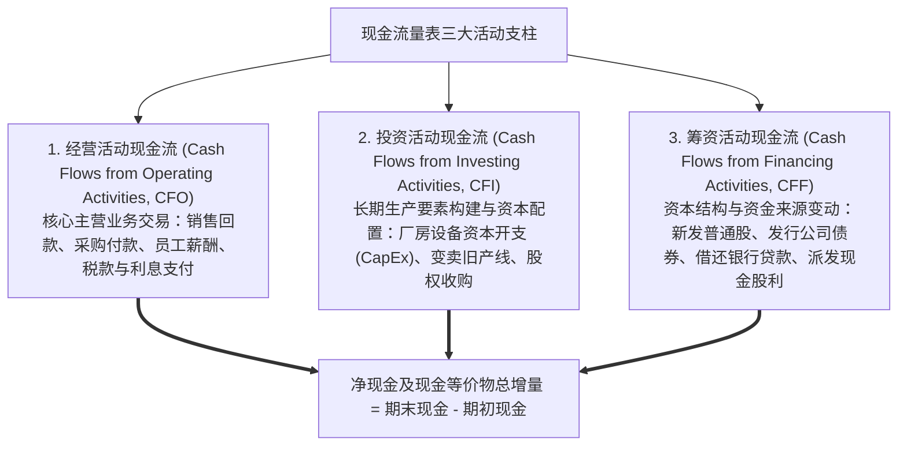

# Lec 09 现金流量表编制逻辑与三类活动分析 (The Statement of Cash Flows: Direct vs. Indirect Method & Working Capital Reconciliations)

> MIT Sloan School of Management · 15.515 Financial Accounting · 讲义 09

## TL;DR

- 现金流量表消除了权责发生制下的主观应计项噪音，客观展现企业纯粹货币资金的物理收支动能。
- 经营活动现金流量（CFO）间接法从净利润出发，依次剔除非现金费用、非经营损益与营运资本变动。
- 营运资本调节遵循“资产反向变动、负债同向变动”的代数守恒法则，精准还原业务回款节奏。
- 企业生命周期现金流特征图谱（CFO/CFI/CFF 符号指纹）是识别企业真实生命力与暴雷隐患的核心工具。

## 现金流量表的核心定位：权责发生制与真实现金的桥梁

在现代企业财务报告体系中，利润表基于权责发生制展示企业的经营业绩，但这往往伴随着海量的应计项估算与会计政策修饰。一家企业可能连续三年在利润表上报告高达数亿元的“净利润（Net Income）”，却因为客户长期赊销无法回款、库存严重积压以及短期债务集中到期，在某一天的清晨由于账户上拿不出区区几百万元现金支付工资与货款而轰然宣告破产（即著名的“猝死型盈利破产”）。

**现金流量表（Statement of Cash Flows, SCF）**正是为了击碎这种纸面利润幻象而设立的法定刚性防线：



此外，对于未发生即时现金流动的重大资本交易（如企业直接发行普通股以置换并收购一座价值 10 亿元的商业大厦、或者通过承接长期抵押贷款购置大型船舶），准则严禁将其强行填入表内现金流量项目中，但**强制要求在报表附注或表底作为“非现金投资与筹资活动（Non-cash Investing and Financing Activities）”予以专项全额披露**。

## 经营活动现金流编制：直接法 vs. 间接法

在编制经营活动现金流量（CFO）时，国际准则与美国 GAAP 均允许采用**直接法（Direct Method）**与**间接法（Indirect Method）**：

```mermaid
flowchart LR
    subgraph Direct_Approach [直接法 Direct Method (FASB 理论首选)]
        direction TB
        D1["销售商品收到的现金"]
        D2["- 购买商品支付的现金"]
        D3["- 支付给职工的现金"]
        D4["- 支付的税费与利息"]
        D1 --- D2 --- D3 --- D4 ==> CFO_Direct["经营活动现金流量净额"]
    end

    subgraph Indirect_Approach [间接法 Indirect Method (全球 98% 工业实务采用)]
        direction TB
        I1["利润表最底行：净利润 (Net Income)"]
        I2["+ 非现金费用 (折旧、摊销、减值)"]
        I3["± 非经营损益 (处置固定资产损益)"]
        I4["± 营运资本净变动 (应收/存货/应付)"]
        I1 --- I2 --- I3 --- I4 ==> CFO_Indirect["经营活动现金流量净额"]
    end
```

### 1. 直接法（Direct Method）
直接法如同企业银行流水的分类总账，清晰列明了“企业从客户手里收了多少现款”、“向上游供货商付了多少现款”、“向员工发了多少工资”。它的优点是极其直观易懂，但缺点是编制极其复杂，需要对企业 ERP 系统中数以百万计的微观现金凭证进行重新编码。

### 2. 间接法（Indirect Method）
间接法是华尔街分析师与注册会计师的最爱。它以利润表最底行的**净利润（Net Income）**为逻辑起点，通过一系列精准的代数反向修正，**将权责发生制下的盈余一步步“反向洗净”为真金白银的经营现金流**：

$$\text{CFO} = \text{净利润 (Net Income)} + \text{非现金费用} - \text{非经营投资收益} + \text{非经营投资损失} + \Delta \text{经营性流动负债} - \Delta \text{经营性流动资产}$$

## 营运资本调节核心代数守恒定理

在间接法的编制流水线中，初学者最容易产生混淆的是各项营运资本账户变动的加减符号。管理会计与财务分析为此总结出了严格的**营运资本调节守恒公理**：

::: theorem 营运资本调节符号公理
- **经营性流动资产项目：变动符号取反（Inverse Sign $-\Delta \text{Asset}$）**
  - 应收账款增加（$\Delta \text{AR} > 0$）$\implies$ **扣减（-）**（说明当期确认的收入中，有一部分只是记在账上的数字，现金尚未收回）；
  - 存货增加（$\Delta \text{Inv} > 0$）$\implies$ **扣减（-）**（说明企业本期采购或生产占用了现金，但尚未转化为销货成本进入利润表）；
  - 预付账款增加（$\Delta \text{Prepaid} > 0$）$\implies$ **扣减（-）**（现金已经提前支付，但利润表尚未确认为费用）。
- **经营性流动负债项目：变动符号取同（Same Sign $+\Delta \text{Liability}$）**
  - 应付账款增加（$\Delta \text{AP} > 0$）$\implies$ **加回（+）**（说明当期确认的原材料费用中，企业成功拖欠了供应商款项，保留了内部现金）；
  - 应付职工薪酬增加（$\Delta \text{Wages Payable} > 0$）$\implies$ **加回（+）**（当期人工费用已冲减利润，但现金尚未实际打入工人工资卡）；
  - 合同负债 / 预收账款增加（$\Delta \text{Unearned} > 0$）$\implies$ **加回（+）**（收到了客户的现金真金白银，但利润表上尚未计入收入）。
:::

| 营运资本项目 | 会计变动情形 | 经济活动现实剖析 | 间接法调节方向 |
| :--- | :--- | :--- | :--- |
| **应收账款 (AR)** | 期末比期初增加 1,000 万 | 赊销产生的纸面收入大于实际收回的现金回款 | **从净利润中减除 -1,000 万** |
| **应收账款 (AR)** | 期末比期初减少 500 万 | 客户加速结清历史欠款，当期回款大于当期收入 | **向净利润中加回 +500 万** |
| **存货 (Inventory)** | 期末比期初增加 800 万 | 企业为了备货大肆采购生产，消耗了流动资金 | **从净利润中减除 -800 万** |
| **应付账款 (AP)** | 期末比期初增加 600 万 | 成功向上游争取到更长免息账期，截留了现金 | **向净利润中加回 +600 万** |

## 综合实战演练：XYZ 公司现金流量表逆向推导

::: example XYZ 装备制造公司 CFO 编制推演
XYZ 公司 2002 年度利润表列示**净利润为 $1,500,000 美元**。当期其他财务资料如下：
1. 固定资产计提折旧费用 **$400,000 美元**；
2. 无形资产专利技术摊销 **$50,000 美元**；
3. 出售一台老旧机床获得现金 $200,000 美元，该机床原值 $500,000，累计折旧 $350,000，账面净值 $150,000，实现**资产处置收益 $50,000 美元**（已包含在净利润中）；
4. 资产负债表经营流动资产变动：应收账款净增 **$300,000 美元**，存货净减 **$120,000 美元**；
5. 经营流动负债变动：应付账款净增 **$180,000 美元**，应付所得税净减 **$40,000 美元**。
:::

按照间接法标准工程框架编制经营活动现金流量：

$$\text{净利润 (起点)}: \quad +\$1,500,000$$
$$\text{非现金调节项：}$$
$$+ \text{折旧费用 (Depreciation)}: \quad +\$400,000$$
$$+ \text{专利摊销 (Amortization)}: \quad +\$50,000$$
$$- \text{固定资产处置收益 (Gain on Sale)}: \quad -\$50,000 \quad \text{(防止与投资活动现金流入双重重复计入)}$$
$$\text{营运资本变动调节项：}$$
$$- \text{应收账款增加 (AR Increase)}: \quad -\$300,000$$
$$+ \text{存货减少 (Inventory Decrease)}: \quad +\$120,000$$
$$+ \text{应付账款增加 (AP Increase)}: \quad +\$180,000$$
$$- \text{应付税费减少 (Tax Payable Decrease)}: \quad -\$40,000$$
$$\mathbf{\text{经营活动现金流量净额 (Net CFO)}} = 1,500,000 + 400,000 + 50,000 - 50,000 - 300,000 + 120,000 + 180,000 - 40,000 = \mathbf{+\$1,860,000 \text{ 美元}}$$

该全真推导清晰展现了：尽管处置收益和应收账款占用了资金，但在高额折旧非现金加回与精益去库存的支撑下，XYZ 公司的实际造血能力（186 万美元）显著超越了其账面净利润（150 万美元），呈现出极高的**盈余质量（Quality of Earnings）**。

## 企业生命周期现金流特征图谱

分析师可以通过企业经营（CFO）、投资（CFI）与筹资（CFF）现金流正负符号的特定拓扑排列，如同提取指纹般精准识别企业所处的**生命周期阶段（Life Cycle Stages）**：

| 生命周期阶段 | 经营活动 CFO | 投资活动 CFI | 筹资活动 CFF | 核心商业特征与典型资本生态解读 |
| :--- | :---: | :---: | :---: | :--- |
| **初创期 (Start-up)** | **-** | **-** | **+** | 商业模式尚未成熟，客户回款微弱；产线大肆投资买设备；完全依赖风险投资（VC）股权融资输血。 |
| **成长期 (Growth)** | **+** | **-** | **+** | 销售回款转正，但仍无法满足扩张野心；大规模推进 CapEx 扩产；通过银行银团贷款与增发维持扩张。 |
| **成熟期 (Mature)** | **+** | **-** | **-** | **最健康的现金牛状态**！主营业务源源不断产生强劲 CFO，足以覆盖日常资本开支，大量资金用于分红回购还债。 |
| **衰退期 (Decline)** | **-** | **+** | **-** | 市场需求坍塌，主营业务持续失血；靠“变卖祖产”（出售土地产线）回收流动性；银行抽贷导致 CFF 净流出。 |

::: pitfall 典型的庞氏骗局型现金流指纹
如果在分析一家上市公司时发现其连续多年呈现 **CFO 为负（持续失血）、CFI 为负（盲目狂热兼并）、CFF 为天量正数（疯狂发债融资借新还旧）**：
- 这表明企业的自身业务根本不具备自我造血能力，其所谓的高估值与跨越式扩张完全依赖资本市场流动性维持；
- 一旦外部宏观利率收紧或二级市场定增受阻，外部输血通道一旦被切断，企业将瞬间陷入债务违约与崩盘暴雷。
:::

## 我的理解

::: insight 净利润是意见，现金流是事实
在公司金融与证券投资的残酷洗礼中，现金流量表享有不可动摇的至高审判权：
1. **折旧与应计项是装点门面的胭脂，现金流才是剥离一切伪装的素颜照**：在上市公司财报电话会上，高管层可以利用各种天花乱坠的专业词汇来解释为什么净利润增长缓慢（“我们采用了更严谨的收入准则、我们在战略性加大研发计提”）。但在现金流量表这面照妖镜面前，一切雄辩都显得苍白无力。无论你的愿景多么宏大，如果经营活动现金流常年为负，就意味着企业在物理现实中每天都在失血走向死亡。
2. **自由现金流（FCF）是企业终极价值的唯一泉源**：沃伦·巴菲特（Warren Buffett）曾深刻指出：任何一家企业的内在经济价值，严格等于其在存续寿命内所能产生的全部未来自由现金流（$\text{FCF} = \text{CFO} - \text{维持性资本开支}$）经由合理贴现率折现后的总和。会计准则编制利润表只是为了帮助人类近似估计这一长期造血潜力；如果分析师在纷繁复杂的权责发生制数字游戏中迷失了对自由现金流的追踪，就无异于买椟还珠。
:::
